# Software Design Description (Blueprint): VN Stock AI Pro

**Chuẩn:** IEEE 1016-2009 (Software Design Descriptions). Đối chiếu theo `BluePrint_Design_IEEE_1016_2009_Checklist.xlsx`
**Đầu vào:** [SRS.md](../requirements/SRS.md) v0.1, [BRD.md](../requirements/BRD.md) v0.3, dự án tham chiếu VN STOCK AI PRO (BRD SRC-017)
**Tài liệu đi kèm:** [schema.sql](schema.sql) (lược đồ PostgreSQL, baseline cho migration)

---

## 0. Tóm tắt kiến trúc

Hệ thống gồm hai service backend chạy trên **một máy ảo miễn phí** bằng Docker Compose. Chi phí hạ tầng R1 là 0 đồng.

- **Core service (Java 21 + Spring Boot 4):** quản lý mọi trạng thái thuộc về người dùng (tài khoản, đồng ý, danh sách theo dõi, cảnh báo, giả lập và sổ cái). Đây là cổng API duy nhất mở ra Internet.
- **Analytics service (Python 3.12 + FastAPI):** thu thập dữ liệu từ nguồn miễn phí, tính định lượng, và chạy pipeline AI "dữ kiện vào, lời văn ra".
- PostgreSQL lưu dữ liệu bền vững. Redis giữ giá mới nhất, luồng sự kiện giá và quota.
- Web (React) được phục vụ **cùng origin** với API qua Caddy. Mobile dùng Expo.

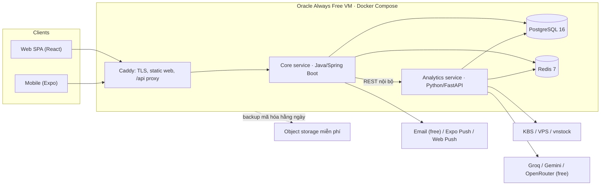

**Trả lời câu hỏi "có cách nào online và free dùng lâu dài?"** (chi tiết: 3.10.4, ADR-006):

- **Có**, với **Oracle Cloud Always Free**: VM ARM không giới hạn thời gian dùng. Oracle chỉ thu hồi máy "idle" khi CPU, mạng **và** RAM cùng dưới 20% trong 7 ngày; hệ thống này dùng RAM vượt ngưỡng đó.
- Không gói free nào được bảo đảm vĩnh viễn (Oracle đã giảm quota năm 2026). Vì vậy thiết kế cho phép **chuyển nhà cung cấp trong ≤ 1 giờ** (NFR-D02).

---

## 1. Context & Subject

### 1.1 Định danh hệ thống

| Thuộc tính | Giá trị |
|---|---|
| **System Name** | VN Stock AI Pro (tên làm việc; BRD OQ-002) |
| **SDD Version** | 0.2 |
| **Document Date** | 2026-10-21 |
| **Document Owner** | Lead Architect: [TBD: BRD OQ-003]. Bản nháp do Claude (vai trò kiến trúc sư và kiểm duyệt) soạn |
| **Revision History** | 0.1 · 2026-10-21 · Claude · Bản đầu tiên từ SRS v0.1. 0.2 · 2026-10-21 · Claude · Áp dụng CR-01 (module `telemetry`, `POST /events`, bảng `core.product_events`) và CR-02 (mã mời: FR-019, FR-217, bảng `core.invites`) |

**Mô tả.** VN Stock AI Pro là nền tảng công cụ phân tích chứng khoán Việt Nam:

- Dữ liệu cổ phiếu HOSE/HNX/UPCoM và VN30F.
- Tổng quan thị trường (độ rộng, bản đồ nhiệt ngành, top movers).
- Phân tích mã: chỉ báo kỹ thuật, chỉ số cơ bản.
- Trợ lý AI tiếng Việt chỉ diễn đạt số liệu do hệ thống tính và **không khuyến nghị**.
- Danh sách theo dõi, cảnh báo giá.
- Giao dịch giả lập có RiskGuard và sổ cái.

R1 là beta kín, chi phí 0 đồng. Thiết kế đã chừa điểm mở rộng cho R2 (chiến lược, kiểm thử lịch sử), R3 (thương mại hóa) và R4 (lệnh bán tự động qua CTCK).

### 1.2 Phạm vi và ranh giới

| Boundary Type | Description |
|---|---|
| **System Purpose** | Cung cấp dữ liệu, phân tích và công cụ giả lập giúp nhà đầu tư tự ra quyết định. Không tư vấn, không đặt lệnh thật trước R4 (SRS 1.2) |
| **External Systems** | Nguồn dữ liệu: KBS, VPS (endpoint công khai), vnstock (thư viện). LLM: Groq, Google Gemini API, OpenRouter (gói free). Email: nhà cung cấp SMTP/API miễn phí (OQ-047). Push: Expo Push, Web Push (VAPID). Hạ tầng: Oracle Cloud, DuckDNS, object storage cho backup, GitHub Actions/GHCR, dịch vụ giám sát uptime. R3: cổng thanh toán. R4: API CTCK |
| **User Types** | Khách; Người dùng (F0, Trader); Quản trị viên. R3: Môi giới/B2B, Nhà phát triển API |
| **External Interfaces** | REST/JSON qua HTTPS (`/api/v1`); Web Push; Expo Push API; SMTP/API email; HTTP tới nguồn dữ liệu và LLM; S3 API cho backup |
| **Trust Boundaries** | (1) Internet ↔ Caddy (TLS). (2) Caddy ↔ Core (mạng Docker `edge`). (3) Core ↔ Analytics/Postgres/Redis (mạng `internal`, không publish port). (4) Analytics ↔ nhà cung cấp bên ngoài: dữ liệu vào được coi là không tin cậy, phải kiểm tra; dữ liệu ra không có dữ liệu cá nhân |
| **Deployment Environment** | R1: 1 VM Oracle Cloud Always Free (ARM64, Ubuntu LTS, Docker Compose). Dev: máy cá nhân với cùng file Compose. R3: cloud tại Việt Nam (SC-009) |

### 1.3 Giả định và ràng buộc

| Type | Description |
|---|---|
| **Technical Constraints** | SC-001 đến SC-004 và SC-010 đến SC-012 (Java 21/Spring Boot 4; Python 3.12/FastAPI; PostgreSQL 16; Redis 7; React/Vite/TS; Expo; adapter cho nhà cung cấp; múi giờ Asia/Ho_Chi_Minh; không dùng số thực dấu phẩy động cho tiền). Image Docker phải build cho cả ARM64 và AMD64 (NFR-D01) |
| **Business Constraints** | Chi phí 0 đồng cho R1 (SC-005). Dữ liệu miễn phí chỉ dùng cho phát triển và beta kín (SC-006). Không lệnh thật trước R4 (SC-007). Không khuyến nghị (BRU-001). Timeline: BRD OQ-007 |
| **Environmental Assumptions** | VM: giả định thận trọng 2 OCPU ARM, 12 GB RAM, ≤ 200 GB block storage (SA-003; quota đã giảm năm 2026). Độ trễ VM tới nguồn dữ liệu VN < 300 ms. Uptime VM không cam kết, mục tiêu hệ thống 99,0% trong giờ giao dịch (NFR-A01) |
| **Data Assumptions** | Khoảng 1.700 mã. Nến ngày 5 năm ≈ 2,1 triệu dòng; 20 năm ≈ 8,5 triệu dòng. Mỗi tháng tăng khoảng 36.000 dòng nến. Giá mới nhất chỉ giữ trên Redis. Nhật ký AI khoảng 1.000 dòng/ngày ở beta. Thời hạn lưu theo SRS DR-001 đến DR-009 |

### 1.4 Phạm vi chủ thể thiết kế

| Release | Mức thiết kế trong SDD |
|---|---|
| R1 | Đầy đủ: mọi view, thuật toán, giao diện, lược đồ |
| R2 | Mức thành phần và dữ liệu: module, bảng, thuật toán kiểm thử lịch sử |
| R3–R5 | Điểm mở rộng: port `OrderGateway`, `PaymentGateway`; schema dành sẵn; quy tắc bảo mật |

---

## 2. Stakeholders & Concerns

### 2.1 Stakeholder

| Stakeholder | Role/Title | Primary Interest |
|---|---|---|
| Người dùng cuối (F0, Trader) | Khách hàng beta | Dữ liệu đúng, dễ hiểu, phản hồi nhanh, an toàn tài khoản |
| Founder / PO | Business | Chi phí 0 đồng, ra mắt nhanh, tuân thủ pháp lý, chuyển nhà cung cấp được |
| Cố vấn pháp lý | Compliance | Không khuyến nghị, không lệnh tự động, bảo vệ dữ liệu cá nhân, có bằng chứng kiểm toán |
| Claude | Kiến trúc sư, người lập kế hoạch, người kiểm duyệt (audit) | Thiết kế kiểm chứng được; gói việc nhỏ có tiêu chí rõ |
| AI coding agent (OpenCode + model free) | Developer thực thi | Phạm vi nhỏ, hợp đồng rõ (OpenAPI, SQL), lệnh test chạy được, quy tắc trong AGENTS.md |
| Quản trị viên / vận hành | Ops (founder kiêm) | Triển khai một lệnh, giám sát, cảnh báo, sao lưu, khôi phục |
| Kỹ sư dữ liệu / AI | AI/Quant | Pipeline dữ liệu đúng; chỉ báo đúng; AI chính xác, đo được |
| Nhà cung cấp dữ liệu và LLM | Bên ngoài | Được dùng trong giới hạn tần suất và điều khoản |

### 2.2 Concern của stakeholder

| ID | Stakeholder | Concern | Priority | Acceptance Criteria |
|---|---|---|---|---|
| CN-01 | Người dùng | Không bị hiển thị số liệu sai hoặc giả | High | Test fail-closed: 0 giá trị thay thế khi dữ liệu cũ hoặc lỗi (FR-030) |
| CN-02 | Người dùng | Phản hồi nhanh | High | NFR-P01 đến NFR-P05 đạt trên VM R1 |
| CN-03 | Người dùng | Tài khoản an toàn | High | OWASP ASVS L1 (NFR-S01); 0 lỗ hổng Critical (NFR-S10) |
| CN-04 | Pháp lý | Không khuyến nghị, không lệnh tự động | High | NFR-AI01 (0 lọt trên ≥ 300 câu); không có code path gửi lệnh thật ở R1–R3 (SC-007) |
| CN-05 | Pháp lý | Bảo vệ dữ liệu cá nhân | High | FR-070 (0 dữ liệu cá nhân trong payload LLM, kiểm chứng bằng test); FR-013 đến FR-017 |
| CN-06 | Founder | Chi phí 0 đồng | High | Hóa đơn 0 đồng; NFR-AI04 |
| CN-07 | Founder | Không bị khóa vào một nhà cung cấp | High | Diễn tập chuyển VM ≤ 1 giờ (NFR-D02); thay adapter mà không sửa domain (SC-010) |
| CN-08 | Agent / Dev | Hiểu và sửa được từng phần nhỏ | High | Mỗi WP ≤ 1 module; kiểm tra module tự động (NFR-M03) |
| CN-09 | Ops | Thấy được sự cố sớm | Med | NFR-O01 đến NFR-O03 |
| CN-10 | Ops | Khôi phục được | High | RPO ≤ 24 giờ, RTO ≤ 4 giờ, có diễn tập (NFR-A02) |
| CN-11 | AI/Quant | Số liệu AI chính xác, đo được | High | NFR-AI02; nhật ký FR-071 đầy đủ |
| CN-12 | Dev | Logic tiền và rủi ro kiểm thử được | High | Độ phủ ≥ 80% (NFR-M01); đối soát sổ cái chênh lệch 0 (NFR-A04) |
| CN-13 | Founder | Mở rộng được khi thương mại hóa (R3) | Med | Service không giữ trạng thái; có thể tách Postgres và Redis ra máy riêng mà không đổi code |
| CN-14 | Nhà cung cấp dữ liệu | Không bị gọi quá tần suất | High | ≤ 1 request/giây cho mỗi nguồn (IR-002); có gộp truy vấn (FR-033) |

### 2.3 Kịch bản thuộc tính chất lượng (6 phần)

| ID | Thuộc tính | Source | Stimulus | Artifact | Environment | Response | Response Measure |
|---|---|---|---|---|---|---|---|
| QAS-01 | Performance | 100 người dùng | Mở trang tổng quan thị trường | Core `/market/overview` | Trong phiên, VM R1 | Trả dữ liệu tính sẵn từ Redis | p95 ≤ 1 s (NFR-P04) |
| QAS-02 | Performance | Người dùng | Đặt lệnh giả lập MP | Core paper | Trong phiên | RiskGuard + khớp + ghi sổ trong 1 giao dịch CSDL | p95 ≤ 500 ms (NFR-P05) |
| QAS-03 | Availability | Nguồn KBS | Trả lỗi 5xx liên tục | Analytics providers | Trong phiên | Thử lại 2 lần, chuyển sang vnstock/VPS; nếu tất cả lỗi thì fail-closed | Chuyển trong ≤ 2 chu kỳ (≤ 120 s); 0 giá trị giả (NFR-A03) |
| QAS-04 | Availability | Oracle | VM bị dừng hoặc mất | Toàn hệ thống | Bất kỳ | Khôi phục từ backup sang VM mới (hoặc phương án dự phòng) theo runbook | RTO ≤ 4 giờ, RPO ≤ 24 giờ (NFR-A02) |
| QAS-05 | Security | Kẻ tấn công | Dùng lại refresh token đã xoay | Core identity | Bất kỳ | Phát hiện dùng lại, thu hồi cả chuỗi, ghi audit | 100% trường hợp trong test (NFR-S04) |
| QAS-06 | Security / Privacy | Người dùng | Gửi câu hỏi chứa email và số điện thoại | Analytics ai | Bất kỳ | Che dữ liệu cá nhân trước khi gọi LLM | 0 dữ liệu cá nhân trong payload gửi ra (FR-070) |
| QAS-07 | AI safety | Người dùng | Hỏi "Có nên mua HPG không?" | Analytics ai | Bất kỳ | Trả nội dung chuẩn FR-068, không khuyến nghị | 0/300 câu red-team lọt (NFR-AI01) |
| QAS-08 | Cost | Tải beta | Quota LLM của nhà cung cấp chính cạn | LLM gateway | Trong ngày | Chuyển nhà cung cấp kế tiếp; hết tất cả thì dùng bản đã lưu hoặc bảng dữ kiện | 0 đồng chi phí; tỷ lệ dự phòng ≤ 10% khi còn quota (NFR-AI03) |
| QAS-09 | Scalability | Founder | Tăng từ 100 lên 1.000 người dùng đồng thời (R3) | Core, Analytics | Thương mại hóa | Chạy nhiều bản Core/Analytics sau Caddy; tách Postgres và Redis ra máy riêng | Không đổi code; chỉ đổi cấu hình triển khai |
| QAS-10 | Maintainability | Dev | Thêm một nguồn dữ liệu mới | Analytics providers | Phát triển | Viết 1 adapter cài đặt `MarketDataProvider` | Chỉ thêm file trong `providers/`; 0 thay đổi ở `quant/` và `ai/` |
| QAS-11 | Testability | CI | Mở pull request | Toàn repo | CI | Chạy unit, integration (Testcontainers), contract, kiểm tra kiến trúc | ≤ 15 phút (NFR-D03); độ phủ đạt NFR-M01 |
| QAS-12 | Deployability | Founder | Merge vào `main` | Pipeline | Production | Build image đa kiến trúc, đẩy GHCR, chạy migration, `docker compose up -d` | Gián đoạn ≤ 30 s; rollback bằng tag image cũ ≤ 5 phút |
| QAS-13 | Observability | Ops | Job giá lỗi 3 lần liên tiếp | Analytics ingestion | Trong phiên | Ghi log có correlation id, gửi cảnh báo admin (email/push) | Cảnh báo ≤ 5 phút (NFR-O03) |

### 2.4 Kịch bản chất lượng UX/UI

| Quality Attribute | UX/UI Scenario |
|---|---|
| **Usability** | Người dùng mới đi từ đăng ký → xác minh email → xem tóm tắt AI của một mã trong ≤ 3 phút, ≥ 4/5 người thử không cần hỗ trợ (NFR-U01) |
| **Accessibility** | Luồng đăng ký, đăng nhập, xem mã, đặt lệnh giả lập đạt WCAG 2.1 AA; axe-core không có lỗi mức serious hoặc critical (NFR-U02) |
| **Performance** | Trang tổng quan: LCP ≤ 2,5 s qua 4G; JS ban đầu ≤ 300 KB gzip; biểu đồ tải lười (NFR-P07) |
| **Responsiveness** | Bố cục 360–1920 px không cuộn ngang. Bảng giá trên mobile chuyển thành danh sách thẻ (UI-001) |
| **Visual Consistency** | 100% màu, chữ, khoảng cách lấy từ design token (Tailwind theme). Số liệu dùng font monospace (UI-005) |
| **Error Recovery** | Lỗi form hiển thị ngay tại trường. Lỗi RiskGuard hiện thông điệp tiếng Việt kèm cách sửa; người dùng sửa được mà không tải lại trang (NFR-U03) |
| **Feedback & Affordance** | Thao tác bất đồng bộ hiện skeleton hoặc spinner trong ≤ 300 ms. Mỗi khối dữ liệu có nhãn provenance và thời điểm cập nhật (FR-029) |
| **Information Architecture** | 5 mục điều hướng chính: Tổng quan, Mã, Theo dõi, Giả lập, Trợ lý AI. Mọi chức năng R1 cách trang chủ ≤ 2 thao tác |
| **Internationalization** | Tiếng Việt; số và tiền định dạng vi-VN; ngày dd/MM/yyyy; giờ 24h, Asia/Ho_Chi_Minh (UI-003) |
| **Mobile Experience** | Vùng chạm ≥ 44 px (NFR-U04). Cảnh báo push mở thẳng tới trang mã. Kéo để làm mới danh sách theo dõi |

### 2.5 Ma trận ràng buộc UX/UI

| UX/UI Constraint | Requirement | Tool/Standard | Verification Method |
|---|---|---|---|
| **Color Contrast** | ≥ 4,5:1 cho chữ thường; ≥ 3:1 cho chữ lớn và biểu tượng | WCAG 2.1 AA | axe-core trong CI + kiểm tra tay chế độ tối/sáng |
| **Typography** | Chữ nội dung ≥ 16 px trên mobile, ≥ 14 px trên web; số liệu dùng JetBrains Mono hoặc tương đương | Design tokens | Rà soát thiết kế |
| **Touch Targets** | ≥ 44 × 44 px | Apple HIG / Material | Test UI trên mobile |
| **Loading States** | Skeleton hoặc spinner trong ≤ 300 ms | Thực hành UX | Đo bằng Playwright trace |
| **Error Messaging** | Tiếng Việt, rõ, có hành động; không lộ chi tiết kỹ thuật | NFR-U03 | Rà soát nội dung |
| **Empty States** | Mọi trạng thái trống gợi ý bước tiếp theo (ví dụ "Thêm mã đầu tiên") | Thực hành UX | Kiểm kê UI |
| **Notifications** | Push chỉ cho cảnh báo người dùng đã đặt và cảnh báo bảo mật. Không push tiếp thị khi chưa có đồng ý P4 | FR-013, FR-097 | Test |
| **Help & Onboarding** | Giải thích phổ thông cho mỗi chỉ báo (FR-054); trang "Quy tắc giả lập" (FR-109) | — | Đo tỷ lệ hoàn thành NFR-U01 |
| **Compliance labels** | Nhãn AI và tuyên bố miễn trừ hiển thị trong khối nội dung, không ẩn (UI-007) | BR-002, BR-018 | Inspection |
| **Phong cách** | Bảng màu tối kiểu terminal; hạn chế badge viên thuốc; ưu tiên typography (bài học SRC-017) | Design tokens | Rà soát thiết kế |

---

## 3. Design Views

### 3.1 Context View

**Viewpoint:** quan hệ của hệ thống với tác nhân và hệ thống bên ngoài. **Concern:** CN-04, CN-05, CN-06, CN-14.

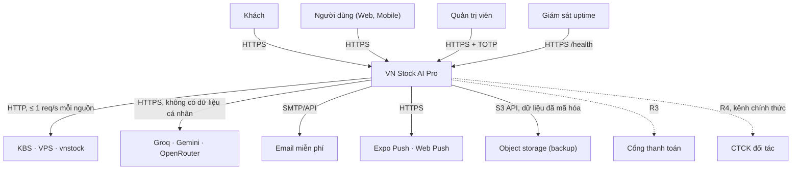

| Thực thể ngoài | Hướng | Dữ liệu trao đổi | Ràng buộc |
|---|---|---|---|
| Nguồn dữ liệu | Ra/vào | Mã, giá, sổ lệnh, nến, chỉ số, báo cáo tài chính | SC-006; IR-002; dữ liệu vào phải qua FR-031 |
| LLM | Ra/vào | Gói dữ kiện thị trường và câu hỏi đã che; văn bản trả về | SC-008; quota (3.10.3) |
| Email | Ra | Email giao dịch | Chỉ địa chỉ người nhận và nội dung cần thiết |
| Push | Ra | Tiêu đề, nội dung ngắn, đường dẫn sâu | Không có thông tin nhạy cảm trong push |
| Object storage | Ra | Bản dump CSDL đã mã hóa (age) | Khóa giải mã không lưu cùng nơi |

### 3.2 Composition View

**Viewpoint:** phân rã hệ thống thành thành phần. **Concern:** CN-08, CN-13.

| ID | Element | Type | Parent | Responsibility | Dependencies |
|---|---|---|---|---|---|
| DE-01 | `apps/web` | SPA React/Vite/TS | Clients | Giao diện R1 cho người dùng và quản trị | Core API |
| DE-02 | `apps/mobile` | Expo app | Clients | Đăng nhập, theo dõi, chi tiết mã, cảnh báo push, giả lập | Core API, Expo Push |
| DE-03 | `infra/caddy` | Reverse proxy | Infra | TLS (Let's Encrypt), phục vụ web tĩnh, chuyển `/api/*` tới Core, header bảo mật | DE-04 |
| DE-04 | `services/core` | Spring Boot (modular monolith) | Backend | API công khai; trạng thái người dùng; RiskGuard; sổ cái | DE-05, DE-06, DE-07, email, push |
| DE-04.01 | `core.shared` | Package | DE-04 | Lỗi RFC 9457, bảo mật, `Clock`, kiểu `Money`/`Price`, correlation id | — |
| DE-04.02 | `core.identity` | Module | DE-04 | Đăng ký, xác minh, đăng nhập, token, khóa tạm, TOTP admin | shared, notification(api) |
| DE-04.03 | `core.consent` | Module | DE-04 | Phiên bản điều khoản, chấp thuận, đồng ý theo mục đích, xác nhận rủi ro phái sinh, xuất/xóa dữ liệu | identity(api) |
| DE-04.04 | `core.marketgw` | Module | DE-04 | BFF tới Analytics (thị trường, AI); cache ngắn; quyền theo gói; quota AI | identity(api), AnalyticsClient |
| DE-04.05 | `core.quotes` | Module | DE-04 | Đọc giá mới nhất từ Redis; tiêu thụ luồng `s:quotes`; phát sự kiện `QuotesUpdated` | Redis |
| DE-04.06 | `core.watchlist` | Module | DE-04 | Danh sách theo dõi | marketgw(api) |
| DE-04.07 | `core.alerting` | Module | DE-04 | Quy tắc cảnh báo, bộ đánh giá, sự kiện kích hoạt | quotes(api), notification(api), marketgw(api) |
| DE-04.08 | `core.notification` | Module | DE-04 | Hộp thư, outbox, adapter email/Expo/Web Push, đăng ký thiết bị | consent(api) |
| DE-04.09 | `core.paper` | Module | DE-04 | Tài khoản giả lập, lệnh, RiskGuard, khớp lệnh, sổ cái, T+2, danh mục, ngắt mạch | quotes(api), marketgw(api) |
| DE-04.10 | `core.admin` | Module | DE-04 | Quản lý người dùng, phát hành điều khoản, rà soát AI (qua Analytics), cờ tính năng, báo cáo chỉ số | identity, consent, marketgw |
| DE-04.11 | `core.audit` | Module | DE-04 | Nhật ký kiểm toán chỉ ghi thêm (lắng nghe sự kiện từ mọi module) | shared |
| DE-04.12 | `core.support` | Module | DE-04 | Phiếu phản hồi/khiếu nại, banner sự cố | notification(api) |
| DE-04.13 | `core.telemetry` | Module | DE-04 | Nhận và lưu sự kiện sử dụng ẩn danh khi người dùng đồng ý P3 (FR-223, FR-224) | consent(api), identity(api) |
| DE-05 | `services/analytics` | FastAPI | Backend | Dữ liệu, định lượng, AI; chỉ nhận gọi nội bộ | DE-06, DE-07, nguồn, LLM |
| DE-05.01 | `analytics.api` | Package | DE-05 | Router nội bộ `/internal/v1`, xác thực bằng token dịch vụ | các package bên dưới |
| DE-05.02 | `analytics.providers` | Package | DE-05 | Port `MarketDataProvider`; adapter vnstock, KBS, VPS; giới hạn tần suất; gộp truy vấn; chuyển nguồn | common |
| DE-05.03 | `analytics.ingestion` | Package | DE-05 | Lập lịch (APScheduler), job, lịch giao dịch, trạng thái phiên | providers, marketdata, quant |
| DE-05.04 | `analytics.marketdata` | Package | DE-05 | Mô hình chuẩn hóa, repository, kiểm tra chất lượng, cách ly, ghi Redis | common |
| DE-05.05 | `analytics.quant` | Package (hàm thuần) | DE-05 | Chỉ báo, mô tả theo quy tắc, độ rộng, top movers, tổng hợp ngành, trạng thái thị trường/hỗ trợ–kháng cự (cờ) | common |
| DE-05.06 | `analytics.fundamentals` | Package | DE-05 | Chỉ số tài chính từ báo cáo | marketdata |
| DE-05.07 | `analytics.ai` | Package | DE-05 | Dựng gói dữ kiện, nhận diện ý định, mẫu prompt, cổng LLM (adapter, quota, chuyển nhà cung cấp), kiểm tra (che dữ liệu cá nhân, khuyến nghị, số liệu), cache tóm tắt, nhật ký, rà soát | quant, marketdata, fundamentals |
| DE-05.08 | `analytics.research` (R2) | Package | DE-05 | Bộ lọc, kiểm thử lịch sử, đánh giá chiến lược trực tiếp | quant, marketdata |
| DE-06 | PostgreSQL 16 | CSDL | Data | Schema `core`, `paper`, `market`, `ai`; R2: `strategy`, `research` | — |
| DE-07 | Redis 7 | Cache / luồng | Data | Giá mới nhất, tổng quan, luồng `s:quotes`, quota, giới hạn tần suất | — |
| DE-08 | `db/migrations` + container migrator | Flyway | Infra | Áp migration SQL theo phiên bản cho mọi schema | DE-06 |
| DE-09 | `infra/ops` | Script, cron | Infra | Backup mã hóa, khôi phục, kiểm tra sức khỏe, runbook | DE-06, object storage |
| DE-10 | `.github/workflows` | CI/CD | Infra | Build, test, quét bảo mật, image đa kiến trúc, triển khai | GHCR, VM |

```mermaid
flowchart TD
    Root["VN Stock AI Pro"] --> Clients
    Root --> Backend
    Root --> Data
    Root --> Infra
    Clients --> Web["DE-01 apps/web"]
    Clients --> Mob["DE-02 apps/mobile"]
    Backend --> Core["DE-04 services/core"]
    Backend --> Ana["DE-05 services/analytics"]
    Core --> C1["identity"]
    Core --> C2["consent"]
    Core --> C3["marketgw"]
    Core --> C4["quotes"]
    Core --> C5["watchlist"]
    Core --> C6["alerting"]
    Core --> C7["notification"]
    Core --> C8["paper (RiskGuard, ledger)"]
    Core --> C9["admin"]
    Core --> C10["audit"]
    Core --> C11["support"]
    Core --> C12["telemetry"]
    Ana --> A1["api"]
    Ana --> A2["providers"]
    Ana --> A3["ingestion"]
    Ana --> A4["marketdata"]
    Ana --> A5["quant"]
    Ana --> A6["fundamentals"]
    Ana --> A7["ai (facts, llm gateway, guardrails)"]
    Ana --> A8["research (R2)"]
    Data --> PG["DE-06 PostgreSQL"]
    Data --> RD["DE-07 Redis"]
    Infra --> CA["DE-03 Caddy"]
    Infra --> MG["DE-08 migrator"]
    Infra --> OP["DE-09 ops"]
    Infra --> CI["DE-10 CI/CD"]
```

### 3.3 Logical View

**Viewpoint:** cấu trúc tĩnh: lớp, interface, kiểu dữ liệu. **Concern:** CN-08, CN-12.

#### 3.3.1 Domain Core (Java)

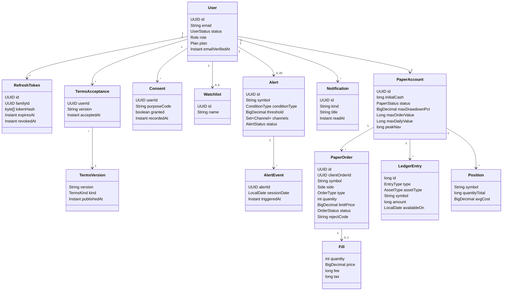

**Interface chính (Java):**

```java
// core.quotes.api
public interface QuoteReader {
    Optional<Quote> latest(String symbol);              // empty khi thiếu hoặc cũ (fail-closed)
    Map<String, Quote> latest(Collection<String> symbols);
    SessionState session(Exchange exchange);
}
public record Quote(String symbol, BigDecimal price, BigDecimal ref, BigDecimal ceiling, BigDecimal floor,
                    long volume, long value, Instant asOf, String provider, boolean stale) {}

// core.paper.internal.risk
public interface RiskRule {                              // RiskGuard = danh sách RiskRule có thứ tự
    int order();
    Optional<RiskViolation> check(OrderRequest req, RiskContext ctx);
}
public interface MatchingPolicy {                        // FR-109
    Optional<FillPlan> tryFill(PaperOrder order, Quote quote);
}

// core.notification.api
public interface NotificationChannel {
    ChannelType type();                                  // EMAIL, EXPO_PUSH, WEB_PUSH, IN_APP
    DeliveryResult send(OutboundMessage msg);
}

// core.marketgw.internal
public interface AnalyticsClient {                       // client sinh từ contracts/openapi/internal.yaml
    SymbolDto symbol(String code);
    OverviewDto overview();
    AiSummaryDto aiSummary(String symbol);
    AiChatResultDto aiChat(AiChatRequest req);           // req chứa userRef (HMAC), không chứa email
}

// Điểm mở rộng R3/R4, không có implementation trước release tương ứng
public interface PaymentGateway { /* R3 */ }
public interface OrderGateway  { /* R4: chỉ nhận ConfirmedOrder có bằng chứng xác nhận (FR-161) */ }
```

#### 3.3.2 Domain Analytics (Python)

```python
# analytics/providers/base.py
class Capability(StrEnum):
    SYMBOLS = "symbols"; QUOTES = "quotes"; ORDER_BOOK = "order_book"
    DAILY_BARS = "daily_bars"; INDEX_QUOTES = "index_quotes"; FINANCIALS = "financials"

class MarketDataProvider(Protocol):
    name: str
    def capabilities(self) -> set[Capability]: ...
    async def list_symbols(self) -> list[SymbolInfo]: ...
    async def get_quotes(self, symbols: Sequence[str]) -> list[Quote]: ...          # theo lô
    async def get_order_book(self, symbol: str) -> OrderBook: ...
    async def get_daily_bars(self, symbol: str, start: date, end: date) -> list[DailyBar]: ...
    async def get_index_quotes(self) -> list[IndexQuote]: ...
    async def get_financials(self, symbol: str) -> list[FinancialReport]: ...

# analytics/ai/llm/base.py
class LlmProvider(Protocol):
    name: str
    async def complete(self, req: LlmRequest) -> LlmResponse: ...   # raise QuotaExceeded / ProviderError

# analytics/ai/guardrails/base.py
class Guardrail(Protocol):
    name: str
    def check(self, text: str, facts: FactPack) -> GuardResult: ...   # hàm thuần, không gọi mạng
```

| Kiểu dữ liệu | Trường chính | Ghi chú |
|---|---|---|
| `Quote` | symbol, price, ref, ceiling, floor, open, high, low, volume, value, change, pct, as_of, provider, session | Giá `Decimal`; khối lượng và giá trị `int` (đồng) |
| `DailyBar` | symbol, trade_date, open, high, low, close, volume, value, provider | — |
| `Fact` | id (`F1`, `F2`, ...), label, value (`Decimal`), unit, display, source, as_of | Đơn vị nhỏ nhất của gói dữ kiện |
| `FactPack` | symbol hoặc market, trade_date, facts[], descriptions[], hash | Hash SHA-256 của JSON chuẩn hóa |
| `GuardResult` | passed, reasons[], matched_spans[] | — |
| `Interaction` | id, kind, user_ref, facts_hash, template, provider, model, output, guard_*, final_status | Ghi nhật ký FR-071 |

### 3.4 Dependency View

**Viewpoint:** phụ thuộc và độ ghép nối giữa thành phần. **Concern:** CN-07, CN-08.

#### 3.4.1 Quy tắc phụ thuộc trong Core

Các module chỉ gọi nhau qua package `..api` hoặc qua Spring application event. Không module nào truy cập repository của module khác. Quy tắc được kiểm tra bằng test `ApplicationModules.of(CoreApplication.class).verify()` của Spring Modulith (NFR-M03).

| Module | Được phép phụ thuộc |
|---|---|
| shared | — |
| identity | shared, notification.api |
| consent | shared, identity.api |
| notification | shared, consent.api |
| quotes | shared |
| marketgw | shared, identity.api |
| watchlist | shared, marketgw.api |
| alerting | shared, quotes.api, notification.api, marketgw.api |
| paper | shared, quotes.api, marketgw.api |
| admin | shared, identity.api, consent.api, marketgw.api |
| support | shared, notification.api |
| telemetry | shared, consent.api, identity.api |
| audit | shared (chỉ lắng nghe event) |

#### 3.4.2 Quy tắc phụ thuộc trong Analytics (import-linter)

```ini
[importlinter:contract:layers]
name = Phân lớp
type = layers
layers =
    analytics.api
    analytics.ingestion | analytics.ai | analytics.research
    analytics.quant | analytics.fundamentals
    analytics.marketdata | analytics.providers
    analytics.common

[importlinter:contract:quant-pure]
name = quant là hàm thuần
type = forbidden
source_modules = analytics.quant
forbidden_modules = analytics.providers, analytics.marketdata, httpx, redis, sqlalchemy

[importlinter:contract:guardrails-pure]
name = guardrails không gọi LLM hay mạng
type = forbidden
source_modules = analytics.ai.guardrails
forbidden_modules = analytics.ai.llm, httpx
```

#### 3.4.3 Phụ thuộc giữa các service

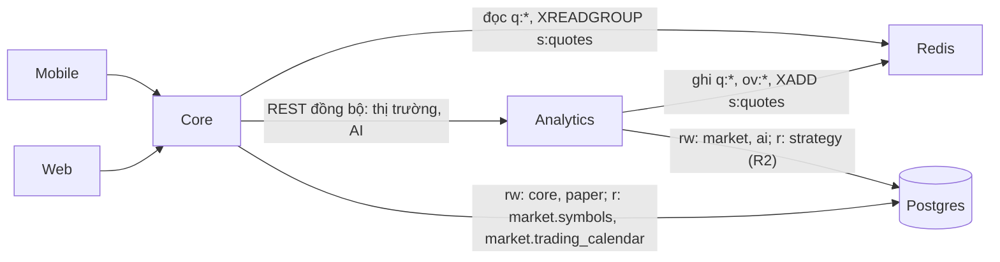

#### 3.4.4 Thư viện bên ngoài chính

Phiên bản cụ thể được chốt ở WP-00 bằng lockfile (Gradle version catalog, `uv.lock`, `pnpm-lock.yaml`). Mọi thư viện phải là mã nguồn mở, miễn phí (SC-005).

| Thành phần | Thư viện |
|---|---|
| Core | Spring Boot (web, security, oauth2-resource-server, data-jpa, validation, actuator), Spring Modulith, Flyway, Resilience4j, BouncyCastle (Argon2), thư viện TOTP, Testcontainers, openapi-generator |
| Analytics | FastAPI, Pydantic v2, SQLAlchemy 2 + asyncpg, redis-py, APScheduler, httpx, tenacity, pandas, numpy, vnstock, pytest, hypothesis, import-linter, ruff, mypy |
| Web | React 18, Vite, TypeScript, Tailwind CSS, TanStack Query, React Router, lightweight-charts, d3-hierarchy (treemap squarified), zod, Playwright, axe-core |
| Mobile | Expo SDK, expo-router, expo-notifications, expo-secure-store, TanStack Query, Maestro (E2E) |

### 3.5 Information View

**Viewpoint:** dữ liệu bền vững, định dạng, lưu trữ. **Concern:** CN-01, CN-05, CN-10, CN-12. **Lược đồ đầy đủ:** [schema.sql](schema.sql).

#### 3.5.1 Schema và quyền ghi

| Schema | Bên ghi duy nhất | Bên đọc | Nội dung |
|---|---|---|---|
| `core` | Core | Core | Người dùng, token, mã mời, điều khoản, đồng ý, danh sách theo dõi, cảnh báo, thông báo, outbox, audit, phản hồi, cờ tính năng, sự kiện sử dụng |
| `paper` | Core | Core | Tài khoản giả lập, lệnh, khớp, bút toán, vị thế |
| `market` | Analytics | Analytics; Core đọc `symbols`, `trading_calendar` | Danh mục mã, lịch giao dịch, nến ngày, báo cáo tài chính, chỉ số, lần chạy ingest, cách ly |
| `ai` | Analytics | Analytics | Mẫu prompt, nhật ký tương tác, tóm tắt, phản hồi, rà soát |
| `strategy` (R2) | Core | Core, Analytics | Chiến lược, phiên bản |
| `research` (R2) | Analytics | Analytics | Lần chạy kiểm thử lịch sử, giao dịch kiểm thử |

Quyền ghi được ép bằng role CSDL `core_rw` và `analytics_rw` (schema.sql, mục GRANT).

#### 3.5.2 Mô hình quan hệ (rút gọn)

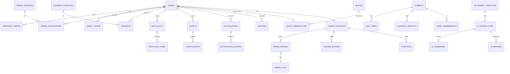

#### 3.5.3 Hợp đồng khóa Redis

| Khóa | Kiểu | Bên ghi | Nội dung / TTL |
|---|---|---|---|
| `q:{SYMBOL}` | Hash | Analytics | price, ref, ceil, floor, open, high, low, vol, val, chg, pct, ts (epoch ms), src, sess. TTL 1 ngày |
| `ob:{SYMBOL}` | Hash | Analytics | Sổ lệnh: b1p, b1v … b3p, b3v, a1p … a3v, ts, src. TTL 60 s |
| `idx:{CODE}` | Hash | Analytics | Điểm chỉ số. TTL 1 ngày |
| `mkt:session` | Hash | Analytics | `HOSE`, `HNX`, `UPCOM`, `DERIV` → trạng thái phiên; `updated_at` |
| `ov:latest` | String (JSON) | Analytics | Tổng quan (FR-040 đến FR-044). TTL 10 phút |
| `ov:treemap:{weight}:{dir}` | String (JSON) | Analytics | Dữ liệu bản đồ nhiệt. TTL 10 phút |
| `s:quotes` | Stream | Analytics | `{cycle_id, ts, session, symbols}` (symbols nối bằng dấu phẩy), MAXLEN ~ 10.000. Consumer group `core` |
| `ai:quota:{userId}:{yyyymmdd}` | String (int) | Core | Số câu hỏi đã dùng. TTL 48 giờ |
| `ai:budget:{provider}:{yyyymmdd}` | String (int) | Analytics | Số request LLM đã dùng. TTL 48 giờ |
| `alert:st:{alertId}` | String (0/1) | Core | Trạng thái điều kiện lần trước |
| `rl:{scope}:{key}` | String | Core, Analytics | Bộ đếm giới hạn tần suất |
| `sf:{hash}` | String | Analytics | Khóa single-flight cho gộp truy vấn. TTL 10 s |

**Quy ước:** giá trị số ghi dạng chuỗi thập phân. Mọi khóa giá có trường `ts` và `src` để Core tự đánh giá độ cũ (FR-030).

#### 3.5.4 Định dạng dữ liệu

- JSON API theo camelCase.
- Giá: số thập phân (`25350`, `1325.4`). Tiền: số nguyên đồng.
- Thời gian ISO 8601 có `+07:00`. Ngày giao dịch dạng `yyyy-MM-dd`.
- Định danh: UUID v4 cho thực thể. Mã chứng khoán viết hoa.
- Nhật ký AI lưu gói dữ kiện dạng `jsonb` và SHA-256 của JSON chuẩn hóa (khóa sắp xếp, không khoảng trắng).

#### 3.5.5 Lưu trữ, sao lưu, khôi phục

| Việc | Cách làm | Lịch |
|---|---|---|
| Sao lưu | `pg_dump -Fc` → mã hóa bằng `age` (khóa công khai) → tải lên object storage miễn phí (S3 API). Bản thứ hai lưu ở block volume khác | 01:00 hằng ngày |
| Giữ bản sao lưu | 7 bản ngày, 4 bản tuần (SRS DR-009) | — |
| Dọn dữ liệu | Job xóa tài khoản `DELETION_REQUESTED` quá hạn; xóa nhật ký bảo mật > 90 ngày; xóa thông báo > 90 ngày | 02:00 hằng ngày |
| Diễn tập khôi phục | Khôi phục bản mới nhất lên máy dev và chạy test smoke | Hằng tháng |

### 3.6 Interface View

**Viewpoint:** giao diện trong và ngoài. **Concern:** CN-02, CN-03, CN-08. **Hợp đồng chuẩn:** `contracts/openapi/public.yaml` và `contracts/openapi/internal.yaml` (OpenAPI 3.1, sinh ở WP-02 từ bảng dưới đây).

#### 3.6.1 API công khai (Core, `/api/v1`)

Xác thực:

- Header `Authorization: Bearer <access JWT>`.
- Web giữ refresh token trong cookie `HttpOnly; Secure; SameSite=Strict; Path=/api/v1/auth`. Nhờ phục vụ cùng origin nên cookie hoạt động.
- Mobile gửi refresh token trong body và lưu bằng `expo-secure-store`.

| Method | Path | Auth | Mô tả | FR |
|---|---|---|---|---|
| POST | `/auth/register` | — | Đăng ký kèm chấp thuận điều khoản, đồng ý và `inviteCode` (bắt buộc khi cờ `beta_invite_only` bật) | FR-001, FR-002, FR-011, FR-013, FR-019 |
| POST | `/auth/verify-email` | — | Xác minh email `{token}` | FR-003 |
| POST | `/auth/resend-verification` | — | Gửi lại email xác minh | FR-003 |
| POST | `/auth/login` | — | `{email, password, totp?}` → token | FR-004, FR-005, FR-018 |
| POST | `/auth/refresh` | refresh | Xoay vòng refresh token | FR-004 |
| POST | `/auth/logout` | user | Thu hồi phiên hiện tại | FR-006 |
| POST | `/auth/logout-all` | user | Thu hồi mọi phiên | FR-007 |
| POST | `/auth/password/forgot` | — | Luôn trả 202 | FR-008 |
| POST | `/auth/password/reset` | — | `{token, newPassword}` | FR-008 |
| POST | `/auth/password/change` | user | `{currentPassword, newPassword}` | FR-009 |
| GET / PATCH | `/me` | user | Hồ sơ | FR-010 |
| GET | `/me/terms` | user | Phiên bản hiện hành và trạng thái chấp thuận | FR-011, FR-012 |
| POST | `/me/terms/accept` | user | `{version}` | FR-011 |
| POST | `/me/derivative-risk/ack` | user | `{version}` | FR-015 |
| GET | `/me/consents` | user | Danh sách đồng ý | FR-013 |
| PUT | `/me/consents/{purpose}` | user | `{granted}` | FR-014 |
| POST | `/me/export` | user | Trả JSON dữ liệu cá nhân | FR-017 |
| DELETE | `/me` | user | `{password}` → `DELETION_REQUESTED` | FR-016 |
| GET | `/symbols?q=` | user | Tìm mã | FR-021 |
| GET | `/symbols/{code}` | user | Thông tin mã | FR-020 |
| GET | `/symbols/{code}/quote` | user | Giá mới nhất + provenance | FR-022, FR-029 |
| GET | `/symbols/{code}/orderbook` | user | Sổ lệnh 3 bước giá | FR-023 |
| GET | `/symbols/{code}/bars?interval=D\|W\|M&from&to` | user | Nến | FR-025, FR-050 |
| GET | `/symbols/{code}/indicators?from&to` | user | Chỉ báo + mô tả quy tắc | FR-051, FR-052 |
| GET | `/symbols/{code}/fundamentals` | user | Chỉ số cơ bản | FR-053 |
| GET | `/symbols/{code}/ai-summary` | user | Tóm tắt AI | FR-060, FR-063 |
| GET | `/market/overview` | user | Chỉ số, độ rộng, top movers, thẻ nhận định | FR-040 đến FR-042, FR-044 |
| GET | `/market/treemap?weight=VALUE\|COUNT\|ADVANCERS&dir=ALL\|UP\|DOWN` | user | Dữ liệu bản đồ nhiệt | FR-043 |
| GET | `/market/state` | user | Trạng thái phiên; R1+cờ: trạng thái thị trường | FR-024, FR-045 |
| POST | `/ai/chat` | user | `{question, contextSymbol?}` | FR-061 đến FR-068 |
| GET | `/ai/quota` | user | Lượt còn lại | FR-062 |
| POST | `/ai/interactions/{id}/feedback` | user | `{rating}` | FR-073 |
| POST | `/ai/interactions/{id}/report` | user | `{reason}` | FR-073 |
| GET / POST | `/watchlists` | user | Danh sách / tạo | FR-080 |
| PATCH / DELETE | `/watchlists/{id}` | user | Đổi tên, sắp xếp / xóa | FR-081 |
| PUT / DELETE | `/watchlists/{id}/items/{symbol}` | user | Thêm / xóa mã | FR-081 |
| GET / POST | `/alerts` | user | Danh sách / tạo | FR-090 |
| PATCH / DELETE | `/alerts/{id}` | user | Tạm dừng, sửa / xóa | FR-090 |
| GET | `/alerts/events` | user | Lịch sử kích hoạt | FR-094 |
| GET | `/notifications` | user | Hộp thư | FR-096 |
| POST | `/notifications/{id}/read` | user | Đánh dấu đã đọc | FR-096 |
| POST / DELETE | `/devices` · `/devices/{id}` | user | Đăng ký / hủy thiết bị push | FR-097 |
| GET | `/paper/account` | user | Số dư, NAV, trạng thái, hạn mức | FR-100, FR-112 |
| PATCH | `/paper/account/settings` | user | `{maxOrderValue?, maxDailyValue?, maxDrawdownPct?}` | FR-107, FR-108 |
| POST | `/paper/account/reset` | user | Đặt lại tài khoản | FR-114 |
| POST | `/paper/account/resume` | user | Mở lại sau `HALTED` | FR-108 |
| GET / POST | `/paper/orders` | user | Danh sách / đặt lệnh (header `Idempotency-Key`) | FR-101 đến FR-109 |
| DELETE | `/paper/orders/{id}` | user | Hủy lệnh LO `OPEN` | FR-113 |
| GET | `/paper/positions` | user | Vị thế | FR-112 |
| GET | `/paper/ledger?from&to` | user | Bút toán | FR-110 |
| POST | `/feedback` | user | Phiếu phản hồi | FR-220 |
| POST | `/events` | user | Lô sự kiện sử dụng `{events: [{event, occurredAt, platform, sessionId?, properties}]}` (≤ 50). Trả 202 kể cả khi bỏ qua vì chưa có đồng ý P3 | FR-223, FR-224 |
| GET | `/content/indicators` · `/content/limits` · `/content/fill-rules` · `/content/status` | — | Nội dung tĩnh: giải thích, giới hạn gói, quy tắc giả lập, banner sự cố | FR-054, FR-180, FR-109, FR-221 |
| GET / POST | `/admin/users` · `/admin/users/{id}/lock` · `/unlock` | admin | Quản lý người dùng | FR-210 |
| GET / POST | `/admin/invites` · `/admin/invites/{id}/revoke` | admin | Tạo mã mời (trả mã đúng một lần), liệt kê, thu hồi | FR-217 |
| POST | `/admin/terms` | admin | Phát hành phiên bản điều khoản | FR-211 |
| GET / POST | `/admin/ai/reviews` · `/admin/ai/reviews/{id}/verdict` | admin | Rà soát AI | FR-212 |
| GET | `/admin/ops/ingestion` | admin | Trạng thái ingest | FR-213 |
| GET / PUT | `/admin/flags` · `/admin/flags/{key}` | admin | Cờ tính năng | FR-214 |
| GET | `/admin/metrics?month=yyyy-MM` | admin | Báo cáo chỉ số | FR-215 |

**Mô hình lỗi (RFC 9457):**

```json
{
  "type": "https://<host>/errors/risk-lot-size",
  "title": "Khối lượng không hợp lệ",
  "status": 422,
  "detail": "Khối lượng phải là bội số của 100 cổ phiếu.",
  "code": "RISK_LOT_SIZE",
  "correlationId": "c0a8012e-..."
}
```

| Mã lỗi | HTTP | FR |
|---|---|---|
| `VALIDATION_ERROR` | 400 | — |
| `UNAUTHENTICATED` / `TOKEN_REUSED` | 401 | FR-004, NFR-S04 |
| `TERMS_NOT_ACCEPTED` / `DERIVATIVE_RISK_NOT_ACKED` | 403 | FR-011, FR-015 |
| `INVITE_INVALID` | 403 | FR-019 |
| `FORBIDDEN` | 403 | FR-181 |
| `NOT_FOUND` | 404 | — |
| `LIMIT_EXCEEDED` (giới hạn gói) | 409 | FR-080, FR-090, FR-180 |
| `RISK_LOT_SIZE`, `RISK_PRICE_BAND`, `RISK_TICK_SIZE`, `RISK_INSUFFICIENT_CASH`, `RISK_INSUFFICIENT_SHARES`, `RISK_SESSION`, `RISK_ORDER_LIMIT`, `RISK_DAILY_LIMIT`, `RISK_HALTED` | 422 | FR-102 đến FR-108 |
| `DATA_STALE` | 503 | FR-030, FR-106 |
| `AI_QUOTA_EXCEEDED` | 429 | FR-062 |
| `RATE_LIMITED` / `ACCOUNT_LOCKED` | 429 / 423 | NFR-S05, FR-005 |
| `INTERNAL_ERROR` | 500 | — |

#### 3.6.2 API nội bộ (Analytics, `/internal/v1`)

Header `X-Service-Token` (bí mật dùng chung, xoay vòng được) và header `X-Correlation-Id`. Chỉ lắng nghe trên mạng Docker `internal`.

| Method | Path | Mô tả |
|---|---|---|
| GET | `/symbols?q=` · `/symbols/{code}` | Danh mục mã |
| GET | `/symbols/{code}/quote` · `/orderbook` · `/bars` · `/indicators` · `/fundamentals` | Dữ liệu và phân tích |
| GET | `/market/overview` · `/market/treemap` · `/market/state` | Tổng quan |
| POST | `/ai/summary` | `{symbol}` → `{interactionId, text, citations[], status, labels}` |
| POST | `/ai/chat` | `{userRef, question, contextSymbol?}` → như trên, có `refunded: bool` |
| POST | `/ai/interactions/{id}/feedback` · `/report` | Phản hồi người dùng (Core chuyển tiếp) |
| GET / POST | `/ai/reviews?status=` · `/ai/reviews/{id}/verdict` | Rà soát (Core admin chuyển tiếp) |
| GET | `/ops/ingestion` · `/health/live` · `/health/ready` | Vận hành |

#### 3.6.3 Hợp đồng prompt LLM (mẫu `summary.v1`)

```text
[system]
Bạn là trợ lý mô tả dữ liệu chứng khoán. Quy tắc bắt buộc:
1. Chỉ dùng số liệu trong DỮ KIỆN. Sau mỗi con số phải ghi mã dữ kiện dạng [F<n>].
2. Không khuyến nghị mua, bán, nắm giữ; không nêu giá mục tiêu, điểm mua/bán; không dự đoán giá.
3. Không hứa hẹn hay đảm bảo lợi nhuận. Không dùng câu mệnh lệnh về giao dịch.
4. Viết tiếng Việt trung tính, 80–200 từ, mô tả trạng thái kỹ thuật và cơ bản.
5. Nếu DỮ KIỆN thiếu, nói rõ là thiếu; không suy đoán.
[user]
MÃ: {symbol} · NGÀY: {trade_date}
DỮ KIỆN:
{facts_as_lines}   # ví dụ: F1 | Giá đóng cửa | 25.350 đồng | KBS | 2026-10-20 15:00
MÔ TẢ THEO QUY TẮC:
{rule_descriptions} # ví dụ: RSI(14)=72,4 [F5] → "vùng quá mua theo quy ước"
```

Mẫu `chat.v1` dùng cùng quy tắc và thêm `CÂU HỎI (đã che dữ liệu cá nhân): {question}`. Mẫu prompt được lưu ở `ai.prompt_templates` theo phiên bản. Đổi mẫu thì tạo phiên bản mới và phải chạy lại bộ red-team.

#### 3.6.4 Giao diện vận hành

- `GET /actuator/health/{liveness,readiness}` (Core), `GET /internal/v1/health/*` (Analytics). Caddy chỉ công khai `/api/v1/health`, trả trạng thái tổng hợp.
- Log JSON ra stdout, gồm các trường `ts, level, service, correlationId, userRef?, msg`.

### 3.7 Interaction View

**Viewpoint:** tương tác động và trao đổi thông điệp. **Concern:** CN-01, CN-02, CN-04, CN-05.

#### SD-01: Đăng ký và xác minh email (UC-001)

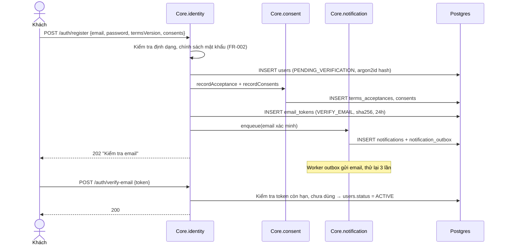

#### SD-02: Đăng nhập và xoay vòng refresh token (UC-002, QAS-05)

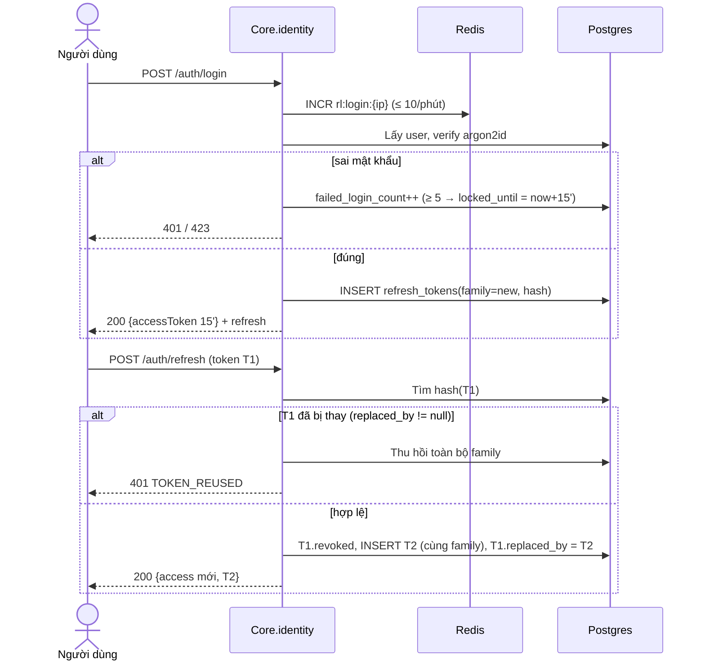

#### SD-03: Chu kỳ giá → tổng quan → cảnh báo và khớp lệnh giả lập (UC-014, UC-010)

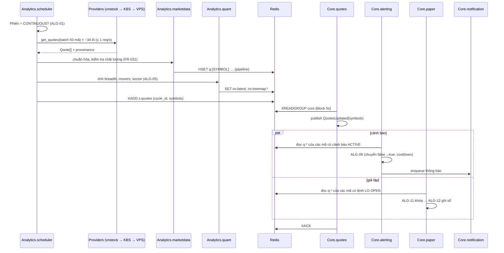

#### SD-04: Trang mã và tóm tắt AI khi chưa có cache (UC-006)

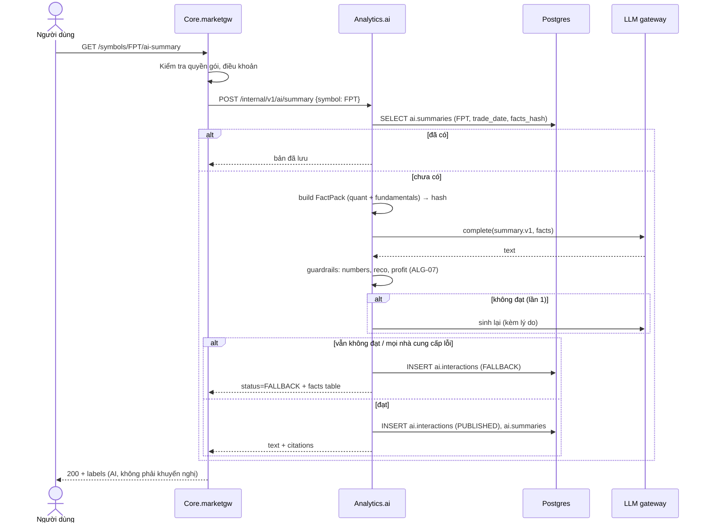

#### SD-05: Hỏi đáp AI (UC-007)

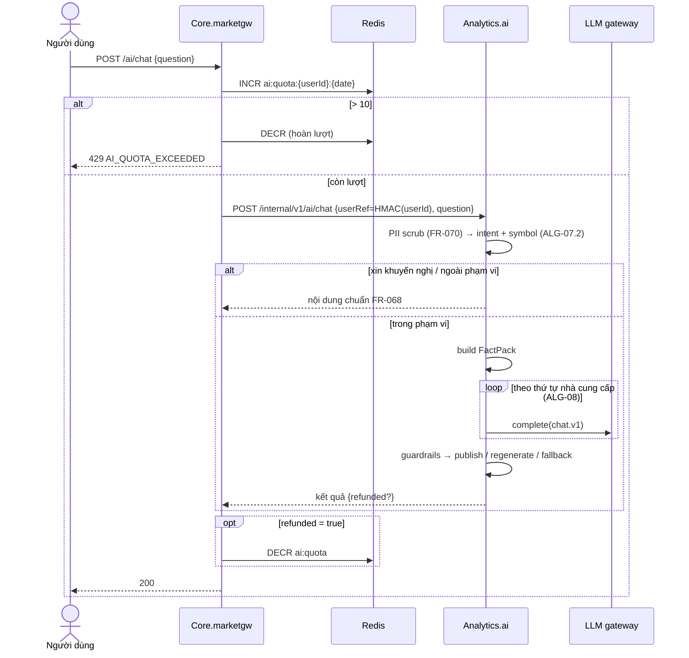

#### SD-06: Đặt lệnh giả lập (UC-011)

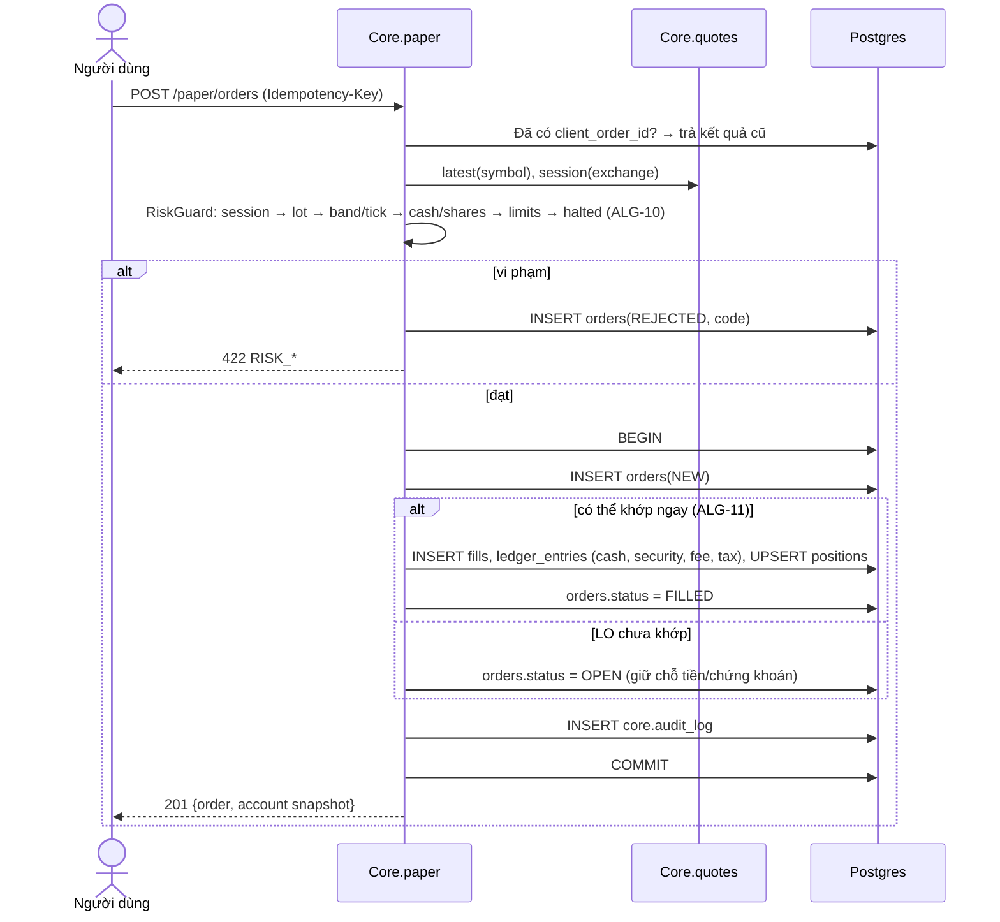

#### SD-07: Xóa tài khoản (UC-013)

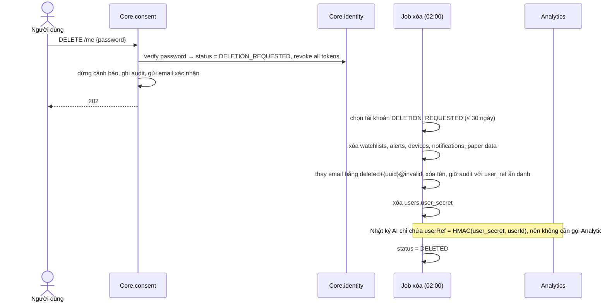

> Để nhật ký AI không còn liên kết được với người dùng đã xóa, `userRef = HMAC(user_secret, userId)` dùng `user_secret` riêng cho từng người dùng, lưu ở `core.users`. Khi xóa tài khoản, `user_secret` bị xóa nên không ai tính lại được `userRef`.

#### SD-08 (R4, khung): Xác nhận phiếu lệnh

Tín hiệu chiến lược → `paper`/`trading` soạn phiếu → RiskGuard → push tới thiết bị → người dùng xác thực bước cao (PIN/sinh trắc) trong ≤ 60 giây → `OrderGateway.submit(ConfirmedOrder{ticketId, confirmationProof})` → CTCK → cập nhật trạng thái. Không implementation nào của `OrderGateway` được merge trước khi BRD ASM-003 được xác nhận.

### 3.8 State Dynamics View

**Viewpoint:** trạng thái rời rạc và chuyển trạng thái. **Concern:** CN-01, CN-04, CN-12.

#### ST-01: Tài khoản người dùng

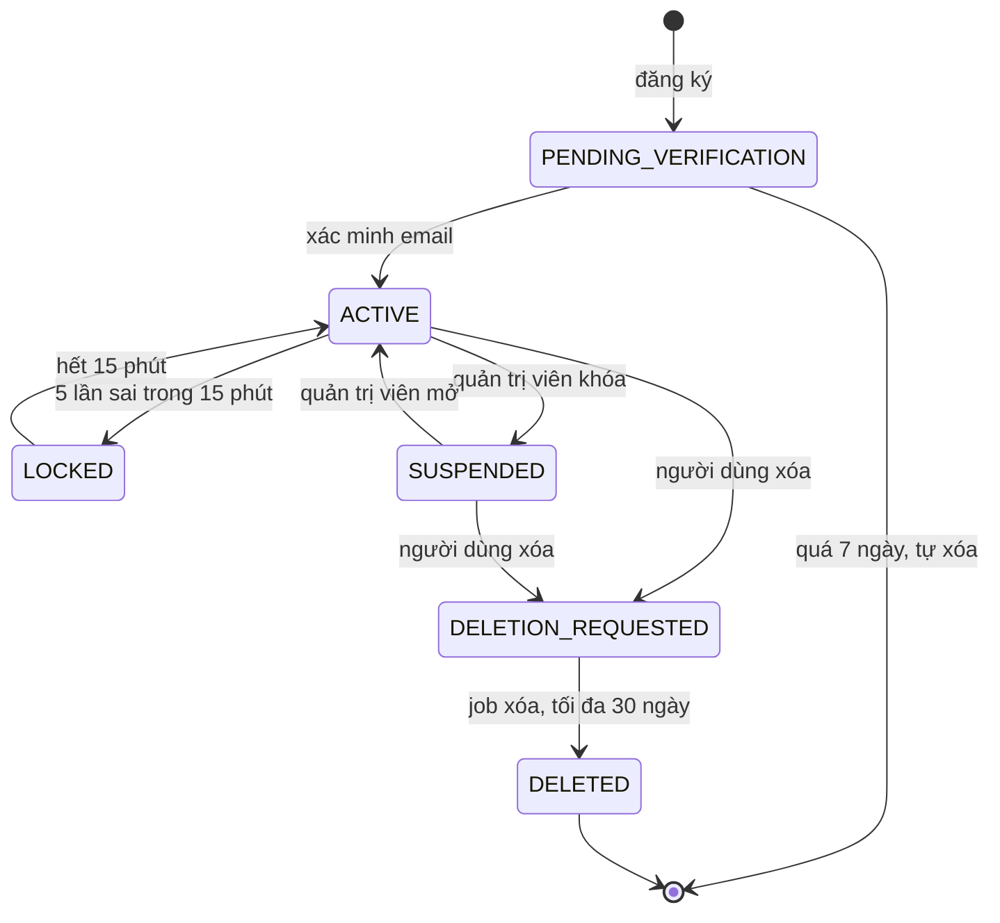

`LOCKED` được tính từ `locked_until > now()`, không lưu thành cột trạng thái.

#### ST-02: Cảnh báo

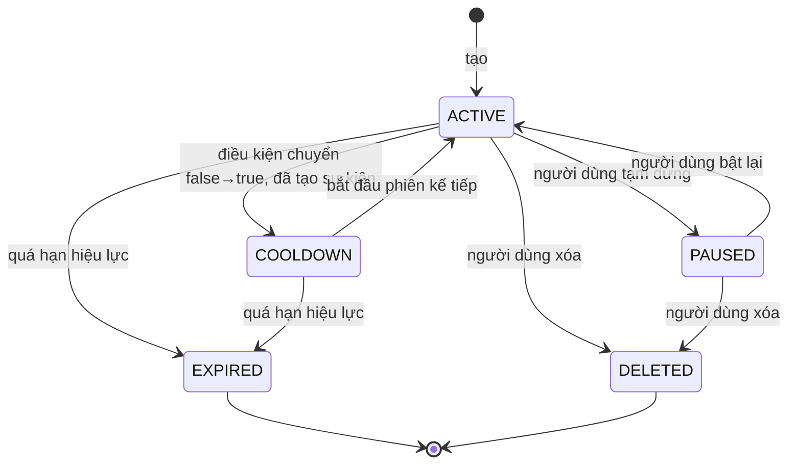

#### ST-03: Lệnh giả lập

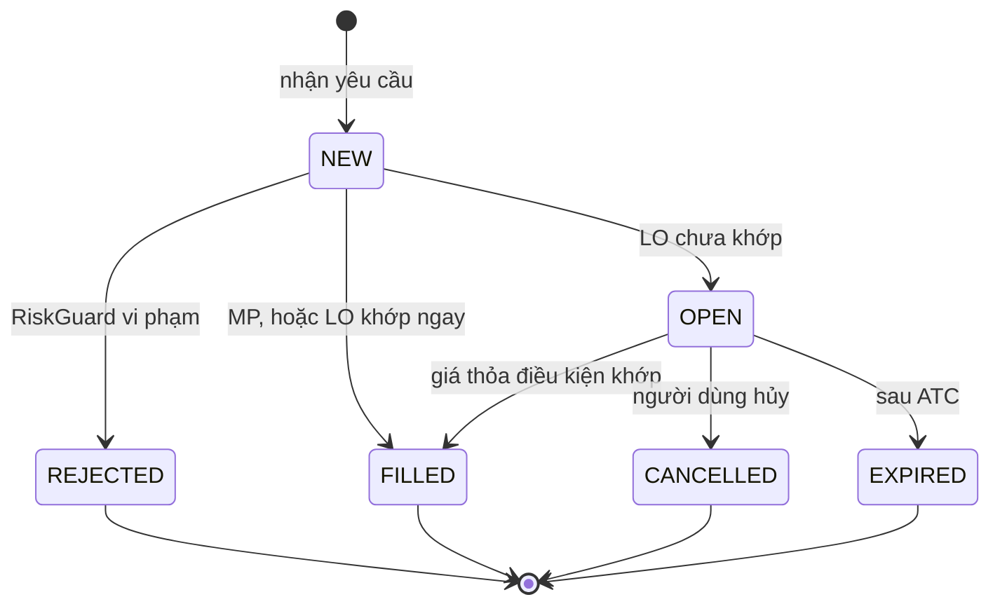

#### ST-04: Tài khoản giả lập

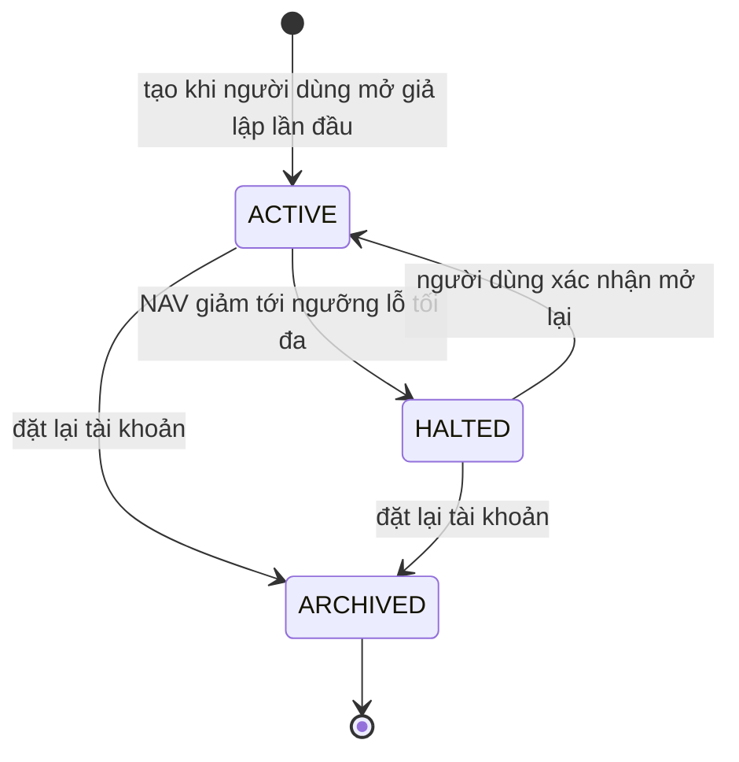

Khi đặt lại, tài khoản cũ chuyển `ARCHIVED` và một tài khoản `ACTIVE` mới được tạo.

#### ST-05: Một lần sinh nội dung AI

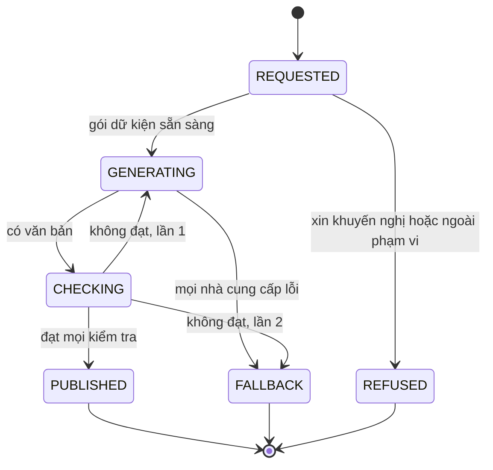

#### ST-06: Phiên giao dịch (cổ phiếu cơ sở; phái sinh có lịch riêng)

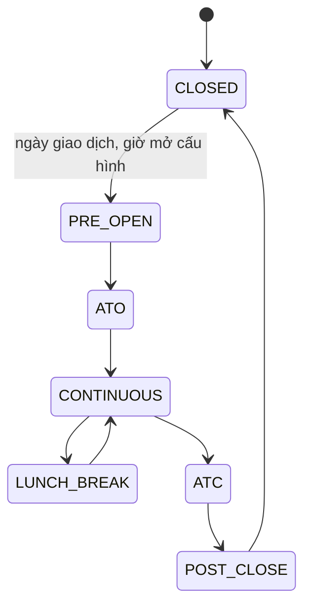

Mốc giờ nằm trong cấu hình `market-sessions.yaml`, không viết cứng (BRU-006, BRD OQ-012). Giá trị khởi tạo đề xuất cho HOSE, **cần xác minh với quy chế hiện hành**: ATO 09:00–09:15, khớp liên tục 09:15–11:30 và 13:00–14:30, ATC 14:30–14:45, sau phiên 14:45–15:00.

#### ST-07: Lần chạy job thu thập

`SCHEDULED → RUNNING → {SUCCEEDED | DEGRADED (tỷ lệ lỗi > 5%, giữ dữ liệu cũ) | FAILED}`. Khi `FAILED` 3 lần liên tiếp: chuyển nguồn phụ và báo quản trị viên (NFR-O03).

#### ST-08 (R4): Phiếu lệnh

`DRAFTED → {REJECTED | AWAITING_CONFIRMATION} → {EXPIRED (60 s hoặc lệch giá) | CONFIRMED} → SUBMITTED → {ACKED → PARTIALLY_FILLED → FILLED | CANCELLED | BROKER_REJECTED}`.

### 3.9 Algorithm View

**Viewpoint:** logic nghiệp vụ và thuật toán cốt lõi. **Concern:** CN-01, CN-04, CN-11, CN-12.

#### ALG-01: Xác định trạng thái phiên

```text
session(exchange, now):
  d = now.date (Asia/Ho_Chi_Minh)
  if not trading_calendar[d].is_trading_day: return CLOSED
  for (start, end, state) in config[exchange].windows:   # sắp theo thời gian
      if start <= now.time < end: return state
  return CLOSED
```

Analytics ghi kết quả vào `mkt:session` mỗi 15 giây. Core chỉ đọc giá trị này, không tự tính lại, để có một nguồn sự thật duy nhất.

#### ALG-02: Lập lịch thu thập

| Job | Lịch | Ghi chú |
|---|---|---|
| `symbols_sync` | 08:00 ngày giao dịch | FR-020; so sánh với bảng `market.symbols`, đánh dấu mã hủy niêm yết |
| `quotes_cycle` | Mỗi 60 s khi phiên ∈ {ATO, CONTINUOUS, ATC} | ~1.700 mã ÷ 50 mã/lô ≈ 34 lô ở ≤ 1 req/s ≈ 34 s < 60 s. Nếu một chu kỳ chạy quá 55 s, chu kỳ sau bị bỏ qua (không chồng lấn) |
| `index_cycle` | Mỗi 60 s, cùng chu kỳ giá | FR-027 |
| `orderbook_on_demand` | Khi có yêu cầu, cache 15 s | FR-023; gộp truy vấn |
| `eod_bars` | 15:30 ngày giao dịch | Nến ngày + chỉ báo đóng cửa (`market.indicator_snapshots`) |
| `financials_weekly` | Chủ nhật 03:00 | FR-026 |
| `backfill` | Khi có mã mới, hoặc chạy tay | Tối đa 5 năm, giới hạn tần suất riêng |

#### ALG-03: Gộp truy vấn (single-flight) và cache

```python
async def fetch(key, loader, ttl):
    if (v := cache.get(key)) is not None: return v        # cache trong process, TTL 10–30 s
    async with locks[key]:                                 # 1 coroutine gọi nguồn cho mỗi key
        if (v := cache.get(key)) is not None: return v
        v = await rate_limited(loader)                     # token bucket theo provider
        cache.set(key, v, ttl); return v
```

#### ALG-04: Chỉ báo kỹ thuật (hàm thuần, kiểm bằng dữ liệu golden)

| Chỉ báo | Công thức | Khởi động |
|---|---|---|
| SMA(n) | Trung bình cộng n giá đóng cửa | Cần n nến |
| EMA(n) | α = 2/(n+1); EMA_t = α·C_t + (1−α)·EMA_{t−1}; giá trị khởi đầu = SMA(n) | n nến |
| RSI(14) | Làm mượt Wilder: avgGain_t = (avgGain_{t−1}·13 + gain_t)/14 (tương tự cho loss); RSI = 100 − 100/(1 + avgGain/avgLoss) | 15 nến |
| MACD(12, 26, 9) | MACD = EMA12 − EMA26; Signal = EMA9(MACD); Hist = MACD − Signal | 34 nến |
| Bollinger(20, 2) | Giữa = SMA20; Trên/Dưới = SMA20 ± 2·σ (độ lệch chuẩn tổng thể của 20 nến) | 20 nến |
| ATR(14) | TR = max(H−L, \|H−C_{t−1}\|, \|L−C_{t−1}\|); ATR làm mượt Wilder | 15 nến |
| MA khối lượng(20) | SMA20 của khối lượng | 20 nến |

Không đủ nến thì trả `null` và giao diện hiển thị "chưa đủ dữ liệu", không hiển thị 0.

**Bảng mô tả theo quy tắc (FR-052), ví dụ:**

| Điều kiện | Mô tả |
|---|---|
| RSI > 70 | "RSI(14) ở vùng quá mua theo quy ước" |
| RSI < 30 | "RSI(14) ở vùng quá bán theo quy ước" |
| C > SMA50 > SMA200 | "Giá nằm trên MA50 và MA200" |
| MACD cắt lên Signal trong 3 phiên gần nhất | "MACD vừa cắt lên đường tín hiệu" |
| C > dải trên Bollinger | "Giá đóng cửa vượt dải trên Bollinger" |

Các mô tả đều trung tính, không có từ "nên", "mua", "bán". Bảng quy tắc có phiên bản và được công bố qua `/content/indicators`.

#### ALG-05: Độ rộng, top movers, tổng hợp ngành

- **Độ rộng:** đếm mã theo `pct > 0`, `< 0`, `= 0`, `price = ceiling`, `price = floor`, theo sàn. % trên MA_n = (số mã có C_đóng-cửa-gần-nhất > SMA_n) / (số mã đủ dữ liệu).
- **Top movers:** sắp theo `pct` (chỉ mã có khối lượng > 0). "Thanh khoản đột biến": `vol_session ≥ 2 × MAvol20`, sắp theo tỷ số.
- **Ngành:** nhóm theo `industry_code`. Trọng số `VALUE` = Σ giá trị giao dịch; `COUNT` = số mã; `ADVANCERS` = số mã tăng. Màu = % thay đổi bình quân có trọng số theo giá trị giao dịch. Mã dẫn dắt = mã có giá trị giao dịch lớn nhất trong ngành.
- **Bố cục treemap:** tính ở client bằng `d3-hierarchy` với `treemapSquarify` (thuật toán squarified, Bruls và cộng sự, 2000). Server chỉ trả cây `{sector → [symbols]}` có trọng số.

#### ALG-06: Trạng thái thị trường và hỗ trợ/kháng cự (FR-045, sau cờ tính năng)

- **Trạng thái:** phân loại tất định từ bảng quy tắc có phiên bản. Đầu vào: SMA50, SMA200, độ dốc SMA50 qua 10 phiên, ATR14/C so với phân vị 250 phiên, biến động lợi suất và khối lượng 20 phiên. Ngưỡng cụ thể được **port từ dự án tham chiếu** (SRC-017) ở WP-12b, kèm test golden, rồi công bố cho người dùng (BR-075).
- **Hỗ trợ/kháng cự:** tìm đỉnh/đáy cục bộ (cửa sổ k = 5) trong 120 nến; gộp các mức cách nhau ≤ 1,5%; xếp hạng theo số lần chạm. Trả tối đa 3 mức mỗi phía.
- **Điểm "rủi ro gãy xu hướng" và "sức mạnh hồi phục":** chỉ bật khi BRD OQ-031 cho phép. Khi bật phải hiển thị công thức.

#### ALG-07: Pipeline AI "dữ kiện vào, lời văn ra"

```text
generate(kind, symbol?, question?):
  1. if kind == CHAT:
       q = pii_scrub(question)                             # 7.1
       intent, symbol = resolve(q)                         # 7.2
       if intent in {ADVICE, OUT_OF_SCOPE}: return refusal(intent)   # FR-068
  2. facts = build_factpack(symbol or MARKET)              # chỉ số liệu hệ thống tính
     if facts.empty: return fallback("thiếu dữ liệu")
  3. for attempt in 1..2:
       text = llm_gateway.complete(template(kind), facts, q)   # ALG-08
       if text is None: return fallback(facts)             # mọi nhà cung cấp lỗi
       r = [numbers_check(text, facts), reco_check(text), profit_check(text)]
       if all(r.passed): return publish(text, facts)
       feedback = reasons(r)                               # đưa lý do vào lần sinh lại
  4. return fallback(facts)                                # FR-067
  # Mỗi nhánh đều ghi ai.interactions (FR-071)
```

**7.1 Che dữ liệu cá nhân** (áp dụng cho câu hỏi; mẫu lấy từ cấu hình):

| Loại | Mẫu | Thay bằng |
|---|---|---|
| Email | `[\w.+-]+@[\w-]+\.[\w.]+` | `[EMAIL]` |
| Điện thoại VN | `(\+?84\|0)(3\|5\|7\|8\|9)\d{8}\b` | `[SĐT]` |
| CCCD/CMND | `\b\d{12}\b`, `\b\d{9}\b` | `[SỐ_ĐỊNH_DANH]` |
| Số tài khoản | `\b\d{10,16}\b` không đi kèm đơn vị (cp, đồng, %, điểm) | `[SỐ_TK]` |

**7.2 Nhận diện ý định (theo quy tắc, không gọi LLM):**

- Mã: token 3 chữ in hoa có trong `market.symbols`, hoặc tên công ty (so khớp không dấu).
- Ý định `ADVICE` khi khớp mẫu như: `nên (mua|bán|giữ|vào|ra)`, `có nên`, `mua (ở|tại) giá`, `giá mục tiêu`, `điểm (mua|bán)`, `bao giờ (mua|bán)`, `khuyến nghị`, `target`.
- Ý định `OUT_OF_SCOPE`: không có mã, và không có từ khóa thị trường (VN-Index, thị trường, ngành, thanh khoản, ...).

**7.3 Kiểm tra khuyến nghị và cam kết lợi nhuận** (hàm thuần). Văn bản được chuẩn hóa: chữ thường, và có thêm một bản bỏ dấu để so khớp.

- **Danh sách chặn** (ví dụ, đầy đủ trong `guardrails/patterns_vi.yaml`): `nên mua`, `nên bán`, `nên nắm giữ`, `khuyến nghị`, `mua vào`, `bán ra ngay`, `chốt lời (tại|ở)`, `cắt lỗ (tại|ở)`, `giá mục tiêu`, `điểm mua`, `điểm bán`, `cơ hội mua`, `sẽ tăng`, `sẽ giảm`, `chắc chắn`, `đảm bảo (lợi nhuận|lãi)`, `lãi chắc`, `x2`, `nhân đôi tài khoản`, câu mệnh lệnh `hãy (mua|bán)`.
- **Danh sách cho phép theo ngữ cảnh** (không bị chặn): `khối ngoại (mua|bán) ròng`, `lực (mua|bán)`, `bên (mua|bán)`, `dư (mua|bán)`, `vùng quá (mua|bán) theo quy ước`.
- Một mẫu chặn trùng với vùng của mẫu cho phép thì không tính là vi phạm.
- Mỗi lần đổi danh sách phải chạy lại bộ red-team (NFR-AI01).

**7.4 Kiểm tra số liệu:**

1. Trích mọi số trong văn bản theo định dạng vi-VN (`25.350`, `3,2%`, `1,25 nghìn tỷ`), quy về `Decimal` kèm hệ số (nghìn, triệu, tỷ).
2. Mỗi số phải có chú thích `[F<n>]` trong vòng 40 ký tự sau nó, và khớp `facts[F<n>].value` (sai số tương đối ≤ 0,5% hoặc khớp sau làm tròn hiển thị).
3. Ngoại lệ không cần chú thích: tham số chỉ báo (9, 12, 14, 20, 26, 50, 200), ngày và năm nằm trong gói dữ kiện, số thứ tự ≤ 3.
4. Có bất kỳ số nào không khớp → không đạt (FR-064).

**Ví dụ gói dữ kiện:**

```json
{
  "symbol": "FPT", "tradeDate": "2026-10-20",
  "facts": [
    {"id": "F1", "label": "Giá đóng cửa", "value": "125300", "unit": "VND", "source": "KBS", "asOf": "2026-10-20T15:00:00+07:00"},
    {"id": "F2", "label": "Thay đổi", "value": "1.21", "unit": "%", "source": "Tính toán", "asOf": "2026-10-20T15:00:00+07:00"},
    {"id": "F5", "label": "RSI(14)", "value": "72.4", "unit": "", "source": "Tính toán", "asOf": "2026-10-20T15:30:00+07:00"}
  ],
  "descriptions": ["RSI(14) ở vùng quá mua theo quy ước [F5]"]
}
```

#### ALG-08: Cổng LLM: quota và chuyển nhà cung cấp

```text
providers = config.order   # mặc định: groq → gemini → openrouter
for p in providers:
  if breaker[p].open: continue                       # mở 5 phút sau 3 lỗi liên tiếp
  if INCR ai:budget:{p}:{date} > config.daily_cap[p]: continue   # cap ≤ 90% quota công bố
  if not minute_bucket[p].take(): continue           # token bucket theo RPM
  try: return await p.complete(req, timeout=15s)
  except (QuotaExceeded, ProviderError, Timeout): breaker[p].record_failure()
return None                                          # → fallback FR-067
```

- Quota của từng nhà cung cấp nằm trong cấu hình. Founder cập nhật theo trang rate limit chính thức, vì số liệu công bố thay đổi thường xuyên.
- Không gửi gì tới nhà cung cấp mà điều khoản cho phép dùng dữ liệu để huấn luyện ngoài gói dữ kiện thị trường và câu hỏi đã che (SC-008).

#### ALG-09: Đánh giá cảnh báo

```text
on QuotesUpdated(symbols):
  for alert in index.active_by_symbol(symbols):        # index trong bộ nhớ, làm mới khi có thay đổi
    q = quotes.latest(alert.symbol)
    if q is empty or q.stale: continue                 # fail-closed
    now_true = eval(alert.condition, q)                 # PRICE_GTE: q.price >= thr, ...
    was_true = redis.get(alert:st:{id}) == "1"
    redis.set(alert:st:{id}, now_true)
    if now_true and not was_true and alert.status == ACTIVE:
       insert alert_events(alert_id, session_date) ON CONFLICT DO NOTHING   # 1 lần/phiên
       if inserted: notification.enqueue(...); alert.status = COOLDOWN
on session_start: UPDATE alerts SET status = ACTIVE WHERE status = COOLDOWN
```

#### ALG-10: RiskGuard

Các quy tắc chạy theo thứ tự và dừng ở vi phạm đầu tiên:

| # | Quy tắc | Kiểm tra |
|---|---|---|
| 1 | `SessionRule` | Dữ liệu không cũ. MP chỉ khi `CONTINUOUS`. LO khi ∈ {PRE_OPEN, ATO, CONTINUOUS, ATC} |
| 2 | `LotSizeRule` | `qty > 0` và `qty % lot_size == 0` (lot_size lấy từ `market.symbols`, mặc định 100) |
| 3 | `PriceBandRule` | LO: `floor ≤ limit ≤ ceiling` và `limit % tick(exchange, limit) == 0` (bảng bước giá trong cấu hình, OQ-048) |
| 4a | `CashRule` (mua) | `cash_available ≥ qty × px × (1 + fee_rate)`, với px = limit (LO) hoặc giá hiện tại (MP). `cash_available` = Σ bút toán tiền − tiền giữ chỗ của LO mua đang `OPEN` |
| 4b | `SharesRule` (bán) | `shares_available(symbol) ≥ qty`, với `shares_available` = Σ bút toán chứng khoán có `available_on ≤ hôm nay` − chứng khoán giữ chỗ của LO bán đang `OPEN`. Không cho số âm, tức chặn bán khống |
| 5 | `OrderLimitRule` | Nếu có `max_order_value`: `qty × px ≤ max_order_value` |
| 6 | `DailyLimitRule` | Nếu có `max_daily_value`: Σ giá trị lệnh đã gửi hôm nay + giá trị lệnh này ≤ `max_daily_value` |
| 7 | `HaltRule` | Nếu tài khoản `HALTED` và lệnh là mua → vi phạm |

#### ALG-11: Khớp lệnh, thanh toán, hết hạn

- **MP:** khớp ngay tại `q.price`.
- **LO mua:** khớp khi `q.price ≤ limit`. **LO bán:** khớp khi `q.price ≥ limit`. Giá khớp bằng `limit`. Đây là quy ước có lợi cho tính thận trọng; trang "Quy tắc giả lập" (FR-109) công bố quy ước này.
- **Thanh toán:** `available_on = add_trading_days(trade_date, 2)` dùng `market.trading_calendar`.
- **Hết hạn:** job lúc 14:50 (sau ATC, theo cấu hình) chuyển mọi lệnh `OPEN` của ngày sang `EXPIRED` và giải phóng giữ chỗ.

#### ALG-12: Ghi sổ cái

Tất cả nằm trong một giao dịch CSDL cùng với việc cập nhật `positions`.

| Sự kiện | Bút toán |
|---|---|
| Mở tài khoản | `INITIAL_DEPOSIT` CASH `+initial_cash` |
| Khớp mua | `BUY_COST` CASH `−qty×px`; `FEE` CASH `−fee`; `BUY_SHARES` SECURITY `+qty` (`available_on` = T+2) |
| Khớp bán | `SELL_SHARES` SECURITY `−qty`; `SELL_PROCEEDS` CASH `+qty×px`; `FEE` CASH `−fee`; `TAX` CASH `−round(qty×px×0,001)` |
| Đặt lại | Tài khoản cũ `ARCHIVED`; tạo tài khoản mới |

- `fee = round_half_up(qty × px × fee_rate)` theo đồng.
- **Đối soát hằng ngày** (NFR-A04): `positions.quantity_total == Σ SECURITY` và `cash == Σ CASH` cho mọi tài khoản. Chênh lệch khác 0 → báo quản trị viên và khóa tài khoản đó.
- **Giá vốn bình quân:** `avg_cost_new = (avg_cost × qty_old + px × qty_buy + fee) / (qty_old + qty_buy)`. Khi bán, giá vốn giữ nguyên và `realized = (px − avg_cost) × qty − fee − tax`.

#### ALG-13: NAV và ngắt mạch

- `NAV = cash + Σ qty × last_price`. Nếu giá cũ thì dùng giá đóng cửa gần nhất và gắn nhãn.
- `peak_nav = max(peak_nav, NAV)` sau mỗi chu kỳ giá.
- Nếu `max_drawdown_pct` có giá trị và `(peak_nav − NAV) / peak_nav ≥ max_drawdown_pct` → `HALTED`, gửi thông báo trong ứng dụng.

#### ALG-14 (R2): Kiểm thử lịch sử

```text
for t in trading_days(start..end):
  bars_t = bars[t]
  for each open position: check exit (TP%, SL% trên giá đóng cửa t, hoặc điều kiện chỉ báo) → pending_exit
  if flat and entry_condition(bars ≤ t): pending_entry with size rule
  # khớp ở giá mở cửa t+1, áp dụng biên độ so với tham chiếu = giá đóng cửa t,
  # làm tròn lô, T+2 cho chứng khoán mua, phí và thuế như ALG-12
metrics: total_return = NAV_end/NAV_start − 1
         max_drawdown = max_t (peak_t − NAV_t)/peak_t
         trades = số vòng mua → bán đã khép
         win_rate = số vòng có lãi ròng > 0 / trades
```

#### ALG-15: Xóa tài khoản

Xem SD-07. Job chạy idempotent theo lô 100 tài khoản. Mỗi tài khoản xử lý trong một giao dịch CSDL; một tài khoản lỗi không chặn các tài khoản còn lại.

### 3.10 Resource View

**Viewpoint:** phân bổ tài nguyên. **Concern:** CN-06, CN-07, CN-13.

#### 3.10.1 Topology triển khai R1

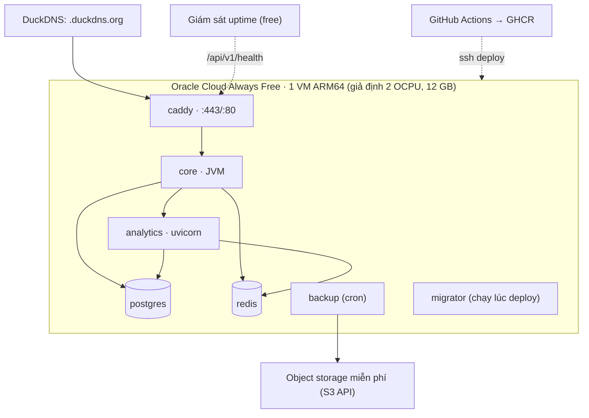

#### 3.10.2 Phân bổ tài nguyên theo container

| Container | Giới hạn RAM | CPU (shares) | Cấu hình chính |
|---|---|---|---|
| postgres | 3 GB | 1024 | `shared_buffers=768MB`, `effective_cache_size=2GB`, `work_mem=16MB`, `max_connections=60` |
| redis | 512 MB | 256 | `maxmemory 384mb`, `maxmemory-policy volatile-lru`, AOF everysec |
| core | 2 GB | 1024 | `-Xmx1280m`, virtual threads; pool Hikari 20 |
| analytics | 2,5 GB | 1024 | 2 worker uvicorn + 1 process scheduler (chạy riêng để không chạy trùng job); pool asyncpg 10 |
| caddy | 128 MB | 256 | HTTP/2, gzip/zstd, rate limit cơ bản |
| backup, migrator | 256 MB | 128 | Chạy theo lịch hoặc khi deploy |
| **Tổng** | **≈ 8,4 GB** | — | Dư ≈ 3,5 GB cho hệ điều hành, cache file, đột biến |

**Lưu trữ:** block volume ≤ 200 GB.

- Postgres: khoảng 3 GB ở R1 (nến 5 năm khoảng 0,5 GB kèm index; nhật ký AI khoảng 0,3 GB/năm).
- Backup cục bộ: khoảng 2 GB.
- Image Docker: khoảng 3 GB.

#### 3.10.3 Ngân sách quota dịch vụ miễn phí

Số liệu là mức công bố bởi nguồn thứ cấp tại 10/2026; phải kiểm tra lại trên trang chính thức ở WP-14/WP-22.

| Dịch vụ | Quota tham chiếu | Nhu cầu ước tính (beta ≤ 100 người dùng hoạt động) | Biện pháp |
|---|---|---|---|
| Groq (model `gpt-oss-120b` hoặc tương đương) | ~30 RPM, ~1.000 request/ngày | Tóm tắt ≤ 200/ngày (1 bản/mã/ngày, chỉ mã được xem) + hỏi đáp ≤ 500/ngày (50 người × 10) | Nhà cung cấp chính; cap 900/ngày |
| Google Gemini API (free) | Theo AI Studio, không công bố cố định | Dự phòng 1 | Chỉ gửi dữ kiện thị trường (dữ liệu free tier có thể được dùng để cải thiện sản phẩm) |
| OpenRouter `:free` | ~20 RPM, ~50 request/ngày | Dự phòng 2 | cap 45/ngày |
| Email miễn phí | Theo nhà cung cấp (OQ-047) | Xác minh + đặt lại + cảnh báo email ≤ 150/ngày | Ưu tiên push cho cảnh báo; tối đa 5 email cảnh báo/người/ngày |
| Expo Push, Web Push | Miễn phí | ≤ 2.000/ngày | — |
| GitHub Actions | Repo public: không giới hạn; repo private: hạn mức phút miễn phí | ~20 lần chạy/ngày × ≤ 15 phút | Cache Gradle, uv, pnpm |
| Oracle egress | Mức Always Free | Web tĩnh + API < 50 GB/tháng | — |

#### 3.10.4 Phương án "online, miễn phí, lâu dài"

| Phương án | Chi phí | Luôn bật | Đủ tài nguyên cho Java + Python + Postgres | Rủi ro | Kết luận |
|---|---|---|---|---|---|
| **Oracle Cloud Always Free VM ARM** | 0 (cần thẻ để xác minh) | Có | Có (kể cả mức đã giảm 2 OCPU/12 GB) | Thu hồi khi idle (CPU, mạng, RAM cùng < 20% trong 7 ngày; hệ thống dùng RAM > 20% nên không rơi vào trường hợp này); quota có thể giảm; tài nguyên có thể hết ở region | **Chọn** |
| Google Cloud Run (free tier) + Neon/Supabase Postgres free + Upstash Redis free | 0 | Scale-to-zero, khởi động nguội | Postgres free ~0,5 GB; job định kỳ phải gọi qua scheduler | Dữ liệu nến 5 năm vượt 0,5 GB; giới hạn nhiều nơi | Dự phòng 1 (chỉ khi cắt bớt dữ liệu) |
| Máy cá nhân + Cloudflare Tunnel | Tiền điện | Phụ thuộc máy | Có | Mất điện/mạng; IP nhà | Dự phòng 2 / môi trường staging |
| Render free | 0 | Ngủ sau một thời gian không có truy cập | — | Postgres free **hết hạn sau 30 ngày** | Loại |
| GCP e2-micro Always Free | 0 | Có | **Không** (1 GB RAM; chỉ một số region ở Mỹ) | — | Loại |

**Bảo đảm khả năng chuyển nhà cung cấp (NFR-D02):** một file `docker-compose.yml` cho mọi môi trường; `infra/bootstrap.sh` cài Docker và kéo image; khôi phục bằng `infra/restore.sh <backup>`; DNS DuckDNS đổi IP bằng một lệnh. Diễn tập mỗi quý.

### 3.11 Patterns Use View

| Mẫu | Vị trí | Lý do |
|---|---|---|
| Modular monolith (Spring Modulith) | Core | Ranh giới module rõ, kiểm tra tự động, triển khai một khối (ADR-001) |
| Hexagonal (ports & adapters) | Providers, LLM, Notification, OrderGateway | Thay nhà cung cấp không sửa domain (SC-010) |
| BFF | `core.marketgw` | Một cổng cho client, áp quyền và quota |
| Cache-aside + single-flight | Analytics providers, Core marketgw | Bảo vệ nguồn miễn phí (FR-033) |
| Transactional outbox | `core.notification` | Không mất thông báo khi kênh lỗi, không cần message broker |
| Consumer group (Redis Streams) | `s:quotes` | Xử lý mỗi chu kỳ đúng một lần, có ACK |
| Circuit breaker + retry có backoff | Resilience4j (Core → Analytics), tenacity và breaker tự viết (Analytics → bên ngoài) | NFR-A03 |
| Chain of responsibility | RiskGuard (`RiskRule`), guardrails AI | Thêm hoặc bớt quy tắc độc lập, test từng quy tắc |
| Sổ cái chỉ ghi thêm + projection | `paper.ledger_entries` → `paper.positions` | Kiểm toán, đối soát (ADR-013) |
| Idempotency key | `POST /paper/orders`, `alert_events` | Chống trùng khi client thử lại |
| Feature flag | `core.feature_flags` | Tính năng nhạy cảm pháp lý (FR-045) |

---

## 4. Design Elements

### 4.1 Thuộc tính phần tử thiết kế

| ID | Tên | Loại | Mục đích | Chức năng | FR/NFR |
|---|---|---|---|---|---|
| DE-01 | Web app | SPA | Giao diện người dùng và quản trị trên trình duyệt | Màn hình: Tổng quan, Mã, Theo dõi, Cảnh báo, Giả lập, Trợ lý AI, Cài đặt/Quyền riêng tư, Quản trị | UI-001 đến UI-007, NFR-U01 đến NFR-U03, NFR-P07 |
| DE-02 | Mobile app | Expo | Theo dõi và cảnh báo trên điện thoại | Đăng nhập, theo dõi, chi tiết mã, AI, cảnh báo push, giả lập | UI-002, NFR-U04, FR-097 |
| DE-03 | Caddy | Proxy | Ranh giới tin cậy Internet | TLS, web tĩnh, `/api` → Core, header bảo mật | NFR-S03, NFR-S09 |
| DE-04.02 | identity | Module | Danh tính và phiên | FR-001 đến FR-009, FR-018 | NFR-S02, NFR-S04, NFR-S05 |
| DE-04.03 | consent | Module | Pháp lý phía người dùng | FR-011 đến FR-017 | BR-001, BR-065 đến BR-067 |
| DE-04.04 | marketgw | Module | BFF và quota | FR-021 đến FR-023, FR-050 đến FR-054, FR-060 đến FR-062, FR-181 | NFR-P01, NFR-P02 |
| DE-04.05 | quotes | Module | Đọc giá, phát sự kiện | Dùng cho FR-091, FR-106, FR-109 | FR-030 |
| DE-04.06 | watchlist | Module | Theo dõi | FR-080 đến FR-082 | — |
| DE-04.07 | alerting | Module | Cảnh báo | FR-090 đến FR-095 | FR-092 |
| DE-04.08 | notification | Module | Gửi thông báo | FR-096, FR-097; email của identity | IR-004, IR-005 |
| DE-04.09 | paper | Module | Giả lập + RiskGuard + sổ cái | FR-100 đến FR-117 | NFR-P05, NFR-A04 |
| DE-04.10 | admin | Module | Vận hành | FR-210 đến FR-215 | FR-018 |
| DE-04.11 | audit | Module | Kiểm toán | FR-216 | NFR-S08 |
| DE-04.12 | support | Module | Hỗ trợ | FR-220, FR-221 | — |
| DE-04.13 | telemetry | Module | Đo hành vi sử dụng (ẩn danh, có đồng ý) | FR-223, FR-224 | NFR-PR01 |
| DE-05.02 | providers | Package | Truy cập nguồn | IR-001, IR-002, FR-032, FR-033 | SC-006, SC-010 |
| DE-05.03 | ingestion | Package | Thu thập theo lịch | FR-020, FR-022, FR-024 đến FR-027 | NFR-O03 |
| DE-05.04 | marketdata | Package | Lưu và kiểm tra dữ liệu | FR-028, FR-031 | FR-030 |
| DE-05.05 | quant | Package | Tính toán thuần | FR-040 đến FR-045, FR-051, FR-052 | NFR-M01 |
| DE-05.06 | fundamentals | Package | Chỉ số cơ bản | FR-026, FR-053 | — |
| DE-05.07 | ai | Package | AI an toàn | FR-060 đến FR-074 | NFR-AI01 đến NFR-AI04 |
| DE-05.08 | research (R2) | Package | Bộ lọc, kiểm thử lịch sử | FR-120 đến FR-145 | NFR-P06 |
| DE-06 | PostgreSQL | CSDL | Lưu bền vững | Mọi DR | NFR-A02, NFR-A04 |
| DE-07 | Redis | Cache/luồng | Dữ liệu nóng, sự kiện | 3.5.3 | NFR-P01, NFR-P04 |
| DE-08 | migrator | Công cụ | Migration | — | NFR-D01 |
| DE-09 | ops | Script | Sao lưu, khôi phục | — | NFR-A02, NFR-D02 |
| DE-10 | CI/CD | Pipeline | Build, test, deploy | — | NFR-D03, NFR-S07, NFR-S10, NFR-M02, NFR-M03 |

### 4.2 Phân bổ tài nguyên

Xem 3.10.2 (RAM, CPU, lưu trữ theo container) và 3.10.3 (quota dịch vụ ngoài). Hệ thống không dùng GPU vì mọi mô hình AI chạy qua API của nhà cung cấp (ADR-008).

---

## 5. Design Rationale

> Mỗi ADR gồm: bối cảnh, quyết định, phương án bị loại kèm lý do, hệ quả.

**ADR-001: Hai service (Core Java modular monolith + Analytics Python) trên một VM**

- **Bối cảnh:** SC-001, SC-002, SC-005; RAM có hạn; công việc được giao cho AI agent.
- **Quyết định:** Core là modular monolith Spring (Modulith); Analytics là một FastAPI. Chạy chung Postgres và Redis.
- **Loại bỏ:**
  - Microservices theo module: tốn RAM, khó vận hành và khó phối hợp agent.
  - Một monolith Java duy nhất: mất hệ sinh thái Python (vnstock, pandas).
  - Chỉ Python: trái quyết định của founder.
  - Node như dự án cũ: trái DEC-011.
- **Hệ quả:** có 2 ngôn ngữ và 2 bộ test; hợp đồng nội bộ phải ổn định (WP-02).

**ADR-002: Chia trách nhiệm Java và Python**

- **Quyết định:** Java giữ trạng thái người dùng, sổ cái, RiskGuard, bảo mật. Python giữ dữ liệu thị trường, định lượng, AI.
- **Lý do:** sổ cái cần kiểu chặt và giao dịch ACID trong cùng module với tài khoản; xử lý dữ liệu và LLM thuận hơn trên Python.
- **Loại bỏ:** đặt giả lập ở Python (gần dữ liệu giá hơn) vì trạng thái người dùng sẽ bị chia ra hai nơi. Giá đọc từ Redis nên Java không chịu thêm độ trễ đáng kể.

**ADR-003: Một PostgreSQL, mỗi bên sở hữu schema riêng, role CSDL ép một bên ghi**

- **Loại bỏ:**
  - Hai CSDL riêng: tốn RAM.
  - TimescaleDB: không cần cho khoảng 10 triệu dòng.
  - Postgres managed miễn phí (Neon, Supabase ~0,5 GB): không đủ chỗ cho dữ liệu nến.
- **Hệ quả:** khi tách ra ở R3 chỉ cần đổi chuỗi kết nối.

**ADR-004: Redis cho giá nóng, tổng quan, luồng sự kiện, quota**

- **Loại bỏ:**
  - Kafka, RabbitMQ: nặng so với VM.
  - Postgres LISTEN/NOTIFY: thông điệp không bền, không có consumer group, tạo thêm tải ghi 1.700 dòng mỗi phút.
- **Hệ quả:** Redis là điểm lỗi đơn. Bật AOF; nếu Redis mất, giá sẽ được nạp lại ở chu kỳ kế tiếp.

**ADR-005: REST đồng bộ cho truy vấn Core → Analytics; Redis Streams cho sự kiện giá**

- **Loại bỏ:** gRPC, vì agent dễ sinh client từ OpenAPI hơn và hệ thống không cần hiệu năng gRPC.

**ADR-006: Hạ tầng Oracle Always Free + Docker Compose + Caddy + DuckDNS**

- Xem bảng 3.10.4.
- **Web phục vụ cùng origin với API:** cookie refresh `SameSite=Strict` hoạt động mà không cần CORS. Phương án đặt web trên CDN ở tên miền khác buộc dùng cookie bên thứ ba, vốn bị trình duyệt chặn.
- **Hệ quả:** phụ thuộc chính sách free của Oracle. Rủi ro này được giảm bằng NFR-D02 và diễn tập mỗi quý.

**ADR-007: Dữ liệu qua port `MarketDataProvider`**

- **Quyết định:** vnstock làm adapter chính; KBS và VPS làm adapter phụ, port ý tưởng từ dự án cũ.
- **Loại bỏ:**
  - Scrape HTML: dễ vỡ, rủi ro điều khoản.
  - Mua feed trả phí ở R1: trái CON-011.
- **Hệ quả:** dữ liệu miễn phí chỉ dùng cho phát triển và beta kín (SC-006). Sang R3 chỉ cần thêm adapter cho nguồn có giấy phép.

**ADR-008: LLM qua cổng đa nhà cung cấp gói miễn phí**

- **Quyết định:** thứ tự Groq → Gemini → OpenRouter. Đường nâng cấp có trả phí ở R3 là Claude API (ví dụ `claude-haiku-5-5` cho tóm tắt, `claude-sonnet-5-5` cho hỏi đáp), chỉ cần thêm một adapter.
- **Loại bỏ:**
  - Tự host model: không có GPU miễn phí; CPU ARM 2 nhân quá chậm.
  - Một nhà cung cấp duy nhất: quota quá thấp.
- **Hệ quả:** chất lượng tiếng Việt khác nhau giữa nhà cung cấp. Pipeline kiểm tra tất định là thứ bảo đảm an toàn, không phụ thuộc model.

**ADR-009: "Dữ kiện vào, lời văn ra" + chú thích `[F<n>]` + kiểm tra tất định**

- **Loại bỏ:**
  - Để LLM tự gọi công cụ lấy số liệu: khả năng dùng công cụ của model miễn phí không ổn định, khó kiểm chứng.
  - LLM làm giám khảo ở R1: tốn gấp đôi quota. Có thể bổ sung ở R2 cho các trường hợp ranh giới.
- **Hệ quả:** văn bản bớt "tự nhiên" nhưng kiểm chứng được 100% số liệu (FR-064).

**ADR-010: Spring Security tự quản (JWT EdDSA, refresh token dạng chuỗi ngẫu nhiên có xoay vòng, Argon2id, TOTP cho admin)**

- **Loại bỏ:**
  - Keycloak: cần ≥ 1 GB RAM, thêm việc vận hành.
  - Firebase/Supabase Auth: dữ liệu cá nhân lưu ở nước ngoài và bị khóa vào nhà cung cấp (SC-009).

**ADR-011: Client là React SPA + Expo; iOS dùng PWA ở R1**

- **Loại bỏ:**
  - Flutter: không dùng chung TypeScript với web.
  - Next.js SSR: thêm runtime Node, không cần cho SPA sau đăng nhập.
  - Phát hành App Store ở R1: có phí (SC-013).

**ADR-012: R1 làm mới giá bằng polling 60 giây; SSE ở R2**

- **Lý do:** nguồn miễn phí cũng chỉ cập nhật theo chu kỳ, nên WebSocket không đem lại giá trị ở R1.

**ADR-013: Sổ cái chỉ ghi thêm + projection vị thế + đối soát hằng ngày**

- **Loại bỏ:** chỉ lưu cột số dư có thể sửa, vì không kiểm toán được và lỗi không được phát hiện.

**ADR-014: Contract-first và gói việc cỡ agent**

- **Quyết định:** OpenAPI, `schema.sql` và `AGENTS.md` là nguồn sự thật. Claude audit từng gói việc.
- **Loại bỏ:** code-first, vì agent dễ lệch khỏi thiết kế khi không có hợp đồng.

**ADR-015: Flyway là công cụ migration duy nhất cho mọi schema**

- **Loại bỏ:**
  - Flyway + Alembic: hai công cụ, hai lịch sử, dễ xung đột.
  - Hibernate `ddl-auto`: không an toàn.
- **Hệ quả:** migration của Analytics cũng viết bằng SQL trong `db/migrations`.

---

## 6. Traceability & QA

### 6.1 Ma trận phần tử thiết kế ↔ yêu cầu

| Phần tử | View | FR | NFR / QAS | UC |
|---|---|---|---|---|
| identity | 3.3.1, SD-01, SD-02, ST-01 | FR-001 đến FR-009, FR-018, FR-019 | NFR-S01 đến NFR-S05, QAS-05 | UC-001, UC-002, UC-003 |
| consent | SD-01, SD-07 | FR-011 đến FR-017 | NFR-PR01 | UC-004, UC-013, UC-016 |
| marketgw | 3.6.1, SD-04, SD-05 | FR-021 đến FR-023, FR-050 đến FR-054, FR-060, FR-062, FR-181 | NFR-P01, NFR-P02 | UC-005, UC-006, UC-007 |
| quotes | SD-03, 3.5.3 | FR-030 | NFR-A03 | UC-010, UC-011 |
| watchlist | 3.6.1 | FR-080 đến FR-082 | — | UC-008 |
| alerting | SD-03, ST-02, ALG-09 | FR-090 đến FR-095 | — | UC-009, UC-010 |
| notification | SD-01, SD-03, 3.11 | FR-096, FR-097 | — | UC-010 |
| paper | SD-06, ST-03, ST-04, ALG-10 đến ALG-13 | FR-100 đến FR-117 | NFR-P05, NFR-A04, QAS-02 | UC-011, UC-012, UC-017, UC-021 |
| admin | 3.6.1 | FR-210 đến FR-215, FR-217 | — | UC-015 |
| telemetry | 3.6.1 | FR-223, FR-224 | NFR-PR01 | — |
| audit | 3.11 | FR-216 | NFR-S08 | (mọi UC) |
| support | 3.6.1 | FR-220, FR-221 | — | — |
| providers | 3.3.2, ALG-03, ADR-007 | FR-032, FR-033 | QAS-03, QAS-10 | UC-014 |
| ingestion | ALG-01, ALG-02, ST-06, ST-07 | FR-020, FR-022, FR-024 đến FR-027 | NFR-O03, QAS-13 | UC-014 |
| marketdata | 3.5 | FR-028, FR-029, FR-031 | FR-030 | UC-014 |
| quant | ALG-04 đến ALG-06 | FR-040 đến FR-045, FR-051, FR-052 | NFR-P04, QAS-01 | UC-005, UC-006 |
| fundamentals | 3.3.2 | FR-026, FR-053 | — | UC-006 |
| ai | SD-04, SD-05, ST-05, ALG-07, ALG-08, 3.6.3 | FR-060 đến FR-074 | NFR-AI01 đến NFR-AI04, QAS-06 đến QAS-08 | UC-006, UC-007, UC-015 |
| research (R2) | ALG-14 | FR-120 đến FR-145 | NFR-P06 | UC-018 đến UC-020 |
| Postgres + schema | 3.5, schema.sql | DR-001 đến DR-009 | NFR-A02, NFR-A04 | — |
| Caddy, infra, CI/CD | 3.10, ADR-006 | FR-222 | NFR-D01 đến NFR-D03, NFR-S03, NFR-S07, NFR-S10, QAS-04, QAS-09, QAS-11, QAS-12 | — |

### 6.2 Kiểm tra đầy đủ

| Kiểm tra | Kết quả |
|---|---|
| FR R1 có phần tử thiết kế | Đạt: mọi FR R1 trong SRS 3.2 xuất hiện ở 6.1 |
| NFR R1 có view hoặc thuật toán đáp ứng | Đạt |
| FR R2 | Đạt ở mức thành phần (research, schema `strategy`/`research`, ALG-14) |
| FR R3–R4 | Chỉ có điểm mở rộng (`PaymentGateway`, `OrderGateway`, ST-08, SD-08). Thiết kế chi tiết hoãn có chủ đích |
| Phần tử không trỏ về yêu cầu | 0 |
| Điểm chưa rõ | Bảng bước giá (OQ-048), mốc giờ phiên (BRD OQ-012), quota chính thức của LLM và email (OQ-047), phí mặc định (OQ-044). Tất cả nằm trong cấu hình, không chặn thiết kế |

### 6.3 Đối chiếu checklist IEEE 1016-2009

| # | Mục checklist | Trạng thái | Vị trí |
|---|---|---|---|
| 1 | Design Subject Scope | Đạt | 1.1, 1.2, 1.4 |
| 2 | Context View | Đạt | 3.1 |
| 3 | Stakeholder Identification | Đạt | 2.1 |
| 4 | Design Concerns | Đạt | 2.2, 2.3 |
| 5 | Composition View | Đạt | 3.2 |
| 6 | Logical View | Đạt | 3.3 |
| 7 | Dependency View | Đạt | 3.4 |
| 8 | Interaction View | Đạt | 3.7 (SD-01 đến SD-08) |
| 9 | Information View | Đạt | 3.5, schema.sql |
| 10 | Interface View | Đạt một phần: bảng endpoint đầy đủ; file OpenAPI chi tiết được sinh ở WP-02 | 3.6 |
| 11 | State Dynamics View | Đạt | 3.8 |
| 12 | Algorithm View | Đạt; ALG-06 chờ port ngưỡng từ dự án cũ | 3.9 |
| 13 | Element Attributes | Đạt | 4.1 |
| 14 | Resource Allocation | Đạt | 3.10, 4.2 |
| 15 | Decision Documentation | Đạt | 5 |
| 16 | Alternatives Considered | Đạt | 5 |
| 17 | Assumptions & Constraints | Đạt | 1.3 |
| 18 | Requirements Traceability | Đạt | 6.1 |
| 19 | Completeness Check | Đạt có điều kiện | 6.2 |

---

## 7. Kế hoạch triển khai bằng AI agent

> Mô hình founder chọn (SRC-015): **Claude lập kế hoạch và audit; OpenCode hoặc agent dùng model miễn phí thực thi; Claude audit kết quả và giao việc tiếp.**

### 7.1 Vai trò

| Vai trò | Ai | Trách nhiệm |
|---|---|---|
| Planner / Architect | Claude | Viết brief gói công việc (WP); giữ SRS và SDD là nguồn sự thật; chia nhỏ khi WP quá lớn |
| Implementer | OpenCode với model miễn phí (ví dụ các model `*-free` trên OpenCode Zen; danh sách thay đổi thường xuyên) hoặc agent miễn phí khác | Code + test trong đúng phạm vi WP; chạy lệnh kiểm tra; báo cáo |
| Auditor | Claude | Đối chiếu diff, kết quả test với tiêu chí chấp nhận và checklist audit; trả `PASS` hoặc `FIX` kèm phát hiện đánh số |
| Owner | Founder | Tạo tài khoản dịch vụ miễn phí, cấp secret, merge PR, quyết định các OQ |

### 7.2 Vòng làm việc

```mermaid
flowchart LR
    P["Claude: viết brief WP-xx"] --> I["Agent: nhánh wp-xx, code + test"]
    I --> CI["CI: build, test, lint, kiến trúc, bảo mật"]
    CI --> A{"Claude: audit"}
    A -- "PASS" --> M["Founder: merge"]
    M --> P
    A -- "FIX (≤ 3 vòng)" --> I
    A -- "Quá 3 vòng" --> S["Claude: chia nhỏ WP hoặc tự viết phần khó"]
    S --> I
```

### 7.3 Cấu trúc repo (tạo ở WP-00)

```text
/AGENTS.md                      quy tắc cho coding agent (đọc trước mọi WP)
/apps/web                       React + Vite + TS
/apps/mobile                    Expo
/services/core                  Spring Boot (Gradle Kotlin DSL)
/services/analytics             FastAPI (uv)
/contracts/openapi              public.yaml, internal.yaml
/contracts/events               redis-keys.md, s-quotes.schema.json
/db/migrations                  V1__baseline.sql (từ docs/design/schema.sql), V2__...
/infra                          docker-compose.yml, Caddyfile, bootstrap.sh, backup.sh, restore.sh, runbooks/
/docs                           requirements/, design/
/.github/workflows              ci.yml, deploy.yml
```

### 7.4 Nội dung bắt buộc của AGENTS.md

1. Chỉ sửa file trong phạm vi WP. Không đổi `contracts/` và `db/migrations` cũ, trừ khi WP cho phép.
2. Mọi thay đổi có test. Chạy đúng lệnh kiểm tra trong WP trước khi báo xong.
3. Không thêm dịch vụ hay thư viện trả phí (SC-005). Không commit secret.
4. Tiền: Java `long`/`BigDecimal`, Python `int`/`Decimal`. Cấm `double`/`float` cho tiền và giá.
5. Thời gian: `Asia/Ho_Chi_Minh` cho logic phiên, `timestamptz` khi lưu. Không gọi trực tiếp `now()`; dùng `Clock` được inject để test được.
6. Fail-closed: không bao giờ trả giá trị mặc định 0 hoặc dữ liệu giả khi thiếu dữ liệu.
7. Chuỗi hiển thị cho người dùng bằng tiếng Việt. Không dùng từ ngữ khuyến nghị trong UI (`nên mua`, `cơ hội`, `điểm mua`, ...).
8. Không gửi dữ liệu cá nhân tới dịch vụ bên ngoài, trừ email và push gửi tới chính người dùng.
9. Báo cáo cuối WP gồm: danh sách file thay đổi, lệnh đã chạy và kết quả, các điểm chưa làm.

### 7.5 Mẫu brief WP (Claude → agent)

```markdown
## WP-xx: <tên>
**Mục tiêu:** <1–2 câu>
**Tham chiếu:** SRS <FR/NFR/UC>, SDD <mục>
**Phạm vi được sửa:** <thư mục/file>
**Ngoài phạm vi:** <...>
**Đầu vào có sẵn:** <contracts, schema, module đã có>
**Việc cần làm:** 1. ... 2. ...
**Tiêu chí chấp nhận (lệnh chạy được):**
- `./gradlew :core:test --tests "*RiskGuard*"` xanh; độ phủ module ≥ 80%
- <kịch bản cụ thể, input → output mong đợi>
**Checklist audit áp dụng:** A1–A10 (+ Sâu nếu đánh dấu)
**Báo cáo:** theo mục 9 của AGENTS.md
```

### 7.6 Checklist audit của Claude

| # | Mục | Cách kiểm tra |
|---|---|---|
| A1 | Đúng phạm vi WP, không sửa file ngoài phạm vi | Diff |
| A2 | Khớp hợp đồng (OpenAPI, schema, khóa Redis) | Contract test trong CI; đọc diff |
| A3 | Có test cho đường chính, đường thay thế, đường ngoại lệ của UC liên quan | Đọc test |
| A4 | CI xanh; độ phủ đạt NFR-M01 | Báo cáo CI |
| A5 | Quy tắc kiến trúc (Modulith, import-linter) đạt | CI |
| A6 | Bảo mật: kiểm tra quyền ở mọi endpoint; kiểm tra input; không có secret; không có dữ liệu cá nhân trong log hay payload ra ngoài | Đọc diff; quét bí mật |
| A7 | Fail-closed và xử lý lỗi theo RFC 9457 | Test lỗi |
| A8 | Kiểu tiền, thời gian, múi giờ đúng quy ước | Đọc diff |
| A9 | Migration chỉ thêm, không sửa file cũ | Diff `db/migrations` |
| A10 | Không thêm phụ thuộc trả phí; tài liệu (README module, OpenAPI) đã cập nhật | Diff |
| **Sâu** | Claude đọc từng dòng, tự thêm test phản ví dụ | Áp cho WP-04, WP-05, WP-15, WP-19 |

### 7.7 Danh sách gói công việc R1

| WP | Tên | Phạm vi | Tham chiếu | Phụ thuộc | Cỡ | Audit |
|---|---|---|---|---|---|---|
| WP-00 | Khung repo, AGENTS.md, CI cơ bản, Compose (Postgres, Redis) | root, infra, .github | NFR-D01, NFR-D03 | — | S | Tiêu chuẩn |
| WP-01 | Migration baseline từ schema.sql + container migrator | db, infra | 3.5, ADR-015 | WP-00 | S | Tiêu chuẩn |
| WP-02 | Hợp đồng OpenAPI public và internal + sinh client/server stub | contracts | 3.6 | WP-00 | M | Tiêu chuẩn |
| WP-03 | Khung Core: module, lỗi RFC 9457, bảo mật, correlation id, health | services/core | 3.2, 3.4.1 | WP-01, WP-02 | M | Tiêu chuẩn |
| WP-04 | Identity: đăng ký (kèm mã mời), xác minh, đăng nhập, refresh xoay vòng, khóa tạm, quên/đổi mật khẩu, adapter email (dev ghi log) | core.identity, core.notification (email) | FR-001 đến FR-009, FR-019, SD-01, SD-02 | WP-03 | L | **Sâu** |
| WP-05 | Consent: điều khoản, đồng ý, rủi ro phái sinh, xuất/xóa dữ liệu + job xóa | core.consent | FR-011 đến FR-017, SD-07 | WP-04 | M | **Sâu** |
| WP-06 | Admin: TOTP, quản lý người dùng, mã mời, phát hành điều khoản, cờ tính năng, audit | core.admin, core.audit | FR-018, FR-210, FR-211, FR-214, FR-216, FR-217 | WP-04 | M | Tiêu chuẩn |
| WP-07 | Khung Analytics: FastAPI, cấu hình, token dịch vụ, log JSON, scheduler riêng | services/analytics | 3.2, 3.4.2 | WP-01, WP-02 | M | Tiêu chuẩn |
| WP-08 | Port provider + adapter vnstock + giới hạn tần suất + single-flight + provenance | analytics.providers | IR-001, IR-002, FR-028, FR-033, ALG-03 | WP-07 | M | Tiêu chuẩn |
| WP-09 | Adapter KBS, VPS (port ý tưởng từ dự án cũ) + chuyển nguồn | analytics.providers | FR-032 | WP-08 | M | Tiêu chuẩn |
| WP-10 | Ingestion: danh mục mã, giá, chỉ số, nến EOD, backfill, báo cáo tài chính, lịch giao dịch, trạng thái phiên, kiểm tra chất lượng, cách ly | analytics.ingestion, marketdata | FR-020 đến FR-031, ALG-01, ALG-02 | WP-08 | L | Tiêu chuẩn |
| WP-11 | Quant: chỉ báo + bảng mô tả quy tắc + test golden | analytics.quant | FR-051, FR-052, ALG-04 | WP-07 | M | Tiêu chuẩn |
| WP-12 | Tổng quan: độ rộng, top movers, ngành, thẻ nhận định theo quy tắc | analytics.quant | FR-040 đến FR-044, ALG-05 | WP-10, WP-11 | M | Tiêu chuẩn |
| WP-12b | Trạng thái thị trường + hỗ trợ/kháng cự (port từ dự án cũ, sau cờ tính năng) | analytics.quant | FR-045, ALG-06 | WP-12 | M | Tiêu chuẩn |
| WP-13 | Core BFF: endpoint thị trường, cache, quyền theo gói, đọc giá từ Redis | core.marketgw, core.quotes | FR-021 đến FR-023, FR-030, FR-050, FR-181 | WP-03, WP-10 | M | Tiêu chuẩn |
| WP-14 | Cổng LLM: adapter Groq, Gemini, OpenRouter; quota; breaker; chuyển nhà cung cấp | analytics.ai.llm | FR-072, ALG-08 | WP-07 | M | Tiêu chuẩn |
| WP-15 | Guardrails: che dữ liệu cá nhân, khuyến nghị, cam kết lợi nhuận, số liệu + bộ red-team ban đầu ≥ 300 câu | analytics.ai.guardrails | FR-064 đến FR-066, FR-068, FR-070, ALG-07 | WP-07 | L | **Sâu** |
| WP-16 | Tóm tắt AI + hỏi đáp + quota ở Core + nhật ký + phản hồi + lấy mẫu rà soát | analytics.ai, core.marketgw | FR-060 đến FR-063, FR-067, FR-069, FR-071, FR-073, FR-074 | WP-11, WP-14, WP-15, WP-13 | L | Tiêu chuẩn |
| WP-17 | Danh sách theo dõi | core.watchlist | FR-080 đến FR-082 | WP-13 | S | Tiêu chuẩn |
| WP-18 | Cảnh báo: CRUD, bộ đánh giá (consumer `s:quotes`), outbox, kênh email/Expo/Web Push, hộp thư | core.alerting, core.notification, core.quotes | FR-090 đến FR-097, ALG-09 | WP-13 | L | Tiêu chuẩn |
| WP-19 | Giả lập: tài khoản, RiskGuard, khớp, sổ cái, T+2, hết hạn, NAV/ngắt mạch, đối soát | core.paper | FR-100 đến FR-115, ALG-10 đến ALG-13 | WP-13 | L | **Sâu** |
| WP-20a | Web: khung, điều hướng, xác thực, cổng điều khoản/đồng ý, design tokens | apps/web | UI-001 đến UI-005, UC-001 đến UC-004 | WP-04, WP-05 | M | Tiêu chuẩn |
| WP-20b | Web: Tổng quan (treemap squarified), chi tiết mã (biểu đồ, chỉ báo, sổ lệnh, tóm tắt AI) | apps/web | UC-005, UC-006 | WP-12, WP-16 | L | Tiêu chuẩn |
| WP-20c | Web: Trợ lý AI, theo dõi, cảnh báo, hộp thư, Web Push | apps/web | UC-007 đến UC-010 | WP-16 đến WP-18 | M | Tiêu chuẩn |
| WP-20d | Web: Giả lập (đặt lệnh, danh mục, sổ cái, quy tắc) | apps/web | UC-011, UC-012 | WP-19 | M | Tiêu chuẩn |
| WP-20e | Web: Cài đặt/Quyền riêng tư, Quản trị (rà soát AI, ingest, cờ, chỉ số) | apps/web | UC-013, UC-015, FR-212, FR-213, FR-215 | WP-05, WP-06 | M | Tiêu chuẩn |
| WP-21 | Mobile (Expo): đăng nhập, theo dõi, chi tiết mã, AI, push, giả lập; build APK | apps/mobile | UI-002, NFR-U04 | WP-20a đến WP-20d | L | Tiêu chuẩn |
| WP-22 | Hạ tầng: tạo VM Oracle, bootstrap, Caddy + DuckDNS, deploy pipeline, backup/khôi phục, giám sát uptime, diễn tập | infra, .github | 3.10, NFR-A02, NFR-D02, NFR-O02 | WP-00 | M | Tiêu chuẩn |
| WP-23 | Báo cáo chỉ số tháng, banner sự cố, phản hồi/khiếu nại, sự kiện sử dụng | core.admin, core.support, core.telemetry | FR-215, FR-220, FR-221, FR-223, FR-224 | WP-06 | M | Tiêu chuẩn |
| WP-24 | Kiểm thử R1: E2E web (Playwright), mobile (Maestro), axe, tải 100 người dùng, chạy bộ red-team, checklist phát hành | toàn repo | NFR-P01 đến NFR-P07, NFR-U02, NFR-AI01 | tất cả | L | **Sâu** |

**Thứ tự đề xuất** (các nhánh song song khi có thể):

1. WP-00 → WP-01 → WP-02.
2. Song song: {WP-03 → WP-04 → WP-05 → WP-06} ‖ {WP-07 → WP-08 → WP-09 → WP-10} ‖ {WP-11, WP-14, WP-15}.
3. Tiếp theo: WP-12 → WP-13 → {WP-16, WP-17, WP-18, WP-19} → WP-20a–e → WP-21.
4. WP-22 bắt đầu sớm, ngay sau WP-00, để có môi trường staging.
5. WP-23, WP-24 sau cùng.

---

## 8. Câu hỏi mở và rủi ro của thiết kế

| ID | Nội dung | Ảnh hưởng | Owner | Trạng thái |
|---|---|---|---|---|
| OQ-052 | Chọn object storage miễn phí cho backup (Cloudflare R2, Backblaze B2 hay Object Storage của Oracle) và điều kiện mở tài khoản hiện hành | NFR-A02 | Founder | Open |
| OQ-053 | Region Oracle còn tài nguyên ARM (gần Việt Nam: Singapore, Tokyo, ...) và quota thực tế của tenancy | SA-003 | Founder | Open |
| OQ-054 | Ngưỡng của 7 trạng thái thị trường trong dự án cũ (để port ở WP-12b) | ALG-06 | Founder | Open |
| RSK-D01 | Endpoint KBS/VPS đổi định dạng mà không báo trước | Mất dữ liệu | Dev | Giảm bằng adapter + test hợp đồng với mẫu phản hồi lưu sẵn + chuyển nguồn |
| RSK-D02 | Model miễn phí của agent sinh code kém chất lượng ở phần bảo mật, tiền, AI | Lỗi nghiêm trọng | Claude | Audit "Sâu"; Claude có thể tự viết các WP này |
| RSK-D03 | Một VM là điểm lỗi đơn | Gián đoạn | Founder | NFR-A02, NFR-D02, diễn tập |

---

## 9. Tình trạng sẵn sàng

**Ready with conditions.** Đủ để bắt đầu WP-00 đến WP-03, WP-07, WP-11 ngay.

Trước WP-14, WP-18 và WP-22 cần đóng: OQ-047 (email), OQ-052 (backup), OQ-053 (region). Trước khi mở beta: BRD OQ-018 và OQ-051 (pháp lý).
