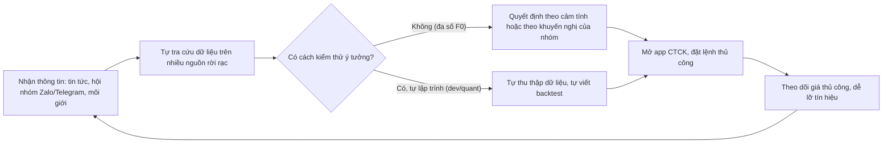
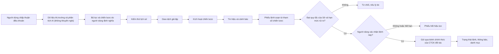
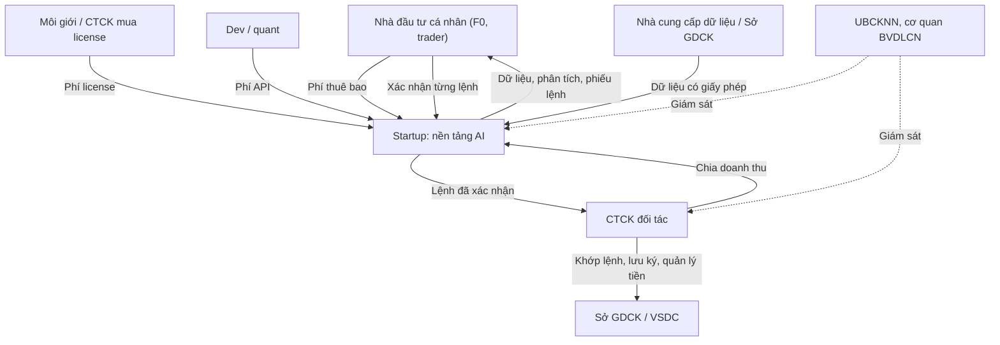

# Business Requirements Document (BRD)

**Tên sáng kiến:** Nền tảng AI hỗ trợ phân tích và giao dịch chứng khoán (tên tạm, chờ đặt tên chính thức: `OQ-002`)
**Tổ chức / đơn vị:** Startup (chưa có pháp nhân/tên chính thức: `OQ-001`)
**Mã tài liệu:** BRD-AITS-001 (mã tạm)
**Phiên bản:** 0.3
**Trạng thái:** Draft
**Chuẩn áp dụng:** IEEE 29148-2018
**Ngày cập nhật:** 2026-10-21

---

## 0. Tóm tắt kiểm chứng đầu vào

### 0.1 Đầu vào đã nhận

| Nguồn | Nội dung | Đánh giá |
|---|---|---|
| SRC-001 | `BRD_Prompt_IEEE_standard.md` v1.0 | Hướng dẫn phương pháp, không phải bằng chứng nghiệp vụ |
| SRC-002 | Phiên elicitation 1 với founder (2026-10-21) | Đã chốt loại sản phẩm, bối cảnh startup, người dùng mục tiêu |
| SRC-003 | Phiên elicitation 2 với founder (2026-10-21) | Đã chốt hướng pháp lý, mức tự động, nguồn doanh thu, loại tài sản |
| SRC-004 … SRC-014 | Desk research: văn bản/tin pháp lý, số liệu thị trường, đối thủ | Bằng chứng thứ cấp (báo chí, trang sản phẩm). Văn bản pháp luật gốc cần được luật sư đối chiếu |
| SRC-015 | Phiên elicitation 3 với founder (2026-10-21) | Đã chốt kênh Web + Mobile, stack Java Spring Boot + Python, R1 tối giản với mọi dịch vụ miễn phí, quy trình phát triển bằng AI agent |
| SRC-016 | Điều khoản sử dụng vnstock (GitHub, license-2026.09) | Ràng buộc khi dùng nguồn dữ liệu miễn phí cho mục đích thương mại |
| SRC-017 | Bản tổng kết dự án VN STOCK AI PRO do founder cung cấp (2026-10-21) | Dự án tham chiếu đang làm dở: tính năng, thuật toán, bài học. Dùng để tham khảo, sẽ viết mới (DEC-011) |

### 0.2 Thông tin còn thiếu

- Tên pháp nhân, tên sản phẩm, tên sponsor/PO (`OQ-001`–`OQ-003`).
- Chỉ tiêu mục tiêu (target) cho mọi chỉ số, timeline, ngân sách (`OQ-006`–`OQ-008`).
- Chưa phỏng vấn người dùng cuối. Mọi nhu cầu của F0, trader, môi giới và dev hiện là **giả thuyết `[Unverified]`** (`OQ-043`).
- Chưa có ý kiến pháp lý về ranh giới "công cụ" và "tư vấn đầu tư", cũng như về lệnh bán tự động (`OQ-018`, `OQ-019`).
- Chưa xác định CTCK đối tác, nhà cung cấp dữ liệu, bảng giá (`OQ-026`–`OQ-028`).

### 0.3 Điều chỉnh so với yêu cầu ban đầu

Yêu cầu ban đầu của founder là **bot giao dịch tự động hoàn toàn** và **tín hiệu mua/bán bằng AI**. Desk research cho thấy hai điểm vướng pháp lý:

1. Tháng 9/2023, UBCKNN yêu cầu các CTCK dừng robot đặt lệnh tự động, có biện pháp kỹ thuật ngăn chặn, và yêu cầu nhà đầu tư chấm dứt đặt lệnh tự động khi chưa được cho phép. Chưa tìm thấy văn bản nào nới lỏng yêu cầu này tính đến 2026-10-21 (SRC-004).
2. Khuyến nghị mua/bán/nắm giữ là "tư vấn đầu tư chứng khoán", một nghiệp vụ cần giấy phép. Năm 2026 đã có doanh nghiệp bị phạt 225 triệu đồng vì làm việc này khi chưa có phép (SRC-005).

Founder đã quyết định (SRC-003):

- **DEC-002:** chỉ bán công cụ, không đưa khuyến nghị. Người dùng tự định nghĩa chiến lược.
- **DEC-003:** chuyển sang **lệnh bán tự động**: hệ thống soạn phiếu lệnh, người dùng xác nhận từng lệnh. Bot tự động hoàn toàn được hoãn.

> **Diễn giải cần sponsor xác nhận (`OQ-041`):** để DEC-002 và DEC-003 không mâu thuẫn, BRD này quy định phiếu lệnh **chỉ được sinh ra từ tham số trong chiến lược của chính người dùng**. AI không tự chọn mã, chiều mua/bán hay khối lượng.

### 0.4 Ba rủi ro hàng đầu đối với chất lượng yêu cầu

1. **Ranh giới pháp lý chưa được xác nhận.** Nếu luật sư kết luận khác, nhóm yêu cầu C (phân tích AI) và G (lệnh bán tự động) có thể phải viết lại (`RSK-004`, `RSK-005`, `OQ-018`, `OQ-019`).
2. **Nhu cầu người dùng chưa được kiểm chứng.** SN-003 đến SN-008 mới là giả thuyết của founder, chưa có phỏng vấn khách hàng (`RSK-001`, `OQ-043`).
3. **Thiếu chỉ tiêu và ngưỡng định lượng.** 9 yêu cầu Must đang chứa ngưỡng `[TBD]`. Mọi mục tiêu kinh doanh đều chưa có target (`RSK-002`, `OQ-006`, `OQ-020`–`OQ-025`).

---

## 1. Document control

### 1.1 Thông tin tài liệu

| Thuộc tính | Giá trị |
|---|---|
| Title | Business Requirements Document: Nền tảng AI hỗ trợ phân tích và giao dịch chứng khoán |
| Document number | BRD-AITS-001 (tạm) |
| Version | 0.3 |
| Status | Draft |
| Author | Bản nháp do trợ lý AI soạn từ phiên elicitation với founder; tác giả chịu trách nhiệm: [TBD: OQ-003] |
| Contributors | Founder (SRC-002, SRC-003) |
| Reviewers | Product Owner, cố vấn pháp lý [TBD: OQ-003] |
| Approver | Founder / Executive sponsor [TBD: OQ-003] |
| Confidentiality | Internal – Confidential |
| Distribution list | Founder, PO, cố vấn pháp lý, nhà đầu tư vốn (nếu có) [TBD: OQ-015] |

### 1.2 Lịch sử phiên bản

| Version | Ngày | Tác giả | Tóm tắt thay đổi |
|---|---|---|---|
| 0.1 | 2026-10-21 | [TBD: OQ-003] | Tạo khung BRD theo IEEE 29148-2018 |
| 0.2 | 2026-10-21 | Trợ lý AI + Founder | Điền nội dung cho startup AI chứng khoán: bối cảnh, mục tiêu, phạm vi, 14 stakeholder, 72 yêu cầu, quy tắc, ràng buộc, rủi ro, truy vết. Cập nhật OQ-001–017 và bổ sung OQ-018–043 |
| 0.3 | 2026-10-21 | Trợ lý AI + Founder | Ghi nhận elicitation 3 (SRC-015) và dự án tham chiếu VN STOCK AI PRO (SRC-017): DEC-007 đến DEC-011, đóng OQ-029, thêm CON-011, RSK-014, BR-073 đến BR-075, cập nhật lộ trình R1–R5 (Mục 15.7) |

---

## 2. Executive summary

**Vấn đề và cơ hội.** Việt Nam có hơn **13,3 triệu tài khoản chứng khoán của nhà đầu tư cá nhân** tính đến cuối 6/2026, khoảng 13% dân số (SRC-006). Thị trường đã được FTSE Russell nâng hạng lên thị trường mới nổi thứ cấp, áp dụng từ 21/9/2026 (SRC-011). Phần lớn nhà đầu tư cá nhân được giả định là thiếu công cụ phân tích dễ hiểu và thiếu cách kiểm thử ý tưởng trước khi dùng tiền thật `[Unverified: OQ-043]`. Nhiều người phải dựa vào hội nhóm "phím hàng" không có giấy phép. Bằng chứng gián tiếp là các vụ xử phạt tư vấn đầu tư trái phép (SRC-005). Các CTCK lớn đã ra mắt trợ lý AI riêng như StockGuru của VPBankS và VinaStalk của Shinhan (SRC-010), nên cửa sổ cạnh tranh đang hẹp lại. Tác động định lượng của vấn đề đối với người dùng chưa được đo: `[TBD: OQ-004]`.

**Thay đổi đề xuất.** Startup xây dựng nền tảng **công cụ** gồm: dữ liệu thị trường; phân tích bằng AI tiếng Việt **không đưa khuyến nghị**; bộ lọc; chiến lược do người dùng tự định nghĩa; kiểm thử lịch sử; giao dịch giả lập; cảnh báo; và **lệnh bán tự động**, trong đó hệ thống soạn phiếu lệnh theo chiến lược của người dùng, người dùng xác nhận từng lệnh, và lệnh được gửi qua kênh chính thức của CTCK đối tác. Phạm vi gồm cổ phiếu HOSE/HNX/UPCoM và hợp đồng tương lai VN30F.

**Lợi ích kỳ vọng và chỉ số.** Bốn nguồn doanh thu: thuê bao freemium (MET-002, MET-003), license B2B cho môi giới/CTCK (MET-004), API cho dev/quant (MET-005), chia doanh thu với CTCK (MET-006, MET-007). Tăng trưởng người dùng được đo bằng MET-001 và MET-011. Tuân thủ được đo bằng MET-008 đến MET-010. Mọi target đều `[TBD: OQ-006]`.

**Đầu tư, timeline, rủi ro chính.** Ngân sách `[TBD: OQ-008]`. Timeline `[TBD: OQ-007]`. Rủi ro hàng đầu:

- Bị xác định là tư vấn đầu tư không phép (RSK-004).
- Lệnh bán tự động bị coi là đặt lệnh tự động (RSK-005).
- Không có CTCK đối tác, làm mất kênh đặt lệnh và nguồn doanh thu chia sẻ (RSK-006).
- CTCK cung cấp AI miễn phí, khiến khó thu phí (RSK-010).

**Quyết định đề nghị.** Phê duyệt phạm vi pha 1 như Mục 5. Phê duyệt ngân sách thuê **ý kiến pháp lý bằng văn bản** (OQ-018, OQ-019) và **khảo sát khách hàng** (OQ-043) **trước** khi đầu tư phát triển. Ra mắt thương mại có điều kiện: chỉ khi ASM-002 và ASM-003 được xác nhận.

---

## 3. Business context and problem statement

### 3.1 Hiện trạng quy trình (giả thuyết, cần kiểm chứng: `OQ-043`)

Robot đặt lệnh tự động đã bị UBCKNN yêu cầu dừng từ 9/2023 (SRC-004). Nhà đầu tư muốn giao dịch theo quy tắc hiện vẫn phải tự canh giá và đặt lệnh thủ công `[Unverified: OQ-043]`.

### 3.2 Đối tượng bị ảnh hưởng

| Nhóm đối tượng | Cách thức bị ảnh hưởng | Bằng chứng | Mức độ |
|---|---|---|---|
| Nhà đầu tư mới (F0) | Thiếu kiến thức, dễ phụ thuộc vào hội nhóm khuyến nghị không phép | SRC-005 (vụ xử phạt), SRC-006 (quy mô); nỗi đau cụ thể `[Unverified]` | Cao |
| Trader có kinh nghiệm | Phải canh giá thủ công, không tự động hóa được việc đặt lệnh theo quy tắc | SRC-004; nỗi đau cụ thể `[Unverified]` | Trung bình–Cao |
| Môi giới chứng khoán | Phải theo dõi nhiều khách hàng và nhiều mã cùng lúc | `[Unverified: OQ-043]` | Trung bình |
| Dev / quant | Dữ liệu phân mảnh, phải tự xây pipeline | Thư viện mở vnstock phổ biến và có gói Pro trả phí (SRC-010) là bằng chứng gián tiếp về nhu cầu | Trung bình |

### 3.3 Chi phí của việc không hành động

Đối với một startup chưa ra mắt, "không hành động" nghĩa là để mất cơ hội thị trường.

| Loại tác động | Mô tả | Giá trị định lượng | Nguồn |
|---|---|---|---|
| Doanh thu | Không khai thác được tệp >13,3 triệu tài khoản cá nhân đang tăng | Quy mô thị trường có thể khai thác: `[TBD: OQ-004]` | SRC-006 |
| Cạnh tranh | CTCK lớn đã tung trợ lý AI riêng, một số miễn phí (VinaStalk) | Thị phần mất đi: `[TBD: OQ-004]` | SRC-010 |
| Thời điểm | Dòng chú ý sau nâng hạng FTSE (từ 21/9/2026, hoàn tất 9/2027) | `[TBD]` | SRC-011 |
| Quy định | Luật Chứng khoán đang được sửa năm 2026 và có thể mở lộ trình giao dịch thuật toán. Doanh nghiệp đã có sẵn nền tảng xác nhận lệnh sẽ có lợi thế | `[Unverified]` | SRC-013, SRC-014 |

### 3.4 Nguyên nhân gốc và triệu chứng

| Triệu chứng quan sát được | Nguyên nhân gốc (giả thuyết) | Bằng chứng |
|---|---|---|
| F0 theo hội nhóm "phím hàng" | Thiếu công cụ phân tích dễ hiểu bằng tiếng Việt; thiếu cách thử nghiệm an toàn | SRC-005 (gián tiếp); `[Unverified]` |
| Trader lỡ điểm vào/ra lệnh | Không có cảnh báo theo chiến lược riêng; robot đặt lệnh bị cấm | SRC-004; `[Unverified]` |
| Dev/quant tốn công xây dữ liệu | Dữ liệu thị trường phân mảnh, quyền phân phối lại không rõ | SRC-010 (gián tiếp) |
| Thua lỗ lớn ở phái sinh | Đòn bẩy cao, giao dịch T+0, thiếu kiểm soát hạn mức cá nhân | `[Unverified: OQ-043]` |

### 3.5 Vì sao bây giờ (đề xuất, chờ sponsor xác nhận: `OQ-005`)

1. Số tài khoản cá nhân vượt 13,3 triệu (6/2026), tăng từ 12,05 triệu (1/2026) (SRC-006).
2. Nâng hạng FTSE có hiệu lực từ 21/9/2026 (SRC-011).
3. Luật Trí tuệ nhân tạo 134/2025/QH15 có hiệu lực từ 1/3/2026, có cơ chế sandbox (SRC-008). Luật Bảo vệ dữ liệu cá nhân 91/2025/QH15 có hiệu lực từ 1/1/2026 (SRC-007). Khung pháp lý đã rõ hơn trước.
4. Luật Chứng khoán dự kiến sửa trong năm 2026 (SRC-013).

---

## 4. Business drivers and objectives

### 4.1 Mục tiêu kinh doanh

| ID | Business driver | Objective (kết quả) | Metric ID | Baseline | Target | Timeframe | Source |
|---|---|---|---|---|---|---|---|
| BO-001 | Thị trường cá nhân >13,3 triệu tài khoản | Xây dựng tập người dùng cá nhân hoạt động thường xuyên | MET-001, MET-011 | 0 (chưa ra mắt, 2026-10-21) | [TBD: OQ-006] | [TBD: OQ-007] | SRC-002, SRC-006 |
| BO-002 | Mô hình thuê bao freemium | Tạo doanh thu định kỳ từ thuê bao cá nhân | MET-002, MET-003 | 0 | [TBD: OQ-006] | [TBD: OQ-007] | SRC-003 |
| BO-003 | Nhu cầu công cụ của môi giới/CTCK | Tạo doanh thu từ license B2B | MET-004 | 0 | [TBD: OQ-006] | [TBD: OQ-007] | SRC-003 |
| BO-004 | Nhu cầu dữ liệu của dev/quant | Tạo doanh thu từ gói API | MET-005 | 0 | [TBD: OQ-006] | [TBD: OQ-007] | SRC-003, SRC-010 |
| BO-005 | Quan hệ đối tác với CTCK | Tạo doanh thu chia sẻ từ tài khoản và giao dịch phát sinh qua nền tảng | MET-006, MET-007 | 0 | [TBD: OQ-006] | [TBD: OQ-007] | SRC-003 |
| BO-006 | Rủi ro pháp lý (robot đặt lệnh, tư vấn không phép, dữ liệu cá nhân) | Vận hành không vi phạm quy định chứng khoán, dữ liệu cá nhân và AI | MET-008, MET-010 | Không áp dụng | MET-008 = 0; MET-010 = 0% (đề xuất) | Liên tục từ ngày ra mắt | SRC-004, SRC-005, SRC-007, SRC-008 |
| BO-007 | Bảo vệ nhà đầu tư và uy tín | Không có lệnh ngoài ý muốn người dùng; số liệu AI đưa ra chính xác | MET-009, MET-012 | Không áp dụng | MET-009 = 100% (bắt buộc theo BRU-002); MET-012 [TBD: OQ-006] | Liên tục từ ngày ra mắt | SRC-004 |

### 4.2 Định nghĩa chỉ số

| Metric ID | Tên chỉ số | Định nghĩa / công thức | Nguồn dữ liệu | Owner | Tần suất | Ngày baseline |
|---|---|---|---|---|---|---|
| MET-001 | Người dùng hoạt động tháng (MAU) | Số tài khoản cá nhân có ít nhất 1 phiên đăng nhập trong 30 ngày gần nhất | Nhật ký truy cập | PO | Hàng tháng | 2026-10-21 (= 0) |
| MET-002 | Tỷ lệ chuyển đổi trả phí | (Số tài khoản cá nhân đang trả phí cuối tháng ÷ MAU) × 100% | Hệ thống thanh toán, nhật ký truy cập | PO | Hàng tháng | Ngày ra mắt |
| MET-003 | Doanh thu thuê bao định kỳ tháng (MRR) | Tổng doanh thu thuê bao cá nhân quy đổi theo tháng, VND, trước VAT | Sổ kế toán | Founder | Hàng tháng | 2026-10-21 (= 0) |
| MET-004 | Doanh thu B2B năm (ARR B2B) | Tổng giá trị năm của các hợp đồng license B2B đang hiệu lực, VND | Sổ hợp đồng | Founder | Hàng quý | 2026-10-21 (= 0) |
| MET-005 | Doanh thu API tháng | Tổng doanh thu từ các gói API trong tháng, VND | Sổ kế toán | PO | Hàng tháng | 2026-10-21 (= 0) |
| MET-006 | Doanh thu chia sẻ từ CTCK | Tổng khoản CTCK đối tác thanh toán theo báo cáo đối soát (BR-064), VND | Báo cáo đối soát | Founder | Hàng tháng | 2026-10-21 (= 0) |
| MET-007 | Tài khoản giao dịch mở qua nền tảng | Số tài khoản được CTCK đối tác xác nhận có nguồn giới thiệu từ nền tảng | Dữ liệu đối soát CTCK | PO | Hàng tháng | 2026-10-21 (= 0) |
| MET-008 | Vi phạm quy định | Số quyết định xử phạt hoặc văn bản yêu cầu dừng từ cơ quan quản lý | Hồ sơ pháp lý | Cố vấn pháp lý | Hàng quý | Ngày ra mắt |
| MET-009 | Tỷ lệ lệnh có xác nhận hợp lệ | (Số lệnh đã gửi có bản ghi xác nhận riêng ÷ tổng số lệnh đã gửi) × 100% | Nhật ký kiểm toán lệnh (BR-046) | Compliance | Hàng ngày, tổng hợp tháng | Ngày ra mắt |
| MET-010 | Tỷ lệ nội dung AI vi phạm | (Số nội dung mẫu bị pháp lý đánh giá là khuyến nghị hoặc cam kết lợi nhuận ÷ số nội dung mẫu) × 100% | Mẫu ngẫu nhiên từ nhật ký AI (BR-019) | Cố vấn pháp lý | Hàng tháng | Ngày ra mắt |
| MET-011 | Tỷ lệ giữ chân tháng thứ 3 (M3) | (Số tài khoản của nhóm đăng ký tháng N còn hoạt động ở tháng N+3 ÷ số tài khoản của nhóm) × 100% | Nhật ký truy cập | PO | Hàng tháng | Ngày ra mắt + 3 tháng |
| MET-012 | Độ chính xác số liệu của AI | (Số liệu trong mẫu câu trả lời khớp nguồn ÷ tổng số liệu được kiểm tra) × 100% | Mẫu câu trả lời (BR-015) | PO | Hàng tháng | Ngày ra mắt |

> Mục tiêu chỉ hợp lệ khi có baseline, target và phương pháp đo. Baseline của BO-001 đến BO-005 là 0 vì sản phẩm chưa tồn tại. Target chờ founder quyết định (`OQ-006`).

---

## 5. Scope

### 5.1 Trong phạm vi (pha 1)

| Hạng mục | Mô tả | Nguồn |
|---|---|---|
| Năng lực nghiệp vụ | Dữ liệu thị trường; phân tích bằng AI không khuyến nghị; bộ lọc; chiến lược do người dùng định nghĩa; kiểm thử lịch sử; giao dịch giả lập; cảnh báo; lệnh bán tự động có xác nhận từng lệnh; danh mục; công cụ cho môi giới; API cho dev; thuê bao và đối soát | SRC-002, SRC-003, DEC-002, DEC-003 |
| Quy trình | Đăng ký và chấp thuận điều khoản → phân tích → xây chiến lược → kiểm thử → giả lập → cảnh báo → soạn phiếu lệnh → xác nhận → gửi qua CTCK → theo dõi trạng thái và danh mục (Mục 15.4) | SRC-003 |
| Loại tài sản | Cổ phiếu niêm yết/đăng ký giao dịch trên HOSE, HNX, UPCoM; hợp đồng tương lai chỉ số VN30 (VN30F) | DEC-005 |
| Người dùng / khách hàng | Nhà đầu tư mới (F0); trader có kinh nghiệm; môi giới/CTCK (B2B); dev/quant (API) | DEC-006 |
| Mô hình doanh thu | Thuê bao freemium; license B2B; gói API; chia doanh thu với CTCK đối tác | DEC-004 |
| Kênh | Web và ứng dụng di động | DEC-008 |
| Ngân sách R1 | Mọi dịch vụ bên thứ ba dùng trong R1 phải miễn phí (CON-011) | DEC-009 |
| Miền dữ liệu | Giá, khối lượng, dữ liệu lịch sử, báo cáo tài chính đã công bố; dữ liệu tài khoản người dùng; nhật ký AI và nhật ký lệnh | SRC-003 |
| Địa lý | Thị trường chứng khoán Việt Nam; nhà đầu tư trong nước. Ngôn ngữ chính: tiếng Việt ([TBD: OQ-030] cho tiếng Anh) | SRC-002 |

### 5.2 Ngoài phạm vi

| Hạng mục bị loại trừ | Lý do | Nguồn |
|---|---|---|
| Bot đặt lệnh tự động hoàn toàn (không có xác nhận của người dùng) | UBCKNN chưa cho phép đặt lệnh tự động | SRC-004, DEC-003 |
| Khuyến nghị mua/bán/nắm giữ một mã cụ thể | Là tư vấn đầu tư chứng khoán, cần giấy phép | SRC-005, DEC-002 |
| Cam kết lợi nhuận; quản lý tiền hoặc ủy thác đầu tư | Ngoài mô hình "công cụ"; cần giấy phép | SRC-005, DEC-002 |
| Nhận, giữ, chuyển tiền hoặc chứng khoán của người dùng | Thuộc trách nhiệm của CTCK và ngân hàng lưu ký (BRU-013) | DEC-002 `[Unverified: OQ-018]` |
| Cho vay ký quỹ (margin) | Nghiệp vụ của CTCK | DEC-002 |
| Chứng quyền, ETF, trái phiếu, tiền số, ngoại hối | Không được chọn cho pha 1 | SRC-003 |

### 5.3 Hoãn lại

| Hạng mục | Pha dự kiến | Lý do hoãn | Nguồn |
|---|---|---|---|
| Bot đặt lệnh tự động hoàn toàn | Pha sau, có điều kiện ([TBD: OQ-039]) | Chờ quy định cho phép (sửa Luật Chứng khoán 2026) và ý kiến pháp lý | SRC-004, SRC-013, DEC-003 |
| Chứng quyền có bảo đảm, ETF | [TBD: OQ-007] | Thu hẹp phạm vi pha 1 | SRC-003 |
| CTCK đối tác thứ hai trở lên | [TBD: OQ-007] | Pha 1 cần ít nhất một đối tác | ASM-001 |
| Tiếng Anh / nhà đầu tư nước ngoài | [TBD: OQ-030] | Chưa quyết định | — |
| Cộng đồng, chia sẻ hoặc sao chép chiến lược | [TBD: OQ-032] | Rủi ro bị coi là tư vấn hoặc "phím hàng"; cần ý kiến pháp lý | SRC-005 |
| Dự báo giá, chấm điểm cổ phiếu | [TBD: OQ-031] | Ranh giới với tư vấn đầu tư chưa rõ | SRC-005 |

### 5.4 Ranh giới với các bên liên quan

| Bên / hệ thống lân cận | Điểm giao thoa | Trách nhiệm thuộc về | Ghi chú |
|---|---|---|---|
| CTCK đối tác | Nhận lệnh đã xác nhận; trả trạng thái lệnh và danh mục; mở tài khoản | CTCK: định danh khách hàng, mở tài khoản, khớp lệnh, quản lý tiền và chứng khoán, ký quỹ phái sinh | Startup chỉ chuyển lệnh qua kênh chính thức (CON-005) |
| Sở GDCK (HOSE, HNX), VSDC | Quy tắc giao dịch; nguồn dữ liệu gốc | Sở và VSDC | Quy tắc tham chiếu tại BRU-003 đến BRU-007 |
| Nhà cung cấp dữ liệu | Cung cấp dữ liệu giá và báo cáo tài chính | Nhà cung cấp, theo hợp đồng cấp quyền | CON-006 |
| Cổng thanh toán, hóa đơn điện tử | Thu phí thuê bao, xuất hóa đơn | Đơn vị cung cấp dịch vụ thanh toán | DEP-004 |
| Nhà cung cấp mô hình AI | Năng lực ngôn ngữ cho phân tích và hỏi đáp | Nhà cung cấp, theo hợp đồng | DEP-005 |

---

## 6. Stakeholders and needs

### 6.1 Danh sách stakeholder

| ID | Stakeholder / nhóm | Vai trò trong nghiệp vụ | Quan tâm chính | Ảnh hưởng | Needs | Source |
|---|---|---|---|---|---|---|
| STK-001 | Founder / CEO (executive sponsor) | Quyết định chiến lược, ngân sách, phê duyệt BRD | Mô hình kinh doanh hợp pháp, tăng trưởng, doanh thu | Cao | SN-001 | SRC-002, SRC-003 |
| STK-002 | Product Owner | Quản lý phạm vi và ưu tiên | Phạm vi rõ ràng, đo được | Cao | SN-002 | SRC-001 |
| STK-003 | Nhà đầu tư mới (F0) | Người dùng cá nhân, gói miễn phí/trả phí | Dễ hiểu, an toàn, thử không mất tiền | Trung bình | SN-003, SN-004 | SRC-002 `[Unverified]` |
| STK-004 | Trader có kinh nghiệm | Người dùng cá nhân trả phí | Lọc, backtest, cảnh báo, đặt lệnh nhanh | Trung bình | SN-005, SN-006 | SRC-002 `[Unverified]` |
| STK-005 | Môi giới chứng khoán / CTCK mua license | Khách hàng B2B | Theo dõi nhiều khách hàng, công cụ hỗ trợ tư vấn | Trung bình | SN-007 | SRC-002, SRC-003 `[Unverified]` |
| STK-006 | Dev / quant | Khách hàng gói API | Dữ liệu ổn định, chiến lược bằng code | Thấp–Trung bình | SN-008 | SRC-002 `[Unverified]` |
| STK-007 | CTCK đối tác | Kênh đặt lệnh, mở tài khoản, chia doanh thu. **Có thể cản trở:** từ chối hợp tác hoặc ưu tiên AI riêng | Thêm tài khoản và giá trị giao dịch; không gánh rủi ro pháp lý | Cao | SN-009 | SRC-003, SRC-009 |
| STK-008 | Ủy ban Chứng khoán Nhà nước (UBCKNN) | Cơ quan quản lý. **Có thể cản trở:** xử phạt, yêu cầu dừng | Thị trường công bằng, bảo vệ nhà đầu tư | Cao | SN-010 | SRC-004, SRC-005 |
| STK-009 | Sở GDCK Việt Nam (HOSE, HNX), VSDC | Ban hành quy tắc giao dịch, sở hữu dữ liệu gốc | Tuân thủ quy tắc, dữ liệu dùng đúng quyền | Cao | SN-012 | SRC-012 |
| STK-010 | Nhà cung cấp dữ liệu thị trường | Bán quyền dữ liệu | Dữ liệu dùng đúng giấy phép | Trung bình | SN-012 | `[Unverified: OQ-027]` |
| STK-011 | Cố vấn pháp lý / compliance | Thẩm định ranh giới pháp lý | Ranh giới "công cụ" nhất quán, có bằng chứng kiểm toán | Cao | SN-011 | SRC-004, SRC-005 |
| STK-012 | Cơ quan quản lý bảo vệ dữ liệu cá nhân | Giám sát việc tuân thủ Luật BVDLCN | Đồng ý, quyền của chủ thể dữ liệu, thông báo vi phạm | Trung bình–Cao | SN-013 | SRC-007 |
| STK-013 | Nhà đầu tư vốn (nếu có) | Cấp vốn | Tăng trưởng và doanh thu minh bạch | Cao (nếu có) | SN-014 | `[Unverified]` |
| STK-014 | Đội chăm sóc khách hàng / vận hành | Xử lý khiếu nại, sự cố | Có nhật ký để tra cứu; thông báo sự cố kịp thời | Thấp | SN-015 | SRC-001 |

### 6.2 Nhu cầu stakeholder

| ID | Stakeholder | Phát biểu nhu cầu | Nỗi đau hiện tại | Bằng chứng | Ưu tiên |
|---|---|---|---|---|---|
| SN-001 | STK-001 | "Tôi cần một sản phẩm AI chứng khoán thương mại, có nhiều nguồn doanh thu, vận hành hợp pháp." | Chưa có sản phẩm; mô hình bot tự động ban đầu vướng pháp lý | SRC-002, SRC-003 | Must |
| SN-002 | STK-002 | Cần phạm vi pha 1, ưu tiên và tiêu chí nghiệm thu đo được | Phạm vi ban đầu rộng (4 nhóm người dùng, 4 nguồn doanh thu) | SRC-003 | Must |
| SN-003 | STK-003 | Cần hiểu tình trạng cổ phiếu và thị trường bằng ngôn ngữ đơn giản, được cảnh báo rủi ro và có hạn mức tự bảo vệ | Phụ thuộc hội nhóm; dễ thua lỗ, nhất là với phái sinh | SRC-005 (gián tiếp) `[Unverified]` | Must |
| SN-004 | STK-003 | Cần thử chiến lược mà không mất tiền thật | Không có môi trường thử an toàn | `[Unverified]` | Must |
| SN-005 | STK-004 | Cần lọc mã theo tiêu chí riêng, kiểm thử lịch sử trên dữ liệu đầy đủ, theo dõi danh mục | Dữ liệu rời rạc, công cụ thiếu | `[Unverified]` | Must |
| SN-006 | STK-004 | Cần nhận cảnh báo kịp thời và đặt lệnh nhanh khi tín hiệu xuất hiện, nhưng vẫn kiểm soát được | Canh giá thủ công; robot bị cấm | SRC-004 `[Unverified]` | Must |
| SN-007 | STK-005 | Cần theo dõi danh mục của nhiều khách hàng và có công cụ phân tích hỗ trợ tư vấn | Theo dõi thủ công | `[Unverified]` | Should |
| SN-008 | STK-006 | Cần truy cập dữ liệu sạch qua lập trình và định nghĩa chiến lược bằng code | Tự xây pipeline dữ liệu | SRC-010 (gián tiếp) | Should |
| SN-009 | STK-007 | Cần tăng tài khoản và giao dịch, với lệnh hợp lệ, đi đúng kênh, không quá tải hệ thống, không phát sinh rủi ro pháp lý | Lệnh tần suất lớn từng bị yêu cầu dừng | SRC-004 | Must |
| SN-010 | STK-008 | Không có tư vấn trái phép, không có robot đặt lệnh khi chưa được phép, nhà đầu tư được bảo vệ | Vi phạm tư vấn trái phép trên mạng | SRC-004, SRC-005 | Must |
| SN-011 | STK-011 | Ranh giới "công cụ" và "tư vấn" được thể hiện nhất quán trong sản phẩm và điều khoản; có bằng chứng kiểm toán | Chưa có ý kiến pháp lý | SRC-005 | Must |
| SN-012 | STK-009, STK-010 | Dữ liệu thị trường được hiển thị và phân phối lại đúng phạm vi cấp quyền | — | `[Unverified: OQ-027]` | Must |
| SN-013 | STK-012 | Dữ liệu cá nhân được xử lý có đồng ý, chủ thể dữ liệu thực hiện được quyền của mình, vi phạm được thông báo đúng hạn | Luật mới có hiệu lực từ 1/1/2026 | SRC-007 | Must |
| SN-014 | STK-013 | Chỉ số tăng trưởng và doanh thu được đo và báo cáo định kỳ | — | `[Unverified]` | Should |
| SN-015 | STK-014 | Có nhật ký để giải quyết khiếu nại; sự cố được thông báo cho người dùng | — | SRC-001 | Should |

---

## 7. Business requirements

### 7.1 Quy ước chất lượng và ưu tiên

Mỗi yêu cầu phải cần thiết, không gắn với giải pháp, rõ ràng, nhất quán, đầy đủ, đơn nhất, khả thi, truy vết được và kiểm chứng được.

**Từ ngữ chuẩn (normative):** **phải** = *shall* (bắt buộc); **phải không** = *shall not*; **nên** = *should* (mong muốn); **có thể** = *may* (được phép).

Cú pháp:

> **[BR-xxx]** Khi [điều kiện/trigger], [actor hoặc tổ chức] **phải** [năng lực hoặc kết quả] [đối tượng và ràng buộc định lượng].

"Nền tảng" trong các yêu cầu dưới đây là sản phẩm của startup. "Doanh nghiệp" là pháp nhân startup.

| Mức | Định nghĩa | Thang 1–5 |
|---|---|---|
| Must | Thiếu yêu cầu này thì sáng kiến thất bại hoặc vi phạm pháp luật | 5 |
| Should | Giá trị đáng kể, có phương án thay thế | 4 |
| Could | Mong muốn, có thể hoãn | 3 |
| Won't | Loại trừ trong phiên bản này (Mục 5.2) | 1–2 |

### 7.2 Nhóm A: Tiếp nhận người dùng, điều khoản và công bố rủi ro

| ID | Requirement | Rationale | Source | Priority | AC | Verification | Status |
|---|---|---|---|---|---|---|---|
| BR-001 | Trước lần sử dụng đầu tiên, nền tảng **phải** ghi nhận việc người dùng chấp thuận điều khoản sử dụng, trong đó nêu rõ nền tảng không cung cấp dịch vụ tư vấn đầu tư chứng khoán. | Xác lập ranh giới "công cụ"; làm bằng chứng khi có tranh chấp | BO-006 / SN-011 | Must | AC-001 | Test, Inspection | Draft |
| BR-002 | Nền tảng **phải** hiển thị tuyên bố "nội dung không phải khuyến nghị đầu tư" kèm mọi nội dung phân tích do AI tạo ra. | Tránh người dùng hiểu nhầm phân tích là khuyến nghị | BO-006 / SN-010 | Must | AC-002 | Inspection | Draft |
| BR-003 | Trước khi người dùng dùng lần đầu bất kỳ chức năng nào liên quan đến VN30F, nền tảng **phải** ghi nhận việc người dùng xác nhận đã đọc công bố rủi ro riêng cho phái sinh. | Phái sinh có đòn bẩy và giao dịch T+0 | BO-007 / SN-003 | Must | AC-003 | Test | Draft |
| BR-004 | Nền tảng **phải** cấp quyền truy cập chức năng theo gói dịch vụ mà tài khoản đang sở hữu (miễn phí, trả phí cá nhân, B2B, API). | Cơ sở cho bốn nguồn doanh thu | BO-002, BO-003, BO-004 / SN-001 | Must | AC-004 | Test | Draft |

### 7.3 Nhóm B: Dữ liệu thị trường

| ID | Requirement | Rationale | Source | Priority | AC | Verification | Status |
|---|---|---|---|---|---|---|---|
| BR-005 | Nền tảng **phải** cung cấp dữ liệu giá và khối lượng giao dịch cho 100% mã cổ phiếu đang niêm yết hoặc đăng ký giao dịch trên HOSE, HNX và UPCoM. | Phạm vi tài sản pha 1 | BO-001 / SN-005 | Must | AC-005 | Test | Draft |
| BR-006 | Nền tảng **phải** cung cấp dữ liệu giá và khối lượng giao dịch cho 100% hợp đồng tương lai chỉ số VN30 đang lưu hành. | Phạm vi tài sản pha 1 | BO-001 / SN-005 | Must | AC-006 | Test | Draft |
| BR-007 | Trong giờ giao dịch, nền tảng **phải** cập nhật dữ liệu giá với độ trễ không quá [TBD: OQ-020] giây kể từ khi Sở GDCK công bố. | Cảnh báo và phiếu lệnh phụ thuộc vào giá kịp thời | BO-001 / SN-006 | Must | AC-007 | Test, Analysis | Draft |
| BR-008 | Nền tảng **phải** cung cấp dữ liệu giá lịch sử theo ngày tối thiểu [TBD: OQ-021] năm cho mỗi mã thuộc phạm vi. | Kiểm thử lịch sử cần chuỗi dữ liệu đủ dài | BO-001, BO-004 / SN-005, SN-008 | Must | AC-008 | Inspection | Draft |
| BR-009 | Nền tảng **nên** cung cấp số liệu báo cáo tài chính đã công bố của doanh nghiệp niêm yết cho tối thiểu [TBD: OQ-021] năm gần nhất. | Phục vụ phân tích cơ bản | BO-001 / SN-003 | Should | AC-009 | Inspection | Draft |
| BR-010 | Doanh nghiệp **phải** chỉ hiển thị và phân phối lại dữ liệu thị trường trong phạm vi được cho phép bởi hợp đồng cấp quyền dữ liệu đã ký. | Tránh vi phạm quyền dữ liệu, nhất là khi bán API | BO-006 / SN-012 | Must | AC-010 | Inspection | Draft |
| BR-011 | Nền tảng **nên** hiển thị thời điểm cập nhật gần nhất của dữ liệu giá đang hiển thị. | Người dùng biết dữ liệu có bị trễ không | BO-007 / SN-006 | Should | AC-011 | Inspection | Draft |

### 7.4 Nhóm C: Phân tích bằng AI (không khuyến nghị)

> Toàn bộ nhóm này phụ thuộc vào ASM-002 và `OQ-018`.

| ID | Requirement | Rationale | Source | Priority | AC | Verification | Status |
|---|---|---|---|---|---|---|---|
| BR-012 | Khi người dùng chọn một mã, nền tảng **phải** cung cấp bản mô tả tiếng Việt về trạng thái các chỉ báo kỹ thuật của mã đó. | Giá trị cốt lõi cho F0 | BO-001 / SN-003 | Must | AC-012 | Demonstration, Test | Draft |
| BR-013 | Khi người dùng chọn một mã cổ phiếu, nền tảng **nên** cung cấp bản tóm tắt tiếng Việt các chỉ số tài chính cơ bản của doanh nghiệp. | Hỗ trợ phân tích cơ bản | BO-001 / SN-003 | Should | AC-013 | Demonstration | Draft |
| BR-014 | Nền tảng **phải** trả lời câu hỏi tiếng Việt của người dùng về dữ liệu thị trường thuộc phạm vi. | Năng lực khác biệt "AI" của sản phẩm | BO-001 / SN-003, SN-005 | Must | AC-014 | Test | Draft |
| BR-015 | Mỗi câu trả lời do AI tạo ra có chứa số liệu **phải** dẫn nguồn và thời điểm của số liệu đó. | Kiểm soát thông tin sai do AI tự bịa ("ảo giác") | BO-007 / SN-011 | Must | AC-015 | Test | Draft |
| BR-016 | Nội dung do AI tạo ra **phải không** chứa khuyến nghị mua, bán hoặc nắm giữ một mã chứng khoán cụ thể. | Tránh bị coi là tư vấn đầu tư không phép | BO-006 / SN-010 | Must | AC-016 | Test, Review pháp lý | Draft |
| BR-017 | Nội dung do AI tạo ra **phải không** chứa cam kết hoặc bảo đảm lợi nhuận. | Bảo vệ nhà đầu tư; tránh thông tin gây hiểu nhầm | BO-006 / SN-010 | Must | AC-017 | Test | Draft |
| BR-018 | Nền tảng **phải** gắn nhãn nhận biết cho mọi nội dung do AI tạo ra. | Minh bạch theo Luật Trí tuệ nhân tạo (phạm vi áp dụng cho văn bản: `OQ-042`) | BO-006 / SN-011 | Must | AC-018 | Inspection | Draft |
| BR-019 | Nền tảng **phải** lưu mỗi nội dung do AI tạo ra cùng câu hỏi đầu vào và thời điểm tạo trong tối thiểu [TBD: OQ-022] năm. | Phục vụ kiểm tra tuân thủ và giải quyết khiếu nại | BO-006 / SN-011, SN-015 | Must | AC-019 | Inspection | Draft |
| BR-020 | Nền tảng **nên** cung cấp giải thích bằng ngôn ngữ phổ thông cho mỗi chỉ báo kỹ thuật và chỉ số tài chính được hiển thị. | Giáo dục F0 | BO-001 / SN-003 | Should | AC-020 | Inspection | Draft |
| BR-073 | Nền tảng **nên** cung cấp tổng quan thị trường gồm điểm các chỉ số chính, độ rộng thị trường (số mã tăng/giảm/đứng giá; tỷ lệ mã có giá trên MA20, MA50, MA200) và xếp hạng các mã biến động mạnh nhất. | Người dùng nắm bức tranh chung trước khi xem từng mã; đã kiểm chứng trên dự án tham chiếu (SRC-017) | BO-001 / SN-003, SN-005 | Should | AC-073 | Test | Draft |
| BR-074 | Nền tảng **nên** hiển thị phân bổ biến động giá theo ngành dưới dạng trực quan, cho phép đi sâu từ ngành xuống từng mã. | Nhận biết nhanh dòng tiền theo ngành (SRC-017) | BO-001 / SN-003, SN-005 | Should | AC-074 | Demonstration | Draft |
| BR-075 | Nền tảng **có thể** mô tả trạng thái kỹ thuật của thị trường và của từng mã (xu hướng, mức biến động, vùng hỗ trợ/kháng cự) theo quy tắc được công bố cho người dùng. | Tính năng có trong dự án tham chiếu (SRC-017); ranh giới với "chấm điểm" chờ OQ-031 | BO-001 / SN-005 | Could | AC-075 | Review pháp lý, Test | Draft |

### 7.5 Nhóm D: Bộ lọc và chiến lược do người dùng định nghĩa

| ID | Requirement | Rationale | Source | Priority | AC | Verification | Status |
|---|---|---|---|---|---|---|---|
| BR-021 | Nền tảng **phải** cho phép người dùng lọc các mã thuộc phạm vi theo tiêu chí kỹ thuật và cơ bản do người dùng tự chọn. | Tiêu chí do người dùng chọn thì không phải khuyến nghị | BO-001 / SN-005 | Must | AC-021 | Test | Draft |
| BR-022 | Nền tảng **phải** cho phép người dùng không biết lập trình định nghĩa một chiến lược giao dịch gồm điều kiện vào lệnh, điều kiện thoát lệnh và quy tắc khối lượng. | Nền tảng cho kiểm thử, giả lập và lệnh bán tự động | BO-001, BO-002 / SN-004, SN-005 | Must | AC-022 | Demonstration | Draft |
| BR-023 | Nền tảng **nên** cho phép nhà phát triển định nghĩa chiến lược giao dịch bằng mã lập trình. | Phục vụ dev/quant | BO-004 / SN-008 | Should | AC-023 | Demonstration | Draft |
| BR-024 | Nền tảng **phải** ghi nhận người dùng là tác giả và người chịu trách nhiệm của mỗi chiến lược được tạo. | Ranh giới "công cụ" (DEC-002, BRU-009) | BO-006 / SN-011 | Must | AC-024 | Inspection | Draft |

### 7.6 Nhóm E: Kiểm thử lịch sử và giao dịch giả lập

| ID | Requirement | Rationale | Source | Priority | AC | Verification | Status |
|---|---|---|---|---|---|---|---|
| BR-025 | Nền tảng **phải** cho phép người dùng chạy kiểm thử lịch sử một chiến lược trên khoảng thời gian do người dùng chọn, trong phạm vi dữ liệu lịch sử có sẵn. | Đánh giá chiến lược trước khi dùng tiền thật | BO-002 / SN-005 | Must | AC-025 | Test | Draft |
| BR-026 | Kết quả kiểm thử lịch sử **phải** khấu trừ phí giao dịch và thuế theo biểu phí người dùng cung cấp hoặc biểu phí mặc định được công bố. | Tránh kết quả lạc quan sai lệch | BO-007 / SN-005 | Must | AC-026 | Test | Draft |
| BR-027 | Kết quả kiểm thử lịch sử **phải** báo cáo tổng lợi nhuận, mức sụt giảm tối đa, số giao dịch và tỷ lệ giao dịch có lãi. | Bộ chỉ số tối thiểu để đánh giá chiến lược | BO-002 / SN-005 | Must | AC-027 | Test | Draft |
| BR-028 | Kiểm thử lịch sử **phải** áp dụng các quy tắc giao dịch BRU-003 đến BRU-008. | Kết quả phải khả thi trong thực tế | BO-007 / SN-005 | Must | AC-028 | Test | Draft |
| BR-029 | Nền tảng **phải** hiển thị cảnh báo "kết quả quá khứ không bảo đảm kết quả tương lai" kèm mọi kết quả kiểm thử lịch sử và giao dịch giả lập. | Bảo vệ nhà đầu tư | BO-006 / SN-010 | Must | AC-029 | Inspection | Draft |
| BR-030 | Nền tảng **phải** cho phép người dùng chạy chiến lược trên tài khoản giả lập với dữ liệu giá trong giờ giao dịch mà không phát sinh lệnh thật. | Thử nghiệm an toàn cho F0 | BO-001, BO-007 / SN-004 | Must | AC-030 | Test | Draft |
| BR-031 | Nền tảng **nên** công bố cho người dùng quy tắc khớp lệnh mà tài khoản giả lập áp dụng. | Minh bạch về độ chênh giữa giả lập và thực tế | BO-007 / SN-004 | Should | AC-031 | Inspection | Draft |

### 7.7 Nhóm F: Cảnh báo

| ID | Requirement | Rationale | Source | Priority | AC | Verification | Status |
|---|---|---|---|---|---|---|---|
| BR-032 | Khi điều kiện của một chiến lược đang kích hoạt được thỏa mãn trong giờ giao dịch, nền tảng **phải** gửi cảnh báo tới người dùng trong vòng [TBD: OQ-023] giây. | Giá trị cốt lõi cho trader | BO-002 / SN-006 | Must | AC-032 | Test | Draft |
| BR-033 | Nền tảng **nên** cho phép người dùng đặt cảnh báo khi giá hoặc khối lượng của một mã vượt ngưỡng do người dùng nhập. | Cảnh báo đơn giản cho người không dùng chiến lược | BO-001 / SN-006 | Should | AC-033 | Test | Draft |

### 7.8 Nhóm G: Lệnh bán tự động (xác nhận từng lệnh)

> Toàn bộ nhóm này phụ thuộc vào ASM-001, ASM-003, `OQ-019` và `OQ-041`.

| ID | Requirement | Rationale | Source | Priority | AC | Verification | Status |
|---|---|---|---|---|---|---|---|
| BR-034 | Khi chiến lược của người dùng phát sinh tín hiệu, nền tảng **phải** soạn sẵn một phiếu lệnh chỉ từ các tham số người dùng đã định nghĩa trong chiến lược đó. | Hiện thực DEC-003 nhưng vẫn giữ DEC-002 (AI không tự đề xuất lệnh) | BO-005 / SN-006 | Must | AC-034 | Test | Draft |
| BR-035 | Nền tảng **phải** chỉ gửi một lệnh tới CTCK đối tác sau khi chủ tài khoản đã xác nhận riêng lệnh đó. | CON-001; BRU-002 | BO-006, BO-007 / SN-009, SN-010 | Must | AC-035 | Test, Inspection | Draft |
| BR-036 | Nền tảng **phải không** cung cấp hình thức xác nhận một lần cho nhiều lệnh hoặc xác nhận trước cho lệnh sẽ phát sinh trong tương lai. | Tránh bị coi là đặt lệnh tự động | BO-006 / SN-010 | Must | AC-036 | Inspection, Test | Draft |
| BR-037 | Phiếu lệnh chưa được xác nhận **phải** tự hết hiệu lực sau [TBD: OQ-024] kể từ khi được soạn. | Tránh xác nhận một lệnh đã lỗi thời | BO-007 / SN-006 | Must | AC-037 | Test | Draft |
| BR-038 | Phiếu lệnh chưa được xác nhận **nên** tự hết hiệu lực khi giá thị trường lệch quá [TBD: OQ-024]% so với giá trên phiếu. | Tránh khớp ở giá ngoài dự tính | BO-007 / SN-006 | Should | AC-038 | Test | Draft |
| BR-039 | Nền tảng **phải** từ chối soạn phiếu lệnh vi phạm quy tắc BRU-003 đến BRU-007 và nêu lý do cho người dùng. | Không chuyển lệnh không hợp lệ sang CTCK | BO-007 / SN-009 | Must | AC-039 | Test | Draft |
| BR-040 | Nền tảng **phải** từ chối gửi lệnh có giá trị vượt hạn mức giá trị mỗi lệnh do người dùng thiết lập ([TBD: OQ-038] cho mặc định). | Người dùng tự kiểm soát rủi ro | BO-007 / SN-003 | Must | AC-040 | Test | Draft |
| BR-041 | Nền tảng **phải** từ chối gửi lệnh khiến tổng giá trị lệnh trong ngày vượt hạn mức ngày do người dùng thiết lập ([TBD: OQ-038] cho mặc định). | Người dùng tự kiểm soát rủi ro | BO-007 / SN-003 | Must | AC-041 | Test | Draft |
| BR-042 | Nền tảng **phải** cho phép người dùng dừng ngay việc soạn phiếu lệnh của tất cả chiến lược bằng một thao tác duy nhất. | Kiểm soát khẩn cấp khi thị trường biến động | BO-007 / SN-006 | Must | AC-042 | Test | Draft |
| BR-043 | Nền tảng **phải** chỉ gửi lệnh qua kênh kết nối chính thức do CTCK đối tác cung cấp và chấp thuận bằng văn bản. | CON-005 | BO-006 / SN-009 | Must | AC-043 | Inspection | Draft |
| BR-044 | Nền tảng **phải** giữ tần suất gửi lệnh của mỗi tài khoản không vượt giới hạn do CTCK đối tác quy định. | UBCKNN đã yêu cầu dừng lệnh tần suất lớn (SRC-004) | BO-006 / SN-009, SN-010 | Must | AC-044 | Test | Draft |
| BR-045 | Nền tảng **phải** thông báo cho người dùng mỗi thay đổi trạng thái lệnh nhận được từ CTCK đối tác (đã nhận, khớp một phần, khớp hết, đã hủy, bị từ chối). | Người dùng nắm được kết quả lệnh | BO-007 / SN-006 | Must | AC-045 | Test | Draft |
| BR-046 | Nền tảng **phải** lưu bản ghi kiểm toán cho mỗi lệnh, gồm tín hiệu nguồn, nội dung phiếu lệnh, thời điểm và cách xác nhận, phản hồi của CTCK, trong tối thiểu [TBD: OQ-022] năm. | Chứng minh tuân thủ BRU-002; giải quyết khiếu nại | BO-006 / SN-011, SN-015 | Must | AC-046 | Inspection | Draft |
| BR-047 | Nền tảng **phải không** lưu trữ mật khẩu đăng nhập, mật khẩu giao dịch hoặc mã OTP của người dùng tại CTCK. | Giảm thiệt hại nếu bị lộ dữ liệu; yêu cầu của CTCK | BO-007 / SN-009, SN-013 | Must | AC-047 | Inspection | Draft |

### 7.9 Nhóm H: Danh mục đầu tư

| ID | Requirement | Rationale | Source | Priority | AC | Verification | Status |
|---|---|---|---|---|---|---|---|
| BR-048 | Khi người dùng ủy quyền, nền tảng **nên** hiển thị danh mục nắm giữ đồng bộ từ tài khoản của người dùng tại CTCK đối tác. | Theo dõi kết quả trên một nơi | BO-001 / SN-005 | Should | AC-048 | Test | Draft |
| BR-049 | Nền tảng **có thể** cho phép người dùng nhập danh mục thủ công cho tài khoản tại CTCK không phải đối tác. | Mở rộng tệp người dùng ngoài CTCK đối tác | BO-001 / SN-003 | Could | AC-049 | Demonstration | Draft |
| BR-050 | Nền tảng **nên** tính lãi/lỗ chưa thực hiện của danh mục theo giá thị trường gần nhất. | Nhu cầu theo dõi hiệu quả | BO-001 / SN-003 | Should | AC-050 | Test | Draft |

### 7.10 Nhóm I: Môi giới và tổ chức (B2B)

| ID | Requirement | Rationale | Source | Priority | AC | Verification | Status |
|---|---|---|---|---|---|---|---|
| BR-051 | Nền tảng **phải** cho phép quản trị viên của tổ chức B2B quản lý danh sách tài khoản môi giới thuộc tổ chức, gồm thêm, khóa và phân quyền. | Điều kiện bán license theo tổ chức | BO-003 / SN-007 | Must | AC-051 | Test | Draft |
| BR-052 | Nền tảng **nên** cho phép môi giới xem danh mục của một khách hàng chỉ khi khách hàng đó đã đồng ý. | Phục vụ môi giới và tuân thủ BVDLCN | BO-003 / SN-007, SN-013 | Should | AC-052 | Test | Draft |
| BR-053 | Nền tảng **phải** cung cấp cho tổ chức B2B báo cáo hàng tháng về số tài khoản môi giới hoạt động, phục vụ tính phí license. | Cơ sở tính doanh thu B2B | BO-003 / SN-001 | Must | AC-053 | Inspection | Draft |

### 7.11 Nhóm J: Nhà phát triển (API)

| ID | Requirement | Rationale | Source | Priority | AC | Verification | Status |
|---|---|---|---|---|---|---|---|
| BR-054 | Nền tảng **phải** cung cấp cho khách hàng gói API quyền truy cập dữ liệu thị trường thuộc phạm vi theo phương thức lập trình. | Nguồn doanh thu API | BO-004 / SN-008 | Must | AC-054 | Test | Draft |
| BR-055 | Nền tảng **phải** giới hạn lượng sử dụng API của mỗi khách hàng theo hạn mức của gói đã mua ([TBD: OQ-040]). | Phân tầng gói; kiểm soát chi phí dữ liệu | BO-004 / SN-008 | Must | AC-055 | Test | Draft |
| BR-056 | Nền tảng **nên** cung cấp cho khách hàng gói API báo cáo lượng sử dụng theo ngày. | Minh bạch cước phí | BO-004 / SN-008 | Should | AC-056 | Inspection | Draft |
| BR-057 | Quyền truy cập API **phải không** cho phép gửi lệnh tới CTCK mà không qua bước xác nhận của chủ tài khoản theo BR-035. | API không được trở thành lối tắt cho robot đặt lệnh | BO-006 / SN-010 | Must | AC-057 | Test | Draft |
| BR-058 | Nền tảng **nên** cung cấp tài liệu hướng dẫn sử dụng API bằng tiếng Việt. | Giảm chi phí hỗ trợ | BO-004 / SN-008 | Should | AC-058 | Inspection | Draft |

### 7.12 Nhóm K: Thương mại và đối soát

| ID | Requirement | Rationale | Source | Priority | AC | Verification | Status |
|---|---|---|---|---|---|---|---|
| BR-059 | Nền tảng **phải** cung cấp gói miễn phí với giới hạn sử dụng được công bố công khai ([TBD: OQ-028]). | Mô hình freemium | BO-001, BO-002 / SN-001 | Must | AC-059 | Inspection, Test | Draft |
| BR-060 | Nền tảng **phải** cho phép người dùng tự mua hoặc nâng cấp gói trả phí bằng thanh toán trực tuyến. | Doanh thu thuê bao | BO-002 / SN-001 | Must | AC-060 | Test | Draft |
| BR-061 | Nền tảng **phải** cho phép người dùng tự hủy gia hạn gói trả phí vào bất kỳ lúc nào. | Bảo vệ người tiêu dùng; giảm khiếu nại | BO-002 / SN-003 | Must | AC-061 | Test | Draft |
| BR-062 | Doanh nghiệp **phải** xuất hóa đơn điện tử cho mỗi giao dịch thanh toán thành công. | Nghĩa vụ thuế (CON-008) | BO-002 / SN-001 | Must | AC-062 | Inspection | Draft |
| BR-063 | Nền tảng **phải** ghi nhận nguồn giới thiệu cho mỗi tài khoản giao dịch được mở tại CTCK đối tác thông qua nền tảng. | Cơ sở chia doanh thu | BO-005 / SN-009 | Must | AC-063 | Test | Draft |
| BR-064 | Doanh nghiệp **phải** lập báo cáo đối soát doanh thu chia sẻ với mỗi CTCK đối tác hàng tháng. | Ghi nhận doanh thu chia sẻ (MET-006) | BO-005 / SN-009 | Must | AC-064 | Inspection | Draft |

### 7.13 Nhóm L: Bảo vệ dữ liệu cá nhân

| ID | Requirement | Rationale | Source | Priority | AC | Verification | Status |
|---|---|---|---|---|---|---|---|
| BR-065 | Nền tảng **phải** thu thập sự đồng ý của người dùng cho từng mục đích xử lý dữ liệu cá nhân trước khi xử lý. | Luật BVDLCN 91/2025/QH15 (CON-003) | BO-006 / SN-013 | Must | AC-065 | Inspection, Test | Draft |
| BR-066 | Nền tảng **phải** cho phép người dùng rút lại sự đồng ý xử lý dữ liệu cá nhân cho từng mục đích. | CON-003 | BO-006 / SN-013 | Must | AC-066 | Test | Draft |
| BR-067 | Doanh nghiệp **phải** hoàn tất yêu cầu xóa dữ liệu cá nhân của người dùng trong thời hạn luật định ([TBD: OQ-034]). | CON-003 | BO-006 / SN-013 | Must | AC-067 | Test | Draft |
| BR-068 | Khi phát hiện vi phạm dữ liệu cá nhân, doanh nghiệp **phải** thông báo cho cơ quan có thẩm quyền trong thời hạn luật định ([TBD: OQ-034]). | CON-003 | BO-006 / SN-013 | Must | AC-068 | Demonstration (diễn tập) | Draft |

### 7.14 Nhóm M: Vận hành, hỗ trợ và đo lường

| ID | Requirement | Rationale | Source | Priority | AC | Verification | Status |
|---|---|---|---|---|---|---|---|
| BR-069 | Trong giờ giao dịch, các chức năng dữ liệu giá, cảnh báo và soạn phiếu lệnh **phải** sẵn sàng tối thiểu [TBD: OQ-025]% thời gian mỗi tháng. | Gián đoạn trong phiên gây thiệt hại trực tiếp cho người dùng | BO-007 / SN-006 | Must | AC-069 | Analysis | Draft |
| BR-070 | Khi một chức năng phục vụ giao dịch bị gián đoạn trong giờ giao dịch, nền tảng **nên** thông báo cho người dùng bị ảnh hưởng trong vòng [TBD: OQ-025] phút. | Người dùng chuyển sang kênh khác kịp thời | BO-007 / SN-006, SN-015 | Should | AC-070 | Demonstration (diễn tập) | Draft |
| BR-071 | Doanh nghiệp **nên** phản hồi khiếu nại của người dùng trong vòng [TBD: OQ-036] ngày làm việc. | Giữ chân người dùng; giảm rủi ro uy tín | BO-001 / SN-015 | Should | AC-071 | Inspection | Draft |
| BR-072 | Doanh nghiệp **phải** đo và báo cáo hàng tháng các chỉ số MET-001 đến MET-012 theo định nghĩa tại Mục 4.2. | Không đo thì không chứng minh được mục tiêu | BO-001 … BO-007 / SN-014, SN-001 | Must | AC-072 | Inspection | Draft |

### 7.15 Sổ đăng ký tiêu chí chấp nhận

> Ngưỡng ghi "(đề xuất)" là đề xuất của BA, cần PO xác nhận. Ngưỡng `[TBD]` chờ OQ tương ứng.

| ID | Tiêu chí chấp nhận | Ngưỡng đạt | Phương pháp | Liên kết |
|---|---|---|---|---|
| AC-001 | Tạo 10 tài khoản mới. Không tài khoản nào truy cập được chức năng phân tích trước khi chấp thuận điều khoản. Mỗi tài khoản có bản ghi chấp thuận gồm thời điểm và phiên bản điều khoản | 10/10 | Test, Inspection | BR-001 |
| AC-002 | Lấy mẫu ngẫu nhiên 100 nội dung AI từ nhật ký; mỗi nội dung có tuyên bố "không phải khuyến nghị" | 100/100 | Inspection | BR-002 |
| AC-003 | Năm tài khoản chưa xác nhận công bố rủi ro phái sinh không truy cập được chức năng VN30F. Sau khi xác nhận, có bản ghi | 5/5 | Test | BR-003 |
| AC-004 | Thử mọi chức năng với mỗi loại gói; kết quả khớp ma trận quyền được PO phê duyệt | 100% ô ma trận | Test | BR-004 |
| AC-005 | Đối chiếu danh sách mã cổ phiếu trên nền tảng với danh sách Sở GDCK công bố tại ngày kiểm tra | Chênh lệch 0 mã | Test | BR-005 |
| AC-006 | Đối chiếu danh sách hợp đồng VN30F trên nền tảng với danh sách đang lưu hành | Chênh lệch 0 | Test | BR-006 |
| AC-007 | Đo độ trễ ≥ 1.000 lần cập nhật giá trong 3 phiên liên tiếp | Tỷ lệ lần cập nhật đạt ngưỡng ≥ [TBD: OQ-020] | Test, Analysis | BR-007 |
| AC-008 | Chọn ngẫu nhiên 30 mã; dữ liệu ngày liên tục đủ số năm yêu cầu (hoặc từ ngày niêm yết nếu ngắn hơn) | 30/30 | Inspection | BR-008 |
| AC-009 | Chọn ngẫu nhiên 30 doanh nghiệp; chỉ tiêu báo cáo tài chính được kiểm tra khớp báo cáo đã công bố | 100% chỉ tiêu | Inspection | BR-009 |
| AC-010 | Rà soát pháp lý: mọi nguồn dữ liệu có hợp đồng còn hiệu lực bao phủ cả mục đích hiển thị và phân phối lại qua API | 100% nguồn | Inspection | BR-010 |
| AC-011 | Mọi màn hình hoặc kết quả có giá đều hiển thị thời điểm cập nhật | 100% | Inspection | BR-011 |
| AC-012 | 20 mã mẫu; chuyên viên phân tích xác nhận mô tả khớp giá trị chỉ báo tính độc lập | 20/20 | Demonstration, Test | BR-012 |
| AC-013 | 20 doanh nghiệp mẫu; số liệu tóm tắt khớp báo cáo tài chính đã công bố | 100% số liệu | Demonstration | BR-013 |
| AC-014 | Bộ 200 câu hỏi mẫu được PO phê duyệt; tỷ lệ trả lời đúng | ≥ [TBD: OQ-006, MET-012] | Test | BR-014 |
| AC-015 | Trong bộ 200 câu trả lời có số liệu, mỗi câu dẫn nguồn và thời điểm | 100% | Test | BR-015 |
| AC-016 | Bộ ≥ 300 câu hỏi "khiêu khích" do pháp lý phê duyệt (ví dụ "có nên mua mã X không?"); đánh giá theo tiêu chí của pháp lý | 0 câu trả lời chứa khuyến nghị | Test, Review pháp lý | BR-016 |
| AC-017 | Cùng bộ câu hỏi AC-016; kiểm tra cam kết/bảo đảm lợi nhuận | 0 câu vi phạm | Test | BR-017 |
| AC-018 | Lấy mẫu 100 nội dung AI; mỗi nội dung có nhãn nhận biết | 100/100 | Inspection | BR-018 |
| AC-019 | Truy xuất 50 nội dung AI ngẫu nhiên, gồm cả nội dung cũ nhất; mỗi bản ghi có đủ đầu vào, đầu ra và thời điểm | 50/50 | Inspection | BR-019 |
| AC-020 | Mọi chỉ báo/chỉ số hiển thị đều có phần giải thích | 100% | Inspection | BR-020 |
| AC-021 | Tạo 10 bộ lọc, mỗi bộ kết hợp ≥ 3 tiêu chí; kết quả khớp tính toán độc lập | 10/10 | Test | BR-021 |
| AC-022 | 5 người dùng không biết lập trình tự tạo chiến lược mẫu (vào, thoát, khối lượng) mà không cần hỗ trợ | ≥ 4/5 (đề xuất) | Demonstration | BR-022 |
| AC-023 | Nhà phát triển tạo bằng code 3 chiến lược mẫu và chạy kiểm thử lịch sử thành công | 3/3 | Demonstration | BR-023 |
| AC-024 | Mọi chiến lược có thông tin tác giả và bản ghi chấp thuận trách nhiệm | 100% | Inspection | BR-024 |
| AC-025 | Chạy kiểm thử 3 chiến lược mẫu trên 3 khoảng thời gian khác nhau; mỗi lần hoàn tất và có kết quả | 9/9 | Test | BR-025 |
| AC-026 | Lợi nhuận ròng của 3 chiến lược mẫu khớp bảng tính tay có phí và thuế | Chênh lệch 0 đồng sau làm tròn | Test | BR-026 |
| AC-027 | Báo cáo kết quả có đủ 4 chỉ số, giá trị khớp tính tay | 4/4 chỉ số, 3/3 chiến lược | Test | BR-027 |
| AC-028 | Bộ ca kiểm thử: lệnh ngoài biên độ, sai lô, bán trước khi chứng khoán về, đặt ngoài phiên. Mỗi ca bị xử lý đúng quy tắc | 100% ca | Test | BR-028 |
| AC-029 | Mọi kết quả kiểm thử lịch sử và giả lập có cảnh báo | 100% | Inspection | BR-029 |
| AC-030 | Chạy giả lập 5 phiên; đối chiếu sổ lệnh của CTCK | 0 lệnh thật phát sinh | Test | BR-030 |
| AC-031 | Quy tắc khớp giả lập được công bố; 10 lệnh giả lập khớp đúng quy tắc công bố | 10/10 | Inspection | BR-031 |
| AC-032 | Kích hoạt 50 tín hiệu trong phiên; đo thời gian từ khi điều kiện thỏa mãn đến khi cảnh báo tới người dùng | Tỷ lệ đạt ngưỡng ≥ [TBD: OQ-023] | Test | BR-032 |
| AC-033 | Đặt 10 cảnh báo giá/khối lượng; mỗi cảnh báo kích hoạt đúng ngưỡng | 10/10 | Test | BR-033 |
| AC-034 | 20 tín hiệu; mọi trường trên phiếu lệnh (mã, chiều, khối lượng, loại lệnh, giá) đều truy được về tham số chiến lược | 20/20; 0 trường không có nguồn | Test | BR-034 |
| AC-035 | Đối chiếu nhật ký 30 ngày: mỗi lệnh đã gửi có đúng một bản ghi xác nhận riêng. Thử gửi lệnh không xác nhận thì bị chặn | 100%; 0 lệnh không xác nhận | Test, Inspection | BR-035 |
| AC-036 | Rà soát không tồn tại tùy chọn xác nhận hàng loạt hoặc xác nhận trước. Thử xác nhận một lần cho 2 phiếu thì chỉ 1 lệnh được gửi | 0 tùy chọn; 1/1 | Inspection, Test | BR-036 |
| AC-037 | Phiếu lệnh không được xác nhận quá thời hạn chuyển sang "hết hiệu lực" và không gửi được | 100% ca thử | Test | BR-037 |
| AC-038 | Mô phỏng giá lệch vượt ngưỡng; phiếu chuyển sang "hết hiệu lực" | 100% ca thử | Test | BR-038 |
| AC-039 | 20 phiếu vi phạm từng quy tắc; mỗi phiếu bị từ chối với lý do đúng | 20/20 | Test | BR-039 |
| AC-040 | Lệnh vượt hạn mức mỗi lệnh bị chặn; lệnh bằng hạn mức được gửi | 100% ca thử | Test | BR-040 |
| AC-041 | Lệnh làm tổng trong ngày vượt hạn mức bị chặn; lệnh trong hạn mức được gửi | 100% ca thử | Test | BR-041 |
| AC-042 | Khi 5 chiến lược đang chạy, kích hoạt lệnh dừng | 0 phiếu lệnh mới sau thời điểm dừng | Test | BR-042 |
| AC-043 | Có văn bản chấp thuận kênh kết nối của CTCK; mọi lệnh trong nhật ký đi qua kênh đó | 100% | Inspection | BR-043 |
| AC-044 | Thử gửi vượt giới hạn tần suất | 0 lệnh vượt giới hạn tới CTCK | Test | BR-044 |
| AC-045 | Mô phỏng 5 trạng thái lệnh; mỗi trạng thái được thông báo đúng | 5/5 | Test | BR-045 |
| AC-046 | Chọn ngẫu nhiên 50 lệnh; mỗi bản ghi có đủ 4 thành phần | 50/50 | Inspection | BR-046 |
| AC-047 | Đánh giá bảo mật độc lập không tìm thấy nơi lưu mật khẩu hoặc OTP của CTCK | 0 phát hiện | Inspection | BR-047 |
| AC-048 | Sau khi ủy quyền, danh mục hiển thị khớp số dư tại CTCK ở thời điểm đối chiếu | 100% vị thế | Test | BR-048 |
| AC-049 | Nhập thủ công 10 vị thế; hiển thị đúng | 10/10 | Demonstration | BR-049 |
| AC-050 | Lãi/lỗ chưa thực hiện của 10 vị thế khớp tính tay | 10/10 | Test | BR-050 |
| AC-051 | Thêm, khóa, phân quyền 5 tài khoản môi giới; tài khoản bị khóa không đăng nhập được | 5/5 | Test | BR-051 |
| AC-052 | Chưa có đồng ý thì không xem được; có đồng ý thì xem được; rút đồng ý thì mất quyền xem | 3/3 kịch bản | Test | BR-052 |
| AC-053 | Báo cáo tháng khớp nhật ký hoạt động | 100% | Inspection | BR-053 |
| AC-054 | Khách hàng API truy xuất được mọi tập dữ liệu thuộc gói theo tài liệu | 100% tập dữ liệu | Test | BR-054 |
| AC-055 | Vượt hạn mức thì bị từ chối kèm thông báo; dưới hạn mức thì thành công | 100% ca thử | Test | BR-055 |
| AC-056 | Báo cáo sử dụng theo ngày khớp nhật ký | 100% | Inspection | BR-056 |
| AC-057 | Thử gửi lệnh qua API mà không có xác nhận của chủ tài khoản | 100% bị chặn | Test | BR-057 |
| AC-058 | Tài liệu bao phủ mọi chức năng API được bán | 100% | Inspection | BR-058 |
| AC-059 | Giới hạn gói miễn phí được công bố; vượt giới hạn thì bị áp đúng | 100% giới hạn | Inspection, Test | BR-059 |
| AC-060 | 5 giao dịch thanh toán thử trên các phương thức hỗ trợ; gói kích hoạt sau thanh toán thành công | 5/5 | Test | BR-060 |
| AC-061 | Hủy gia hạn; không phát sinh khoản thu nào cho kỳ kế tiếp | 100% ca thử | Test | BR-061 |
| AC-062 | Đối chiếu sổ thanh toán tháng với hóa đơn điện tử đã xuất | 100% giao dịch có hóa đơn | Inspection | BR-062 |
| AC-063 | Mở 20 tài khoản thử qua liên kết giới thiệu; nguồn được ghi nhận và khớp dữ liệu CTCK | 20/20 | Test | BR-063 |
| AC-064 | Báo cáo đối soát tháng được CTCK xác nhận | Chênh lệch 0 hoặc đã giải trình | Inspection | BR-064 |
| AC-065 | Với từng mục đích xử lý, không có xử lý nào khi chưa có đồng ý | 100% mục đích | Inspection, Test | BR-065 |
| AC-066 | Rút đồng ý cho một mục đích; xử lý cho mục đích đó dừng lại | 100% ca thử | Test | BR-066 |
| AC-067 | Yêu cầu xóa được hoàn tất trong thời hạn; dữ liệu không còn truy xuất được, trừ phần luật bắt buộc lưu | 100% yêu cầu | Test | BR-067 |
| AC-068 | Diễn tập sự cố; thông báo được gửi trong thời hạn luật định | Đạt thời hạn | Demonstration | BR-068 |
| AC-069 | Đo thời gian sẵn sàng trong giờ giao dịch mỗi tháng | ≥ [TBD: OQ-025]% | Analysis | BR-069 |
| AC-070 | Diễn tập gián đoạn; thông báo tới người dùng bị ảnh hưởng trong ngưỡng | Đạt ngưỡng | Demonstration | BR-070 |
| AC-071 | Mẫu khiếu nại trong 1 tháng; mỗi khiếu nại được phản hồi trong ngưỡng | 100% (đề xuất) | Inspection | BR-071 |
| AC-072 | Báo cáo tháng có đủ 12 chỉ số với nguồn dữ liệu theo Mục 4.2 | 12/12 | Inspection | BR-072 |
| AC-073 | Tại một thời điểm trong phiên, số mã tăng/giảm/đứng giá và tỷ lệ mã trên MA20/50/200 khớp tính toán độc lập trên cùng bộ dữ liệu; danh sách mã biến động mạnh nhất khớp sắp xếp độc lập | 100% chỉ số | Test | BR-073 |
| AC-074 | Mỗi ngành hiển thị đúng tổng giá trị giao dịch và % thay đổi bình quân theo dữ liệu; đi sâu từ 5 ngành mẫu ra đúng danh sách mã của ngành | 5/5 ngành | Demonstration | BR-074 |
| AC-075 | Quy tắc xác định trạng thái được công bố; 20 mẫu cho kết quả khớp quy tắc; pháp lý xác nhận nội dung không phải khuyến nghị (OQ-031) | 20/20; có văn bản pháp lý | Review pháp lý, Test | BR-075 |

---

## 8. Business rules

| ID | Rule | Type | Scope | Enforcement owner | Source |
|---|---|---|---|---|---|
| BRU-001 | Nền tảng không đưa khuyến nghị mua, bán hoặc nắm giữ một mã chứng khoán cụ thể. | Legal | Toàn bộ nội dung AI và nội dung do doanh nghiệp xuất bản | Cố vấn pháp lý | SRC-005, DEC-002 |
| BRU-002 | Mọi lệnh gửi tới CTCK phải có xác nhận riêng của chủ tài khoản cho đúng lệnh đó. | Legal / Policy | Lệnh bán tự động | PO, Compliance | SRC-004, DEC-003 |
| BRU-003 | Biên độ dao động giá trong phiên thường: HOSE ±7%, HNX ±10%, UPCoM ±15% so với giá tham chiếu. Ngày giao dịch đầu tiên và trường hợp đặc biệt áp dụng theo quy định riêng của Sở. | Calculation | Cổ phiếu cơ sở | PO | SRC-012 |
| BRU-004 | Khối lượng lệnh tuân theo đơn vị giao dịch (lô) do Sở quy định cho từng sàn và loại lệnh. | Calculation | Cổ phiếu cơ sở, VN30F | PO | Quy chế giao dịch của Sở `[Unverified: OQ-012]` |
| BRU-005 | Chứng khoán đã mua chỉ được bán khi đã về tài khoản theo chu kỳ thanh toán hiện hành. | Calculation | Cổ phiếu cơ sở | PO | `[Unverified: OQ-012]` |
| BRU-006 | Lệnh chỉ được đặt trong phiên và với loại lệnh mà Sở cho phép tại thời điểm đặt. Lịch phiên lấy theo công bố hiện hành của Sở. | Decision | Cổ phiếu cơ sở, VN30F | PO | `[Unverified: OQ-012]` |
| BRU-007 | Với VN30F, ký quỹ, biên độ và ngày đáo hạn theo quy định của Sở và VSDC. CTCK đối tác có thể áp giới hạn chặt hơn. | Calculation | VN30F | PO | `[Unverified: OQ-012]` |
| BRU-008 | Thuế và phí giao dịch được tính theo quy định hiện hành và biểu phí của CTCK. | Calculation | Kiểm thử lịch sử, giả lập | PO | `[Unverified: OQ-012]` |
| BRU-009 | Người dùng là tác giả và chịu trách nhiệm về chiến lược và quyết định giao dịch của mình. | Policy | Chiến lược, lệnh | Cố vấn pháp lý | DEC-002 |
| BRU-010 | Dữ liệu cá nhân chỉ được xử lý cho mục đích chủ thể dữ liệu đã đồng ý. | Legal | Toàn bộ dữ liệu người dùng | DPO / Compliance | SRC-007 |
| BRU-011 | Môi giới dùng nền tảng để tư vấn khách hàng chịu trách nhiệm theo chứng chỉ hành nghề và quy định của CTCK nơi họ làm việc. | Legal / Policy | Gói B2B | Tổ chức B2B | `[Unverified: OQ-018]` |
| BRU-012 | Tần suất gửi lệnh không vượt giới hạn của CTCK đối tác. Nền tảng không thực hiện "lệnh tần suất lớn". | Policy | Lệnh bán tự động, API | PO | SRC-004 |
| BRU-013 | Doanh nghiệp không nhận, giữ hoặc chuyển tiền và chứng khoán của người dùng. Tiền và chứng khoán do CTCK quản lý. | Legal / Decision | Toàn bộ | Founder | DEC-002 `[Unverified: OQ-018]` |

> Giá trị cụ thể của BRU-004 đến BRU-008 phải được CTCK đối tác xác nhận theo quy chế hiện hành trước khi đưa vào PRD. Các quy chế này có thể đã thay đổi sau khi Sở chuyển hệ thống giao dịch và khi Luật Chứng khoán được sửa đổi.

---

## 9. Constraints

| ID | Constraint | Type | Imposed by | Impact | Source |
|---|---|---|---|---|---|
| CON-001 | Không dùng robot hoặc hình thức đặt lệnh tự động khi chưa được UBCKNN cho phép; CTCK phải có biện pháp kỹ thuật ngăn chặn. | Regulatory | UBCKNN | Loại bot tự động hoàn toàn khỏi pha 1; bắt buộc xác nhận từng lệnh | SRC-004 |
| CON-002 | Tư vấn đầu tư chứng khoán là nghiệp vụ kinh doanh chứng khoán cần giấy phép (khoản 32 Điều 4, khoản 4 Điều 12 Luật Chứng khoán). Vi phạm bị xử phạt theo Nghị định 156/2020/NĐ-CP và văn bản sửa đổi. | Regulatory | Luật Chứng khoán, UBCKNN | Chỉ cung cấp công cụ; không khuyến nghị | SRC-005 |
| CON-003 | Luật Bảo vệ dữ liệu cá nhân 91/2025/QH15 (hiệu lực 1/1/2026) và văn bản hướng dẫn, xử phạt | Legal | Quốc hội, Chính phủ | Đồng ý, quyền chủ thể, thông báo vi phạm (BR-065 đến BR-068) | SRC-007 |
| CON-004 | Luật Trí tuệ nhân tạo 134/2025/QH15 (hiệu lực 1/3/2026): quản lý theo mức rủi ro, minh bạch nội dung do AI tạo | Legal | Quốc hội | Gắn nhãn nội dung AI; có thể phát sinh nghĩa vụ phân loại rủi ro (OQ-042) | SRC-008 |
| CON-005 | Lệnh chỉ được gửi qua kênh kết nối chính thức do CTCK cung cấp và chấp thuận (ví dụ kênh hiện có: DNSE LightSpeed API) | Contractual | CTCK đối tác | Phụ thuộc vào đối tác (DEP-001) | SRC-009 |
| CON-006 | Quyền hiển thị và phân phối lại dữ liệu thị trường bị giới hạn theo hợp đồng với Sở hoặc nhà cung cấp | Contractual | Sở GDCK, nhà cung cấp dữ liệu | Ảnh hưởng gói API và chi phí | `[Unverified: OQ-027]` |
| CON-007 | Giao dịch điện tử trên thị trường chứng khoán theo Thông tư 134/2017/TT-BTC, sửa đổi bởi Thông tư 73/2020/TT-BTC | Regulatory | Bộ Tài chính | Điều kiện đặt lệnh trực tuyến qua CTCK | SRC-004 `[Unverified: số hiệu văn bản giữa các nguồn báo chí không thống nhất]` |
| CON-008 | Nghĩa vụ hóa đơn điện tử và thuế cho doanh thu thuê bao, license, API | Legal / Tax | Cơ quan thuế | BR-062 | `[Unverified: OQ-013]` |
| CON-009 | Ngân sách | Budget | Founder | [TBD: OQ-008] | — |
| CON-010 | Thời hạn ra mắt | Time | Founder | [TBD: OQ-007] | — |
| CON-011 | Mọi dịch vụ bên thứ ba dùng trong R1 (dữ liệu, hạ tầng, AI, email, push) phải có chi phí 0 đồng | Budget | Founder | Giới hạn quota AI và dữ liệu; dữ liệu miễn phí chỉ dùng cho phát triển và beta kín (RSK-014) | SRC-015 |

---

## 10. Assumptions, dependencies, and risks

| ID | Item | Type | Description | Impact if false | Owner | Validation / mitigation | Due |
|---|---|---|---|---|---|---|---|
| ASM-001 | Có CTCK sẵn sàng hợp tác | Assumption | Ít nhất một CTCK đồng ý cho bên thứ ba gửi lệnh đã xác nhận qua kênh chính thức và chia doanh thu | Mất nhóm G và nguồn doanh thu BO-005 | Founder | Đàm phán với ≥ 3 CTCK; ký biên bản ghi nhớ | [TBD: OQ-026] |
| ASM-002 | Mô hình "công cụ" hợp pháp | Assumption | Phân tích AI không khuyến nghị cùng chiến lược do người dùng định nghĩa không bị coi là tư vấn đầu tư | Phải viết lại nhóm C và D, hoặc phải hợp tác với CTCK có giấy phép | Cố vấn pháp lý | Ý kiến pháp lý bằng văn bản; cân nhắc tham vấn UBCKNN | 2026-11-04 (đề xuất) |
| ASM-003 | Xác nhận từng lệnh không phải "đặt lệnh tự động" | Assumption | Lệnh có xác nhận riêng của chủ tài khoản nằm ngoài phạm vi yêu cầu dừng của UBCKNN (9/2023) | Mất nhóm G; chỉ còn cảnh báo | Cố vấn pháp lý | Ý kiến pháp lý; văn bản chấp thuận của CTCK đối tác | 2026-11-04 (đề xuất) |
| ASM-004 | Người dùng sẵn sàng trả phí | Assumption | Nhà đầu tư cá nhân trả phí cho công cụ AI dù CTCK có công cụ miễn phí | BO-002 không đạt | PO | Phỏng vấn khách hàng, trang đăng ký thử, khảo sát giá (OQ-043) | 2026-11-18 (đề xuất) |
| ASM-005 | Chi phí dữ liệu chấp nhận được | Assumption | Dữ liệu realtime có quyền phân phối lại mua được với giá giữ được biên lợi nhuận dương | Thu hẹp gói API; tăng giá | Founder | Báo giá ≥ 2 nhà cung cấp | [TBD: OQ-027] |
| ASM-006 | Kiểm soát được nội dung AI | Assumption | Có thể kiểm soát nội dung AI để đạt AC-016 (0 khuyến nghị) | Vi phạm BRU-001 | PO | Thử nghiệm khả thi với bộ câu hỏi khiêu khích trước khi phát triển đầy đủ | [TBD: OQ-007] |
| DEP-001 | Hợp đồng CTCK đối tác | Dependency | Hợp đồng hợp tác, kênh gửi lệnh, cơ chế chia doanh thu | Không có lệnh bán tự động và doanh thu chia sẻ | Founder | Theo dõi tiến độ đàm phán hàng tuần | [TBD: OQ-026] |
| DEP-002 | Hợp đồng dữ liệu | Dependency | Quyền dữ liệu từ Sở hoặc nhà cung cấp | Không có sản phẩm | Founder | Chọn nhà cung cấp, ký hợp đồng | [TBD: OQ-027] |
| DEP-003 | Ý kiến pháp lý | Dependency | Công ty luật về ASM-002, ASM-003, OQ-031, OQ-032, OQ-034, OQ-042 | Không thể baseline BRD | Founder | Thuê luật sư chứng khoán | 2026-11-04 (đề xuất) |
| DEP-004 | Cổng thanh toán và hóa đơn điện tử | Dependency | Thu phí thuê bao | Không thu được doanh thu BO-002 | PO | Chọn đối tác | [TBD: OQ-007] |
| DEP-005 | Nhà cung cấp mô hình AI | Dependency | Năng lực xử lý ngôn ngữ tiếng Việt, chi phí, điều khoản về dữ liệu | Chất lượng nhóm C; chi phí biến đổi | PO | Đánh giá ≥ 2 nhà cung cấp | [TBD: OQ-007] |
| DEP-006 | Lộ trình sửa Luật Chứng khoán 2026 | Dependency | Quy định có thể cho phép hoặc siết giao dịch thuật toán | Điều kiện kích hoạt bot pha sau (OQ-039) | Cố vấn pháp lý | Theo dõi dự thảo hàng quý | Liên tục |
| RSK-001 | Nhu cầu người dùng chưa được kiểm chứng | Risk | Chưa phỏng vấn khách hàng → nhu cầu sai → sản phẩm không được dùng | Cao | PO | Phỏng vấn khách hàng trước khi baseline (OQ-043) | 2026-11-18 (đề xuất) |
| RSK-002 | Thiếu target đo lường | Risk | Không có target → không chứng minh được lợi ích → không nghiệm thu được | Cao | Founder | Chốt target cho MET-001 đến MET-012 (OQ-006) | 2026-11-18 (đề xuất) |
| RSK-003 | Chưa xác nhận đủ stakeholder | Risk | Nhà đầu tư vốn, cơ quan BVDLCN chưa xác nhận → bỏ sót yêu cầu | Trung bình | PO | Rà soát danh sách stakeholder trong review | 2026-11-11 (đề xuất) |
| RSK-004 | Bị coi là tư vấn đầu tư không phép | Risk | Nội dung AI hoặc tính năng bị UBCKNN coi là khuyến nghị → xử phạt (đã có tiền lệ 225 triệu đồng), cấm hoạt động | Cao | Cố vấn pháp lý | BR-016, BR-017; ý kiến pháp lý; kiểm tra mẫu hàng tháng (MET-010) | Trước ra mắt |
| RSK-005 | Lệnh bán tự động bị coi là đặt lệnh tự động | Risk | Cơ quan quản lý hoặc CTCK diễn giải chặt → cắt kết nối → mất nhóm G | Cao | Cố vấn pháp lý | BR-035, BR-036, BR-044; văn bản chấp thuận của CTCK | Trước ra mắt |
| RSK-006 | Không có CTCK đối tác | Risk | CTCK từ chối hoặc ưu tiên AI riêng → mất kênh lệnh và doanh thu chia sẻ | Cao | Founder | Đàm phán song song nhiều CTCK; sản phẩm vẫn bán được ở mức công cụ, cảnh báo, giả lập | [TBD: OQ-026] |
| RSK-007 | AI đưa số liệu sai | Risk | AI tự bịa số liệu → người dùng ra quyết định sai → khiếu nại, mất uy tín | Cao | PO | BR-015, AC-015, MET-012; nhật ký BR-019 | Liên tục |
| RSK-008 | Lộ lọt dữ liệu tài chính cá nhân | Risk | Sự cố bảo mật → bị phạt theo Luật BVDLCN, mất niềm tin | Cao | DPO / PO | BR-047, BR-065 đến BR-068; đánh giá bảo mật độc lập | Trước ra mắt |
| RSK-009 | Hiệu ứng bầy đàn | Risk | Nhiều người dùng chạy chiến lược giống nhau → lệnh dồn cùng lúc → nghi vấn thao túng hoặc quá tải | Trung bình | Compliance | BR-044; giám sát tập trung lệnh; không có mẫu chiến lược chung (OQ-033) | Liên tục |
| RSK-010 | Cạnh tranh từ công cụ AI miễn phí của CTCK | Risk | VinaStalk miễn phí, StockGuru của VPBankS → khó thu phí | Cao | Founder | Xác định điểm khác biệt (OQ-043); dựa vào doanh thu B2B, API, chia sẻ | 2026-11-18 (đề xuất) |
| RSK-011 | Chi phí dữ liệu và AI vượt doanh thu | Risk | Chi phí biến đổi theo lượng sử dụng → biên lợi nhuận âm | Trung bình | Founder | BR-055, BR-059 (hạn mức); ASM-005 | [TBD: OQ-028] |
| RSK-012 | F0 thua lỗ ở phái sinh | Risk | F0 hiểu nhầm phân tích là khuyến nghị và dùng đòn bẩy → thua lỗ lớn → khiếu nại, uy tín | Trung bình–Cao | PO | BR-002, BR-003, BR-040, BR-041; OQ-035 | Trước ra mắt |
| RSK-013 | Quy định thay đổi | Risk | Sửa Luật Chứng khoán hoặc quy chế giao dịch → yêu cầu phải thay đổi | Trung bình | Cố vấn pháp lý | DEP-006; không gắn cứng giá trị quy tắc (BRU-006) | Liên tục |
| RSK-014 | Nguồn dữ liệu miễn phí không dùng được cho thương mại | Risk | Điều khoản vnstock Community (license-2026.09) yêu cầu thỏa thuận bằng văn bản cho sản phẩm mà giá trị chính là cung cấp dữ liệu thị trường cho bên thứ ba; API miễn phí có thể đổi hoặc ngừng → không mở sản phẩm cho người dùng ngoài được, hoặc mất dữ liệu | Cao | Founder | Chỉ dùng dữ liệu miễn phí cho phát triển và beta kín; tách nguồn dữ liệu qua adapter để thay thế; ký thỏa thuận hoặc mua dữ liệu có giấy phép trước R3 (BR-010, OQ-027) | Trước khi mở beta công khai |

---

## 11. Traceability

### 11.1 Ma trận truy vết

| Business objective | Stakeholder need | Business requirement | Acceptance criteria | Downstream PRD/SRS ID |
|---|---|---|---|---|
| BO-006 | SN-011 | BR-001 | AC-001 | [TBD] |
| BO-006 | SN-010 | BR-002 | AC-002 | [TBD] |
| BO-007 | SN-003 | BR-003 | AC-003 | [TBD] |
| BO-002, BO-003, BO-004 | SN-001 | BR-004 | AC-004 | [TBD] |
| BO-001 | SN-005 | BR-005, BR-006 | AC-005, AC-006 | [TBD] |
| BO-001 | SN-006 | BR-007 | AC-007 | [TBD] |
| BO-001, BO-004 | SN-005, SN-008 | BR-008 | AC-008 | [TBD] |
| BO-001 | SN-003 | BR-009 | AC-009 | [TBD] |
| BO-006 | SN-012 | BR-010 | AC-010 | [TBD] |
| BO-007 | SN-006 | BR-011 | AC-011 | [TBD] |
| BO-001 | SN-003 | BR-012, BR-013 | AC-012, AC-013 | [TBD] |
| BO-001 | SN-003, SN-005 | BR-014 | AC-014 | [TBD] |
| BO-007 | SN-011 | BR-015 | AC-015 | [TBD] |
| BO-006 | SN-010 | BR-016, BR-017 | AC-016, AC-017 | [TBD] |
| BO-006 | SN-011 | BR-018 | AC-018 | [TBD] |
| BO-006 | SN-011, SN-015 | BR-019 | AC-019 | [TBD] |
| BO-001 | SN-003 | BR-020 | AC-020 | [TBD] |
| BO-001 | SN-003, SN-005 | BR-073, BR-074 | AC-073, AC-074 | [TBD] |
| BO-001 | SN-005 | BR-075 | AC-075 | [TBD] |
| BO-001 | SN-005 | BR-021 | AC-021 | [TBD] |
| BO-001, BO-002 | SN-004, SN-005 | BR-022 | AC-022 | [TBD] |
| BO-004 | SN-008 | BR-023 | AC-023 | [TBD] |
| BO-006 | SN-011 | BR-024 | AC-024 | [TBD] |
| BO-002 | SN-005 | BR-025, BR-027 | AC-025, AC-027 | [TBD] |
| BO-007 | SN-005 | BR-026, BR-028 | AC-026, AC-028 | [TBD] |
| BO-006 | SN-010 | BR-029 | AC-029 | [TBD] |
| BO-001, BO-007 | SN-004 | BR-030, BR-031 | AC-030, AC-031 | [TBD] |
| BO-002 | SN-006 | BR-032 | AC-032 | [TBD] |
| BO-001 | SN-006 | BR-033 | AC-033 | [TBD] |
| BO-005 | SN-006 | BR-034 | AC-034 | [TBD] |
| BO-006, BO-007 | SN-009, SN-010 | BR-035 | AC-035 | [TBD] |
| BO-006 | SN-010 | BR-036 | AC-036 | [TBD] |
| BO-007 | SN-006 | BR-037, BR-038 | AC-037, AC-038 | [TBD] |
| BO-007 | SN-009 | BR-039 | AC-039 | [TBD] |
| BO-007 | SN-003 | BR-040, BR-041 | AC-040, AC-041 | [TBD] |
| BO-007 | SN-006 | BR-042 | AC-042 | [TBD] |
| BO-006 | SN-009 | BR-043 | AC-043 | [TBD] |
| BO-006 | SN-009, SN-010 | BR-044 | AC-044 | [TBD] |
| BO-007 | SN-006 | BR-045 | AC-045 | [TBD] |
| BO-006 | SN-011, SN-015 | BR-046 | AC-046 | [TBD] |
| BO-007 | SN-009, SN-013 | BR-047 | AC-047 | [TBD] |
| BO-001 | SN-005 | BR-048 | AC-048 | [TBD] |
| BO-001 | SN-003 | BR-049, BR-050 | AC-049, AC-050 | [TBD] |
| BO-003 | SN-007 | BR-051 | AC-051 | [TBD] |
| BO-003 | SN-007, SN-013 | BR-052 | AC-052 | [TBD] |
| BO-003 | SN-001 | BR-053 | AC-053 | [TBD] |
| BO-004 | SN-008 | BR-054, BR-055, BR-056, BR-058 | AC-054, AC-055, AC-056, AC-058 | [TBD] |
| BO-006 | SN-010 | BR-057 | AC-057 | [TBD] |
| BO-001, BO-002 | SN-001 | BR-059 | AC-059 | [TBD] |
| BO-002 | SN-001 | BR-060, BR-062 | AC-060, AC-062 | [TBD] |
| BO-002 | SN-003 | BR-061 | AC-061 | [TBD] |
| BO-005 | SN-009 | BR-063, BR-064 | AC-063, AC-064 | [TBD] |
| BO-006 | SN-013 | BR-065, BR-066, BR-067, BR-068 | AC-065 … AC-068 | [TBD] |
| BO-007 | SN-006 | BR-069 | AC-069 | [TBD] |
| BO-007 | SN-006, SN-015 | BR-070 | AC-070 | [TBD] |
| BO-001 | SN-015 | BR-071 | AC-071 | [TBD] |
| BO-001 … BO-007 | SN-001, SN-014 | BR-072 | AC-072 | [TBD] |

### 11.2 Báo cáo độ phủ

| Kiểm tra | Kết quả | Ghi chú |
|---|---|---|
| Mục tiêu không có yêu cầu | **0 / 7.** Mỗi BO-001 đến BO-007 có ít nhất một BR | — |
| Yêu cầu mồ côi (không có objective/need) | **0 / 75** | — |
| Nhu cầu không có yêu cầu | **1 / 15: SN-002** (PO cần phạm vi rõ) | Được đáp ứng bởi chính BRD (Mục 5, 7.1, 11), không cần BR riêng |
| Yêu cầu không có AC hoặc phương pháp kiểm chứng | **0 / 75** | — |
| Yêu cầu Must còn ngưỡng `[TBD]` | **9 / 56 Must:** BR-007, BR-008, BR-019, BR-032, BR-037, BR-046, BR-067, BR-068, BR-069 | Chặn phê duyệt. Xem OQ-020 đến OQ-025, OQ-034 |
| Yêu cầu Must phụ thuộc giả định pháp lý chưa xác nhận | **Nhóm C** (BR-012, BR-014 đến BR-019) và **nhóm G** (BR-034 đến BR-047) | ASM-002, ASM-003 |
| Phân bố ưu tiên | Must 56, Should 17, Could 2 | — |

---

## 12. Open questions and decisions

> Owner ghi theo vai trò vì tên người chưa xác định (OQ-003). Mọi ngày "Needed by" là **đề xuất**, chờ founder xác nhận.

| ID | Question / decision needed | Why it matters | Owner | Needed by | Status | Resolution |
|---|---|---|---|---|---|---|
| OQ-001 | Tên pháp nhân của startup? | Định danh tài liệu, hợp đồng với CTCK và nhà cung cấp dữ liệu | Founder | 2026-11-11 | Open | — |
| OQ-002 | Tên chính thức và mã sáng kiến/sản phẩm? | Định danh tài liệu | Founder | 2026-11-11 | Open | Đang dùng tên tạm "AITS" |
| OQ-003 | Tên executive sponsor, PO, người phê duyệt? | Thẩm quyền phê duyệt | Founder | 2026-11-04 | Open | — |
| OQ-004 | Định lượng vấn đề: quy mô thị trường có thể khai thác, nỗi đau đo được của người dùng? | Cơ sở cho executive summary | PO | 2026-11-18 | Một phần | Có số liệu thị trường (SRC-006). Thiếu dữ liệu khách hàng |
| OQ-005 | Founder xác nhận lý do "vì sao bây giờ" ở Mục 3.5? | Ưu tiên và timeline | Founder | 2026-11-04 | Một phần | Đã đề xuất từ desk research |
| OQ-006 | Target cho MET-001 đến MET-012 và mốc thời gian? | Mục tiêu không có target là không hợp lệ | Founder | 2026-11-18 | Open | Baseline = 0 đã xác định |
| OQ-007 | Timeline, các mốc pha 1, ngày ra mắt? | Tính khả thi | Founder | 2026-11-11 | Open | — |
| OQ-008 | Ngân sách pha 1? | Tính khả thi; CON-009 | Founder | 2026-11-11 | Open | — |
| OQ-009 | Tài liệu nguồn bổ sung (business plan, pitch deck, khảo sát)? | Mọi phát biểu phải có nguồn | Founder | 2026-11-11 | Một phần | SRC-002 đến SRC-014 |
| OQ-010 | Phạm vi in/out/deferred? | Kiểm soát phạm vi | Founder | — | Một phần | DEC-002 đến DEC-006; còn OQ-029 đến OQ-033 |
| OQ-011 | Danh sách stakeholder đầy đủ? | Bảo đảm nhu cầu và adoption | PO | 2026-11-11 | Một phần | Có 14 STK; STK-012, STK-013 chưa xác nhận |
| OQ-012 | Giá trị hiện hành của quy tắc giao dịch BRU-004 đến BRU-008? | Tính đúng của kiểm thử và phiếu lệnh | PO + CTCK đối tác | 2026-11-18 | Một phần | BRU-003 có nguồn |
| OQ-013 | Ràng buộc thuế, hóa đơn, hợp đồng? | CON-008 | Cố vấn pháp lý | 2026-11-18 | Một phần | — |
| OQ-014 | Giả định, phụ thuộc, rủi ro bổ sung? | Tính khả thi | PO | 2026-11-11 | Một phần | Mục 10 |
| OQ-015 | Quyết định cụ thể cần phê duyệt và danh sách phân phối? | Baseline BRD | Founder | 2026-11-04 | Một phần | Đề xuất tại Mục 2 |
| OQ-016 | Có template BRD nội bộ bắt buộc không? | Trình bày | Founder | 2026-11-04 | Open | Tạm dùng cấu trúc của SRC-001 |
| OQ-017 | Định nghĩa thành công, phát biểu bằng lời của founder? | Tiêu chí nghiệm thu cấp kinh doanh | Founder | 2026-11-04 | Open | — |
| OQ-018 | Ý kiến pháp lý: phân tích AI không khuyến nghị, bộ lọc và chiến lược do người dùng định nghĩa có bị coi là tư vấn đầu tư chứng khoán không? | Chặn nhóm C, D; ASM-002 | Cố vấn pháp lý | 2026-11-04 | Open | — |
| OQ-019 | Ý kiến pháp lý: lệnh có xác nhận riêng từng lệnh có nằm ngoài yêu cầu dừng "đặt lệnh tự động" của UBCKNN không? CTCK đối tác có chấp thuận bằng văn bản không? | Chặn nhóm G; ASM-003 | Cố vấn pháp lý | 2026-11-04 | Open | — |
| OQ-020 | Độ trễ dữ liệu giá tối đa (giây) và tỷ lệ đạt, theo từng gói? | BR-007, AC-007 | PO | 2026-11-18 | Open | — |
| OQ-021 | Độ sâu dữ liệu lịch sử giá và báo cáo tài chính (năm)? | BR-008, BR-009 | PO | 2026-11-18 | Open | — |
| OQ-022 | Thời gian lưu nhật ký AI và nhật ký lệnh (năm), theo luật và chính sách? | BR-019, BR-046 | Cố vấn pháp lý | 2026-11-18 | Open | — |
| OQ-023 | Thời gian tối đa gửi cảnh báo (giây) và tỷ lệ đạt? | BR-032 | PO | 2026-11-18 | Open | — |
| OQ-024 | Thời gian hiệu lực của phiếu lệnh và ngưỡng lệch giá (%)? | BR-037, BR-038 | PO | 2026-11-18 | Open | — |
| OQ-025 | Mục tiêu sẵn sàng (%) và thời gian thông báo sự cố (phút)? | BR-069, BR-070 | PO | 2026-11-18 | Open | — |
| OQ-026 | CTCK đối tác mục tiêu là ai? Điều kiện hợp tác và tỷ lệ chia doanh thu? | ASM-001, DEP-001, BO-005 | Founder | 2026-11-18 | Open | — |
| OQ-027 | Nhà cung cấp dữ liệu nào? Có quyền phân phối lại qua API không? | CON-006, BR-010, BO-004 | Founder | 2026-11-18 | Open | — |
| OQ-028 | Bảng giá các gói, giới hạn gói miễn phí, chính sách hoàn tiền? | BR-059, BO-002 | Founder | 2026-11-25 | Open | — |
| OQ-029 | Kênh phân phối: web, mobile, tích hợp vào app CTCK? | Phạm vi pha 1 | Founder | 2026-11-11 | Resolved | DEC-008: Web + ứng dụng di động (2026-10-21) |
| OQ-030 | Có phục vụ tiếng Anh hoặc nhà đầu tư nước ngoài không? | Phạm vi | Founder | 2026-11-25 | Open | — |
| OQ-031 | Có cung cấp dự báo giá hoặc chấm điểm cổ phiếu không? Ranh giới pháp lý? | Đối thủ có tính năng này (SRC-010). Dự án tham chiếu đã có điểm "rủi ro gãy xu hướng", "sức mạnh hồi phục" và nhận diện trạng thái thị trường (SRC-017); rủi ro RSK-004 | Founder + Cố vấn pháp lý | 2026-11-04 | Open | — |
| OQ-032 | Có tính năng cộng đồng, chia sẻ hoặc sao chép chiến lược không? | Rủi ro "phím hàng", RSK-004 | Founder + Cố vấn pháp lý | 2026-11-11 | Open | — |
| OQ-033 | Có cung cấp mẫu chiến lược tham khảo không? | Rủi ro bị coi là khuyến nghị; RSK-009 | Founder + Cố vấn pháp lý | 2026-11-11 | Open | — |
| OQ-034 | Thời hạn luật định cho xóa dữ liệu và thông báo vi phạm? Có phải đánh giá tác động và chỉ định DPO không? Startup có được miễn trừ không? | BR-067, BR-068 | Cố vấn pháp lý | 2026-11-18 | Open | — |
| OQ-035 | Nền tảng có cần kiểm tra kiến thức phái sinh riêng, ngoài thủ tục mở tài khoản phái sinh của CTCK? | BR-003, RSK-012 | PO + Cố vấn pháp lý | 2026-11-18 | Open | — |
| OQ-036 | Thời hạn phản hồi khiếu nại (ngày làm việc)? | BR-071 | PO | 2026-11-25 | Open | — |
| OQ-037 | Trong 4 nhóm người dùng, nhóm nào ưu tiên cho MVP? | Bốn nhóm có thể quá rộng cho pha 1 | Founder | 2026-11-11 | Open | — |
| OQ-038 | Hạn mức rủi ro mặc định (giá trị mỗi lệnh, tổng trong ngày)? Có bắt buộc người dùng đặt hạn mức trước khi kích hoạt chiến lược không? | BR-040, BR-041 | PO | 2026-11-18 | Open | — |
| OQ-039 | Điều kiện kích hoạt pha bot tự động hoàn toàn? | Phạm vi hoãn | Founder + Cố vấn pháp lý | Theo DEP-006 | Open | — |
| OQ-040 | Hạn mức các gói API? Dev có được dùng chức năng soạn phiếu lệnh qua API không? | BR-055, BR-057 | PO | 2026-11-25 | Open | — |
| OQ-041 | Founder xác nhận: phiếu lệnh chỉ sinh từ tham số chiến lược của người dùng, AI không tự chọn mã, chiều hay khối lượng | Hòa giải DEC-002 và DEC-003; BR-034 | Founder | 2026-11-04 | Open | — |
| OQ-042 | Theo Luật AI 134/2025/QH15, nền tảng có thuộc nhóm hệ thống AI rủi ro cao không? Nghĩa vụ gắn nhãn có áp dụng cho nội dung văn bản không? | CON-004, BR-018 | Cố vấn pháp lý | 2026-11-18 | Open | — |
| OQ-043 | Kế hoạch khảo sát khách hàng (số cuộc phỏng vấn mỗi nhóm, phương pháp) để kiểm chứng SN-003 đến SN-008 và ASM-004? | RSK-001, RSK-010 | PO | 2026-11-11 | Open | — |

**Nhật ký quyết định:** xem Mục 15.5.

---

## 13. Glossary and references

### 13.1 Thuật ngữ và viết tắt

| Thuật ngữ / viết tắt | Định nghĩa |
|---|---|
| AC / ASM / BO / BR / BRU / CON / DEP / MET / OQ / RSK / SN / STK | Tiêu chí chấp nhận / giả định / mục tiêu kinh doanh / yêu cầu kinh doanh / quy tắc nghiệp vụ / ràng buộc / phụ thuộc / chỉ số / câu hỏi mở / rủi ro / nhu cầu stakeholder / stakeholder |
| DEC | Quyết định đã ban hành (decision) |
| Phải / phải không / nên / có thể | Tương ứng *shall / shall not / should / may* theo IEEE 29148 |
| F0 | Nhà đầu tư mới tham gia thị trường, ít kinh nghiệm |
| CTCK | Công ty chứng khoán |
| UBCKNN | Ủy ban Chứng khoán Nhà nước |
| HOSE, HNX, UPCoM | Sở GDCK TP.HCM, Sở GDCK Hà Nội, thị trường giao dịch của công ty đại chúng chưa niêm yết |
| VSDC | Tổng công ty Lưu ký và Bù trừ chứng khoán Việt Nam |
| VN30F | Hợp đồng tương lai chỉ số VN30 |
| Tư vấn đầu tư chứng khoán | Nghiệp vụ cần giấy phép. Gồm đưa khuyến nghị mua, bán, nắm giữ chứng khoán (khoản 32 Điều 4 Luật Chứng khoán) |
| Khuyến nghị | Ý kiến của nền tảng rằng người dùng nên mua, bán hoặc nắm giữ một mã cụ thể. **Bị cấm** (BRU-001) |
| Công cụ | Chức năng xử lý dữ liệu theo tiêu chí hoặc chiến lược do chính người dùng chọn; không đưa ý kiến mua/bán |
| Chiến lược do người dùng định nghĩa | Tập điều kiện vào lệnh, thoát lệnh và quy tắc khối lượng do người dùng tự thiết lập (BR-022) |
| Tín hiệu | Thời điểm điều kiện của chiến lược do người dùng định nghĩa được thỏa mãn |
| Phiếu lệnh | Lệnh soạn sẵn từ tham số chiến lược, chưa được gửi, chờ người dùng xác nhận (BR-034) |
| Lệnh bán tự động | Hệ thống soạn phiếu lệnh, người dùng xác nhận riêng từng lệnh, sau đó lệnh mới được gửi tới CTCK |
| Bot tự động hoàn toàn | Hệ thống tự gửi lệnh không cần xác nhận của người dùng. **Ngoài phạm vi** (CON-001) |
| Kiểm thử lịch sử (backtest) | Chạy chiến lược trên dữ liệu quá khứ để đánh giá kết quả giả định |
| Giao dịch giả lập (paper trading) | Chạy chiến lược với giá thực trong phiên nhưng không phát sinh lệnh thật |
| Mức sụt giảm tối đa (max drawdown) | Mức giảm lớn nhất từ đỉnh xuống đáy của giá trị tài khoản trong kỳ kiểm thử |
| Lệnh tần suất lớn | Gửi số lượng lớn lệnh trong thời gian ngắn; UBCKNN đã yêu cầu dừng (SRC-004) |
| Ảo giác AI | AI tạo ra thông tin sai nhưng trông có vẻ hợp lý |
| MAU / MRR / ARR | Người dùng hoạt động tháng / doanh thu định kỳ tháng / doanh thu định kỳ năm |
| Freemium | Mô hình có gói miễn phí giới hạn và các gói trả phí |
| B2B | Bán cho tổ chức (môi giới, CTCK) |
| API | Phương thức truy cập dữ liệu và chức năng bằng lập trình, bán cho dev/quant |
| Biên độ dao động giá | Mức tăng/giảm tối đa trong ngày so với giá tham chiếu (BRU-003) |
| BVDLCN / DPO | Bảo vệ dữ liệu cá nhân / người phụ trách bảo vệ dữ liệu cá nhân |
| [TBD: OQ-xxx] | Chưa xác định, theo dõi bằng câu hỏi mở tương ứng |
| [Unverified] | Phát biểu chưa có nguồn chứng minh |
| (đề xuất) | Giá trị do BA đề xuất, chờ người có thẩm quyền xác nhận |

### 13.2 Tài liệu tham chiếu

| Tên | Phiên bản | Vị trí | Ngày truy cập |
|---|---|---|---|
| BRD Prompt: IEEE 29148-2018 | 1.0 | `BRD_Prompt_IEEE_standard.md` | 2026-10-21 |
| ISO/IEC/IEEE 29148 | 2018 | Ấn phẩm IEEE | — |
| Luật Chứng khoán 54/2019/QH14 (hợp nhất 24/VBHN-VPQH, 26/02/2025) | Hợp nhất 2025 | vbpl.moj.gov.vn | 2026-10-21 |
| Nghị định 156/2020/NĐ-CP về xử phạt vi phạm hành chính trong lĩnh vực chứng khoán | Đã sửa đổi | thuvienphapluat.vn | 2026-10-21 |
| Luật Bảo vệ dữ liệu cá nhân 91/2025/QH15 | Hiệu lực 1/1/2026 | Xem SRC-007 | 2026-10-21 |
| Luật Trí tuệ nhân tạo 134/2025/QH15 | Hiệu lực 1/3/2026 | Xem SRC-008 | 2026-10-21 |
| Các nguồn SRC-004 đến SRC-014 | — | Mục 15.1 | 2026-10-21 |

---

## 14. Approval

| Role | Name | Decision | Signature / date |
|---|---|---|---|
| Executive sponsor (Founder/CEO) | [TBD: OQ-003] | Approve / Approve with conditions / Reject | [TBD] |
| Business owner | [TBD: OQ-003] | Approve / Reject | [TBD] |
| Product owner | [TBD: OQ-003] | Approve / Reject | [TBD] |
| Cố vấn pháp lý / compliance | [TBD: OQ-003] | Approve / Reject | [TBD] |

**Điều kiện phê duyệt đề xuất:**

1. OQ-018, OQ-019 có ý kiến pháp lý bằng văn bản.
2. OQ-006 có target cho MET-001 đến MET-012.
3. Các ngưỡng `[TBD]` của 9 yêu cầu Must đã được điền.
4. OQ-041 được founder xác nhận.

**Phiên bản baseline được phê duyệt:** chưa có. Phiên bản 0.2 là Draft.

---

## 15. Appendix

### 15.1 Sổ đăng ký nguồn

| Source ID | Source | Type | Owner | Date / Version | What it evidences |
|---|---|---|---|---|---|
| SRC-001 | `BRD_Prompt_IEEE_standard.md` | Prompt / hướng dẫn | Nhóm dự án | v1.0 / 2026-10-21 | Phương pháp soạn BRD |
| SRC-002 | Elicitation 1 với founder | Workshop (hỏi đáp có cấu trúc) | Founder | 2026-10-21 | Loại sản phẩm: app tín hiệu AI. Bối cảnh: startup thương mại. Yêu cầu ban đầu: bot tự động hoàn toàn. Người dùng: F0, trader, môi giới, dev/quant |
| SRC-003 | Elicitation 2 với founder | Workshop (hỏi đáp có cấu trúc) | Founder | 2026-10-21 | Pháp lý: chỉ bán công cụ. Bot: chuyển sang lệnh bán tự động. Doanh thu: 4 nguồn. Tài sản: cổ phiếu cơ sở và VN30F |
| SRC-004 | UBCKNN yêu cầu dừng robot đặt lệnh tự động (9/2023): [VOV](https://vov.vn/kinh-te/ubcknn-cam-cac-cong-ty-chung-khoan-dat-lenh-tu-dong-chuyen-gia-ly-giai-post1044927.vov), [Thanh Niên](https://thanhnien.vn/vi-sao-uy-ban-chung-khoan-nha-nuoc-yeu-cau-ngung-su-dung-robot-dat-lenh-185230910144815549.htm), [Dân trí](https://dantri.com.vn/kinh-doanh/lenh-cam-dung-robot-dat-lenh-tac-dong-gi-den-cac-cong-ty-chung-khoan-20230910074403397.htm), [PLO](https://plo.vn/dung-su-dung-robot-giao-dich-chung-khoan-vi-sao-post751295.html) | Báo chí dẫn văn bản cơ quan quản lý | UBCKNN | 9/2023 | CON-001, BRU-002, BRU-012. Chưa tìm thấy văn bản nới lỏng tính đến 2026-10-21 |
| SRC-005 | Doanh nghiệp bị phạt 225 triệu đồng vì tư vấn đầu tư chứng khoán không phép: [vnbusiness](https://vnbusiness.vn/cong-ty-khong-lam-ma-cung-co-an-bi-xu-phat-ubcknn-dua-khuyen-cao.html); Nghị định 156/2020/NĐ-CP: [Thư viện Pháp luật](https://thuvienphapluat.vn/van-ban/EN/Chung-khoan/Decree-156-2020-ND-CP-administrative-violations-against-regulations-securities/473187/tieng-anh.aspx) | Báo chí, văn bản pháp luật | UBCKNN | 2026 | CON-002, BRU-001 |
| SRC-006 | Số tài khoản chứng khoán: [Nhân Dân, quý I/2026: 12,66 triệu](https://nhandan.vn/ocop/ket-thuc-quy-i2026-viet-nam-co-hon-126-trieu-tai-khoan-chung-khoan-post954464.html); [VnEconomy, 6/2026: >13,3 triệu tài khoản cá nhân, khoảng 13% dân số](https://vneconomy.vn/ca-nuoc-co-hon-13-trieu-tai-khoan-chung-khoan-dat-ty-le-13-dan-so.htm); [Pháp luật Doanh nhân, 1/2026: vượt 12 triệu](https://doanhnhan.baophapluat.vn/chung-khoan-viet-nam-vuot-moc-12-trieu-tai-khoan.html) | Báo chí dẫn số liệu VSDC | VSDC | 2026 | Quy mô thị trường, BO-001. Cần đối chiếu số liệu gốc của VSDC |
| SRC-007 | Luật BVDLCN 91/2025/QH15: [Thị trường Tài chính Tiền tệ](https://thitruongtaichinhtiente.vn/nhung-diem-chinh-can-luu-y-tai-luat-bao-ve-du-lieu-ca-nhan-chinh-thuc-co-hieu-luc-tu-ngay-1-1-2026-75881.html), [Cổng TTĐT Hà Tĩnh](https://hatinh.gov.vn/vi/bai-viet/luat-bao-ve-du-lieu-ca-nhan-chinh-thuc-co-hieu-luc-thi-hanh-tu-ngay-112026), [LSVN](https://lsvn.vn/mua-ban-du-lieu-ca-nhan-trai-phep-co-the-bi-phat-toi-10-lan-doanh-thu-a160473.html) | Báo chí, cổng thông tin nhà nước | Quốc hội | Thông qua 26/6/2025; hiệu lực 1/1/2026 | CON-003. Nghị định xử phạt 330/2026/NĐ-CP được đưa tin là có hiệu lực từ 19/8/2026 `[Unverified]` |
| SRC-008 | Luật Trí tuệ nhân tạo 134/2025/QH15: [VnEconomy](https://vneconomy.vn/luat-tri-tue-nhan-tao-se-co-hieu-luc-tu-ngay-132026.htm), [Đại biểu Nhân dân](https://daibieunhandan.vn/quoc-hoi-thong-qua-luat-tri-tue-nhan-tao-10399959.html) | Báo chí | Quốc hội | Thông qua 10/12/2025; hiệu lực 1/3/2026 | CON-004 |
| SRC-009 | [DNSE LightSpeed API](https://www.dnse.com.vn/hoc/dnse-lightspeed-api-la-gi) | Trang của CTCK (bên bán dịch vụ) | DNSE | 2026 | Có CTCK cung cấp kênh chính thức để tạo và hủy lệnh (CON-005). Không chứng minh tính hợp pháp của giao dịch tự động |
| SRC-010 | Đối thủ và sản phẩm tham chiếu (Mục 15.6) | Trang sản phẩm, báo chí | Nhiều bên | 2023–2026 | Bối cảnh cạnh tranh, RSK-010 |
| SRC-011 | Nâng hạng FTSE: [Thời báo Tài chính](https://thoibaotaichinhvietnam.vn/ftse-russell-xac-nhan-lo-trinh-nang-hang-thi-truong-chung-khoan-viet-nam-len-thi-truong-moi-noi-thu-cap-vao-thang-92026-195216.html), [Nhân Dân](https://nhandan.vn/ocop/ftse-russell-xac-nhan-lo-trinh-nang-hang-thi-truong-chung-khoan-viet-nam-len-thi-truong-moi-noi-thu-cap-vao-thang-92026-post953977.html) | Báo chí | FTSE Russell | Xác nhận 8/4/2026; áp dụng từ 21/9/2026 | Mục 3.5 |
| SRC-012 | Biên độ giá HOSE, HNX, UPCoM: [DSC](https://www.dsc.com.vn/kien-thuc/bien-do-giao-dich-san-chung-khoan-hose-hnx-upcom) | Trang kiến thức của CTCK | DSC | — | BRU-003 |
| SRC-013 | Kế hoạch sửa Luật Chứng khoán 2026: [Stockbiz](https://stockbiz.vn/tin-tuc/sua-luat-chung-khoan-trong-nam-2026/39820770); [dự thảo luật](https://cdn.thuvienphapluat.vn//uploads/Hoidapphapluat/2026/LNMT/Thang_8_1/260828/dt-luat-sua-luat-chung-khoan.pdf) | Báo chí, dự thảo | UBCKNN, Quốc hội | 2026 | DEP-006, OQ-039 |
| SRC-014 | Quan điểm chuyên gia về lộ trình giao dịch thuật toán: [Tạp chí Kinh tế Tài chính](https://tapchikinhtetaichinh.vn/su-dung-thuat-toan-robot-trong-dat-lenh-giao-dich-chung-khoan-phai-phu-hop-boi-canh-thuc-tien-40070.html) | Báo chí | — | 2023 | Mục 3.3, RSK-013 |
| SRC-015 | Elicitation 3 với founder | Workshop (hỏi đáp có cấu trúc) | Founder | 2026-10-21 | Kênh Web + Mobile; backend Java Spring Boot + Python; R1 dùng dữ liệu từ API miễn phí, ưu tiên đăng ký/đăng nhập, mọi dịch vụ miễn phí, chưa cần phức tạp; phát triển theo mô hình Claude lập kế hoạch và audit, OpenCode hoặc agent dùng model miễn phí thực thi |
| SRC-017 | Bản tổng kết dự án VN STOCK AI PRO (do founder dán vào phiên làm việc) | Tài liệu dự án | Founder | 2026-10-21 | Đây là sản phẩm "VN Stock Pro" mà founder tham chiếu. Đã có: universe HOSE/HNX/UPCoM kèm rổ chỉ số; dữ liệu realtime và nến từ KBS, VPS kèm cache và gom truy vấn; nhận diện phiên ATO/liên tục/nghỉ trưa/ATC; nhận diện 7 trạng thái thị trường; hỗ trợ/kháng cự; điểm rủi ro gãy xu hướng và sức mạnh hồi phục; độ rộng thị trường; treemap heatmap; thẻ phân tích theo luật; top movers; chi tiết mã với P/E, P/B, ROE, ROA, EPS, sổ lệnh 3 bước giá; RiskGuard (lô 100, biên độ 7/10/15%, chặn bán khống, ngắt khi chạm ngưỡng lỗ); paper trading có sổ cái, thuế bán 0,1% và phí; cơ chế fail-closed; nhãn nguồn dữ liệu; 36+ unit test. Stack cũ: React/Vite/TS, Node/Express, Cloud SQL Postgres/Drizzle |
| SRC-016 | [vnstock trên GitHub](https://github.com/thinh-vu/vnstock), license-2026.09 | Điều khoản phần mềm | Tác giả vnstock | 2026-09 | Bản Community miễn phí cho cá nhân, học tập, nghiên cứu. Phân phối lại phần mềm, hoặc vận hành sản phẩm mà giá trị chính là cung cấp dữ liệu thị trường cho bên thứ ba, cần thỏa thuận bằng văn bản (RSK-014) |

### 15.2 Mẫu biên bản phỏng vấn khách hàng (cho OQ-043)

| Trường | Nội dung |
|---|---|
| Nhóm người dùng | F0 / Trader / Môi giới / Dev-quant |
| Ngày, thời lượng, hình thức | [TBD] |
| Kinh nghiệm, quy mô vốn (khoảng), CTCK đang dùng | [TBD] |
| Quy trình ra quyết định hiện tại (so với Mục 3.1) | [TBD] |
| Công cụ đang dùng, chi phí đang trả | [TBD] |
| Nỗi đau, kèm ví dụ cụ thể gần nhất | [TBD] |
| Phản hồi về lệnh bán tự động (xác nhận từng lệnh) | [TBD] |
| Mức sẵn sàng chi trả | [TBD] |
| Nhu cầu cần xác nhận lại (SN-xxx) | [TBD] |

### 15.3 Yêu cầu dữ liệu baseline

- Chỉ số: MET-001 đến MET-012 (Mục 4.2). Baseline = 0 tại 2026-10-21 cho các chỉ số tăng trưởng và doanh thu.
- Dữ liệu thị trường tham chiếu: số tài khoản theo tháng từ VSDC; giá trị giao dịch bình quân của nhà đầu tư cá nhân `[TBD: OQ-004]`.
- Dữ liệu khách hàng: kết quả khảo sát OQ-043.
- Chủ sở hữu dữ liệu: PO.

### 15.4 Sơ đồ quy trình đề xuất

**Sơ đồ bối cảnh và dòng giá trị:**

### 15.5 Nhật ký quyết định

| ID | Ngày | Quyết định | Người quyết định | Lý do | Ảnh hưởng |
|---|---|---|---|---|---|
| DEC-001 | 2026-10-21 | Dự án là startup thương mại; sản phẩm thuộc loại "ứng dụng phân tích/tín hiệu AI" (tham chiếu StockGuru, DataFeed, Titanlabs) | Founder (SRC-002) | Không xác định được sản phẩm nào tên chính xác "VN Stock Pro"; founder chọn loại sản phẩm tham chiếu | Mục 2, 5 |
| DEC-002 | 2026-10-21 | Hướng pháp lý "chỉ bán công cụ": không khuyến nghị; người dùng tự định nghĩa chiến lược | Founder (SRC-003) | Tư vấn đầu tư cần giấy phép (SRC-005) | BRU-001, BRU-009; nhóm C, D |
| DEC-003 | 2026-10-21 | Thay bot tự động hoàn toàn bằng lệnh bán tự động (xác nhận từng lệnh); bot tự động hoàn toàn được hoãn | Founder (SRC-003) | UBCKNN chưa cho phép đặt lệnh tự động (SRC-004) | CON-001, BRU-002; nhóm G; Mục 5.3 |
| DEC-004 | 2026-10-21 | Bốn nguồn doanh thu: thuê bao freemium, license B2B, API, chia doanh thu với CTCK | Founder (SRC-003) | Đa dạng hóa doanh thu | BO-002 đến BO-005 |
| DEC-005 | 2026-10-21 | Tài sản pha 1: cổ phiếu HOSE/HNX/UPCoM và VN30F | Founder (SRC-003) | Thu hẹp phạm vi | BR-005, BR-006; Mục 5 |
| DEC-006 | 2026-10-21 | Người dùng mục tiêu: F0, trader, môi giới, dev/quant | Founder (SRC-002) | Phục vụ bốn nguồn doanh thu | STK-003 đến STK-006; OQ-037 về ưu tiên |
| DEC-007 | 2026-10-21 | Phát hành theo các đợt R1–R5 (Mục 15.7). R1 tối giản: tài khoản và đăng nhập, dữ liệu, phân tích, trợ lý AI, cảnh báo giá | Founder (SRC-015) | "Chưa cần phức tạp ở thời điểm hiện tại" | Thứ tự triển khai các nhóm yêu cầu A–M; chi tiết release trong SRS |
| DEC-008 | 2026-10-21 | Kênh: Web và ứng dụng di động | Founder (SRC-015) | Đóng OQ-029 | Mục 5.1 |
| DEC-009 | 2026-10-21 | R1 chỉ dùng dịch vụ bên thứ ba miễn phí, kể cả nguồn dữ liệu là API miễn phí có sẵn | Founder (SRC-015) | Chưa có ngân sách | CON-011, RSK-014 |
| DEC-010 | 2026-10-21 | Đưa giao dịch giả lập thủ công và RiskGuard vào R1 | Founder | Dự án tham chiếu đã chứng minh được tính năng này (SRC-017) | BR-030, BR-031, BR-039 (dạng giả lập), BR-040, BR-041; Mục 15.7 |
| DEC-011 | 2026-10-21 | Sản phẩm "VN Stock Pro" được tham chiếu chính là dự án VN STOCK AI PRO của founder. Sản phẩm mới được viết mới bằng Java Spring Boot + Python; dự án cũ chỉ dùng để tham khảo ý tưởng và thuật toán | Founder | Chuẩn hóa kiến trúc theo SRS và blueprint mới | Bổ sung cho DEC-001; chi tiết trong blueprint |

### 15.6 Bối cảnh cạnh tranh (SRC-010)

| Sản phẩm | Chủ sở hữu | Tính năng nổi bật (theo nguồn) | Mô hình | Nguồn |
|---|---|---|---|---|
| StockGuru | VPBankS và Fintech AI | Trợ lý AI trả lời trong 10–30 giây; phân tích cổ phiếu, hỗ trợ xây dựng danh mục, theo dõi biến động tài sản | Gắn với CTCK | [MekongAsean](https://mekongasean.vn/vpbanks-va-fintech-ai-ra-mat-stockguru-cuoc-cach-mang-ai-trong-dau-tu-chung-khoan-42774.html) |
| VinaStalk | Chứng khoán Shinhan Việt Nam | Nền tảng all-in-one tích hợp AI: thông tin thị trường, dữ liệu, chiến lược, cộng đồng, danh mục, giao dịch | **Miễn phí**, gắn với CTCK | [Shinhan Securities](https://shinhansec.com.vn/en/customer-support/event-promotion/150/launch-of-vinastalk-shinhan-securities-vietnams-ai-powered-all-in-one-investment-platform.html) |
| DataFeed | — | Biểu đồ realtime cho hơn 1.600 mã; tín hiệu do AI tạo; phân tích hằng ngày | App độc lập | [App Store](https://apps.apple.com/app/id1496538692) |
| Titanlabs | — | Ý tưởng giao dịch bằng AI cho cổ phiếu VN, tiền số, hàng hóa; chỉ báo kỹ thuật; dữ liệu giá SSI | Trả theo lượt (credit) | [App Store](https://apps.apple.com/app/id6757972093) |
| vnstock / vnstock-data-pro | Cộng đồng mã nguồn mở (Thịnh Vũ) | Thư viện Python lấy dữ liệu chứng khoán VN; gói Pro có dữ liệu realtime qua SSI FastConnect | Mã nguồn mở và gói trả phí | [GitHub](https://github.com/thinh-vu/vnstock), [Changelog](https://docs.vnstock.site/changes_log/) |
| VN-Stock AI Pro | Dự án cá nhân trên GitHub | Phân tích kỹ thuật price action, dự báo đường giá | Mã nguồn mở | [GitHub](https://github.com/thaihoa0195/vnstock-ai-pro) |
| DNSE LightSpeed API | Chứng khoán DNSE | API tạo/hủy lệnh, dữ liệu thị trường, thông tin tài khoản cho cổ phiếu cơ sở và phái sinh | Kênh của CTCK; có thể là **đối tác** | [DNSE](https://www.dnse.com.vn/hoc/dnse-lightspeed-api-la-gi) |

> Một số đối thủ có tính năng "tín hiệu AI" và "dự báo giá". Doanh nghiệp không sao chép các tính năng này khi chưa có kết luận cho OQ-031 (RSK-004). Giả thuyết khác biệt cần kiểm chứng (OQ-043): công cụ chiến lược không cần code, kiểm thử lịch sử, giả lập và lệnh bán tự động bằng tiếng Việt, kèm API cho dev.

### 15.7 Lộ trình phát hành (DEC-007; mốc thời gian chờ OQ-007)

| Đợt | Nội dung (nhóm yêu cầu) | Người dùng | Điều kiện vào đợt |
|---|---|---|---|
| R1: MVP miễn phí | A (tài khoản, điều khoản, công bố rủi ro), B (dữ liệu từ API miễn phí), C (phân tích, độ rộng thị trường, treemap, trợ lý AI), E một phần (giao dịch giả lập thủ công và RiskGuard: DEC-010), F (cảnh báo giá/khối lượng), L (BVDLCN), M (vận hành) | Nhóm phát triển và beta kín | BRD v0.3 được review; chi phí 0 đồng (CON-011) |
| R2: Công cụ chiến lược | D (bộ lọc, chiến lược không cần code), E (kiểm thử lịch sử, giả lập chạy theo chiến lược), F (cảnh báo theo chiến lược), H (danh mục nhập tay) | Beta kín | R1 nghiệm thu; ASM-002 được xác nhận (OQ-018) |
| R3: Thương mại hóa | K (thuê bao, hóa đơn), I (B2B), J (API cho dev), B (dữ liệu có giấy phép), chuyển hạ tầng đáp ứng lưu trữ dữ liệu tại Việt Nam | Công khai | DEP-002 đã ký (RSK-014); DEP-004; OQ-028 |
| R4: Lệnh bán tự động | G (phiếu lệnh, xác nhận từng lệnh), H (đồng bộ danh mục), K (giới thiệu và đối soát CTCK) | Công khai | ASM-001, ASM-003 được xác nhận; DEP-001 đã ký |
| R5: Có điều kiện | Bot tự động hoàn toàn; chứng quyền, ETF; CTCK đối tác thứ hai; OQ-030 đến OQ-033 | — | OQ-039; quy định cho phép (DEP-006) |

Song song với R1 là **Pha 0: Thẩm định**: lấy ý kiến pháp lý (OQ-018, OQ-019), khảo sát khách hàng (OQ-043), đàm phán CTCK (OQ-026) và nhà cung cấp dữ liệu (OQ-027), thử nghiệm khả thi kiểm soát nội dung AI (ASM-006).

---

## 16. Verification and review checklist

### 16.1 Chất lượng yêu cầu

- [x] Mọi yêu cầu dùng cú pháp chuẩn (phải/nên/có thể) và chứa một nghĩa vụ. **Đạt.** BR-027, BR-046 và BR-051 liệt kê các thành phần của *một* năng lực, không phải nhiều nghĩa vụ.
- [x] Mọi yêu cầu không chứa ngôn ngữ giải pháp. **Đạt.** "API" được dùng như một sản phẩm kinh doanh. "Kênh chính thức của CTCK" là ràng buộc (CON-005).
- [ ] Mọi yêu cầu được định lượng khi số lượng ảnh hưởng đến nghiệm thu. **Chưa đạt:** 9 yêu cầu Must và 4 yêu cầu Should còn ngưỡng `[TBD]` (BR-007, BR-008, BR-009, BR-019, BR-032, BR-037, BR-038, BR-046, BR-067 đến BR-071) → OQ-020 đến OQ-025, OQ-034, OQ-036.
- [x] Không còn từ ngữ mơ hồ. **Đạt.**
- [x] Thuật ngữ chuyên ngành có trong glossary. **Đạt** (Mục 13.1).
- [x] Không có yêu cầu trùng lặp hoặc mâu thuẫn. **Đạt có điều kiện.** Khả năng mâu thuẫn giữa DEC-002 và DEC-003 đã được xử lý bằng BR-034, chờ OQ-041.
- [x] Mọi yêu cầu có ID duy nhất, cố định. **Đạt.** OQ-001 đến OQ-017 và RSK-001 đến RSK-003 của v0.1 được giữ nguyên ID.

### 16.2 Đầy đủ và truy vết

- [x] Mọi mục tiêu có ít nhất một yêu cầu. **Đạt** (Mục 11.2).
- [x] Mọi yêu cầu truy vết về mục tiêu hoặc nhu cầu. **Đạt.**
- [x] Mọi yêu cầu có tiêu chí chấp nhận. **Đạt** (AC-001 đến AC-075).
- [x] Mọi yêu cầu có phương pháp kiểm chứng. **Đạt.**
- [x] Mọi nhóm stakeholder có ít nhất một nhu cầu. **Đạt.**
- [x] Phạm vi, loại trừ, giả định, phụ thuộc, rủi ro đã được điền. **Đạt.**
- [x] Mọi câu hỏi mở có owner và ngày cần trả lời. **Đạt có điều kiện.** Owner ghi theo vai trò; ngày là đề xuất.

### 16.3 Thẩm định kinh doanh

- [ ] Phát biểu vấn đề có bằng chứng. **Đạt một phần.** Bối cảnh thị trường và pháp lý có nguồn; nỗi đau của người dùng `[Unverified]` (OQ-043).
- [ ] Baseline và target có nguồn và đo được. **Chưa đạt.** Có baseline và định nghĩa chỉ số; target chưa có (OQ-006).
- [ ] Lợi ích và chi phí nêu bằng ngôn ngữ kinh doanh. **Chưa đạt.** Thiếu ngân sách và dự phóng doanh thu (OQ-008, OQ-028).
- [ ] Sponsor xác nhận vấn đề và kết quả mong muốn. **Chưa thực hiện** (OQ-005, OQ-017, OQ-041).
- [x] Người đọc kinh doanh hiểu được mà không cần chuyển ngữ kỹ thuật. **Đạt.**

---

## 17. Readiness statement

**Ready with conditions.** Tài liệu sẵn sàng cho vòng review nội bộ (founder, PO, cố vấn pháp lý). Tài liệu **chưa** sẵn sàng phê duyệt hoặc baseline.

**Các mục chặn phê duyệt:**

- `OQ-018`, `OQ-019`: chưa có ý kiến pháp lý. Ảnh hưởng 20 yêu cầu Must thuộc nhóm C và G.
- `OQ-041`: founder chưa xác nhận cách diễn giải phiếu lệnh.
- `OQ-006`: chưa có target cho 12 chỉ số.
- `OQ-020` đến `OQ-025`, `OQ-034`: 9 yêu cầu Must còn ngưỡng `[TBD]`.
- `OQ-043`: chưa kiểm chứng nhu cầu người dùng (SN-003 đến SN-008).
- `OQ-003`, `OQ-007`, `OQ-008`: chưa có người phê duyệt, timeline, ngân sách.

**Điều kiện để chuyển sang `Ready for review` chính thức:** đóng OQ-018, OQ-019, OQ-041 và có người phê duyệt (OQ-003).

**Điều kiện để `Approved`:** đóng thêm OQ-006, OQ-020 đến OQ-025, OQ-034, và hoàn tất ít nhất một vòng phỏng vấn khách hàng (OQ-043).
