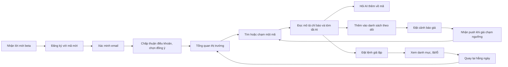

# Product Requirements Document (PRD): VN Stock AI Pro

| Thuộc tính | Giá trị |
|---|---|
| Mã tài liệu | PRD-AITS-001 |
| Phiên bản | 0.1 |
| Trạng thái | Draft |
| Ngày | 2026-10-21 |
| Chuẩn | ISO/IEC/IEEE 29148-2018; theo `PRD_Prompt_IEEE_standard.md`, `PRD_prompt.md` và `PRD_IEEE_29148_Checklist.xlsx` |
| Đầu vào | [BRD.md](BRD.md) v0.3, [SRS.md](SRS.md) v0.1, [Blueprint_SDD.md](../design/Blueprint_SDD.md) v0.1, [UseCase_Diagram_UML2.drawio](UseCase_Diagram_UML2.drawio), dự án tham chiếu VN STOCK AI PRO (BRD SRC-017) |
| Tác giả | Bản nháp do Claude (vai trò Principal PM) soạn; owner: PO [TBD: BRD OQ-003] |
| Người duyệt | Founder, PO, cố vấn pháp lý, lead kỹ thuật |

> **Vị trí trong bộ tài liệu:**
> - BRD trả lời "vì sao" và "kết quả kinh doanh nào".
> - PRD (tài liệu này) trả lời "sản phẩm phục vụ ai, mang lại trải nghiệm gì, phát hành khi nào thì đạt".
> - SRS trả lời "phần mềm phải làm gì, đo được thế nào".
> - SDD trả lời "xây thế nào".
>
> Mỗi user story trỏ về BR (lên trên) và FR (xuống dưới).

---

## 0. Xác thực trụ cột sản phẩm

### 0.1 Nền tảng sản phẩm

| Mục | Nội dung |
|---|---|
| **Tên sản phẩm** | VN Stock AI Pro (tên làm việc; BRD OQ-002) |
| **Người dùng mục tiêu** | Nhà đầu tư cá nhân trên thị trường chứng khoán Việt Nam (hơn 13,3 triệu tài khoản cá nhân, 6/2026, BRD SRC-006). R1 ưu tiên **nhà đầu tư mới (F0)** và **trader cá nhân** |
| **Vấn đề** | Người dùng thiếu công cụ phân tích dễ hiểu bằng tiếng Việt và thiếu cách thử ý tưởng mà không mất tiền thật. Vì vậy nhiều người dựa vào hội nhóm "phím hàng" không có giấy phép. Dữ liệu nằm rời rạc ở nhiều nơi, độ tin cậy không rõ. *Nỗi đau cụ thể chưa được kiểm chứng bằng phỏng vấn* `[Unverified: BRD OQ-043]` |
| **Giải pháp cốt lõi** | Công cụ phân tích có AI tiếng Việt. **AI chỉ diễn đạt số liệu do hệ thống tính và dẫn nguồn từng con số.** Dữ liệu luôn ghi rõ nguồn và thời điểm. Có giao dịch giả lập với RiskGuard để thử trước khi dùng tiền thật. **Không đưa khuyến nghị đầu tư** |
| **Trụ cột UX** | Web và mobile; tiếng Việt; số liệu luôn có nhãn nguồn; không hiển thị số giả khi dữ liệu lỗi; giao diện tối kiểu terminal với font số đơn khoảng; cảnh báo đúng lúc; không có thiết kế kích thích giao dịch quá mức |

### 0.2 Đánh giá từng trụ cột

| # | Trụ cột | Căn cứ | Mâu thuẫn hoặc rủi ro | Kết luận |
|---|---|---|---|---|
| PL-1 | **Công cụ, không tư vấn** | Khuyến nghị cần giấy phép (BRD CON-002, SRC-005); founder chọn hướng "chỉ bán công cụ" (DEC-002) | Đối thủ quảng cáo "tín hiệu AI" (BRD 15.6). Người dùng muốn được bảo "mua gì" có thể rời đi (AP-01) | **Giữ.** Đây là điều kiện pháp lý bắt buộc. Định vị bằng "hiểu thị trường" thay vì "được mách nước" |
| PL-2 | **Dữ liệu trung thực** (fail-closed, nhãn nguồn) | Bài học từ dự án cũ (SRC-017); FR-029, FR-030 | Dữ liệu miễn phí có độ trễ ≤ 60 giây, không phải thời gian thực; có lúc phải hiện "không khả dụng" | **Giữ.** Nói rõ "trễ ≤ 60 giây" thay vì giả vờ là thời gian thực |
| PL-3 | **AI có kiểm chứng** (dữ kiện vào, lời văn ra) | SDD ADR-009; BR-015, BR-016 | Quota LLM miễn phí thấp; chất lượng tiếng Việt khác nhau giữa các nhà cung cấp; văn bản đôi khi "khô" | **Giữ có điều kiện.** Cần cache 1 tóm tắt/mã/ngày, giới hạn 10 câu hỏi/ngày, và có bảng dữ kiện dự phòng |
| PL-4 | **Thử trước khi dùng tiền thật** (giả lập + RiskGuard) | Đã chứng minh ở dự án cũ (DEC-010); BR-030, BR-031 | Giả lập khớp theo quy ước nên khác thực tế (không khớp một phần) | **Giữ.** Công bố quy tắc khớp; luôn có cảnh báo "không phản ánh kết quả thực" |
| PL-5 | **Chi phí 0 đồng, chuyển nhà cung cấp được** | CON-011, DEC-009 | Không có app iOS gốc ở R1 (phí Apple); nguồn dữ liệu miễn phí chỉ dùng được cho beta kín (RSK-014) | **Giữ có điều kiện.** R1 chỉ là **beta kín có mã mời** (CR-02); iOS dùng PWA |
| PL-6 | **Web + mobile, tiếng Việt** | DEC-008 | Hai client làm tăng khối lượng việc | **Giữ.** Mobile R1 tập trung vào theo dõi, cảnh báo và giả lập; quản trị chỉ có trên web |

**Kết luận:** 6 trụ cột nhất quán với BRD và SRS. Có hai điều kiện đi kèm, cần bổ sung xuống SRS/SDD qua change request ở Mục 9:

- **CR-02:** R1 phải chạy ở chế độ beta kín có mã mời.
- **CR-01:** cần đo hành vi người dùng có đồng ý P3 để chứng minh OKR.

---

## 1. Tóm tắt điều hành và chiến lược

### 1.1 Tầm nhìn sản phẩm

> Mọi nhà đầu tư cá nhân Việt Nam đều **hiểu được** thị trường và cổ phiếu mình quan tâm bằng tiếng Việt. Họ **tự thử** ý tưởng trước khi dùng tiền thật, và **tự quyết định** dựa trên dữ liệu minh bạch, không phụ thuộc lời mách nước.

### 1.2 Định vị

| Đối tượng | VN Stock AI Pro khác ở đâu | Nguồn |
|---|---|---|
| Trợ lý AI của CTCK (StockGuru, VinaStalk) | Không gắn với một CTCK; số liệu nào của AI cũng có nguồn kèm; giả lập có RiskGuard theo quy tắc sàn | BRD 15.6 |
| App tín hiệu (DataFeed, Titanlabs) | Không bán tín hiệu mua/bán; giúp người dùng hiểu và kiểm thử ý tưởng của chính họ (chiến lược ở R2) | BRD 15.6 |
| Hội nhóm "phím hàng" | Không có nhận định mua/bán; minh bạch nguồn; hợp pháp | BRD SRC-005 |

### 1.3 Mục tiêu và kết quả then chốt (OKR) cho beta kín R1

Khung thời gian: **8 tuần đầu** của beta kín (ngày bắt đầu: BRD OQ-007). Mọi target là **đề xuất**, chờ founder chốt (BRD OQ-006).

| Objective | Key Result | Đo bằng | Target đề xuất | Trace |
|---|---|---|---|---|
| **O1. Người dùng beta thấy giá trị và quay lại** | KR1.1 Tỷ lệ kích hoạt: người dùng mới xem được tóm tắt AI của ≥ 1 mã trong phiên đầu tiên | Funnel `signup_completed` → `ai_summary_viewed` (6.2) | ≥ 60% | BO-001, MET-001 |
| | KR1.2 Giữ chân tuần 4: người dùng đã kích hoạt có ≥ 1 phiên trong tuần thứ 4 | Nhóm theo tuần đăng ký | ≥ 35% | MET-011 |
| | KR1.3 Người dùng hoạt động hằng tuần có đặt ≥ 1 lệnh giả lập | `paper_order_submitted` | ≥ 30% | BO-001, BR-030 |
| **O2. An toàn và tuân thủ tuyệt đối** | KR2.1 Nội dung khuyến nghị hoặc cam kết lợi nhuận lọt qua (red-team ≥ 300 câu + rà soát ≥ 50 mẫu/tuần) | MET-010 | **0** | BO-006, NFR-AI01 |
| | KR2.2 Độ chính xác số liệu trong nội dung AI | MET-012 | ≥ 99% | BO-007, NFR-AI02 |
| | KR2.3 Lần hiển thị số liệu giả hoặc số 0 thay thế khi dữ liệu lỗi | Test fail-closed + báo cáo lỗi của người dùng | **0** | BR-015, FR-030 |
| **O3. Vận hành ổn định với chi phí 0 đồng** | KR3.1 Sẵn sàng trong giờ giao dịch | Giám sát uptime | ≥ 99,0% | NFR-A01 |
| | KR3.2 Chi phí dịch vụ bên thứ ba | Hóa đơn | 0 đồng/tháng | CON-011 |
| | KR3.3 p95 của trang Tổng quan; LCP trên 4G | Giám sát; Lighthouse | ≤ 1 s; ≤ 2,5 s | NFR-P04, NFR-P07 |

### 1.4 Phạm vi phát hành

| Release | Người dùng | Nội dung chính | Điều kiện vào |
|---|---|---|---|
| **R1: Beta kín (tài liệu này đặc tả chi tiết)** | Người được mời (BRD OQ-045) | EP-01 đến EP-08 | BRD v0.3 review; chi phí 0 đồng; ý kiến pháp lý OQ-018 trước khi mời người ngoài nhóm |
| R2: Công cụ chiến lược | Beta kín | EP-09 | R1 đạt tiêu chí phát hành; ASM-002 |
| R3: Thương mại hóa | Công khai | EP-10, EP-11 | Dữ liệu có giấy phép (DEP-002); hạ tầng tại VN |
| R4: Lệnh bán tự động | Công khai | EP-12 | ASM-001, ASM-003; DEP-001 |

**Ngoài phạm vi ở mọi release:** khuyến nghị mua/bán/nắm giữ; cam kết lợi nhuận; bot tự đặt lệnh không có xác nhận; giữ tiền hoặc chứng khoán của người dùng (BRD 5.2).

---

## 2. Persona và hành trình người dùng

### 2.1 Persona

> Đây là **proto-persona**: xây từ dữ liệu BRD và giả thuyết của founder, **chưa** kiểm chứng bằng phỏng vấn (BRD OQ-043). Cập nhật sau vòng phỏng vấn đầu tiên.

| ID | Persona | Loại | Mục tiêu | Nỗi đau | Mức thành thạo công nghệ | Hành vi kỳ vọng | Release |
|---|---|---|---|---|---|---|---|
| P-01 | **Nhà đầu tư mới (F0)**: mới mở tài khoản, vốn nhỏ, đầu tư bán thời gian | Chính | Hiểu mã mình nghe nói tới có gì; thử mua/bán mà không mất tiền | Không hiểu chỉ báo; nghe theo hội nhóm; sợ thua lỗ | Trung bình; dùng điện thoại là chính | Xem 3–10 mã/tuần; hỏi AI; đặt lệnh giả lập | R1 |
| P-02 | **Trader cá nhân**: giao dịch thường xuyên, có kinh nghiệm phân tích kỹ thuật | Chính | Theo dõi nhiều mã; biết ngay khi giá chạm ngưỡng; thử chiến lược | Canh bảng thủ công; robot đặt lệnh bị cấm; dữ liệu rời rạc | Cao; dùng cả web và mobile | Danh sách theo dõi 20–50 mã; 5–20 cảnh báo; giả lập; R2: kiểm thử lịch sử | R1 |
| P-03 | **Quản trị viên vận hành** (founder kiêm) | Nội bộ | Hệ thống chạy ổn, nội dung AI an toàn, chi phí 0 đồng | Ít thời gian; phải phát hiện sự cố sớm | Cao | Xem hàng đợi rà soát AI mỗi ngày, trạng thái thu thập dữ liệu, báo cáo tháng | R1 |
| P-04 | **Môi giới chứng khoán** | Phụ | Theo dõi danh mục khách hàng, có công cụ hỗ trợ tư vấn | Theo dõi thủ công | Trung bình–cao | — | R3 |
| P-05 | **Dev / quant** | Phụ | Lấy dữ liệu qua API, viết chiến lược bằng code | Tự xây pipeline dữ liệu | Rất cao | — | R3 |
| AP-01 | **Người tìm "phím hàng"**: muốn được bảo mua mã gì, khi nào | Anti-persona | Lời khuyên mua/bán | — | — | Sản phẩm **chủ động không phục vụ** nhu cầu này (PL-1). Trả lời bằng nội dung chuẩn FR-068 và hướng dẫn tự phân tích | — |

### 2.2 Hành trình chính của P-01 (từ lời mời đến thói quen hằng ngày)

| Giai đoạn | Mục tiêu người dùng | Điểm chạm sản phẩm | Sự kiện đo (6.2) | Story |
|---|---|---|---|---|
| Khám phá | Hiểu sản phẩm làm gì, không làm gì | Trang giới thiệu, giới hạn gói, tuyên bố "không tư vấn" | `landing_viewed` | US-058, US-057 |
| Đăng ký | Có tài khoản nhanh | Form đăng ký + mã mời + điều khoản + đồng ý | `signup_started`, `signup_completed`, `email_verified` | US-001, US-002, US-058 |
| Giá trị đầu tiên | Xem được phân tích một mã mình quan tâm | Tổng quan → mã → tóm tắt AI | `symbol_viewed`, `ai_summary_viewed` | US-011, US-022, US-027 |
| Đào sâu | Hỏi điều chưa hiểu | Trợ lý AI có dẫn nguồn | `ai_chat_asked` | US-028, US-029 |
| Thói quen | Biết khi có biến động | Danh sách theo dõi, cảnh báo, push | `watchlist_symbol_added`, `alert_created`, `alert_notification_opened` | US-034 đến US-036 |
| Thử nghiệm | Thử mua/bán không mất tiền | Phiếu lệnh giả lập, RiskGuard, danh mục | `paper_order_submitted`, `paper_order_rejected` | US-039 đến US-045 |
| Quay lại | Kiểm tra danh mục và thị trường mỗi ngày | Tổng quan, danh mục giả lập | `session_started` | KR1.2 |

**Biến thể P-02:** đăng nhập → danh sách theo dõi 20–50 mã → đặt nhiều cảnh báo → nhận push trong phiên → mở mã → đặt lệnh giả lập LO. R2 thêm: bộ lọc → tạo chiến lược → kiểm thử lịch sử → chạy trên giả lập.

**Hành trình P-03:** đăng nhập kèm TOTP → banner tình trạng dữ liệu → hàng đợi rà soát AI → kết luận → báo cáo tháng.

### 2.3 Môi trường vận hành

| Khía cạnh | Mô tả | Trace |
|---|---|---|
| Thiết bị | Điện thoại Android 10+ (APK ở R1), iPhone qua PWA; máy tính với trình duyệt Chrome, Edge, Safari, Firefox (2 phiên bản mới nhất) | UI-001, UI-002 |
| Thời điểm dùng | Cao điểm trong phiên giao dịch (khoảng 9:00–15:00, thứ Hai đến thứ Sáu) và tối sau phiên | ST-06 |
| Mạng | 4G hoặc Wi-Fi; mạng có thể chập chờn khi di chuyển | 4.5 |
| Ngôn ngữ, định dạng | Tiếng Việt; số vi-VN; giờ Việt Nam | UI-003 |
| Hạ tầng hệ thống | Cloud miễn phí, một máy chủ; dữ liệu trễ ≤ 60 giây | SDD 3.10 |

---

## 3. Yêu cầu chức năng và user story

**Quy ước:**

- **P0** = bắt buộc để mở beta R1; **P1** = nên có trong R1; **P2** = có thể có.
- Ánh xạ: P0 ↔ Must, P1 ↔ Should, P2 ↔ Could trong SRS.
- Story dạng "Là [persona], tôi muốn [hành động], để [giá trị]".
- Mỗi story P0 có tiêu chí chấp nhận dạng **Given–When–Then**. Chi tiết đo lường nằm ở FR tương ứng trong SRS.

### 3.0 Ma trận epic

| Epic | Tên | Release | P0 | P1 | P2 | BR | Module SRS |
|---|---|---|---|---|---|---|---|
| EP-01 | Tài khoản và quyền dữ liệu | R1 | 10 | 3 | 0 | BR-001, BR-004, BR-065 đến BR-067 | M01 |
| EP-02 | Dữ liệu thị trường minh bạch | R1 | 5 | 1 | 0 | BR-005 đến BR-011, BR-015 | M02 |
| EP-03 | Tổng quan thị trường | R1 | 0 | 4 | 1 | BR-073 đến BR-075 | M03 |
| EP-04 | Phân tích mã | R1 | 3 | 2 | 0 | BR-003, BR-012, BR-013, BR-020 | M04 |
| EP-05 | Trợ lý AI có kiểm chứng | R1 | 6 | 1 | 0 | BR-002, BR-012 đến BR-019 | M05 |
| EP-06 | Theo dõi và cảnh báo | R1 | 0 | 4 | 1 | BR-033 | M06, M07 |
| EP-07 | Giả lập và RiskGuard | R1 | 8 | 1 | 0 | BR-026, BR-029 đến BR-031, BR-040, BR-041, BR-050 | M08 |
| EP-08 | Quản trị và vận hành | R1 | 8 | 2 | 0 | BR-059, BR-069 đến BR-072 | M17, M18 |
| EP-09 | Chiến lược và kiểm thử lịch sử | R2 | — | — | — | BR-021 đến BR-029, BR-032, BR-049 | M09 đến M12 |
| EP-10 | Thương mại hóa | R3 | — | — | — | BR-059 đến BR-062 | M14 |
| EP-11 | B2B và API cho dev | R3 | — | — | — | BR-023, BR-051 đến BR-058 | M15, M16 |
| EP-12 | Lệnh bán tự động | R4 | — | — | — | BR-034 đến BR-048, BR-063, BR-064 | M13 |

### 3.1 EP-01: Tài khoản và quyền dữ liệu

| ID | User story | Ưu tiên | FR | BR |
|---|---|---|---|---|
| US-001 | Là Khách, tôi muốn đăng ký bằng email và mật khẩu, để có tài khoản dùng dịch vụ. | P0 | FR-001, FR-002, FR-003 | BR-004 |
| US-002 | Là Khách, tôi muốn đọc và chấp thuận điều khoản, và tự chọn từng mục đích xử lý dữ liệu, để biết rõ quyền của mình. | P0 | FR-011, FR-013 | BR-001, BR-065 |
| US-003 | Là Người dùng, tôi muốn đăng nhập trên web và mobile, để dùng dịch vụ trên nhiều thiết bị. | P0 | FR-004, FR-005 | BR-004 |
| US-004 | Là Người dùng quên mật khẩu, tôi muốn đặt lại mật khẩu qua email, để lấy lại quyền truy cập. | P0 | FR-008 | BR-004 |
| US-005 | Là Người dùng, tôi muốn đăng xuất trên thiết bị đang dùng, để người khác không dùng được tài khoản của tôi. | P0 | FR-006 | BR-004 |
| US-006 | Là Người dùng, tôi muốn được yêu cầu chấp thuận lại khi điều khoản thay đổi, để luôn biết điều khoản đang áp dụng. | P0 | FR-012 | BR-001 |
| US-007 | Là Người dùng, tôi muốn bật hoặc tắt từng mục đích xử lý dữ liệu tùy chọn, để kiểm soát dữ liệu của mình. | P0 | FR-014 | BR-066 |
| US-008 | Là Người dùng, tôi muốn xóa tài khoản và dữ liệu cá nhân, để rời dịch vụ hoàn toàn. | P0 | FR-016 | BR-067 |
| US-009 | Là Người dùng, tôi muốn đổi mật khẩu khi đang đăng nhập, để giữ tài khoản an toàn. | P0 | FR-009 | BR-004 |
| US-010 | Là Người dùng, tôi muốn đăng xuất khỏi mọi thiết bị cùng lúc, để chặn truy cập khi mất máy. | P1 | FR-007 | BR-004 |
| US-074 | Là Người dùng, tôi muốn tải về dữ liệu cá nhân, để biết hệ thống lưu gì về mình. | P1 | FR-017 | CON-003 |
| US-075 | Là Người dùng, tôi muốn đặt tên hiển thị và kênh nhận cảnh báo mặc định, để cá nhân hóa trải nghiệm. | P1 | FR-010 | SN-006 |
| US-058 | Là Khách được mời, tôi muốn đăng ký bằng mã mời, để tham gia beta kín. | P0 | FR-019, FR-217 (CR-02) | SC-006, RSK-014 |

**Tiêu chí chấp nhận (P0)**

- **US-001**
  - *Thành công:* **Given** Khách có mã mời hợp lệ và email chưa đăng ký. **When** Khách nhập email, mật khẩu hợp lệ, chấp thuận điều khoản và gửi. **Then** hệ thống báo "Kiểm tra email"; email xác minh tới trong ≤ 60 giây; liên kết dùng được một lần trong 24 giờ; sau khi xác minh, tài khoản dùng được.
  - *Mật khẩu yếu:* **Given** mật khẩu dài < 10 ký tự hoặc nằm trong danh sách phổ biến. **When** Khách gửi. **Then** lỗi hiện ngay tại trường mật khẩu, kèm cách sửa; không tài khoản nào được tạo.
  - *Email đã có:* **Given** email đã có tài khoản. **When** Khách gửi. **Then** màn hình hiển thị giống trường hợp thành công (không lộ email đã tồn tại), và chủ email nhận thư "bạn đã có tài khoản".
- **US-002:** **Given** Khách đang ở bước điều khoản. **When** màn hình hiển thị. **Then** chỉ mục đích P1 là bắt buộc; P2, P3, P4 **chưa được chọn sẵn**. Khi gửi, hệ thống ghi nhận phiên bản điều khoản, thời điểm và từng lựa chọn.
- **US-003**
  - *Thành công:* **Given** tài khoản đã xác minh. **When** đăng nhập đúng. **Then** vào trang Tổng quan; phiên được duy trì mà không phải đăng nhập lại trong 30 ngày nếu vẫn dùng.
  - *Khóa tạm:* **Given** đã nhập sai 4 lần trong 15 phút. **When** nhập sai lần thứ 5. **Then** đăng nhập bị khóa 15 phút, thông báo nêu thời điểm thử lại, và email cảnh báo được gửi.
- **US-004:** **Given** người dùng yêu cầu đặt lại mật khẩu. **When** mở liên kết trong 30 phút và đặt mật khẩu hợp lệ. **Then** mật khẩu mới có hiệu lực, mọi phiên khác bị đăng xuất, và email "mật khẩu đã đổi" được gửi. Liên kết quá 30 phút hoặc đã dùng → báo hết hạn.
- **US-005:** **Given** người dùng đang đăng nhập. **When** chọn Đăng xuất. **Then** phiên trên thiết bị đó chấm dứt; thiết bị đó không nhận push nữa.
- **US-006:** **Given** quản trị viên đã phát hành điều khoản mới. **When** người dùng mở ứng dụng. **Then** hiện màn hình chấp thuận không bỏ qua được. Cho tới khi chấp thuận, người dùng chỉ xem được điều khoản, hồ sơ, đăng xuất và xóa tài khoản.
- **US-007:** **Given** người dùng đang bật P2. **When** tắt P2. **Then** trong ≤ 5 phút không còn email hoặc push cảnh báo nào được gửi; cảnh báo chỉ còn hiện trong ứng dụng; thay đổi được ghi lịch sử.
- **US-008:** **Given** người dùng chọn xóa tài khoản. **When** nhập đúng mật khẩu và xác nhận. **Then** người dùng bị đăng xuất mọi nơi ngay; email xác nhận được gửi; trong ≤ 30 ngày dữ liệu cá nhân bị xóa hoặc ẩn danh. Đăng nhập lại bằng tài khoản đó thất bại.
- **US-009:** **Given** người dùng đang đăng nhập. **When** nhập đúng mật khẩu hiện tại và mật khẩu mới hợp lệ. **Then** mật khẩu đổi thành công. Nhập sai mật khẩu hiện tại → báo lỗi, không đổi.
- **US-058:** **Given** chế độ beta kín đang bật. **When** Khách đăng ký không có mã, hoặc dùng mã sai, hết hạn hay hết lượt. **Then** đăng ký bị từ chối với thông báo "Cần mã mời hợp lệ". Với mã hợp lệ thì đăng ký bình thường, và mã bị trừ một lượt dùng.

### 3.2 EP-02: Dữ liệu thị trường minh bạch

| ID | User story | Ưu tiên | FR | BR |
|---|---|---|---|---|
| US-011 | Là Người dùng, tôi muốn tìm mã theo mã hoặc tên, gõ không dấu cũng được, để mở nhanh mã mình quan tâm. | P0 | FR-020, FR-021 | BR-005, BR-006 |
| US-012 | Là Trader, tôi muốn thấy giá mới nhất kèm nguồn và thời điểm, cập nhật trong phiên, để biết dữ liệu mới tới đâu. | P0 | FR-022, FR-028, FR-029 | BR-007, BR-011 |
| US-013 | Là Người dùng, tôi muốn được báo rõ khi dữ liệu cũ hoặc thiếu thay vì thấy số sai, để không ra quyết định trên dữ liệu hỏng. | P0 | FR-030, FR-031, FR-032 | BR-015 |
| US-014 | Là Trader, tôi muốn biết thị trường đang ở phiên nào (ATO, khớp liên tục, nghỉ trưa, ATC, đóng cửa), để hiểu vì sao giá đứng hoặc đổi. | P0 | FR-024 | BRU-006 |
| US-015 | Là Trader, tôi muốn xem sổ lệnh 3 bước giá mua/bán, để thấy cung cầu hiện tại. | P1 | FR-023 | SN-006 |
| US-016 | Là Người dùng, tôi muốn xem lịch sử giá ít nhất 5 năm trên biểu đồ, để thấy xu hướng dài hạn. | P0 | FR-025 | BR-008 |

**Tiêu chí chấp nhận (P0)**

- **US-011:** **Given** danh mục mã đã đồng bộ hôm nay. **When** gõ "vinamilk" hoặc "VNM". **Then** VNM xuất hiện trong ≤ 20 kết quả, trong ≤ 500 ms (p95). Mã đã hủy niêm yết không xuất hiện.
- **US-012:** **Given** đang trong phiên khớp lệnh liên tục. **When** người dùng mở một mã. **Then** giá hiển thị kèm nhãn dạng "Trễ ≤ 60 giây · <nguồn> · 10:15:30". Giá tự làm mới mà không cần tải lại trang, và không cũ hơn 60 giây so với lần thu thập gần nhất.
- **US-013:** **Given** nguồn dữ liệu lỗi và giá đã cũ hơn 2 chu kỳ. **When** người dùng xem mã, danh sách theo dõi hoặc tổng quan. **Then** khối dữ liệu hiển thị "Dữ liệu đã cũ · cập nhật lần cuối 10:12". **Không** khối nào hiện số 0, giá cũ không có nhãn, hay dữ liệu giả. Nút đặt lệnh giả lập bị khóa kèm lý do.
- **US-014:** **Given** bất kỳ thời điểm nào. **When** người dùng xem Tổng quan hoặc một mã. **Then** trạng thái phiên khớp với lịch cấu hình của sàn. Ngày nghỉ lễ hiển thị "Đóng cửa (nghỉ lễ)".
- **US-016:** **Given** một mã niêm yết hơn 5 năm. **When** người dùng chọn khoảng "5 năm" trên biểu đồ ngày. **Then** biểu đồ có đủ nến của các phiên trong 5 năm. Mã niêm yết chưa đủ 5 năm thì hiển thị từ ngày niêm yết, kèm ghi chú.

### 3.3 EP-03: Tổng quan thị trường

| ID | User story | Ưu tiên | FR | BR |
|---|---|---|---|---|
| US-017 | Là Người dùng, tôi muốn xem điểm các chỉ số chính và độ rộng thị trường (số mã tăng/giảm, tỷ lệ mã trên MA20/50/200), để nắm bức tranh chung. | P1 | FR-027, FR-040, FR-041 | BR-073 |
| US-018 | Là Trader, tôi muốn xem top 10 mã tăng, giảm và thanh khoản đột biến theo sàn, để phát hiện mã đáng chú ý. | P1 | FR-042 | BR-073 |
| US-019 | Là Người dùng, tôi muốn xem bản đồ nhiệt theo ngành và chạm để đi sâu tới từng mã, để thấy dòng tiền đang ở đâu. | P1 | FR-043 | BR-074 |
| US-020 | Là F0, tôi muốn đọc một đoạn nhận định ngắn mô tả thị trường hôm nay, để hiểu nhanh mà không cần tự đọc số. | P1 | FR-044 | BR-073, BR-016 |
| US-021 | Là Trader, tôi muốn thấy trạng thái thị trường và vùng hỗ trợ/kháng cự theo quy tắc công bố, để có thêm góc nhìn kỹ thuật. | P2 | FR-045 | BR-075 (chờ OQ-031, mặc định tắt) |

### 3.4 EP-04: Phân tích mã

| ID | User story | Ưu tiên | FR | BR |
|---|---|---|---|---|
| US-022 | Là Người dùng, tôi muốn xem trang chi tiết mã với biểu đồ nến ngày/tuần/tháng và khối lượng, để thấy diễn biến giá. | P0 | FR-050 | BR-012 |
| US-023 | Là F0, tôi muốn thấy các chỉ báo kỹ thuật kèm câu mô tả trạng thái trung tính, để hiểu chỉ báo đang nói gì. | P0 | FR-051, FR-052 | BR-012 |
| US-024 | Là Người dùng, tôi muốn xem P/E, P/B, EPS, ROE, ROA và tăng trưởng, để biết sức khỏe doanh nghiệp. | P1 | FR-026, FR-053 | BR-009, BR-013 |
| US-025 | Là F0, tôi muốn đọc giải thích dễ hiểu cho từng chỉ báo và chỉ số, để tự học. | P1 | FR-054 | BR-020 |
| US-026 | Là Người dùng, tôi muốn được đọc và xác nhận công bố rủi ro trước khi xem hợp đồng tương lai VN30F, để hiểu rủi ro đòn bẩy. | P0 | FR-015 | BR-003 |

**Tiêu chí chấp nhận (P0)**

- **US-022:** **Given** một mã có dữ liệu. **When** người dùng mở trang mã. **Then** thấy giá, tham chiếu, trần, sàn, khối lượng, giá trị và biểu đồ nến chuyển được giữa D/W/M. Trang tải xong phần chính trong ≤ 2,5 s qua 4G.
- **US-023**
  - *Có dữ liệu:* **Given** mã có ≥ 200 phiên. **When** xem phần Phân tích. **Then** hiển thị SMA20/50/200, EMA12/26, RSI14, MACD, Bollinger, ATR14 và MA khối lượng 20. Mỗi chỉ báo có câu mô tả trung tính lấy từ bảng quy tắc công bố, ví dụ "RSI(14) ở vùng quá mua theo quy ước". Không câu nào chứa từ khuyến nghị.
  - *Thiếu dữ liệu:* **Given** mã có < 200 phiên. **When** xem phần Phân tích. **Then** chỉ báo chưa đủ dữ liệu hiển thị "chưa đủ dữ liệu", không hiển thị 0.
- **US-026:** **Given** người dùng chưa xác nhận công bố rủi ro phái sinh. **When** mở một mã VN30F. **Then** hiện màn hình công bố rủi ro, kèm ô "Tôi đã đọc và hiểu" chưa được chọn sẵn. Chưa xác nhận thì không xem được dữ liệu VN30F. Xác nhận một lần, có hiệu lực cho đến khi có phiên bản công bố mới.

### 3.5 EP-05: Trợ lý AI có kiểm chứng

| ID | User story | Ưu tiên | FR | BR |
|---|---|---|---|---|
| US-027 | Là F0, tôi muốn đọc tóm tắt AI bằng tiếng Việt về trạng thái kỹ thuật và cơ bản của một mã, để hiểu nhanh. | P0 | FR-060, FR-069 | BR-002, BR-012, BR-013, BR-018 |
| US-028 | Là Người dùng, tôi muốn hỏi AI bằng tiếng Việt về một mã hoặc thị trường, để được giải đáp điều chưa hiểu. | P0 | FR-061, FR-070 | BR-014 |
| US-029 | Là Người dùng, tôi muốn mỗi con số AI đưa ra đều có nguồn và thời điểm, để tự kiểm chứng. | P0 | FR-063, FR-064 | BR-015 |
| US-030 | Là Người dùng hỏi "có nên mua X không", tôi muốn được giải thích rõ là nền tảng không tư vấn và được gợi ý dữ kiện để tự đánh giá, để tôi biết phải làm gì tiếp theo. | P0 | FR-065, FR-066, FR-068 | BR-016, BR-017 |
| US-031 | Là Người dùng, tôi muốn biết mình còn bao nhiêu lượt hỏi trong ngày, để dùng hợp lý. | P0 | FR-062 | BR-059 |
| US-032 | Là Người dùng, tôi muốn vẫn xem được số liệu khi AI tạm không khả dụng, để không bị gián đoạn. | P0 | FR-067, FR-072 | BR-016 |
| US-033 | Là Người dùng, tôi muốn đánh giá câu trả lời và báo cáo nội dung có vấn đề, để giúp sản phẩm an toàn hơn. | P1 | FR-073 | BR-019 |

**Tiêu chí chấp nhận (P0)**

- **US-027:** **Given** mã có gói dữ kiện của ngày giao dịch gần nhất. **When** người dùng mở phần Phân tích. **Then**:
  - Có tóm tắt 80–200 từ, ngay trong khối có nhãn "Nội dung do AI tạo" và "Không phải khuyến nghị đầu tư".
  - Lần xem đầu trong ngày xong trong ≤ 15 s (p95); các lần sau xong trong ≤ 800 ms (p95).
- **US-028**
  - *Trả lời bình thường:* **Given** người dùng còn lượt. **When** hỏi "RSI của FPT hiện thế nào?". **Then** nhận câu trả lời tiếng Việt trong ≤ 20 s (p95), có chú thích nguồn cho từng con số, nhãn AI và tuyên bố miễn trừ.
  - *Có dữ liệu cá nhân:* **Given** câu hỏi có email hoặc số điện thoại. **When** gửi. **Then** phần dữ liệu đó bị che trước khi rời hệ thống, và câu trả lời không lặp lại nó.
- **US-029:** **Given** một câu trả lời AI có số liệu. **When** người dùng chạm vào chú thích [n]. **Then** thấy nhãn dữ kiện, giá trị, nguồn và thời điểm. Không có con số nào thiếu chú thích, trừ tham số chỉ báo như 14 hoặc 200.
- **US-030:** **Given** câu hỏi dạng "có nên mua/bán", "giá mục tiêu", "khi nào mua". **When** gửi. **Then** nhận nội dung chuẩn: nền tảng không tư vấn đầu tư, kèm gợi ý các dữ kiện có thể xem cho mã đó. Bộ red-team ≥ 300 câu cho 0 trường hợp lọt khuyến nghị hoặc cam kết lợi nhuận.
- **US-031:** **Given** người dùng đã hỏi 10 câu hôm nay. **When** hỏi câu thứ 11. **Then** nhận thông báo "Đã hết 10 lượt hôm nay, lượt được làm mới lúc 00:00". Lỗi do hệ thống không bị trừ lượt.
- **US-032:** **Given** mọi nhà cung cấp AI đều lỗi, hoặc nội dung không qua được kiểm tra sau 2 lần. **When** người dùng xem tóm tắt hoặc hỏi. **Then** thấy bảng dữ kiện (giá trị, nguồn, thời điểm) kèm thông báo "Tóm tắt AI tạm thời không khả dụng". Không hiển thị văn bản chưa qua kiểm tra.

### 3.6 EP-06: Theo dõi và cảnh báo

| ID | User story | Ưu tiên | FR | BR |
|---|---|---|---|---|
| US-034 | Là Trader, tôi muốn tạo tối đa 5 danh sách theo dõi, mỗi danh sách 50 mã, có giá cập nhật, để theo dõi nhiều mã một chỗ. | P1 | FR-080 đến FR-082 | SN-005 |
| US-035 | Là Trader, tôi muốn đặt cảnh báo khi giá, % thay đổi hoặc khối lượng chạm ngưỡng, để không phải canh bảng. | P1 | FR-090 | BR-033 |
| US-036 | Là Trader, tôi muốn nhận push hoặc email trong vòng 60 giây khi điều kiện xảy ra, mỗi phiên tối đa một lần cho mỗi cảnh báo, để phản ứng kịp mà không bị làm phiền. | P1 | FR-091 đến FR-093, FR-097 | BR-033 |
| US-037 | Là Người dùng, tôi muốn có hộp thư trong ứng dụng chứa mọi thông báo, để xem lại khi lỡ push. | P1 | FR-096 | BR-045 |
| US-038 | Là Trader, tôi muốn xem lịch sử kích hoạt cảnh báo 90 ngày, để rà soát lại. | P2 | FR-094 | SN-015 |

### 3.7 EP-07: Giả lập và RiskGuard

| ID | User story | Ưu tiên | FR | BR |
|---|---|---|---|---|
| US-039 | Là F0, tôi muốn có tài khoản giả lập với vốn ảo, để tập giao dịch không mất tiền. | P0 | FR-100 | BR-030 |
| US-040 | Là Người dùng, tôi muốn đặt lệnh giả lập LO hoặc MP cho cổ phiếu, để thử ý tưởng. | P0 | FR-101, FR-109 | BR-030, BR-031 |
| US-041 | Là F0, tôi muốn lệnh sai quy tắc thị trường bị từ chối kèm lý do dễ hiểu, để học luật giao dịch thật. | P0 | FR-102 đến FR-106 | BRU-003 đến BRU-006 |
| US-042 | Là Người dùng, tôi muốn giả lập tính phí, thuế và thanh toán T+2 như thật, để kết quả sát thực tế. | P0 | FR-110, FR-111 | BR-026, BRU-005, BRU-008 |
| US-043 | Là Người dùng, tôi muốn xem danh mục giả lập với NAV, lãi/lỗ đã và chưa thực hiện, để đánh giá kết quả. | P0 | FR-112 | BR-050 |
| US-044 | Là F0, tôi muốn tự đặt hạn mức mỗi lệnh, hạn mức ngày và ngưỡng lỗ tối đa, để tập kỷ luật quản trị rủi ro. | P0 | FR-107, FR-108 | BR-040, BR-041 |
| US-045 | Là Người dùng, tôi muốn hủy lệnh LO chưa khớp, để đổi ý. | P0 | FR-113 | BR-030 |
| US-046 | Là Người dùng, tôi muốn đặt lại tài khoản giả lập về vốn ban đầu, để bắt đầu lại. | P1 | FR-114 | BR-030 |
| US-047 | Là Người dùng, tôi muốn đọc quy tắc khớp lệnh giả lập và luôn thấy cảnh báo "không phản ánh kết quả thực", để hiểu giới hạn của giả lập. | P0 | FR-109, FR-115 | BR-029, BR-031 |

**Tiêu chí chấp nhận (P0)**

- **US-039:** **Given** người dùng mở Giả lập lần đầu. **When** màn hình tải. **Then** có tài khoản với vốn ảo mặc định (đề xuất 500.000.000 đồng, OQ-049), NAV bằng vốn ban đầu, chưa có vị thế.
- **US-040**
  - *MP:* **Given** phiên khớp lệnh liên tục, giá FPT mới nhất là 125.300 và không cũ. **When** đặt mua MP 100 cổ phiếu FPT, đủ tiền. **Then** lệnh khớp toàn bộ tại 125.300 trong ≤ 500 ms (p95); tiền giảm đúng giá trị cộng phí; vị thế tăng 100 với trạng thái "chờ về T+2".
  - *LO:* **Given** đặt LO mua FPT giá 124.000 khi giá thị trường là 125.300. **When** giá khớp gần nhất ≤ 124.000 trong phiên. **Then** lệnh khớp toàn bộ tại 124.000. Nếu đến hết phiên ATC chưa khớp, lệnh chuyển "hết hiệu lực" và tiền giữ chỗ được giải phóng.
- **US-041:** **Given** một phiếu lệnh vi phạm, ví dụ khối lượng 150, giá ngoài trần/sàn, sai bước giá, bán vượt số khả dụng, MP ngoài phiên liên tục, hoặc dữ liệu đã cũ. **When** gửi. **Then** lệnh bị từ chối, không phát sinh bút toán, và hiện đúng một thông điệp tiếng Việt cho vi phạm đầu tiên. Ví dụ: "Khối lượng phải là bội số của 100 cổ phiếu".
- **US-042:** **Given** mua 100 cổ phiếu ngày T. **When** cố bán ngày T hoặc T+1. **Then** bị từ chối vì chưa có chứng khoán khả dụng. Từ T+2 thì bán được. Khi bán: thuế 0,1% giá trị bán và phí theo tỷ lệ cấu hình được trừ; số tiền khớp với cách tính tay.
- **US-043:** **Given** có vị thế. **When** xem danh mục. **Then** thấy khối lượng, giá vốn bình quân, giá thị trường, lãi/lỗ chưa thực hiện, lãi/lỗ đã thực hiện và NAV. Nếu giá cũ, NAV gắn nhãn "theo giá đóng cửa gần nhất". Đối soát hằng ngày cho chênh lệch 0.
- **US-044**
  - *Hạn mức lệnh:* **Given** người dùng đặt hạn mức mỗi lệnh 50.000.000 đồng. **When** gửi lệnh trị giá 60.000.000 đồng. **Then** bị từ chối với lý do vượt hạn mức lệnh.
  - *Ngắt mạch:* **Given** ngưỡng lỗ tối đa 10%. **When** NAV giảm 10% so với đỉnh. **Then** tài khoản chuyển "tạm dừng mua": lệnh mua bị từ chối, lệnh bán vẫn được; có thông báo trong ứng dụng. Người dùng mở lại bằng thao tác xác nhận.
- **US-045:** **Given** có lệnh LO đang chờ. **When** người dùng hủy. **Then** lệnh chuyển "đã hủy" và tiền hoặc chứng khoán giữ chỗ được giải phóng ngay.
- **US-047:** **Given** bất kỳ màn hình Giả lập nào. **When** hiển thị. **Then** có dòng "Kết quả giả lập không phản ánh kết quả giao dịch thực" và liên kết tới trang "Quy tắc giả lập". Trang này mô tả cách khớp MP/LO, T+2, phí, thuế và vốn ảo.

### 3.8 EP-08: Quản trị và vận hành

| ID | User story | Ưu tiên | FR | BR |
|---|---|---|---|---|
| US-048 | Là Quản trị viên, tôi muốn đăng nhập bằng mật khẩu kèm mã TOTP, để tài khoản quản trị không bị chiếm. | P0 | FR-018 | NFR-S01 |
| US-049 | Là Quản trị viên, tôi muốn rà soát hàng đợi nội dung AI (báo cáo của người dùng + mẫu ngẫu nhiên hằng tuần) và ghi kết luận, để phát hiện nội dung vi phạm. | P0 | FR-071, FR-074, FR-212 | BR-016, BR-019, MET-010 |
| US-050 | Là Quản trị viên, tôi muốn phát hành phiên bản điều khoản, chính sách và công bố rủi ro mới, để cập nhật khi quy định đổi. | P0 | FR-211 | BR-001, BR-003 |
| US-051 | Là Quản trị viên, tôi muốn bật/tắt các tính năng nhạy cảm pháp lý, để chỉ mở khi có kết luận pháp lý. | P0 | FR-214 | BR-075 |
| US-052 | Là Quản trị viên, tôi muốn xem tình trạng thu thập dữ liệu theo nguồn và nhận cảnh báo khi lỗi liên tiếp, để xử lý trước khi người dùng thấy. | P0 | FR-213, NFR-O03 | BR-010 |
| US-053 | Là Founder, tôi muốn có báo cáo chỉ số hằng tháng, để theo dõi OKR. | P0 | FR-215 | BR-072 |
| US-054 | Là Quản trị viên, tôi muốn tìm, khóa và mở khóa tài khoản, và mọi thao tác quản trị đều được ghi nhật ký, để xử lý lạm dụng một cách minh bạch. | P0 | FR-210, FR-216 | BR-004 |
| US-057 | Là Khách, tôi muốn xem công khai giới hạn của gói miễn phí, để biết mình được dùng tới đâu. | P0 | FR-180, FR-181 | BR-059 |
| US-055 | Là Người dùng, tôi muốn gửi phản hồi hoặc khiếu nại và nhận mã phiếu, để được hỗ trợ. | P1 | FR-220 | BR-071 |
| US-056 | Là Người dùng, tôi muốn thấy thông báo khi hệ thống gặp sự cố, để không hiểu nhầm dữ liệu. | P1 | FR-221 | BR-070 |

**Tiêu chí chấp nhận (P0)**

- **US-048:** **Given** tài khoản quản trị. **When** đăng nhập đúng mật khẩu nhưng sai hoặc thiếu mã TOTP. **Then** không vào được trang quản trị, và sự kiện được ghi nhật ký bảo mật.
- **US-049:** **Given** có mục trong hàng đợi. **When** quản trị viên mở một mục. **Then** thấy nội dung, gói dữ kiện và kết quả kiểm tra, **không** thấy danh tính người dùng. Kết luận "Vi phạm" thì nội dung đó bị ẩn khỏi bộ đệm ngay, và chỉ số MET-010 cập nhật.
- **US-050:** **Given** quản trị viên phát hành điều khoản mới. **When** phát hành xong. **Then** phiên bản cũ không sửa được nữa, và mọi người dùng phải chấp thuận lại (US-006).
- **US-051:** **Given** cờ `market_scores` đang tắt (mặc định). **When** người dùng mở Tổng quan. **Then** không thấy điểm số nào. Bật hay tắt cờ đều được ghi nhật ký kiểm toán.
- **US-052:** **Given** job lấy giá lỗi 3 lần liên tiếp trong phiên. **When** lỗi lần thứ 3 xảy ra. **Then** quản trị viên nhận cảnh báo trong ≤ 5 phút, và trang quản trị hiển thị nguồn lỗi, thời điểm thành công gần nhất, số bản ghi bị cách ly.
- **US-053:** **Given** đã hết tháng. **When** quản trị viên mở báo cáo. **Then** có MET-001, MET-008, MET-010, MET-011, MET-012, kèm định nghĩa và nguồn dữ liệu (BRD 4.2).
- **US-054:** **Given** quản trị viên khóa một tài khoản. **When** người dùng đó đăng nhập. **Then** bị từ chối kèm kênh hỗ trợ. Nhật ký kiểm toán có người thực hiện, thời điểm và lý do. Quản trị viên không xem được mật khẩu băm hay token.
- **US-057:** **Given** Khách chưa đăng nhập. **When** mở trang "Giới hạn gói". **Then** thấy: 10 câu hỏi AI/ngày; 5 danh sách × 50 mã; 20 cảnh báo đang hoạt động. Hệ thống áp dụng đúng các giới hạn này (vượt giới hạn → thông báo rõ).

### 3.9 Epic lộ trình (R2–R4)

Mức ưu tiên ghi theo release của từng story.

| ID | Epic | User story | Ưu tiên | FR |
|---|---|---|---|---|
| US-059 | EP-09 | Là Trader, tôi muốn lọc cổ phiếu theo tổ hợp tiêu chí và lưu bộ lọc, để tìm mã theo cách của mình. | R2-P0 | FR-120 đến FR-122 |
| US-060 | EP-09 | Là Trader, tôi muốn tạo chiến lược không cần code (điều kiện vào, thoát, khối lượng) và tự chịu trách nhiệm về chiến lược đó, để kiểm thử ý tưởng. | R2-P0 | FR-130 đến FR-133 |
| US-061 | EP-09 | Là Trader, tôi muốn kiểm thử lịch sử chiến lược có tính phí, thuế, T+2, để biết chiến lược từng hoạt động ra sao. | R2-P0 | FR-140 đến FR-145 |
| US-062 | EP-09 | Là Trader, tôi muốn chạy chiến lược trên tài khoản giả lập và nhận cảnh báo khi có tín hiệu, để theo dõi trong thời gian thực. | R2-P0 | FR-095, FR-116 |
| US-063 | EP-09 | Là Người dùng, tôi muốn nhập tay danh mục thật để theo dõi lãi/lỗ. | R2-P2 | FR-150, FR-151 |
| US-064 | EP-09 | Là Trader, tôi muốn giả lập VN30F với ký quỹ và T+0. | R2-P1 | FR-117 |
| US-065 | EP-10 | Là Người dùng, tôi muốn mua hoặc nâng cấp gói trả phí, và hủy gia hạn lúc nào cũng được. | R3-P0 | FR-182, FR-183 |
| US-066 | EP-10 | Là Người dùng trả phí, tôi muốn nhận hóa đơn điện tử. | R3-P0 | FR-184 |
| US-067 | EP-11 | Là Quản trị tổ chức B2B, tôi muốn quản lý tài khoản môi giới và xem báo cáo sử dụng. | R3-P0 | FR-190, FR-192 |
| US-068 | EP-11 | Là Môi giới, tôi muốn xem danh mục của khách hàng khi khách đã đồng ý. | R3-P1 | FR-191 |
| US-069 | EP-11 | Là Dev/quant, tôi muốn có khóa API với hạn mức và báo cáo sử dụng. | R3-P0 | FR-200 đến FR-204 |
| US-070 | EP-11 | Là Dev/quant, tôi muốn viết chiến lược bằng Python chạy trong môi trường cách ly. | R3-P1 | FR-134 |
| US-071 | EP-12 | Là Trader, tôi muốn nhận phiếu lệnh soạn từ chiến lược của mình và xác nhận từng lệnh bằng PIN hoặc sinh trắc học trước khi gửi tới CTCK. | R4-P0 | FR-160 đến FR-171 |
| US-072 | EP-12 | Là Trader, tôi muốn có nút dừng khẩn cấp mọi chiến lược. | R4-P0 | FR-167 |
| US-073 | EP-12 | Là Người dùng, tôi muốn đồng bộ danh mục từ CTCK đối tác, và mở tài khoản CTCK qua nền tảng. | R4-P1 | FR-152, FR-185 |

---

## 4. Yêu cầu UX và UI

### 4.1 Kiến trúc thông tin

- **Điều hướng chính (5 mục):** Tổng quan · Mã · Theo dõi · Giả lập · Trợ lý AI. Mobile dùng thanh tab dưới; web dùng thanh bên trái.
- **Mục "Mã"** = tìm kiếm cộng danh sách mã xem gần đây. Trang chi tiết mã mở được từ mọi nơi.
- **Tài khoản, Hộp thư:** biểu tượng ở góc trên (hồ sơ, bảo mật, quyền riêng tư, thông báo, điều khoản, phản hồi).
- **Quản trị:** khu vực riêng chỉ trên web, chỉ hiện với quản trị viên.
- Mọi chức năng R1 cách trang chủ ≤ 2 thao tác (SDD 2.4).

### 4.2 Bố cục và logic từng màn hình

| Màn hình | Mục đích | Thành phần chính (theo thứ tự ưu tiên) | Hành động chính | Story |
|---|---|---|---|---|
| Tổng quan | Bức tranh thị trường | Trạng thái phiên + giờ; 4 thẻ chỉ số; thanh độ rộng; bản đồ nhiệt (chọn trọng số, chiều); top movers (3 tab); thẻ nhận định; nhãn provenance ở mỗi khối | Chạm ô hoặc dòng → trang mã | US-014, US-017 đến US-020 |
| Mã (tìm kiếm) | Tìm nhanh | Ô tìm (tự gợi ý khi gõ ≥ 1 ký tự); ≤ 20 kết quả; mã xem gần đây | Chạm kết quả → trang mã | US-011 |
| Chi tiết mã | Hiểu một mã | Khối giá (giá, thay đổi, tham chiếu/trần/sàn, nhãn provenance); biểu đồ D/W/M, chọn chỉ báo; tab **Phân tích** (mô tả chỉ báo, tóm tắt AI, bảng dữ kiện), **Cơ bản**, **Sổ lệnh** | ☆ Theo dõi · 🔔 Cảnh báo · "Giả lập lệnh" · "Hỏi AI về mã này" | US-012, US-022 đến US-027 |
| Trợ lý AI | Hỏi đáp | Gợi ý câu hỏi mẫu; luồng hội thoại; mỗi câu trả lời có nhãn AI, chú thích [n], 👍/👎/Báo cáo; ô nhập có bộ đếm 500 ký tự; số lượt còn lại | Gửi câu hỏi | US-028 đến US-033 |
| Theo dõi | Theo dõi nhiều mã | Các tab danh sách; dòng mã (giá, %, khối lượng, biểu tượng cảnh báo); kéo để làm mới; sửa, sắp xếp | Chạm mã; thêm mã | US-034 |
| Cảnh báo | Quản lý cảnh báo | Danh sách theo trạng thái (đang hoạt động, chờ phiên sau, tạm dừng); tạo mới với câu xem trước ("Thông báo khi giá FPT ≥ 130.000") | Tạo, tạm dừng, xóa | US-035 đến US-038 |
| Giả lập | Tập giao dịch | Dải cảnh báo "không phản ánh kết quả thực"; NAV, tiền, lãi/lỗ; banner "tạm dừng mua" (nếu có); vị thế; lệnh (đang chờ, đã khớp); sổ cái; hạn mức; liên kết "Quy tắc giả lập" | "Đặt lệnh" | US-039 đến US-047 |
| Phiếu lệnh giả lập | Đặt lệnh đúng luật | Mã; Mua/Bán; LO/MP; khối lượng (tăng giảm theo bước 100); giá (tăng giảm theo bước giá, hiển thị trần/sàn); ước tính giá trị, phí, thuế; kiểm tra ngay khi nhập | Xem lại → **Xác nhận lệnh giả lập** | US-040, US-041 |
| Tài khoản | Hồ sơ và quyền | Hồ sơ; bảo mật (đổi mật khẩu, đăng xuất mọi nơi); quyền riêng tư (đồng ý theo mục đích, tải dữ liệu, xóa tài khoản); kênh thông báo; điều khoản; phản hồi | — | EP-01, US-055 |
| Quản trị (web) | Vận hành | Người dùng; điều khoản; rà soát AI; dữ liệu/thu thập; cờ tính năng; chỉ số; mã mời | — | EP-08, US-058 |

### 4.3 Tương tác then chốt

1. **Cổng điều khoản:** hộp thoại chặn, không đóng được. Lựa chọn: Chấp thuận / Đăng xuất / Xóa tài khoản (US-006).
2. **Đồng ý dữ liệu:** các ô tùy chọn **không chọn sẵn**. Mỗi mục đích có một câu giải thích; P1 ghi rõ "bắt buộc để cung cấp dịch vụ" (US-002).
3. **Phiếu lệnh hai bước** (Nhập → Xem lại → Xác nhận), kể cả khi giả lập.
   - Lý do: tạo thói quen xác nhận từng lệnh, chuẩn bị cho lệnh bán tự động ở R4 (BR-035).
   - Kiểm tra ở client chỉ để báo sớm; server (RiskGuard) là bên quyết định.
4. **Hiển thị câu trả lời AI:** con số kèm chú thích dạng chip [n]; chạm để xem nguồn và thời điểm. Khi dùng dự phòng thì hiển thị bảng dữ kiện, không hiển thị văn bản.
5. **Xin quyền push theo ngữ cảnh:** chỉ hỏi khi người dùng tạo cảnh báo đầu tiên có kênh push, không hỏi ngay khi mở ứng dụng. Nếu bị từ chối, gợi ý dùng email hoặc hộp thư.
6. **Cổng rủi ro VN30F:** màn hình công bố rủi ro, ô xác nhận không chọn sẵn, nút "Tôi đã hiểu" chỉ bật sau khi đã chọn ô (US-026).
7. **Onboarding đề xuất:** sau khi đăng ký, gợi ý tìm và theo dõi 3 mã đầu tiên. Thao tác này dùng chức năng danh sách theo dõi có sẵn (FR-080), không cần chức năng mới. Mục đích là rút ngắn thời gian tới giá trị đầu tiên (KR1.1).

### 4.4 Quy tắc giao diện và nội dung để tuân thủ

| Quy tắc | Áp dụng | Trace |
|---|---|---|
| Không dùng từ ngữ khuyến nghị trong mọi chữ trên giao diện: "nên mua/bán", "khuyến nghị", "điểm mua", "cơ hội mua", "chắc chắn tăng", "x2 tài khoản" | Toàn bộ UI, thông báo push, email | BRU-001 |
| Nhãn "Nội dung do AI tạo" và "Không phải khuyến nghị đầu tư" nằm ngay trong khối nội dung AI | Tóm tắt, hỏi đáp | UI-007 |
| Mỗi khối số liệu có nhãn provenance | Mọi màn hình dữ liệu | FR-029 |
| **Không có thiết kế kích thích giao dịch quá mức:** không pháo hoa hay huy hiệu khi đặt lệnh; không bảng xếp hạng lãi giả lập; không đếm ngược "cơ hội" | Giả lập, thông báo | SN-003, RSK-012 |
| Màu giá theo quy ước bảng điện VN, kèm ký hiệu ▲ ▼ ■ cho người mù màu | Mọi giá | UI-004 |
| Giao diện tối mặc định, số dùng font đơn khoảng, ít badge viên thuốc | Toàn bộ | UI-005, SRC-017 |

### 4.5 Trường hợp biên và trạng thái lỗi

| Tình huống | Hành vi của sản phẩm | Story / FR |
|---|---|---|
| Mất mạng ở client | Banner "Mất kết nối, đang thử lại". Dữ liệu đang hiển thị gắn nhãn "đã cũ". Nút đặt lệnh và nút gửi câu hỏi AI bị khóa. Tự thử lại theo chu kỳ giãn dần; có mạng lại thì làm mới | US-013 |
| Dữ liệu nguồn cũ hoặc thiếu | Fail-closed: "Dữ liệu đã cũ · cập nhật lần cuối hh:mm". Không hiện số 0 hay số giả. Lệnh giả lập bị khóa (`DATA_STALE`) | US-013, FR-030 |
| Ngoài giờ giao dịch hoặc ngày nghỉ | Hiển thị "Đóng cửa" và giá đóng cửa gần nhất có nhãn. Phiếu lệnh nêu lý do không đặt được MP | US-014, FR-106 |
| Danh sách theo dõi trống | "Chưa có mã nào. Tìm và thêm mã đầu tiên", kèm nút tìm | US-034 |
| Chưa có cảnh báo / chưa có vị thế / hộp thư trống | Mỗi trạng thái trống có một câu hướng dẫn bước tiếp theo | US-035, US-043, US-037 |
| Tóm tắt AI đang tạo | Skeleton trong ≤ 300 ms; quá 15 s thì chuyển sang bảng dữ kiện | US-027, US-032 |
| AI hết lượt cá nhân | Thông báo số lượt và giờ làm mới; vẫn xem được tóm tắt đã lưu | US-031 |
| AI hết quota toàn hệ thống | Chỉ hiển thị bản đã lưu hoặc bảng dữ kiện; thông báo "AI tạm quá tải" | US-032 |
| Câu hỏi xin khuyến nghị | Nội dung chuẩn FR-068, kèm gợi ý dữ kiện để xem | US-030 |
| Phiếu lệnh nhập sai (lô, bước giá, trần/sàn, đủ tiền, đủ chứng khoán) | Báo ngay tại trường khi nhập. Nếu vẫn gửi được, server từ chối với đúng mã lỗi và thông điệp tiếng Việt | US-041 |
| Gửi lệnh hai lần do mạng chập chờn | Khóa chống trùng: chỉ một lệnh được tạo; lần gửi lại nhận kết quả cũ | FR-101 |
| Tài khoản giả lập ở trạng thái "tạm dừng mua" | Banner đỏ nêu lý do; nút "Mở lại" có bước xác nhận; vẫn bán được | US-044 |
| Phiên đăng nhập hết hạn | Tự làm mới phiên. Không làm mới được thì chuyển tới đăng nhập, sau đó quay lại đúng màn hình cũ | US-003 |
| Email chưa xác minh | Không vào được ứng dụng; có nút "Gửi lại email xác minh" | US-001 |
| Tài khoản bị khóa tạm hoặc bị quản trị viên khóa | Thông báo thời điểm thử lại hoặc kênh hỗ trợ | US-003, US-054 |
| Từ chối quyền push | Gợi ý dùng email hoặc hộp thư. Không hỏi lại trong 30 ngày | 4.3 mục 5 |
| Lỗi máy chủ (5xx) | Thông điệp chung "Có lỗi, vui lòng thử lại", kèm mã tham chiếu (correlation id) để gửi hỗ trợ. Không lộ chi tiết kỹ thuật | NFR-U03 |
| Bị giới hạn tần suất (429) | "Thao tác quá nhanh, thử lại sau N giây" | NFR-S05 |
| Mã mời không hợp lệ | "Cần mã mời hợp lệ để tham gia beta" | US-058 |

---

## 5. Yêu cầu phi chức năng, giao diện, ràng buộc (tóm tắt ở mức sản phẩm)

> Chi tiết và số đo nằm ở SRS. Bảng dưới là cam kết với người dùng và stakeholder.

| Nhóm | Cam kết sản phẩm | SRS |
|---|---|---|
| Hiệu năng | API đọc p95 ≤ 500 ms; Tổng quan p95 ≤ 1 s; đặt lệnh giả lập p95 ≤ 500 ms; tóm tắt AI đã lưu ≤ 800 ms, sinh mới ≤ 15 s; hỏi đáp ≤ 20 s; LCP ≤ 2,5 s | NFR-P01 đến NFR-P07 |
| Sức chứa và mở rộng | R1: 1.000 tài khoản, 100 người dùng đồng thời, khoảng 1.700 mã. R3: mở rộng bằng cách chạy thêm bản service, không đổi sản phẩm | NFR-C01, QAS-09 |
| Bảo mật và quyền riêng tư | OWASP ASVS L1; Argon2id; TLS ≥ 1.2; TOTP cho quản trị; không gửi dữ liệu cá nhân cho AI; đồng ý theo mục đích; xóa dữ liệu ≤ 30 ngày | NFR-S01 đến NFR-S10, NFR-PR01 đến NFR-PR03 |
| Sẵn sàng và khôi phục | ≥ 99,0% trong giờ giao dịch; RPO ≤ 24 giờ; RTO ≤ 4 giờ; chuyển nhà cung cấp hạ tầng ≤ 1 giờ | NFR-A01 đến NFR-A04, NFR-D02 |
| Khả năng tiếp cận | WCAG 2.1 AA cho luồng chính; vùng chạm ≥ 44 px | NFR-U02, NFR-U04 |
| Giao diện người dùng | Web 360–1920 px; Android 10+; iOS qua PWA; tiếng Việt | UI-001 đến UI-007 |
| Giao diện phần cứng | Không áp dụng: chỉ dùng thiết bị phổ thông, không có phần cứng chuyên dụng | — |
| Giao diện phần mềm | Nguồn dữ liệu (KBS, VPS, vnstock); LLM (Groq, Gemini, OpenRouter); email; Expo Push, Web Push | IR-001 đến IR-005 |
| Giao diện truyền thông | HTTPS; REST/JSON; R1 làm mới giá theo chu kỳ ≤ 60 giây | CI-001 đến CI-004 |
| Ràng buộc | Chi phí 0 đồng; không khuyến nghị; không lệnh thật trước R4; dữ liệu miễn phí chỉ cho beta kín; Java + Python; lưu dữ liệu trong nước trước R3 | SC-001 đến SC-013 |
| Phụ thuộc | Ý kiến pháp lý (OQ-018, OQ-019); tài khoản dịch vụ miễn phí; nguồn dữ liệu còn truy cập được (SA-001) | BRD DEP-003, SRS 6 |

---

## 6. Tiêu chí phát hành và chỉ số sau ra mắt

### 6.1 Cổng phát hành beta kín R1

Phải đạt **tất cả** trước khi mời người dùng ngoài nhóm phát triển.

| ID | Cổng | Tiêu chí | Cách kiểm |
|---|---|---|---|
| LG-01 | Chức năng | 100% tiêu chí Given–When–Then của mọi story P0 đạt | E2E Playwright (web), Maestro (mobile), test tay có biên bản |
| LG-02 | Hiệu năng | NFR-P01 đến NFR-P05 và NFR-P07 đạt trên hạ tầng R1 với 100 người dùng đồng thời mô phỏng | Test tải (WP-24) |
| LG-03 | Bảo mật | Checklist ASVS L1 đạt; 0 lỗ hổng Critical/High chưa xử lý (quét thư viện + quét ứng dụng cơ bản OWASP ZAP); quét bí mật sạch; dev ports chỉ trên localhost | Báo cáo CI + checklist |
| LG-04 | An toàn AI | Red-team ≥ 300 câu: 0 lọt; test che dữ liệu cá nhân: 0 rò rỉ; tỷ lệ dùng dự phòng ≤ 10% trong 3 ngày thử | Bộ test AI (WP-15, WP-24) |
| LG-05 | Dữ liệu | Thu thập chạy 5 phiên liên tiếp, ≥ 99% chu kỳ thành công; test fail-closed đạt; không thiếu phiên | Nhật ký `market.ingestion_runs` |
| LG-06 | Chất lượng mã | Độ phủ ≥ 80% logic nghiệp vụ, ≥ 60% tổng; kiểm tra kiến trúc đạt | CI |
| LG-07 | Sổ cái | Đối soát 5 ngày liên tiếp: chênh lệch 0 | `paper.reconciliation_runs` |
| LG-08 | Khả năng tiếp cận | axe-core: 0 lỗi serious/critical trên luồng chính | CI |
| LG-09 | Vận hành | Diễn tập sao lưu và khôi phục thành công; giám sát uptime chạy; runbook sự cố có sẵn | Biên bản diễn tập |
| LG-10 | Pháp lý | Có ý kiến pháp lý cho OQ-018 (ranh giới "công cụ"); điều khoản, chính sách dữ liệu, công bố rủi ro phái sinh đã phát hành; chế độ mã mời đang bật | Văn bản pháp lý + kiểm tra cấu hình |
| LG-11 | Chi phí | Mọi dịch vụ đang dùng đều 0 đồng; không có phương thức thanh toán nào tự động kích hoạt phí | Kiểm tra tài khoản dịch vụ |

### 6.2 Analytics và theo dõi

**Nguyên tắc:**

1. Sự kiện hành vi chỉ được ghi khi người dùng **đồng ý P3** (FR-013).
2. Không có dữ liệu cá nhân trong sự kiện. Người dùng chỉ được định danh bằng mã ẩn danh (HMAC), giống nhật ký AI.
3. Lưu trên hệ thống của mình (không dùng SaaS analytics bên ngoài) để giữ chi phí 0 đồng và tuân thủ SC-009.
4. Các chỉ số tổng hợp cần cho vận hành (MAU, sẵn sàng) lấy từ nhật ký dịch vụ; cách tính cần pháp lý xác nhận (OQ-055).

Cần bổ sung xuống SRS/SDD: **CR-01** (Mục 9).

**Danh mục sự kiện** (tên `đối_tượng_hành_động`, thuộc tính không có dữ liệu cá nhân):

| Sự kiện | Phía ghi | Thuộc tính | Dùng cho |
|---|---|---|---|
| `landing_viewed` | Client | `referrer_type` | Funnel khám phá |
| `signup_started`, `signup_completed` | Client, Server | `has_invite` | KR1.1 |
| `email_verified`, `terms_accepted` | Server | `terms_version` | Funnel |
| `consent_changed` | Server | `purpose`, `granted` | Quyền riêng tư |
| `session_started` | Client | `platform` (web, android, pwa) | MAU, KR1.2 |
| `overview_viewed`, `treemap_drilldown` | Client | `weight`, `direction` | Tương tác tổng quan |
| `symbol_viewed` | Client | `symbol`, `source` (search, watchlist, overview, alert, ai) | Giá trị đầu tiên |
| `ai_summary_viewed` | Server | `symbol`, `status` (published, cached, fallback) | KR1.1, NFR-AI03 |
| `ai_chat_asked` | Server | `intent` (in_scope, advice, out_of_scope), `status`, `latency_bucket` | Chất lượng AI |
| `ai_quota_exhausted` | Server | — | Điều chỉnh hạn mức |
| `ai_feedback_given`, `ai_content_reported` | Server | `rating`, `reason` | MET-010 |
| `watchlist_symbol_added` | Server | `list_size_bucket` | Thói quen |
| `alert_created`, `alert_triggered`, `alert_notification_opened` | Server, Client | `condition_type`, `channel`, `delay_bucket` | Funnel cảnh báo, FR-092 |
| `paper_order_submitted`, `paper_order_filled`, `paper_order_rejected` | Server | `order_type`, `side`, `reject_code` | KR1.3; quy tắc nào hay bị vi phạm |
| `paper_account_halted`, `paper_account_reset` | Server | — | Hành vi rủi ro |
| `data_stale_shown` | Client | `dataset` | Chất lượng dữ liệu |
| `error_shown` | Client | `code` | UX lỗi |
| `push_permission_result` | Client | `granted` | Kênh thông báo |
| `account_deletion_requested` | Server | — | Rời bỏ |

**Funnel và bảng theo dõi:**

| Funnel / chỉ số | Định nghĩa | Tần suất xem |
|---|---|---|
| Kích hoạt (KR1.1) | `signup_completed` → `email_verified` → `terms_accepted` → `symbol_viewed` → `ai_summary_viewed`, trong 24 giờ | Hằng tuần |
| Cảnh báo | `alert_created` → `alert_triggered` → `alert_notification_opened` → `symbol_viewed` | Hằng tuần |
| Giả lập (KR1.3) | `paper_order_submitted` → `paper_order_filled`; tỷ lệ `paper_order_rejected` theo `reject_code` | Hằng tuần |
| Giữ chân (KR1.2, MET-011) | Theo nhóm tuần đăng ký, W1/W4 | Hằng tuần |
| An toàn AI | MET-010, MET-012, tỷ lệ dự phòng | Hằng tuần |
| Vận hành | Sẵn sàng, p95, tỷ lệ chu kỳ thu thập thành công | Hằng ngày |

### 6.3 Nhịp đánh giá sau ra mắt

| Mốc | Câu hỏi quyết định | Đầu ra |
|---|---|---|
| Tuần 2 | Funnel kích hoạt gãy ở bước nào? Có nội dung AI vi phạm không? | Danh sách sửa lỗi ưu tiên |
| Tuần 4 | KR1.1 và KR1.2 đạt bao nhiêu? Hạn mức 10 câu/ngày có phù hợp? | Điều chỉnh hạn mức, onboarding |
| Tuần 8 | Đạt O1–O3 chưa? Có đủ điều kiện mở R2? | Quyết định Go/No-go R2; cập nhật persona sau phỏng vấn (OQ-043) |

---

## 7. Phụ thuộc, giả định, rủi ro ở mức sản phẩm

| ID | Rủi ro | Ảnh hưởng | Giảm thiểu | Liên quan |
|---|---|---|---|---|
| PR-01 | Người dùng muốn "tín hiệu mua bán" nên thấy sản phẩm thiếu giá trị (AP-01) | KR1.1, KR1.2 thấp | Định vị "hiểu thị trường"; trợ lý AI giải thích; R2 có công cụ tự kiểm thử ý tưởng | PL-1, BRD RSK-010 |
| PR-02 | Chất lượng tiếng Việt của LLM miễn phí kém | Trải nghiệm AI | Mẫu prompt có phiên bản; kiểm tra tất định; bảng dữ kiện dự phòng; đường nâng cấp có trả phí ở R3 | SDD ADR-008 |
| PR-03 | Nguồn dữ liệu miễn phí đổi hoặc ngừng | Mất dữ liệu | Adapter + chuyển nguồn + fail-closed; tìm nguồn có giấy phép sớm | BRD RSK-014 |
| PR-04 | F0 hiểu nhầm mô tả hoặc tóm tắt là khuyến nghị | Pháp lý, khiếu nại | Quy tắc nội dung 4.4; nhãn; rà soát hằng tuần | BRD RSK-004, RSK-012 |
| PR-05 | Không có app iOS gốc | Ít người dùng iOS tham gia | PWA; khảo sát thiết bị của người tham gia beta | SC-013, OQ-050 |
| PR-06 | Beta quá nhỏ nên số liệu OKR không có ý nghĩa thống kê | Quyết định sai | Kết hợp số liệu định lượng với phỏng vấn; xem OKR như tín hiệu, không phải kết luận | OQ-045 |

Giả định và phụ thuộc: BRD Mục 10, SRS Mục 6.

---

## 8. Truy vết

### 8.1 Từ BR xuống US xuống FR

Mỗi story ở Mục 3 ghi FR và BR tương ứng. Bảng sau là tóm tắt theo epic.

| BR | User story | FR (SRS) |
|---|---|---|
| BR-001, BR-065 đến BR-067 | US-002, US-006 đến US-008, US-074 | FR-011 đến FR-017 |
| BR-004 | US-001, US-003 đến US-005, US-009, US-010, US-054, US-057 | FR-001 đến FR-010, FR-181, FR-210 |
| BR-003 | US-026, US-050 | FR-015, FR-211 |
| BR-005 đến BR-011, BR-015 | US-011 đến US-016, US-029 | FR-020 đến FR-033, FR-063, FR-064 |
| BR-073 đến BR-075 | US-017 đến US-021, US-051 | FR-040 đến FR-045, FR-214 |
| BR-012, BR-013, BR-020 | US-022 đến US-025, US-027 | FR-050 đến FR-054, FR-060 |
| BR-002, BR-014, BR-016 đến BR-019 | US-027 đến US-033, US-049 | FR-061 đến FR-074, FR-212 |
| BR-033 | US-034 đến US-038 | FR-080 đến FR-097 |
| BR-026, BR-029 đến BR-031, BR-040, BR-041, BR-050 | US-039 đến US-047 | FR-100 đến FR-115 |
| BR-059, BR-069 đến BR-072 | US-052, US-053, US-055 đến US-057 | FR-180, FR-213, FR-215, FR-220 đến FR-222 |
| SC-006, RSK-014 | US-058 | FR-019, FR-217 (CR-02) |
| BR-072 | (đo OKR, Mục 6.2) | FR-223, FR-224 (CR-01) |
| BR-021 đến BR-064 (R2–R4) | US-059 đến US-073 | FR-095, FR-116, FR-117, FR-120 đến FR-204 |

### 8.2 Độ phủ

- Mọi FR R1 trong SRS được ít nhất một story bao phủ, trừ các FR thuần kỹ thuật được kiểm bằng cổng phát hành:
  - FR-031 đến FR-033 (kiểm tra chất lượng dữ liệu, chuyển nguồn, gộp truy vấn) → LG-05.
  - FR-222 (health endpoint) → LG-09.
- Mọi story có FR và BR (hoặc ràng buộc) nguồn. Riêng US-058 và sự kiện analytics cần CR-01, CR-02.
- 40 story P0 có tiêu chí Given–When–Then: EP-01: 10, EP-02: 5, EP-04: 3, EP-05: 6, EP-07: 8, EP-08: 8.

---

## 9. Change request cần đồng bộ xuống SRS, SDD, schema

> **Trạng thái (2026-10-21):** CR-01 và CR-02 **đã được áp dụng** vào SRS v0.2 (FR-019, FR-217, FR-223, FR-224, DR-010, DR-011), SDD v0.2 (module `telemetry`, endpoint `/events`, `/admin/invites`, mã lỗi `INVITE_INVALID`) và `schema.sql` (`core.invites`, `core.invite_redemptions`, `core.product_events`, cờ `beta_invite_only`). Schema đã được chạy thử trên PostgreSQL 16.

| ID | Thay đổi | Lý do | Ảnh hưởng | Đề xuất |
|---|---|---|---|---|
| CR-01 | Ghi sự kiện sử dụng ẩn danh (Mục 6.2), chỉ khi người dùng đồng ý P3 | Cần dữ liệu để đo OKR (KR1.1 đến KR1.3) | SRS: FR-223 (ghi sự kiện), FR-224 (endpoint nhận sự kiện theo lô từ client), DR mới (giữ 13 tháng). SDD: endpoint `POST /api/v1/events`. Schema: bảng `core.product_events` | Làm ở WP-23 hoặc WP mới |
| CR-02 | Chế độ beta kín: đăng ký bắt buộc có mã mời (cờ `beta_invite_only`, mặc định bật); quản trị viên tạo mã có số lượt và hạn dùng | Dữ liệu miễn phí chỉ dùng cho beta kín (SC-006, RSK-014). Ai cũng đăng ký được sẽ vi phạm điều kiện này | SRS: FR-019 (mã mời), FR-217 (quản lý mã mời). Schema: bảng `core.invites`. Brief WP-04 và WP-06 | **Bắt buộc trước LG-10** |

---

## 10. Câu hỏi mở (tiếp nối đánh số)

| ID | Câu hỏi | Ảnh hưởng | Owner | Needed by |
|---|---|---|---|---|
| OQ-055 | Có được dùng nhật ký dịch vụ (đăng nhập) để tính MAU mà không cần đồng ý P3 không? | 6.2, MET-001 | Cố vấn pháp lý | 2026-11-18 |
| OQ-056 | Founder chốt các target OKR ở 1.3 và thời điểm bắt đầu 8 tuần beta | 1.3 | Founder | 2026-11-11 |
| OQ-057 | Số mã mời, số lượt cho mỗi mã và hạn dùng của beta kín | CR-02 | Founder | 2026-11-11 |
| OQ-058 | Có đưa bước onboarding "theo dõi 3 mã đầu tiên" (4.3 mục 7) vào R1 không? | KR1.1 | PO | 2026-11-11 |

Các câu hỏi đang mở từ trước: BRD OQ-006, OQ-007, OQ-018, OQ-031, OQ-043; SRS OQ-044 đến OQ-051.

---

## 11. Đối chiếu checklist PRD IEEE 29148

| # | Mục | Trạng thái | Vị trí |
|---|---|---|---|
| 1 | Purpose & Scope | Đạt | 0.1, 1.4 |
| 2 | Business Context | Đạt | 1.1 đến 1.3; BRD |
| 3 | User Characteristics | Đạt (proto-persona, cần kiểm chứng) | 2.1 |
| 4 | Operating Environment | Đạt | 2.3 |
| 5 | Singular & Complete | Đạt: mỗi story một năng lực; chi tiết ở FR | 3 |
| 6 | Implementation-Free | Đạt: story và tiêu chí mô tả hành vi, không mô tả công nghệ | 3 |
| 7 | Verifiable | Đạt: Given–When–Then cho mọi P0; cổng phát hành đo được | 3, 6.1 |
| 8 | Performance & Capacity | Đạt | 5; SRS NFR-P, NFR-C01 |
| 9 | Security & Privacy | Đạt | 5; SRS NFR-S, NFR-PR |
| 10 | Reliability & Availability | Đạt | 5; SRS NFR-A |
| 11 | Scalability | Đạt | 5; SDD QAS-09 |
| 12 | User Interfaces | Đạt: mô tả logic, không ép thiết kế hình ảnh | 4 |
| 13 | Hardware Interfaces | Không áp dụng (có lý do) | 5 |
| 14 | Software Interfaces | Đạt | 5; SRS IR |
| 15 | Communication Interfaces | Đạt | 5; SRS CI |
| 16 | Design Constraints | Đạt | 5; SRS SC |
| 17 | Dependencies | Đạt | 5, 7 |
| 18 | Unambiguous Language | Đạt: không còn từ mơ hồ, mọi ngưỡng có số | Toàn tài liệu |
| 19 | Traceable & Numbered | Đạt | US-xxx, LG-xx, CR-xx, Mục 8 |
| 20 | Consistent | Đạt: CR-01 và CR-02 đã được áp dụng xuống SRS v0.2 và SDD v0.2 | 9 |

---

## 12. Tình trạng sẵn sàng

**Ready with conditions.** PRD đủ để thiết kế UI và viết test E2E cho R1.

Điều kiện:

1. Founder chốt OKR (OQ-056).
2. ~~Áp dụng CR-01 và CR-02 vào SRS v0.2, SDD và schema.~~ Đã xong (2026-10-21).
3. Đạt LG-10 (pháp lý) trước khi mời người dùng ngoài nhóm.
