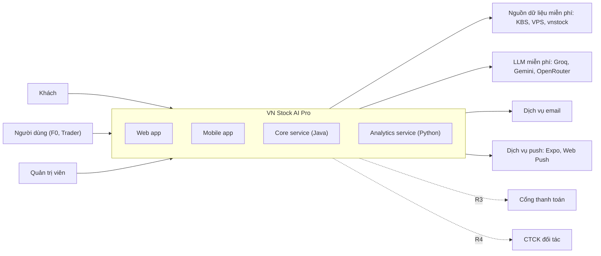
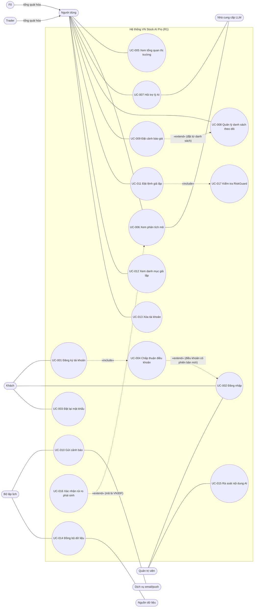

# Software Requirements Specification (SRS)

**Hệ thống:** VN Stock AI Pro (tên làm việc, chờ tên chính thức: BRD `OQ-002`)
**Mã tài liệu:** SRS-AITS-001
**Phiên bản:** 0.2 (0.1 → 0.2: áp dụng CR-01 sự kiện sử dụng, CR-02 beta kín có mã mời, từ PRD-AITS-001)
**Trạng thái:** Draft
**Chuẩn áp dụng:** ISO/IEC/IEEE 29148-2018, mục 9.5 (nội dung SRS). Đặc tả use case theo UML 2.0 và `UseCase_Document_UML2.0_Checklist.xlsx`
**Đầu vào:** [BRD.md](BRD.md) v0.3 (BRD-AITS-001)
**Ngày:** 2026-10-21

---

## 0. Tóm tắt kiểm chứng đầu vào

### 0.1 Đầu vào

| Nguồn | Nội dung |
|---|---|
| BRD v0.3 | 75 yêu cầu kinh doanh (BR-001 đến BR-075), quy tắc BRU-001 đến BRU-013, ràng buộc CON-001 đến CON-011, lộ trình R1–R5 |
| SRC-015 (elicitation 3) | Kênh Web + Mobile; backend Java Spring Boot + Python; R1 tối giản, mọi dịch vụ miễn phí; phát triển theo mô hình Claude lập kế hoạch và audit, agent miễn phí thực thi |
| SRC-017 | Dự án tham chiếu VN STOCK AI PRO (React/Node). Sản phẩm mới viết mới, chỉ tham khảo ý tưởng và thuật toán (DEC-011) |
| DEC-010 | Giao dịch giả lập thủ công và RiskGuard thuộc R1 |

### 0.2 Cách đọc tài liệu

- Mỗi yêu cầu có **Release** (R1–R5). **R1 được đặc tả chi tiết nhất.** R2 đặc tả ở mức đủ để thiết kế. R3–R5 đặc tả ở mức khung để giữ khả năng truy vết.
- Các giá trị ghi **(đề xuất)** là giá trị kỹ thuật BA/kiến trúc đề xuất để lấp các ngưỡng `[TBD]` của BRD. Chúng chờ PO duyệt (Mục 8) và có thể đổi mà không phải sửa thiết kế.
- Từ chuẩn: **phải** = *shall*, **phải không** = *shall not*, **nên** = *should*, **có thể** = *may*.

### 0.3 Ba rủi ro hàng đầu đối với đặc tả

1. **Nguồn dữ liệu miễn phí** (KBS, VPS, vnstock) không có cam kết dịch vụ và hạn chế dùng thương mại (RSK-014). Đặc tả buộc tách nguồn qua adapter (SC-010) và giới hạn R1 ở beta kín (SC-006).
2. **Quota LLM miễn phí thấp** (khoảng 50–1.000 request/ngày cho mỗi nhà cung cấp). Đặc tả buộc có cache, hạn mức theo người dùng và chế độ dự phòng "chỉ dữ kiện" (FR-062, FR-067, FR-072).
3. **Ranh giới pháp lý chưa chốt** (BRD OQ-018, OQ-031). Các tính năng nhạy cảm được bật/tắt bằng cờ tính năng, mặc định tắt (FR-045, FR-214).

---

## 1. Giới thiệu

### 1.1 Mục đích

SRS chuyển yêu cầu kinh doanh trong BRD thành yêu cầu phần mềm có thể kiểm thử, làm đầu vào cho blueprint (IEEE 1016, [Blueprint_SDD.md](../design/Blueprint_SDD.md)) và cho các gói công việc giao cho AI coding agent.

**Người đọc:** đội phát triển (gồm agent như OpenCode), QA, PO, cố vấn pháp lý (Mục 3.2.5, 3.2.13), Claude với vai trò lập kế hoạch và audit.

### 1.2 Phạm vi

VN Stock AI Pro là nền tảng **công cụ** phân tích chứng khoán Việt Nam có AI, gồm web app, mobile app và backend.

- **R1** cung cấp: tài khoản; dữ liệu thị trường; tổng quan thị trường; phân tích mã; trợ lý AI tiếng Việt không khuyến nghị; danh sách theo dõi; cảnh báo giá; giao dịch giả lập có RiskGuard; quyền dữ liệu cá nhân; quản trị cơ bản.
- **Hệ thống không** đưa khuyến nghị đầu tư, **không** gửi lệnh thật trước R4, và **không** tự đặt lệnh không có xác nhận ở bất kỳ release nào (BRU-001, BRU-002, CON-001).

### 1.3 Tổng quan sản phẩm

#### 1.3.1 Bối cảnh hệ thống

#### 1.3.2 Chức năng chính theo release

| Release | Module | Nhóm BR |
|---|---|---|
| R1 | M01 Tài khoản, M02 Dữ liệu, M03 Tổng quan thị trường, M04 Phân tích mã, M05 Trợ lý AI, M06 Theo dõi, M07 Cảnh báo giá, M08 Giả lập thủ công + RiskGuard, M17 Quản trị, M18 Hỗ trợ | A, B, C, E (một phần), F, L, M, BR-059, BR-072 đến BR-075 |
| R2 | M09 Bộ lọc, M10 Chiến lược, M11 Kiểm thử lịch sử, M08 Giả lập theo chiến lược, M07 Cảnh báo theo chiến lược, M12 Danh mục nhập tay | D, E, F, H |
| R3 | M14 Thương mại, M15 B2B, M16 API cho dev, dữ liệu có giấy phép, hạ tầng tại VN | I, J, K, BR-010 |
| R4 | M13 Lệnh bán tự động, đồng bộ danh mục, đối soát CTCK | G, BR-048, BR-063, BR-064 |
| R5 | Theo điều kiện của BRD Mục 5.3 | — |

#### 1.3.3 Tác nhân (actor)

| ID | Tác nhân | Loại | Mô tả | Release |
|---|---|---|---|---|
| ACT-01 | Khách | Chính | Chưa đăng nhập; chỉ đăng ký, đăng nhập, xem trang giới thiệu và giới hạn gói | R1 |
| ACT-02 | Người dùng | Chính | Đã đăng ký và xác minh email. Tổng quát hóa của ACT-02a và ACT-02b | R1 |
| ACT-02a | Nhà đầu tư mới (F0) | Chính | Kế thừa ACT-02 | R1 |
| ACT-02b | Trader | Chính | Kế thừa ACT-02 | R1 |
| ACT-03 | Quản trị viên | Chính | Vận hành, rà soát nội dung AI, quản lý điều khoản | R1 |
| ACT-04 | Bộ lập lịch | Phụ (hệ thống) | Kích hoạt đồng bộ dữ liệu, đánh giá cảnh báo, hết hạn lệnh giả lập | R1 |
| ACT-05 | Nguồn dữ liệu thị trường | Phụ (ngoài) | KBS, VPS, vnstock (R1); nhà cung cấp có giấy phép (R3) | R1 |
| ACT-06 | Nhà cung cấp LLM | Phụ (ngoài) | Groq, Google Gemini API, OpenRouter (R1, gói miễn phí) | R1 |
| ACT-07 | Dịch vụ email | Phụ (ngoài) | Gửi email xác minh, đặt lại mật khẩu, cảnh báo | R1 |
| ACT-08 | Dịch vụ push | Phụ (ngoài) | Expo Push (mobile), Web Push (web) | R1 |
| ACT-09 | Môi giới / Quản trị tổ chức B2B | Chính | — | R3 |
| ACT-10 | Nhà phát triển API | Chính | — | R3 |
| ACT-11 | Cổng thanh toán | Phụ (ngoài) | — | R3 |
| ACT-12 | CTCK đối tác | Phụ (ngoài) | — | R4 |

#### 1.3.4 Giới hạn

1. Không khuyến nghị, không cam kết lợi nhuận (BRU-001, CON-002).
2. Không gửi lệnh thật trước R4. Không có lệnh nào được gửi mà thiếu xác nhận riêng (CON-001).
3. Dữ liệu R1 là dữ liệu trễ, lấy từ nguồn miễn phí. Không cam kết thời gian thực (FR-022).
4. Hạ tầng R1 là một máy ảo miễn phí, không có dự phòng nóng (NFR-A01).

### 1.4 Định nghĩa

Dùng glossary của BRD Mục 13.1, bổ sung:

| Thuật ngữ | Định nghĩa |
|---|---|
| Core service | Dịch vụ Java Spring Boot: tài khoản, người dùng, theo dõi, cảnh báo, giả lập, quản trị; là cổng API duy nhất mở ra Internet |
| Analytics service | Dịch vụ Python FastAPI: thu thập dữ liệu, tính toán định lượng, AI; chỉ nhận gọi nội bộ từ Core |
| Gói dữ kiện (facts) | Tập số liệu do hệ thống tính, có ID, giá trị, nguồn, thời điểm. LLM chỉ được diễn đạt các số liệu này |
| Fail-closed | Khi dữ liệu thiếu, cũ hoặc sai, hệ thống báo "không khả dụng" thay vì hiển thị giá trị thay thế |
| Provenance | Nhãn nguồn gốc dữ liệu: nguồn, thời điểm, loại (trực tiếp/trễ, tính toán, đóng cửa) |
| RiskGuard | Bộ kiểm tra lệnh (giả lập ở R1–R3, thật ở R4) theo BRU-003 đến BRU-008 và hạn mức của người dùng |
| Phiên | Trạng thái giao dịch: PRE_OPEN, ATO, CONTINUOUS, LUNCH_BREAK, ATC, POST_CLOSE, CLOSED |
| Beta kín | Nhóm người dùng được mời, không thu phí, không mở đăng ký công khai (SC-006) |
| p95 | Phân vị 95 của thời gian phản hồi |

---

## 2. Tài liệu tham chiếu

| Tài liệu | Phiên bản |
|---|---|
| BRD-AITS-001 ([BRD.md](BRD.md)) | 0.3 |
| ISO/IEC/IEEE 29148 | 2018 |
| IEEE 1016 (Software Design Description) | 2009 |
| OWASP Application Security Verification Standard | 4.0.3 |
| WCAG | 2.1, mức AA |
| OpenAPI Specification | 3.1 |
| RFC 9457 (Problem Details for HTTP APIs) | 2023 |
| RFC 7519 (JWT) | 2015 |
| Luật BVDLCN 91/2025/QH15; Luật Trí tuệ nhân tạo 134/2025/QH15; Luật Chứng khoán 2019 (hợp nhất 2025) | Xem BRD SRC-005, SRC-007, SRC-008 |

---

## 3. Yêu cầu cụ thể

### 3.1 Giao diện bên ngoài

#### 3.1.1 Giao diện người dùng

| ID | Yêu cầu | Trace | Release | Ưu tiên | Kiểm chứng |
|---|---|---|---|---|---|
| UI-001 | Web app **phải** hiển thị đúng ở chiều rộng 360–1920 px, không cuộn ngang trang, trên 2 phiên bản mới nhất của Chrome, Edge, Safari và Firefox. | DEC-008 | R1 | Must | Test |
| UI-002 | Mobile app **phải** chạy trên Android 10 trở lên (R1, phát hành APK). iOS 16 trở lên được hỗ trợ khi có tài khoản Apple Developer (R3); trước đó người dùng iOS dùng web app cài đặt được (PWA). | DEC-008, SC-013 | R1 | Must | Test |
| UI-003 | Giao diện **phải** dùng tiếng Việt; số theo định dạng vi-VN (1.234.567,89); thời gian theo múi giờ Asia/Ho_Chi_Minh. | BRD 5.1 | R1 | Must | Inspection |
| UI-004 | Màu giá **phải** theo quy ước bảng điện Việt Nam: tăng xanh lá, tham chiếu vàng, giảm đỏ, trần tím, sàn xanh lơ. Mỗi trạng thái có thêm ký hiệu (▲ ▼ ■) để người mù màu vẫn phân biệt được. | SRC-017, NFR-U02 | R1 | Must | Inspection |
| UI-005 | Số liệu **phải** dùng font đơn khoảng (monospace) để các cột thẳng hàng; giao diện mặc định tối, có chế độ sáng. | SRC-017 | R1 | Should | Inspection |
| UI-006 | Mọi khối dữ liệu **phải** có nhãn provenance theo FR-029. | BR-011 | R1 | Must | Inspection |
| UI-007 | Mọi nội dung AI **phải** có nhãn "Nội dung do AI tạo" và tuyên bố "Không phải khuyến nghị đầu tư" ngay trong khối nội dung, không ẩn sau thao tác mở rộng. | BR-002, BR-018 | R1 | Must | Inspection |

#### 3.1.2 Giao diện phần mềm

| ID | Hệ thống ngoài | Yêu cầu | Trace | Release |
|---|---|---|---|---|
| IR-001 | Nguồn dữ liệu thị trường (port) | Analytics **phải** truy cập mọi nguồn dữ liệu qua một giao diện chung, gồm: danh sách mã, giá theo lô mã, sổ lệnh, nến ngày, điểm chỉ số, báo cáo tài chính, chỉ số tài chính. Mỗi kết quả trả về mô hình chuẩn hóa kèm provenance | SC-010, FR-028 | R1 |
| IR-002 | KBS, VPS (endpoint công khai), vnstock (thư viện Python) | Adapter R1. Mỗi adapter **phải** có giới hạn tần suất cấu hình được (mặc định ≤ 1 request/giây cho mỗi nguồn, đề xuất) và timeout 10 giây | SC-006, RSK-014 | R1 |
| IR-003 | Nhà cung cấp LLM (port) | Analytics **phải** gọi LLM qua một giao diện chung: đầu vào là danh sách message, nhiệt độ, số token tối đa; đầu ra là văn bản và số token đã dùng. Adapter R1: Groq, Google Gemini API, OpenRouter (model `:free`). Có thể thêm adapter trả phí (Claude API) ở R3 | SC-010, FR-072 | R1 |
| IR-004 | Dịch vụ email | Core **phải** gửi email qua một adapter SMTP/API. Môi trường dev dùng adapter ghi ra log. Mẫu email: xác minh, đặt lại mật khẩu, thông báo khóa tạm, cảnh báo, xác nhận xóa tài khoản | FR-003, FR-008 | R1 |
| IR-005 | Dịch vụ push | Core **phải** gửi push qua Expo Push API (mobile) và Web Push chuẩn VAPID (web) | FR-097 | R1 |
| IR-006 | Cổng thanh toán | Khung, đặc tả ở R3 | BR-060 | R3 |
| IR-007 | API đặt lệnh của CTCK đối tác | Chỉ dùng kênh chính thức. Ủy quyền bằng token do CTCK cấp; **không** lưu mật khẩu hoặc OTP (BR-047) | BR-043 | R4 |

#### 3.1.3 Giao diện truyền thông

| ID | Yêu cầu | Release |
|---|---|---|
| CI-001 | Mọi kết nối ra Internet **phải** dùng HTTPS, TLS ≥ 1.2. | R1 |
| CI-002 | API công khai **phải** là REST/JSON UTF-8, có phiên bản trong đường dẫn (`/api/v1`), lỗi theo RFC 9457 (`application/problem+json`) kèm trường `code` ổn định. | R1 |
| CI-003 | Thời gian truyền tải **phải** theo ISO 8601 có độ lệch múi giờ; tiền tính bằng đồng, kiểu số nguyên; giá cổ phiếu tính bằng đồng; điểm chỉ số và giá phái sinh dùng số thập phân 2 chữ số. | R1 |
| CI-004 | R1 làm mới giá bằng polling từ client theo chu kỳ của FR-022. Đẩy giá thời gian thực (SSE/WebSocket) để ở R2. | R1 |

### 3.2 Yêu cầu chức năng

> Cột **Trace** trỏ về BR, BRU, CON của BRD. Chữ "Derived" nghĩa là yêu cầu được suy ra để đáp ứng một nhu cầu (SN) hoặc ràng buộc; có ghi lý do.

#### 3.2.1 M01: Tài khoản và xác thực

| ID | Yêu cầu | Trace | Release | Ưu tiên | Kiểm chứng |
|---|---|---|---|---|---|
| FR-001 | Hệ thống **phải** cho phép Khách đăng ký bằng email và mật khẩu. | BR-004 (Derived: cần danh tính để phân quyền) | R1 | Must | Test |
| FR-002 | Mật khẩu **phải** dài 10–128 ký tự và không nằm trong danh sách mật khẩu phổ biến (≥ 10.000 mục). | NFR-S01 | R1 | Must | Test |
| FR-003 | Hệ thống **phải** gửi email xác minh chứa liên kết dùng một lần, hết hạn sau 24 giờ. Tài khoản ở trạng thái `PENDING_VERIFICATION` cho đến khi xác minh. | BR-004 | R1 | Must | Test |
| FR-004 | Hệ thống **phải** cho phép tài khoản đã xác minh đăng nhập bằng email và mật khẩu. Hệ thống cấp access token hiệu lực 15 phút và refresh token hiệu lực 30 ngày; refresh token được xoay vòng sau mỗi lần dùng. | NFR-S04 | R1 | Must | Test |
| FR-005 | Sau 5 lần đăng nhập sai liên tiếp trong 15 phút, hệ thống **phải** khóa đăng nhập của tài khoản đó 15 phút và gửi email thông báo. | NFR-S05 | R1 | Must | Test |
| FR-006 | Khi người dùng đăng xuất, hệ thống **phải** thu hồi refresh token của phiên hiện tại. | NFR-S04 | R1 | Must | Test |
| FR-007 | Hệ thống **nên** cho phép người dùng đăng xuất khỏi mọi thiết bị, tức là thu hồi mọi refresh token của tài khoản. | NFR-S04 | R1 | Should | Test |
| FR-008 | Hệ thống **phải** cho phép đặt lại mật khẩu qua liên kết email dùng một lần, hết hạn sau 30 phút. Phản hồi không được tiết lộ email có tồn tại hay không. Sau khi đặt lại, mọi refresh token bị thu hồi. | NFR-S01 | R1 | Must | Test |
| FR-009 | Hệ thống **phải** cho phép người dùng đã đăng nhập đổi mật khẩu sau khi nhập đúng mật khẩu hiện tại. | NFR-S01 | R1 | Must | Test |
| FR-010 | Hệ thống **nên** cho phép người dùng xem và cập nhật tên hiển thị và kênh nhận cảnh báo mặc định. | Derived (SN-006) | R1 | Should | Test |
| FR-011 | Người dùng chưa chấp thuận phiên bản điều khoản hiện hành **phải** chỉ truy cập được các chức năng: xem và chấp thuận điều khoản, xem hồ sơ, đăng xuất, xóa tài khoản. Mỗi lần chấp thuận được ghi nhận gồm người dùng, phiên bản, thời điểm, IP, user-agent. | BR-001 | R1 | Must | Test |
| FR-012 | Khi một phiên bản điều khoản mới được phát hành, hệ thống **phải** yêu cầu người dùng chấp thuận lại ở lần truy cập kế tiếp. | BR-001 | R1 | Must | Test |
| FR-013 | Hệ thống **phải** ghi nhận đồng ý riêng cho từng mục đích xử lý dữ liệu cá nhân: P1 cung cấp dịch vụ cốt lõi (bắt buộc); P2 gửi cảnh báo qua email/push (tùy chọn); P3 phân tích sử dụng để cải tiến sản phẩm (tùy chọn); P4 email tiếp thị (tùy chọn, mặc định tắt). | BR-065 | R1 | Must | Test |
| FR-014 | Hệ thống **phải** cho phép rút đồng ý với từng mục đích tùy chọn; việc xử lý cho mục đích đó dừng trong ≤ 5 phút. Rút P1 được xử lý như yêu cầu xóa tài khoản (FR-016). | BR-066 | R1 | Must | Test |
| FR-015 | Trước lần đầu người dùng mở dữ liệu hoặc chức năng của VN30F, hệ thống **phải** yêu cầu xác nhận đã đọc công bố rủi ro phái sinh, và ghi nhận như FR-011. | BR-003 | R1 | Must | Test |
| FR-016 | Hệ thống **phải** cho phép người dùng yêu cầu xóa tài khoản sau khi nhập lại mật khẩu. Tài khoản chuyển sang `DELETION_REQUESTED` và bị đăng xuất mọi nơi. Trong ≤ 30 ngày (đề xuất, BRD OQ-034), dữ liệu cá nhân bị xóa hoặc ẩn danh hóa. Bản ghi phải giữ theo luật (nhật ký kiểm toán, nhật ký AI) chỉ còn tham chiếu ẩn danh. | BR-067 | R1 | Must | Test |
| FR-017 | Hệ thống **nên** cho phép người dùng tải về dữ liệu cá nhân của mình dạng JSON. | Derived (CON-003: quyền truy cập của chủ thể dữ liệu) | R1 | Should | Test |
| FR-018 | Tài khoản quản trị viên **phải** đăng nhập bằng mật khẩu kèm mã TOTP (xác thực hai lớp). | NFR-S01 | R1 | Must | Test |
| FR-019 | Khi cờ `beta_invite_only` bật (mặc định bật ở R1), hệ thống **phải** chỉ cho phép đăng ký với mã mời hợp lệ (chưa bị thu hồi, còn hạn, còn lượt). Mỗi lần đăng ký thành công trừ 1 lượt của mã. Mã không hợp lệ trả lỗi `INVITE_INVALID` mà không tiết lộ lý do cụ thể. | SC-006, RSK-014 (CR-02) | R1 | Must | Test |

#### 3.2.2 M02: Dữ liệu thị trường

| ID | Yêu cầu | Trace | Release | Ưu tiên | Kiểm chứng |
|---|---|---|---|---|---|
| FR-020 | Mỗi ngày giao dịch, trước 08:30, hệ thống **phải** đồng bộ danh mục mã: cổ phiếu HOSE, HNX, UPCoM; hợp đồng VN30F đang lưu hành; sàn, ngành, thành phần rổ chỉ số có sẵn từ nguồn (VN30, VN100, ...). | BR-005, BR-006 | R1 | Must | Test |
| FR-021 | Hệ thống **phải** cho phép tìm mã theo mã hoặc tên, gõ không dấu vẫn tìm được, trả về tối đa 20 kết quả. | Derived (SN-005) | R1 | Must | Test |
| FR-022 | Trong phiên giao dịch, hệ thống **phải** cập nhật giá mới nhất của mọi mã thuộc phạm vi (giá khớp, thay đổi, %, khối lượng, giá trị, tham chiếu, trần, sàn, cao, thấp, mở cửa) với chu kỳ ≤ 60 giây (đề xuất cho BRD OQ-020; nguồn miễn phí). | BR-007 | R1 | Must | Test |
| FR-023 | Khi có người đang xem một mã, hệ thống **nên** cập nhật sổ lệnh 3 bước giá mua/bán của mã đó với chu kỳ ≤ 15 giây. | Derived (SN-006, SRC-017) | R1 | Should | Test |
| FR-024 | Hệ thống **phải** xác định trạng thái phiên (PRE_OPEN, ATO, CONTINUOUS, LUNCH_BREAK, ATC, POST_CLOSE, CLOSED) theo lịch giao dịch và lịch nghỉ lễ cấu hình được, riêng cho cổ phiếu cơ sở và phái sinh. | BRU-006 | R1 | Must | Test |
| FR-025 | Hệ thống **phải** lưu nến ngày (mở, cao, thấp, đóng, khối lượng, giá trị) tối thiểu 5 năm cho mỗi mã (đề xuất cho BRD OQ-021), và tự bổ sung lịch sử khi có mã mới. | BR-008 | R1 | Must | Inspection |
| FR-026 | Hệ thống **nên** lưu báo cáo tài chính năm và quý tối thiểu 5 năm khi nguồn có dữ liệu. | BR-009 | R1 | Should | Inspection |
| FR-027 | Hệ thống **phải** cập nhật điểm các chỉ số VN-Index, VN30, HNX-Index, UPCoM-Index theo chu kỳ của FR-022. | BR-073 | R1 | Must | Test |
| FR-028 | Mỗi bản ghi dữ liệu thị trường **phải** lưu nguồn dữ liệu và thời điểm lấy. | BR-010, SRC-017 | R1 | Must | Inspection |
| FR-029 | Mỗi khối dữ liệu hiển thị **phải** có nhãn provenance là một trong: "Trễ ≤ N giây · <nguồn>", "Tính toán · <thời điểm>", "Đóng cửa <ngày>". Môi trường production không được có nhãn "Demo". | BR-011 | R1 | Must | Inspection |
| FR-030 | Khi dữ liệu thiếu, không hợp lệ, hoặc cũ hơn 2 lần chu kỳ cập nhật trong phiên, hệ thống **phải** hiển thị trạng thái "Dữ liệu không khả dụng" hoặc "Dữ liệu đã cũ" và **phải không** hiển thị giá trị thay thế (số 0, giá cũ không gắn nhãn, dữ liệu giả). | BR-015, SRC-017 | R1 | Must | Test |
| FR-031 | Hệ thống **phải** kiểm tra chất lượng mỗi bản ghi: thấp ≤ mở, đóng ≤ cao; khối lượng ≥ 0; giá nằm trong [sàn, trần]; không thiếu phiên. Bản ghi lỗi bị cách ly và tạo cảnh báo cho quản trị viên. | BR-010 | R1 | Must | Test |
| FR-032 | Khi nguồn chính lỗi ≥ 3 lần liên tiếp với một loại dữ liệu, hệ thống **nên** chuyển sang nguồn phụ đã cấu hình và ghi provenance theo nguồn thực tế. | NFR-A03 | R1 | Should | Test |
| FR-033 | Hệ thống **phải** gộp các yêu cầu đồng thời cho cùng một dữ liệu thành một lần gọi nguồn, và tuân thủ giới hạn tần suất của IR-002. | IR-002, SRC-017 | R1 | Must | Test |

#### 3.2.3 M03: Tổng quan thị trường

| ID | Yêu cầu | Trace | Release | Ưu tiên | Kiểm chứng |
|---|---|---|---|---|---|
| FR-040 | Hệ thống **nên** hiển thị điểm, thay đổi, % thay đổi và giá trị giao dịch của VN-Index, VN30, HNX-Index, UPCoM-Index. | BR-073 | R1 | Should | Test |
| FR-041 | Hệ thống **nên** hiển thị độ rộng thị trường theo từng sàn: số mã tăng, giảm, đứng giá, trần, sàn; tỷ lệ mã có giá đóng cửa gần nhất trên MA20, MA50, MA200. | BR-073 | R1 | Should | Test |
| FR-042 | Hệ thống **nên** hiển thị 10 mã tăng mạnh nhất, 10 mã giảm mạnh nhất, và 10 mã thanh khoản đột biến (khối lượng phiên ≥ 2 lần trung bình 20 phiên, đề xuất), lọc được theo sàn. | BR-073 | R1 | Should | Test |
| FR-043 | Hệ thống **nên** cung cấp dữ liệu bản đồ nhiệt theo ngành: trọng số chọn được (giá trị giao dịch, số mã, số mã tăng); lọc chiều thị trường (tất cả, tăng, giảm); đi sâu từ ngành xuống mã; mỗi ngành có mã dẫn dắt. | BR-074 | R1 | Should | Demonstration |
| FR-044 | Hệ thống **nên** hiển thị thẻ nhận định thị trường sinh theo quy tắc công bố: ngành có giá trị giao dịch và % thay đổi nổi bật, độ rộng, cảnh báo biến động chung. Thẻ **phải không** chứa khuyến nghị. | BR-073, BR-016 | R1 | Should | Test |
| FR-045 | Hệ thống **có thể** hiển thị trạng thái thị trường (7 trạng thái: xu hướng tăng, xu hướng giảm, đi ngang, biến động cao, biến động thấp, tích lũy, phân phối) và vùng hỗ trợ/kháng cự theo quy tắc công bố. Các chỉ số dạng điểm (rủi ro gãy xu hướng, sức mạnh hồi phục) chỉ được bật qua cờ tính năng sau khi BRD OQ-031 có kết luận; **mặc định tắt**. | BR-075 | R1 | Could | Review pháp lý, Test |

#### 3.2.4 M04: Phân tích mã

| ID | Yêu cầu | Trace | Release | Ưu tiên | Kiểm chứng |
|---|---|---|---|---|---|
| FR-050 | Trang chi tiết mã **phải** hiển thị giá, thay đổi, tham chiếu, trần, sàn, khối lượng, giá trị, sổ lệnh 3 bước giá (FR-023), và biểu đồ nến khung ngày/tuần/tháng có khối lượng. | BR-012 | R1 | Must | Demonstration |
| FR-051 | Hệ thống **phải** tính trên nến ngày các chỉ báo: SMA(20, 50, 200), EMA(12, 26), RSI(14), MACD(12, 26, 9), Bollinger(20, 2), ATR(14), MA khối lượng(20). | BR-012 | R1 | Must | Test (golden data) |
| FR-052 | Hệ thống **phải** sinh mô tả trạng thái của từng chỉ báo theo bảng quy tắc công bố (ví dụ: RSI(14) > 70 thì "vùng quá mua theo quy ước"). Đây là đầu vào cho AI (FR-060). | BR-012 | R1 | Must | Test |
| FR-053 | Hệ thống **nên** hiển thị P/E, P/B, EPS, ROE, ROA, nợ/vốn chủ sở hữu, tăng trưởng doanh thu và lợi nhuận sau thuế theo năm, khi có dữ liệu. | BR-013 | R1 | Should | Test |
| FR-054 | Mỗi chỉ báo và chỉ số **nên** có phần giải thích bằng ngôn ngữ phổ thông, do quản trị viên quản lý nội dung. | BR-020 | R1 | Should | Inspection |

#### 3.2.5 M05: Trợ lý AI

> Nguyên tắc thiết kế bắt buộc: **"dữ kiện vào, lời văn ra"**. Hệ thống tính mọi số liệu; LLM chỉ diễn đạt (SDD ADR-009).

| ID | Yêu cầu | Trace | Release | Ưu tiên | Kiểm chứng |
|---|---|---|---|---|---|
| FR-060 | Hệ thống **phải** sinh tóm tắt AI tiếng Việt 80–200 từ cho một mã, chỉ từ gói dữ kiện đóng cửa gần nhất (FR-051 đến FR-053). Mỗi mã sinh tối đa 1 bản cho mỗi ngày giao dịch; các lần xem sau dùng bản đã lưu. | BR-012, BR-013 | R1 | Must | Test |
| FR-061 | Hệ thống **phải** trả lời câu hỏi tiếng Việt (≤ 500 ký tự) về mã hoặc thị trường thuộc phạm vi. Hệ thống xác định mã và loại dữ kiện cần thiết, tính gói dữ kiện, rồi dùng LLM để diễn đạt câu trả lời. | BR-014 | R1 | Must | Test |
| FR-062 | Mỗi người dùng gói miễn phí **phải** bị giới hạn ≤ 10 câu hỏi/ngày (đề xuất, BRD OQ-028), kèm hạn mức toàn hệ thống theo quota nhà cung cấp. Hệ thống hiển thị số lượt còn lại. Khi hết lượt, hệ thống trả lỗi `AI_QUOTA_EXCEEDED`. | BR-059, SA-002 | R1 | Must | Test |
| FR-063 | Mỗi con số trong nội dung AI **phải** có chú thích trỏ tới dữ kiện nguồn, hiển thị nguồn và thời điểm. | BR-015 | R1 | Must | Test |
| FR-064 | Mỗi con số trong nội dung AI **phải** khớp giá trị của dữ kiện được chú thích, sai số tương đối ≤ 0,5% hoặc khớp sau làm tròn hiển thị. Nội dung có số không khớp bị loại. | BR-015 | R1 | Must | Test |
| FR-065 | Hệ thống **phải** phát hiện và loại nội dung AI chứa khuyến nghị mua/bán/nắm giữ, giá mục tiêu, điểm mua/bán, hoặc lời kêu gọi hành động giao dịch với một mã cụ thể. | BR-016 | R1 | Must | Test (bộ red-team) |
| FR-066 | Hệ thống **phải** phát hiện và loại nội dung AI chứa cam kết hoặc bảo đảm lợi nhuận. | BR-017 | R1 | Must | Test |
| FR-067 | Khi nội dung bị loại bởi FR-064, FR-065 hoặc FR-066, hệ thống **phải** sinh lại tối đa 1 lần. Nếu vẫn bị loại, hệ thống trả về bảng dữ kiện kèm thông báo "Tóm tắt AI tạm thời không khả dụng". | BR-016, NFR-AI03 | R1 | Must | Test |
| FR-068 | Khi câu hỏi xin khuyến nghị (ví dụ "có nên mua X?") hoặc nằm ngoài phạm vi, hệ thống **phải** trả lời bằng nội dung chuẩn: nêu rõ nền tảng không tư vấn đầu tư và gợi ý các dữ kiện có thể xem. | BR-016 | R1 | Must | Test |
| FR-069 | Mọi nội dung AI **phải** hiển thị theo UI-007. | BR-002, BR-018 | R1 | Must | Inspection |
| FR-070 | Hệ thống **phải không** gửi dữ liệu cá nhân tới nhà cung cấp LLM. Trước khi gửi, câu hỏi được loại bỏ email, số điện thoại, số CCCD/CMND, số tài khoản; người dùng chỉ được tham chiếu bằng mã băm. | CON-003, SC-008 | R1 | Must | Test |
| FR-071 | Hệ thống **phải** lưu nhật ký mỗi lần sinh nội dung AI, gồm: câu hỏi đã che dữ liệu cá nhân, gói dữ kiện và mã băm, phiên bản mẫu prompt, nhà cung cấp, model, đầu ra, kết quả từng bộ kiểm tra, trạng thái cuối, độ trễ. Thời hạn lưu ≥ 5 năm (đề xuất, BRD OQ-022). | BR-019 | R1 | Must | Inspection |
| FR-072 | Hệ thống **phải** gọi nhà cung cấp LLM theo thứ tự ưu tiên cấu hình được. Khi một nhà cung cấp lỗi, quá thời gian chờ hoặc hết quota, hệ thống chuyển sang nhà cung cấp kế tiếp. Khi tất cả đều lỗi, áp dụng phần dự phòng của FR-067. | IR-003, NFR-A03 | R1 | Must | Test |
| FR-073 | Hệ thống **nên** cho phép người dùng đánh giá nội dung AI (hữu ích / không hữu ích) và báo cáo "nội dung vi phạm". Báo cáo được đưa vào hàng đợi rà soát (FR-212). | BR-019, MET-010 | R1 | Should | Test |
| FR-074 | Mỗi tuần, hệ thống **nên** chọn ngẫu nhiên ≥ 50 nội dung AI đưa vào hàng đợi rà soát. | MET-010, MET-012 | R1 | Should | Inspection |

#### 3.2.6 M06: Danh sách theo dõi

| ID | Yêu cầu | Trace | Release | Ưu tiên | Kiểm chứng |
|---|---|---|---|---|---|
| FR-080 | Hệ thống **nên** cho phép mỗi người dùng tạo tối đa 5 danh sách theo dõi, mỗi danh sách tối đa 50 mã (đề xuất, BRD OQ-028). | Derived (SN-005: theo dõi mã) | R1 | Should | Test |
| FR-081 | Hệ thống **nên** cho phép thêm, xóa và sắp xếp mã trong danh sách. | Derived (SN-005) | R1 | Should | Test |
| FR-082 | Hệ thống **nên** hiển thị giá mới nhất và % thay đổi của các mã trong danh sách, làm mới theo chu kỳ FR-022. | Derived (SN-006) | R1 | Should | Test |

#### 3.2.7 M07: Cảnh báo

| ID | Yêu cầu | Trace | Release | Ưu tiên | Kiểm chứng |
|---|---|---|---|---|---|
| FR-090 | Hệ thống **nên** cho phép tạo cảnh báo cho một mã với điều kiện giá ≥ / ≤ ngưỡng, % thay đổi ≥ / ≤ ngưỡng, hoặc khối lượng phiên ≥ ngưỡng. Người dùng chọn kênh (push, email, trong ứng dụng) và hiệu lực (đến khi hủy, hoặc N ngày). Mỗi người dùng có tối đa 20 cảnh báo đang hoạt động (đề xuất). | BR-033 | R1 | Should | Test |
| FR-091 | Với mỗi lần cập nhật giá trong phiên, hệ thống **nên** đánh giá cảnh báo và chỉ kích hoạt khi điều kiện chuyển từ không thỏa sang thỏa. | BR-033 | R1 | Should | Test |
| FR-092 | Hệ thống **nên** gửi thông báo trong ≤ 60 giây kể từ khi ghi nhận giá thỏa điều kiện (đề xuất cho BRD OQ-023). | BR-033 | R1 | Should | Test |
| FR-093 | Mỗi cảnh báo **nên** kích hoạt tối đa 1 lần mỗi phiên, sau đó ở trạng thái chờ đến phiên kế tiếp. | BR-033 | R1 | Should | Test |
| FR-094 | Hệ thống **có thể** lưu lịch sử kích hoạt cảnh báo trong 90 ngày. | Derived (SN-015) | R1 | Could | Inspection |
| FR-095 | Khi điều kiện của một chiến lược đang kích hoạt được thỏa mãn, hệ thống **phải** gửi cảnh báo trong ≤ 60 giây (đề xuất cho BRD OQ-023). | BR-032 | R2 | Must | Test |
| FR-096 | Hệ thống **nên** lưu mọi thông báo vào hộp thư trong ứng dụng của người dùng. | BR-045 (Derived) | R1 | Should | Test |
| FR-097 | Hệ thống **nên** cho phép đăng ký và hủy thiết bị nhận push; thiết bị bị hủy khi người dùng đăng xuất trên thiết bị đó. Push chỉ gửi khi người dùng đồng ý mục đích P2 (FR-013). | BR-065 | R1 | Should | Test |

#### 3.2.8 M08: Giao dịch giả lập và RiskGuard

> R1: lệnh thủ công, chỉ cổ phiếu cơ sở. R2: chạy theo chiến lược và hỗ trợ VN30F. Quy tắc khớp lệnh và mọi giá trị mặc định được công bố trên trang "Quy tắc giả lập" (FR-109).

| ID | Yêu cầu | Trace | Release | Ưu tiên | Kiểm chứng |
|---|---|---|---|---|---|
| FR-100 | Mỗi người dùng **phải** có 1 tài khoản giả lập với vốn ảo ban đầu 500.000.000 đồng (đề xuất, OQ-049). | BR-030 | R1 | Must | Test |
| FR-101 | Hệ thống **phải** cho phép đặt lệnh giả lập thủ công cho cổ phiếu cơ sở: mã, chiều (mua/bán), loại lệnh (LO, MP), khối lượng, giá (với LO). Mỗi lệnh có khóa chống trùng do client sinh. | BR-030 | R1 | Must | Test |
| FR-102 | RiskGuard **phải** từ chối lệnh có khối lượng không phải bội số của lô giao dịch (mặc định 100 cổ phiếu), mã lỗi `RISK_LOT_SIZE`. | BRU-004 | R1 | Must | Test |
| FR-103 | RiskGuard **phải** từ chối lệnh LO có giá ngoài [sàn, trần] của phiên hoặc sai bước giá cấu hình, mã lỗi `RISK_PRICE_BAND` hoặc `RISK_TICK_SIZE`. | BRU-003, BRU-004 | R1 | Must | Test |
| FR-104 | RiskGuard **phải** từ chối lệnh mua khi tiền khả dụng nhỏ hơn giá trị lệnh cộng phí ước tính, mã lỗi `RISK_INSUFFICIENT_CASH`. | BR-030 | R1 | Must | Test |
| FR-105 | RiskGuard **phải** từ chối lệnh bán vượt số chứng khoán khả dụng (đã về tài khoản theo T+2, trừ phần đang chờ bán). Đây là quy tắc chặn bán khống, mã lỗi `RISK_INSUFFICIENT_SHARES`. | BRU-005 | R1 | Must | Test |
| FR-106 | RiskGuard **phải** từ chối lệnh không hợp lệ với phiên hiện tại: MP chỉ trong CONTINUOUS; không nhận lệnh khi CLOSED, LUNCH_BREAK, POST_CLOSE; dữ liệu giá đang ở trạng thái fail-closed (FR-030). Mã lỗi `RISK_SESSION` hoặc `DATA_STALE`. | BRU-006, FR-030 | R1 | Must | Test |
| FR-107 | RiskGuard **phải** từ chối lệnh vượt hạn mức giá trị mỗi lệnh hoặc hạn mức tổng giá trị trong ngày do người dùng đặt, mã lỗi `RISK_ORDER_LIMIT` hoặc `RISK_DAILY_LIMIT`. | BR-040, BR-041 | R1 | Must | Test |
| FR-108 | Khi NAV giả lập giảm tới ngưỡng lỗ tối đa do người dùng đặt (tính từ đỉnh NAV), RiskGuard **phải** chuyển tài khoản sang `HALTED`: từ chối lệnh mua mới (`RISK_HALTED`), vẫn cho phép bán. Người dùng mở lại bằng thao tác xác nhận. | BR-041 (Derived), SRC-017 | R1 | Must | Test |
| FR-109 | Hệ thống **phải** khớp lệnh giả lập theo quy tắc công bố. MP khớp toàn bộ tại giá khớp gần nhất khi nhận lệnh. LO khớp toàn bộ tại giá đặt khi giá khớp gần nhất bằng hoặc tốt hơn giá đặt (mua: ≤ giá đặt; bán: ≥ giá đặt). LO chưa khớp hết hiệu lực sau phiên ATC. R1 không mô phỏng khớp một phần. | BR-031 | R1 | Must | Test |
| FR-110 | Mọi biến động tiền và chứng khoán giả lập **phải** được ghi thành bút toán không sửa được trong sổ cái. Số dư bằng tổng các bút toán. Phí bằng tỷ lệ cấu hình nhân giá trị khớp (mặc định `[TBD: OQ-044]`); thuế bán bằng 0,1% giá trị bán (BRU-008, cần xác minh). | BR-026 (Derived), BRU-008 | R1 | Must | Test |
| FR-111 | Chứng khoán mua **phải** khả dụng để bán sau 2 ngày giao dịch (T+2). Tiền bán được dùng để mua ngay (quy ước giả lập, công bố cho người dùng). | BRU-005 | R1 | Must | Test |
| FR-112 | Hệ thống **phải** hiển thị danh mục giả lập: vị thế, giá vốn bình quân, giá thị trường, lãi/lỗ chưa thực hiện, lãi/lỗ đã thực hiện, NAV, lịch sử lệnh và bút toán. | BR-050 (dạng giả lập) | R1 | Must | Test |
| FR-113 | Hệ thống **phải** cho phép hủy lệnh LO chưa khớp. | BR-030 | R1 | Must | Test |
| FR-114 | Hệ thống **nên** cho phép đặt lại tài khoản giả lập về vốn ban đầu; lịch sử cũ được lưu trữ, không xóa. | BR-030 | R1 | Should | Test |
| FR-115 | Màn hình giả lập **phải** hiển thị cảnh báo "Kết quả giả lập không phản ánh kết quả giao dịch thực". | BR-029 | R1 | Must | Inspection |
| FR-116 | Hệ thống **phải** cho phép chạy một chiến lược đang kích hoạt trên tài khoản giả lập; lệnh do chiến lược sinh ra cũng phải qua RiskGuard. | BR-030 | R2 | Must | Test |
| FR-117 | Hệ thống **nên** hỗ trợ giả lập VN30F: ký quỹ, lãi/lỗ theo giá thị trường hằng ngày, T+0, theo quy tắc BRU-007. | BR-030, BRU-007 | R2 | Should | Test |

#### 3.2.9 M09: Bộ lọc (R2)

| ID | Yêu cầu | Trace | Release | Ưu tiên | Kiểm chứng |
|---|---|---|---|---|---|
| FR-120 | Hệ thống **phải** cho phép lọc toàn bộ mã cổ phiếu theo tổ hợp điều kiện AND (sàn, ngành, giá, khối lượng, giá trị chỉ báo FR-051, chỉ số FR-053) do người dùng chọn. | BR-021 | R2 | Must | Test |
| FR-121 | Hệ thống **nên** cho phép lưu bộ lọc (tối đa 10, đề xuất). | BR-021 | R2 | Should | Test |
| FR-122 | Hệ thống **phải** trả kết quả lọc toàn thị trường trong ≤ 5 giây (NFR-P06). | BR-021 | R2 | Must | Test |

#### 3.2.10 M10: Chiến lược (R2)

| ID | Yêu cầu | Trace | Release | Ưu tiên | Kiểm chứng |
|---|---|---|---|---|---|
| FR-130 | Hệ thống **phải** cho phép tạo chiến lược không cần lập trình. Điều kiện vào lệnh là tổ hợp so sánh hoặc giao cắt giữa chỉ báo, giá và hằng số. Điều kiện thoát gồm chốt lời %, cắt lỗ %, hoặc điều kiện chỉ báo. Quy tắc khối lượng là giá trị cố định (đồng), % NAV, hoặc số cổ phiếu, được làm tròn xuống theo lô. | BR-022 | R2 | Must | Demonstration |
| FR-131 | Chiến lược **phải** được lưu theo lược đồ JSON có phiên bản và được kiểm tra hợp lệ trước khi lưu. | BR-022 | R2 | Must | Test |
| FR-132 | Mỗi lần sửa chiến lược **phải** tạo một phiên bản mới; kết quả kiểm thử và giả lập tham chiếu đúng phiên bản đã chạy. | BR-024 | R2 | Must | Test |
| FR-133 | Hệ thống **phải** ghi nhận người tạo là tác giả và người chịu trách nhiệm của chiến lược, kèm bản ghi chấp thuận trách nhiệm khi tạo chiến lược đầu tiên. | BR-024, BRU-009 | R2 | Must | Inspection |
| FR-134 | Hệ thống **nên** cho phép nhà phát triển viết chiến lược bằng mã Python chạy trong môi trường cách ly. | BR-023 | R3 | Should | Demonstration |

#### 3.2.11 M11: Kiểm thử lịch sử (R2)

| ID | Yêu cầu | Trace | Release | Ưu tiên | Kiểm chứng |
|---|---|---|---|---|---|
| FR-140 | Hệ thống **phải** chạy kiểm thử lịch sử của một phiên bản chiến lược trên 1–20 mã và khoảng thời gian do người dùng chọn, trên nến ngày. Lệnh chạy dạng công việc nền có trạng thái theo dõi được. | BR-025 | R2 | Must | Test |
| FR-141 | Kiểm thử lịch sử **phải** khấu trừ phí và thuế theo biểu phí người dùng nhập, hoặc mặc định theo FR-110. | BR-026 | R2 | Must | Test |
| FR-142 | Kết quả **phải** gồm tổng lợi nhuận, mức sụt giảm tối đa, số giao dịch khép kín, tỷ lệ giao dịch có lãi; **nên** có thêm CAGR và đường NAV. | BR-027 | R2 | Must | Test |
| FR-143 | Kiểm thử **phải** áp dụng BRU-003 đến BRU-008: tín hiệu tại giá đóng cửa ngày t, khớp tại giá mở cửa ngày t+1, làm tròn lô, khả dụng T+2, phí và thuế (thuật toán: SDD 3.9.5). | BR-028 | R2 | Must | Test |
| FR-144 | Kết quả **phải** hiển thị cảnh báo theo BR-029. | BR-029 | R2 | Must | Inspection |
| FR-145 | Một lần chạy 1 mã × 5 năm **phải** hoàn tất trong ≤ 10 giây (NFR-P06). | BR-025 | R2 | Must | Test |

#### 3.2.12 M12: Danh mục thực

| ID | Yêu cầu | Trace | Release | Ưu tiên | Kiểm chứng |
|---|---|---|---|---|---|
| FR-150 | Hệ thống **có thể** cho phép nhập tay vị thế của tài khoản thật (mã, khối lượng, giá vốn). | BR-049 | R2 | Could | Demonstration |
| FR-151 | Hệ thống **nên** tính lãi/lỗ chưa thực hiện của danh mục nhập tay theo giá mới nhất. | BR-050 | R2 | Should | Test |
| FR-152 | Hệ thống **nên** đồng bộ danh mục từ CTCK đối tác khi người dùng ủy quyền. | BR-048 | R4 | Should | Test |

#### 3.2.13 M13: Lệnh bán tự động (R4, chặn bởi BRD ASM-001, ASM-003, OQ-019)

| ID | Yêu cầu | Trace | Release | Ưu tiên | Kiểm chứng |
|---|---|---|---|---|---|
| FR-160 | Khi chiến lược phát sinh tín hiệu, hệ thống **phải** soạn phiếu lệnh chỉ từ tham số của chiến lược. | BR-034 | R4 | Must | Test |
| FR-161 | Hệ thống **phải** chỉ gửi lệnh sau khi chủ tài khoản xác nhận riêng lệnh đó bằng xác thực bước cao (PIN hoặc sinh trắc học trên thiết bị). | BR-035 | R4 | Must | Test |
| FR-162 | Hệ thống **phải không** có xác nhận hàng loạt hoặc xác nhận trước. | BR-036 | R4 | Must | Inspection |
| FR-163 | Phiếu lệnh **phải** hết hiệu lực sau 60 giây nếu chưa được xác nhận (đề xuất, BRD OQ-024). | BR-037 | R4 | Must | Test |
| FR-164 | Phiếu lệnh **nên** hết hiệu lực khi giá thị trường lệch quá 1% so với giá trên phiếu (đề xuất, BRD OQ-024). | BR-038 | R4 | Should | Test |
| FR-165 | Phiếu lệnh **phải** qua RiskGuard (FR-102 đến FR-107) trước khi đưa cho người dùng xác nhận. | BR-039 | R4 | Must | Test |
| FR-166 | Hạn mức giá trị mỗi lệnh và hạn mức ngày **phải** được người dùng đặt trước khi kích hoạt chiến lược có lệnh thật. Không có giá trị mặc định (đề xuất cho BRD OQ-038). | BR-040, BR-041 | R4 | Must | Test |
| FR-167 | Hệ thống **phải** có nút dừng khẩn cấp: dừng soạn phiếu của mọi chiến lược bằng 1 thao tác. | BR-042 | R4 | Must | Test |
| FR-168 | Hệ thống **phải** chỉ gửi lệnh qua IR-007 và giữ tần suất không vượt giới hạn của CTCK. | BR-043, BR-044 | R4 | Must | Test |
| FR-169 | Hệ thống **phải** thông báo mọi thay đổi trạng thái lệnh. | BR-045 | R4 | Must | Test |
| FR-170 | Hệ thống **phải** lưu bản ghi kiểm toán đầy đủ cho mỗi lệnh (FR-071 áp dụng thời hạn tương tự). | BR-046 | R4 | Must | Inspection |
| FR-171 | Hệ thống **phải không** lưu mật khẩu hoặc OTP của CTCK. | BR-047 | R4 | Must | Inspection |

#### 3.2.14 M14 đến M16: Thương mại, B2B, API cho dev

| ID | Yêu cầu | Trace | Release | Ưu tiên | Kiểm chứng |
|---|---|---|---|---|---|
| FR-180 | Hệ thống **phải** công bố công khai giới hạn của gói miễn phí (FR-062, FR-080, FR-090) và áp dụng đúng các giới hạn đó. | BR-059 | R1 | Must | Inspection |
| FR-181 | Hệ thống **phải** gắn mỗi tài khoản với một gói (R1 chỉ có `FREE`) và kiểm tra quyền chức năng theo ma trận gói. | BR-004 | R1 | Must | Test |
| FR-182 | Hệ thống **phải** cho phép mua và nâng cấp gói bằng thanh toán trực tuyến. | BR-060 | R3 | Must | Test |
| FR-183 | Hệ thống **phải** cho phép hủy gia hạn bất kỳ lúc nào. | BR-061 | R3 | Must | Test |
| FR-184 | Doanh nghiệp **phải** xuất hóa đơn điện tử cho mỗi thanh toán thành công. | BR-062 | R3 | Must | Inspection |
| FR-185 | Hệ thống **phải** ghi nhận nguồn giới thiệu khi người dùng mở tài khoản tại CTCK đối tác. | BR-063 | R4 | Must | Test |
| FR-186 | Hệ thống **phải** lập báo cáo đối soát doanh thu chia sẻ hàng tháng. | BR-064 | R4 | Must | Inspection |
| FR-190 | Hệ thống **phải** cho phép quản trị viên tổ chức B2B thêm, khóa và phân quyền tài khoản môi giới. | BR-051 | R3 | Must | Test |
| FR-191 | Hệ thống **nên** cho phép môi giới xem danh mục của khách hàng khi khách hàng đã đồng ý. | BR-052 | R3 | Should | Test |
| FR-192 | Hệ thống **phải** lập báo cáo tháng về số tài khoản môi giới hoạt động. | BR-053 | R3 | Must | Inspection |
| FR-200 | Hệ thống **phải** cấp và thu hồi khóa API cho khách hàng gói API; mỗi khóa có phạm vi đọc dữ liệu. | BR-054 | R3 | Must | Test |
| FR-201 | Hệ thống **phải** giới hạn lượng gọi API theo hạn mức gói. | BR-055 | R3 | Must | Test |
| FR-202 | Hệ thống **nên** báo cáo lượng sử dụng API theo ngày. | BR-056 | R3 | Should | Inspection |
| FR-203 | API cho dev **phải không** có chức năng gửi lệnh bỏ qua FR-161. | BR-057 | R3 | Must | Test |
| FR-204 | Hệ thống **nên** có tài liệu API tiếng Việt sinh từ đặc tả OpenAPI. | BR-058 | R3 | Should | Inspection |

#### 3.2.15 M17: Quản trị

| ID | Yêu cầu | Trace | Release | Ưu tiên | Kiểm chứng |
|---|---|---|---|---|---|
| FR-210 | Quản trị viên **phải** xem, tìm, khóa và mở khóa tài khoản người dùng. Quản trị viên không xem được mật khẩu băm, token, hay nội dung câu hỏi AI gắn với danh tính người dùng. | BR-004, CON-003 | R1 | Must | Test |
| FR-211 | Quản trị viên **phải** phát hành phiên bản mới cho điều khoản, chính sách dữ liệu và công bố rủi ro phái sinh; phiên bản đã phát hành không sửa được. | BR-001, BR-003 | R1 | Must | Test |
| FR-212 | Quản trị viên **phải** rà soát hàng đợi nội dung AI (từ FR-073, FR-074) và ghi kết luận "Đạt" hoặc "Vi phạm" kèm ghi chú. | MET-010, BR-016 | R1 | Must | Test |
| FR-213 | Quản trị viên **phải** xem trạng thái các job thu thập dữ liệu: lần chạy thành công gần nhất, số lỗi, bản ghi bị cách ly, theo nguồn. | FR-031, NFR-O03 | R1 | Must | Demonstration |
| FR-214 | Quản trị viên **phải** bật/tắt cờ tính năng (ví dụ FR-045); mỗi thay đổi được ghi nhật ký kiểm toán. | BR-075, OQ-031 | R1 | Must | Test |
| FR-215 | Hệ thống **phải** lập báo cáo tháng cho các chỉ số đo được ở R1: MET-001, MET-008, MET-010, MET-011, MET-012. | BR-072 | R1 | Must | Inspection |
| FR-216 | Hệ thống **phải** ghi nhật ký kiểm toán (không sửa được) cho các sự kiện: đăng nhập, đăng nhập thất bại, đổi hoặc đặt lại mật khẩu, chấp thuận điều khoản, đồng ý và rút đồng ý, xóa tài khoản, lệnh giả lập, mọi hành động của quản trị viên. | BR-046 (Derived), NFR-S08 | R1 | Must | Inspection |
| FR-217 | Quản trị viên **phải** tạo, xem và thu hồi mã mời, mỗi mã có nhãn, số lượt tối đa (1–1.000) và hạn dùng. Mã chỉ hiển thị một lần khi tạo; hệ thống chỉ lưu bản băm. Mỗi thao tác ghi nhật ký kiểm toán. | SC-006 (CR-02) | R1 | Must | Test |

#### 3.2.16 M18: Hỗ trợ và vận hành

| ID | Yêu cầu | Trace | Release | Ưu tiên | Kiểm chứng |
|---|---|---|---|---|---|
| FR-220 | Hệ thống **nên** cho phép người dùng gửi phản hồi hoặc khiếu nại, nhận mã phiếu, và nhận trả lời qua email trong ≤ 3 ngày làm việc (đề xuất cho BRD OQ-036). | BR-071 | R1 | Should | Inspection |
| FR-221 | Khi có sự cố ảnh hưởng chức năng giao dịch hoặc dữ liệu trong phiên, hệ thống **nên** hiển thị thông báo sự cố cho người dùng trong ≤ 15 phút (đề xuất cho BRD OQ-025). | BR-070 | R1 | Should | Demonstration |
| FR-222 | Mỗi service **phải** cung cấp endpoint kiểm tra sức khỏe (sống / sẵn sàng) cho giám sát. | BR-069 | R1 | Must | Test |
| FR-223 | Khi người dùng đã đồng ý mục đích P3, hệ thống **nên** ghi sự kiện sử dụng theo danh mục PRD 6.2. Mỗi sự kiện chỉ chứa mã người dùng ẩn danh (`userRef`), tên sự kiện, nền tảng, thời điểm và thuộc tính không có dữ liệu cá nhân. Khi chưa có đồng ý P3, sự kiện bị bỏ qua (không lưu). | BR-072 (CR-01) | R1 | Should | Test |
| FR-224 | Hệ thống **nên** nhận sự kiện từ client theo lô (≤ 50 sự kiện mỗi lần gửi, mỗi sự kiện ≤ 2 KB), từ chối tên sự kiện ngoài danh mục cho phép. | BR-072 (CR-01) | R1 | Should | Test |

### 3.3 Yêu cầu khả dụng

| ID | Yêu cầu | Trace | Release | Kiểm chứng |
|---|---|---|---|---|
| NFR-U01 | 5 người dùng mới chưa từng dùng sản phẩm **phải** đi từ đăng ký đến xem tóm tắt AI của mã đầu tiên trong ≤ 3 phút mà không cần hỗ trợ; đạt ≥ 4/5 người (đề xuất). | SN-003 | R1 | Demonstration |
| NFR-U02 | Các luồng đăng ký, đăng nhập, xem mã, đặt lệnh giả lập **phải** đạt WCAG 2.1 AA (tương phản ≥ 4,5:1; dùng được bằng bàn phím; có nhãn cho trình đọc màn hình). | SN-003 | R1 | Test (axe) + Inspection |
| NFR-U03 | Mọi thông báo lỗi **phải** bằng tiếng Việt, nêu nguyên nhân và hành động gợi ý. Mỗi mã lỗi RiskGuard có thông điệp riêng. | SN-003 | R1 | Inspection |
| NFR-U04 | Vùng chạm trên mobile **phải** ≥ 44 × 44 px. | SN-003 | R1 | Inspection |

### 3.4 Yêu cầu hiệu năng

> Đo trên hạ tầng R1 (SDD 3.10).

| ID | Yêu cầu | Trace | Release |
|---|---|---|---|
| NFR-P01 | API đọc không gồm AI: p95 ≤ 500 ms và p99 ≤ 1.500 ms với 100 người dùng đồng thời. | SN-005 | R1 |
| NFR-P02 | Tóm tắt AI đã lưu: p95 ≤ 800 ms. Tóm tắt sinh mới: p95 ≤ 15 giây. | BR-012 | R1 |
| NFR-P03 | Câu trả lời hỏi đáp AI: p95 ≤ 20 giây. | BR-014 | R1 |
| NFR-P04 | Tổng quan thị trường (FR-040 đến FR-043): p95 ≤ 1 giây (dữ liệu tính sẵn sau mỗi chu kỳ thu thập). | BR-073 | R1 |
| NFR-P05 | Đặt lệnh giả lập (gồm RiskGuard và ghi sổ): p95 ≤ 500 ms. | BR-030 | R1 |
| NFR-P06 | Kiểm thử lịch sử 1 mã × 5 năm: ≤ 10 giây. Bộ lọc toàn thị trường: ≤ 5 giây. | BR-021, BR-025 | R2 |
| NFR-P07 | Trang tổng quan trên web: LCP ≤ 2,5 giây qua mạng 4G; JavaScript tải ban đầu ≤ 300 KB (gzip). | SN-003 | R1 |
| NFR-C01 | Sức chứa R1: 1.000 tài khoản, 100 người dùng đồng thời, khoảng 1.700 mã (đề xuất, OQ-045). | BRD 15.7 | R1 |

### 3.5 Yêu cầu cơ sở dữ liệu logic

| ID | Dữ liệu | Chủ sở hữu ghi | Thời hạn lưu | Trace |
|---|---|---|---|---|
| DR-001 | Tài khoản người dùng | Core | Đến khi xóa, cộng tối đa 30 ngày (FR-016) | BR-067 |
| DR-002 | Đồng ý và chấp thuận điều khoản | Core | Thời gian tồn tại của tài khoản + 5 năm, chỉ còn tham chiếu ẩn danh sau khi xóa (đề xuất, BRD OQ-034) | BR-001, BR-065 |
| DR-003 | Nhật ký bảo mật (IP, user-agent, đăng nhập) | Core | 90 ngày | NFR-PR01 |
| DR-004 | Nhật ký kiểm toán | Core | ≥ 5 năm (đề xuất, BRD OQ-022) | FR-216 |
| DR-005 | Nhật ký AI | Analytics | ≥ 5 năm (đề xuất, BRD OQ-022); người dùng chỉ tham chiếu bằng mã băm | BR-019 |
| DR-006 | Dữ liệu thị trường | Analytics | Không giới hạn | BR-008 |
| DR-007 | Sổ cái và lệnh giả lập | Core | Thời gian tồn tại của tài khoản; khi đặt lại tài khoản thì lưu trữ, không xóa | BR-030 |
| DR-008 | Thông báo | Core | 90 ngày | FR-096 |
| DR-009 | Bản sao lưu | Hạ tầng | 7 bản hằng ngày + 4 bản hằng tuần; mã hóa trước khi đưa ra ngoài | NFR-A02 |
| DR-010 | Sự kiện sử dụng (FR-223) | Core | 13 tháng; chỉ có `userRef` ẩn danh | BR-072 |
| DR-011 | Mã mời và lượt dùng mã (FR-019, FR-217) | Core | Đến hết R1 + 12 tháng | SC-006 |

Mô hình dữ liệu chi tiết: SDD 3.5 và [schema.sql](../design/schema.sql).

### 3.6 Ràng buộc thiết kế

| ID | Ràng buộc | Nguồn |
|---|---|---|
| SC-001 | Core service: Java 21 LTS, Spring Boot 4.x (bản GA mới nhất; 3.x không còn được Spring Initializr phát hành tại 10/2026). | SRC-015, DEC-011 |
| SC-002 | Analytics service: Python 3.12, FastAPI. | SRC-015 |
| SC-003 | Cơ sở dữ liệu PostgreSQL 16; cache và luồng sự kiện dùng Redis 7 hoặc Valkey. | SDD ADR-003, ADR-004 |
| SC-004 | Web: React 18, Vite, TypeScript, Tailwind CSS. Mobile: React Native (Expo), TypeScript. | SRC-017, DEC-008 |
| SC-005 | Mọi dịch vụ bên thứ ba ở R1 phải có chi phí 0 đồng. | CON-011 |
| SC-006 | Dữ liệu từ nguồn miễn phí chỉ được dùng cho phát triển và beta kín (người dùng được mời, không thu phí) cho đến khi có thỏa thuận hoặc dữ liệu có giấy phép (DEP-002). | RSK-014, SRC-016 |
| SC-007 | Không gửi lệnh thật trước R4. | CON-001, ASM-003 |
| SC-008 | Không gửi dữ liệu cá nhân cho LLM. | CON-003 |
| SC-009 | Trước khi mở công khai (R3), dữ liệu cá nhân phải được lưu trữ theo quy định của Việt Nam về lưu trữ dữ liệu trong nước. Beta kín R1 có thể chạy ngoài Việt Nam với dữ liệu cá nhân tối thiểu, chờ xác nhận pháp lý (OQ-046). | CON-003 `[Unverified]` |
| SC-010 | Nguồn dữ liệu, LLM, email và push phải đi qua adapter để thay nhà cung cấp mà không sửa logic nghiệp vụ. | RSK-014, CON-011 |
| SC-011 | Logic giao dịch dùng múi giờ Asia/Ho_Chi_Minh; cơ sở dữ liệu lưu `timestamptz`. | BRU-006 |
| SC-012 | Tiền và giá không dùng kiểu số thực dấu phẩy động. Java dùng `long` hoặc `BigDecimal`; Python dùng `int` hoặc `Decimal`. | FR-110 |
| SC-013 | R1 không phát hành trên App Store (cần phí Apple Developer). iOS dùng PWA cho đến R3. | CON-011 |

### 3.7 Tuân thủ tiêu chuẩn

| ID | Tiêu chuẩn | Áp dụng |
|---|---|---|
| STD-001 | OWASP ASVS 4.0.3 | Level 1 ở R1; Level 2 trước R3 |
| STD-002 | OWASP Top 10 (2021) | Mọi release |
| STD-003 | WCAG 2.1 AA | Theo NFR-U02 |
| STD-004 | OpenAPI 3.1 | Hợp đồng API công khai và nội bộ |
| STD-005 | RFC 9457 | Mô hình lỗi |
| STD-006 | ISO 8601 | Thời gian |

### 3.8 Thuộc tính hệ thống phần mềm

#### 3.8.1 Độ tin cậy và sẵn sàng

| ID | Yêu cầu | Trace | Release |
|---|---|---|---|
| NFR-A01 | Trong giờ giao dịch, hệ thống **phải** sẵn sàng ≥ 99,0% mỗi tháng (đề xuất cho BRD OQ-025; hạ tầng 1 VM miễn phí). Mục tiêu R3: ≥ 99,5%. | BR-069 | R1 |
| NFR-A02 | Mất dữ liệu tối đa (RPO) ≤ 24 giờ, nhờ sao lưu hằng ngày ra ngoài nhà cung cấp hạ tầng. Thời gian khôi phục sang máy mới (RTO) ≤ 4 giờ theo runbook. | BR-069 | R1 |
| NFR-A03 | Khi một nguồn dữ liệu hoặc LLM lỗi, chức năng phụ thuộc **phải** chuyển sang nguồn phụ, hoặc fail-closed, trong ≤ 2 chu kỳ. | FR-030, FR-072 | R1 |
| NFR-A04 | Sổ cái giả lập **phải** ghi bút toán trong giao dịch ACID. Đối soát hằng ngày "số dư = tổng bút toán" phải có chênh lệch bằng 0. | FR-110 | R1 |

#### 3.8.2 Bảo mật

| ID | Yêu cầu | Release |
|---|---|---|
| NFR-S01 | Đạt OWASP ASVS L1 ở R1 (STD-001). | R1 |
| NFR-S02 | Mật khẩu băm bằng Argon2id (hoặc bcrypt cost ≥ 12). | R1 |
| NFR-S03 | TLS ≥ 1.2, có HSTS. | R1 |
| NFR-S04 | JWT ký bất đối xứng (EdDSA hoặc RS256). Refresh token lưu dạng băm. Khi phát hiện refresh token cũ bị dùng lại, thu hồi cả chuỗi token đó. | R1 |
| NFR-S05 | Giới hạn tần suất: đăng nhập 10/phút/IP; API chung 120/phút/người dùng; AI theo FR-062. | R1 |
| NFR-S06 | Analytics service không mở ra Internet. Chỉ Core gọi được, qua mạng nội bộ, kèm token dịch vụ. | R1 |
| NFR-S07 | Bí mật (khóa API, khóa ký JWT, mật khẩu CSDL) không nằm trong repo. CI quét bí mật ở mọi commit. | R1 |
| NFR-S08 | Nhật ký kiểm toán chỉ ghi thêm, chặn sửa và xóa ở tầng CSDL. | R1 |
| NFR-S09 | Web dùng CSP chặt và danh sách CORS chỉ gồm origin của web app. Mobile lưu token trong secure storage của hệ điều hành. | R1 |
| NFR-S10 | CI quét lỗ hổng thư viện. Không phát hành khi còn lỗ hổng mức Critical. | R1 |

#### 3.8.3 Quyền riêng tư

| ID | Yêu cầu | Release |
|---|---|---|
| NFR-PR01 | R1 chỉ thu thập: email, tên hiển thị (tùy chọn), mật khẩu băm, token thiết bị push, IP và user-agent trong nhật ký bảo mật. | R1 |
| NFR-PR02 | Không gửi dữ liệu cá nhân cho LLM (FR-070). | R1 |
| NFR-PR03 | Sao lưu được mã hóa trước khi rời máy chủ. | R1 |

#### 3.8.4 Chất lượng AI

| ID | Yêu cầu | Trace | Release |
|---|---|---|---|
| NFR-AI01 | Trên bộ red-team ≥ 300 câu hỏi do pháp lý duyệt, **0** nội dung khuyến nghị hoặc cam kết lợi nhuận lọt qua. | AC-016, AC-017 | R1 |
| NFR-AI02 | Độ chính xác số liệu (MET-012) ≥ 99% trên mẫu rà soát (đề xuất; nhờ FR-064 kiểm tra tự động). | AC-015 | R1 |
| NFR-AI03 | Khi quota còn, tỷ lệ phải dùng phần dự phòng của FR-067 ≤ 10%. | FR-067 | R1 |
| NFR-AI04 | Chi phí LLM ở R1 bằng 0 đồng. | CON-011 | R1 |

#### 3.8.5 Bảo trì, kiểm thử, triển khai, quan sát

| ID | Yêu cầu | Release |
|---|---|---|
| NFR-M01 | Độ phủ test ≥ 80% cho logic nghiệp vụ (RiskGuard, sổ cái, chỉ báo, kiểm tra AI, xác thực); ≥ 60% toàn bộ. | R1 |
| NFR-M02 | Đặc tả OpenAPI là nguồn sự thật cho API; CI kiểm tra code khớp đặc tả. | R1 |
| NFR-M03 | Quy tắc phụ thuộc giữa các module được kiểm tra tự động: Spring Modulith/ArchUnit cho Java, import-linter cho Python. | R1 |
| NFR-D01 | Toàn bộ backend chạy bằng `docker compose up` trên ARM64 và AMD64. | R1 |
| NFR-D02 | Chuyển sang nhà cung cấp hạ tầng khác trong ≤ 1 giờ theo runbook (NFR-A02). | R1 |
| NFR-D03 | Pipeline CI (build và test) chạy xong trong ≤ 15 phút. | R1 |
| NFR-O01 | Log dạng JSON có mã tương quan (correlation id) xuyên Core và Analytics. | R1 |
| NFR-O02 | Có giám sát uptime từ bên ngoài, chu kỳ ≤ 5 phút. | R1 |
| NFR-O03 | Quản trị viên nhận cảnh báo khi một job thu thập lỗi > 3 lần liên tiếp, hoặc giá cũ > 5 phút trong phiên. | R1 |

---

## 4. Use case (UML 2.0)

### 4.1 Danh sách use case

| ID | Tên (động từ + bổ ngữ) | Tác nhân chính | Release | FR chính |
|---|---|---|---|---|
| UC-001 | Đăng ký tài khoản | Khách | R1 | FR-001 đến FR-003, FR-019 |
| UC-002 | Đăng nhập | Người dùng, Quản trị viên | R1 | FR-004, FR-005, FR-018 |
| UC-003 | Đặt lại mật khẩu | Người dùng | R1 | FR-008 |
| UC-004 | Chấp thuận điều khoản và đồng ý xử lý dữ liệu | Người dùng | R1 | FR-011 đến FR-014 |
| UC-005 | Xem tổng quan thị trường | Người dùng | R1 | FR-040 đến FR-045 |
| UC-006 | Xem phân tích mã | Người dùng | R1 | FR-050 đến FR-054, FR-060 |
| UC-007 | Hỏi trợ lý AI | Người dùng | R1 | FR-061 đến FR-072 |
| UC-008 | Quản lý danh sách theo dõi | Người dùng | R1 | FR-080 đến FR-082 |
| UC-009 | Đặt cảnh báo giá | Người dùng | R1 | FR-090 |
| UC-010 | Gửi cảnh báo | Bộ lập lịch (hệ thống) | R1 | FR-091 đến FR-097 |
| UC-011 | Đặt lệnh giả lập | Người dùng | R1 | FR-101 đến FR-109 |
| UC-012 | Xem danh mục giả lập | Người dùng | R1 | FR-112 |
| UC-013 | Xóa tài khoản | Người dùng | R1 | FR-016 |
| UC-014 | Đồng bộ dữ liệu thị trường | Bộ lập lịch | R1 | FR-020 đến FR-033 |
| UC-015 | Rà soát nội dung AI | Quản trị viên | R1 | FR-212 |
| UC-016 | Xác nhận công bố rủi ro phái sinh | Người dùng | R1 | FR-015 |
| UC-017 | Kiểm tra lệnh theo RiskGuard | (được include) | R1 | FR-102 đến FR-108 |
| UC-018 | Lọc cổ phiếu | Người dùng | R2 | FR-120 đến FR-122 |
| UC-019 | Tạo chiến lược | Người dùng | R2 | FR-130 đến FR-133 |
| UC-020 | Chạy kiểm thử lịch sử | Người dùng | R2 | FR-140 đến FR-145 |
| UC-021 | Chạy chiến lược trên tài khoản giả lập | Người dùng | R2 | FR-116 |
| UC-022 | Xác nhận phiếu lệnh | Người dùng | R4 | FR-160 đến FR-171 |

### 4.2 Sơ đồ use case

Sơ đồ dưới đây được vẽ bằng Mermaid nên chỉ xấp xỉ ký hiệu UML. Bản Draw.io UML 2.0 đầy đủ (người que, khung hệ thống, oval) có thể sinh theo `useCase_prompt.md`.

### 4.3 Đặc tả use case chi tiết (R1)

> Mọi use case dưới đây: Phiên bản 0.1, ngày 2026-10-21, tác giả là trợ lý AI (BA), người duyệt là PO và cố vấn pháp lý (BRD OQ-003), trạng thái **Draft**.

#### UC-001: Đăng ký tài khoản

| Mục | Nội dung |
|---|---|
| Mô tả | Khách tạo tài khoản bằng email và mật khẩu để dùng dịch vụ |
| Tác nhân chính / phụ | Khách / Dịch vụ email |
| Phạm vi hệ thống | Core service (module identity, consent) |
| Trigger | Khách chọn "Đăng ký" |
| Tiền điều kiện | Khách chưa đăng nhập. Email chưa gắn với tài khoản nào ở trạng thái khác `DELETED` |
| Hậu điều kiện thành công | Tài khoản `ACTIVE`, đã xác minh email; đã ghi nhận chấp thuận điều khoản và đồng ý P1 (UC-004) |
| Hậu điều kiện thất bại | Không có tài khoản `ACTIVE`. Nếu đã tạo thì tài khoản ở `PENDING_VERIFICATION` và tự xóa sau 7 ngày (đề xuất) |

**Luồng chính**

1. Khách nhập email, mật khẩu, nhập lại mật khẩu, và mã mời (khi chế độ beta kín bật, FR-019).
2. Hệ thống kiểm tra định dạng email, chính sách mật khẩu (FR-002) và mã mời (FR-019).
3. Hệ thống hiển thị điều khoản, chính sách dữ liệu và các mục đích đồng ý («include» UC-004).
4. Khách chấp thuận điều khoản, chọn các mục đích tùy chọn, rồi gửi.
5. Hệ thống tạo tài khoản `PENDING_VERIFICATION`, lưu mật khẩu băm, ghi chấp thuận và đồng ý.
6. Hệ thống gửi email xác minh (FR-003) và thông báo cho Khách kiểm tra email.
7. Khách mở liên kết xác minh.
8. Hệ thống kiểm tra token còn hạn và chưa dùng, chuyển tài khoản sang `ACTIVE`, ghi nhật ký kiểm toán.
9. Hệ thống chuyển Khách tới màn hình đăng nhập.

**Luồng thay thế**

- 4a. Khách không chọn mục đích tùy chọn nào: tiếp tục bước 5 với chỉ P1.
- 7a. Khách yêu cầu gửi lại email: hệ thống vô hiệu token cũ và gửi token mới (tối đa 3 lần/giờ).

**Luồng ngoại lệ**

- 2a. Email sai định dạng hoặc mật khẩu không đạt chính sách: hệ thống báo lỗi ngay tại trường, quay lại bước 1.
- 2b. Mã mời không hợp lệ, hết hạn, hết lượt hoặc đã bị thu hồi: hệ thống báo "Cần mã mời hợp lệ để tham gia beta" (`INVITE_INVALID`), không tạo tài khoản, quay lại bước 1.
- 5a. Email đã tồn tại: hệ thống hiển thị cùng thông báo như bước 6 (không tiết lộ email đã tồn tại) và gửi email "đã có tài khoản" tới địa chỉ đó.
- 6a. Dịch vụ email lỗi: hệ thống đưa email vào hàng đợi thử lại (tối đa 3 lần) và cho phép Khách gửi lại.
- 8a. Token hết hạn hoặc đã dùng: hệ thống báo và đề nghị gửi lại (7a).

| Mục | Nội dung |
|---|---|
| Quy tắc nghiệp vụ | BRU-010; FR-002 (10–128 ký tự, không thuộc danh sách phổ biến) |
| Yêu cầu phi chức năng | NFR-S02, NFR-S05; email gửi trong ≤ 60 giây |
| Dữ liệu | email (bắt buộc, ≤ 254 ký tự), password (bắt buộc), invite_code (bắt buộc khi beta kín bật), terms_version (bắt buộc), consents: P1 = true, P2/P3/P4 (boolean) |
| Giả định | Dịch vụ email miễn phí đủ hạn mức cho beta kín (OQ-047) |
| Vấn đề mở | OQ-047; BRD OQ-034 (thời hạn giữ tài khoản chưa xác minh) |

#### UC-002: Đăng nhập

| Mục | Nội dung |
|---|---|
| Mô tả | Người dùng hoặc quản trị viên xác thực để truy cập dịch vụ |
| Tác nhân chính / phụ | Người dùng, Quản trị viên / — |
| Phạm vi hệ thống | Core (identity) |
| Trigger | Chọn "Đăng nhập" |
| Tiền điều kiện | Tài khoản `ACTIVE` và không bị khóa tạm |
| Hậu điều kiện thành công | Có access token và refresh token; nhật ký kiểm toán ghi "đăng nhập thành công" |
| Hậu điều kiện thất bại | Không cấp token; bộ đếm lần sai tăng; ghi nhật ký "đăng nhập thất bại" |

**Luồng chính**

1. Người dùng nhập email và mật khẩu.
2. Hệ thống kiểm tra giới hạn tần suất theo IP (NFR-S05).
3. Hệ thống xác thực thông tin đăng nhập.
4. Hệ thống đặt lại bộ đếm lần sai và cấp token (FR-004).
5. Hệ thống kiểm tra trạng thái chấp thuận điều khoản. Nếu đã chấp thuận phiên bản hiện hành, chuyển tới trang chủ.

**Luồng thay thế**

- 3a. Tài khoản quản trị viên: hệ thống yêu cầu mã TOTP (FR-018). Mã đúng thì tiếp bước 4; sai thì xử lý như 3E1.
- 5a. Điều khoản có phiên bản mới: «extend» UC-004, chỉ cho truy cập các chức năng ở FR-011 cho đến khi chấp thuận.

**Luồng ngoại lệ**

- 2E1. Vượt giới hạn tần suất: trả lỗi 429 kèm thời gian chờ.
- 3E1. Sai thông tin: báo "Email hoặc mật khẩu không đúng", tăng bộ đếm. Lần sai thứ 5 trong 15 phút thì khóa 15 phút và gửi email (FR-005).
- 3E2. Tài khoản `PENDING_VERIFICATION`: đề nghị gửi lại email xác minh.
- 3E3. Tài khoản bị khóa bởi quản trị viên hoặc ở `DELETION_REQUESTED`: báo không thể đăng nhập, kèm kênh hỗ trợ.

| Mục | Nội dung |
|---|---|
| Quy tắc nghiệp vụ | FR-005 (5 lần / 15 phút) |
| Yêu cầu phi chức năng | NFR-S04, NFR-S05; p95 ≤ 500 ms |
| Dữ liệu | email, password, totp (chỉ quản trị viên), thông tin thiết bị (user-agent) |
| Giả định | — |
| Vấn đề mở | — |

#### UC-003: Đặt lại mật khẩu

| Mục | Nội dung |
|---|---|
| Mô tả | Người dùng quên mật khẩu đặt mật khẩu mới qua email |
| Tác nhân chính / phụ | Người dùng / Dịch vụ email |
| Trigger | Chọn "Quên mật khẩu" |
| Tiền điều kiện | — |
| Hậu điều kiện thành công | Mật khẩu mới có hiệu lực; mọi refresh token bị thu hồi |
| Hậu điều kiện thất bại | Mật khẩu không đổi |

**Luồng chính**

1. Người dùng nhập email.
2. Hệ thống luôn báo "Nếu email tồn tại, liên kết đã được gửi".
3. Nếu email thuộc tài khoản `ACTIVE`, hệ thống gửi liên kết dùng một lần, hạn 30 phút.
4. Người dùng mở liên kết và nhập mật khẩu mới.
5. Hệ thống kiểm tra token và chính sách mật khẩu, cập nhật mật khẩu, thu hồi mọi refresh token, ghi nhật ký kiểm toán, gửi email thông báo đã đổi mật khẩu.

**Luồng ngoại lệ**

- 4E1. Token hết hạn hoặc đã dùng: báo lỗi và đề nghị làm lại từ bước 1.
- 5E1. Mật khẩu không đạt chính sách: báo lỗi tại trường, quay lại bước 4.

| Mục | Nội dung |
|---|---|
| Quy tắc / phi chức năng / dữ liệu | FR-002, FR-008; tối đa 3 yêu cầu/giờ cho mỗi email; dữ liệu: email, token, new_password |

#### UC-006: Xem phân tích mã

| Mục | Nội dung |
|---|---|
| Mô tả | Người dùng xem giá, biểu đồ, chỉ báo, chỉ số và tóm tắt AI của một mã |
| Tác nhân chính / phụ | Người dùng / Nhà cung cấp LLM |
| Phạm vi hệ thống | Core (BFF), Analytics (marketdata, quant, ai) |
| Trigger | Người dùng chọn một mã (từ tìm kiếm, danh sách theo dõi, tổng quan) |
| Tiền điều kiện | Đã đăng nhập, đã chấp thuận điều khoản hiện hành |
| Hậu điều kiện thành công | Thông tin mã được hiển thị kèm provenance. Tóm tắt AI (nếu có) đã qua kiểm tra và được ghi nhật ký |
| Hậu điều kiện thất bại | Phần dữ liệu lỗi hiển thị "không khả dụng" (fail-closed); không có giá trị thay thế |

**Luồng chính**

1. Người dùng chọn mã.
2. Hệ thống hiển thị giá, sổ lệnh, biểu đồ nến ngày và chỉ báo, mỗi khối kèm nhãn provenance.
3. Hệ thống hiển thị bảng chỉ số cơ bản (nếu có) và giải thích phổ thông.
4. Hệ thống hiển thị tóm tắt AI của ngày giao dịch gần nhất kèm nhãn AI, tuyên bố miễn trừ và chú thích nguồn cho từng số liệu.
5. Hệ thống tự làm mới giá theo chu kỳ FR-022 khi người dùng còn ở trang.

**Luồng thay thế**

- 1a. Mã là VN30F và người dùng chưa xác nhận công bố rủi ro phái sinh: «extend» UC-016, sau đó tiếp bước 2.
- 4a. Chưa có tóm tắt của ngày: hệ thống sinh tóm tắt (FR-060). Trong lúc chờ, hiển thị trạng thái "đang tạo"; tối đa 15 giây (NFR-P02).

**Luồng ngoại lệ**

- 2E1. Giá cũ hơn ngưỡng (FR-030): khối giá hiển thị "Dữ liệu đã cũ" kèm thời điểm cuối cùng.
- 4E1. Kiểm tra AI thất bại 2 lần, hoặc mọi nhà cung cấp LLM lỗi: hiển thị bảng dữ kiện kèm thông báo (FR-067).
- 4E2. Hết hạn mức AI toàn hệ thống: chỉ hiển thị bản đã lưu, nếu không có thì hiển thị bảng dữ kiện.

| Mục | Nội dung |
|---|---|
| Quy tắc nghiệp vụ | BRU-001; FR-064 đến FR-066 |
| Yêu cầu phi chức năng | NFR-P01, NFR-P02; UI-006, UI-007 |
| Dữ liệu | symbol (bắt buộc); interval của biểu đồ (D/W/M); khoảng thời gian (mặc định 1 năm) |
| Giả định | SA-002 |
| Vấn đề mở | BRD OQ-031 (FR-045) |

#### UC-007: Hỏi trợ lý AI

| Mục | Nội dung |
|---|---|
| Mô tả | Người dùng đặt câu hỏi tiếng Việt về dữ liệu thị trường và nhận câu trả lời có dẫn nguồn |
| Tác nhân chính / phụ | Người dùng / Nhà cung cấp LLM |
| Phạm vi hệ thống | Core (quota, BFF), Analytics (ai) |
| Trigger | Người dùng gửi câu hỏi |
| Tiền điều kiện | Đã đăng nhập, đã chấp thuận điều khoản, còn lượt hỏi trong ngày |
| Hậu điều kiện thành công | Câu trả lời đạt mọi kiểm tra được hiển thị; giảm 1 lượt; ghi nhật ký AI |
| Hậu điều kiện thất bại | Không trừ lượt nếu lỗi do hệ thống; ghi nhật ký kèm trạng thái |

**Luồng chính**

1. Người dùng nhập câu hỏi (≤ 500 ký tự) và gửi.
2. Hệ thống kiểm tra và giữ chỗ 1 lượt hỏi (FR-062).
3. Hệ thống che dữ liệu cá nhân trong câu hỏi (FR-070).
4. Hệ thống nhận diện ý định và mã liên quan, rồi tính gói dữ kiện.
5. Hệ thống gửi gói dữ kiện và câu hỏi đã che tới nhà cung cấp LLM theo mẫu prompt hiện hành.
6. Hệ thống kiểm tra số liệu (FR-064), khuyến nghị (FR-065) và cam kết lợi nhuận (FR-066).
7. Hệ thống trả câu trả lời kèm chú thích nguồn, nhãn AI và tuyên bố miễn trừ; xác nhận trừ lượt; ghi nhật ký (FR-071).

**Luồng thay thế**

- 4a. Câu hỏi xin khuyến nghị hoặc ngoài phạm vi: trả nội dung chuẩn theo FR-068 (vẫn trừ lượt), kết thúc.
- 4b. Không nhận diện được mã: hệ thống hỏi lại người dùng muốn hỏi về mã nào (không trừ lượt).
- 6a. Kiểm tra thất bại lần đầu: sinh lại 1 lần (FR-067), quay lại bước 6.

**Luồng ngoại lệ**

- 2E1. Hết lượt: trả `AI_QUOTA_EXCEEDED` kèm thời điểm lượt được làm mới, kết thúc.
- 5E1. Nhà cung cấp lỗi hoặc quá thời gian chờ (15 giây): chuyển nhà cung cấp kế tiếp (FR-072). Nếu tất cả lỗi: trả bảng dữ kiện và hoàn lượt.
- 6E1. Kiểm tra thất bại lần thứ 2: trả bảng dữ kiện kèm thông báo (FR-067), trạng thái `FALLBACK`.

| Mục | Nội dung |
|---|---|
| Quy tắc nghiệp vụ | BRU-001; FR-062 (10 lượt/ngày, làm mới lúc 00:00 giờ Việt Nam) |
| Yêu cầu phi chức năng | NFR-P03, NFR-AI01 đến NFR-AI04 |
| Dữ liệu | question (bắt buộc, 1–500 ký tự), context_symbol (tùy chọn) |
| Giả định | SA-002 |
| Vấn đề mở | OQ-028 (hạn mức), BRD OQ-018 |

#### UC-009: Đặt cảnh báo giá

| Mục | Nội dung |
|---|---|
| Mô tả | Người dùng tạo cảnh báo khi giá, % thay đổi hoặc khối lượng của một mã chạm ngưỡng |
| Tác nhân chính / phụ | Người dùng / — |
| Trigger | Chọn "Tạo cảnh báo" ở trang mã hoặc danh sách theo dõi |
| Tiền điều kiện | Đã đăng nhập; số cảnh báo đang hoạt động < 20 |
| Hậu điều kiện thành công | Cảnh báo ở trạng thái `ACTIVE` |
| Hậu điều kiện thất bại | Không tạo cảnh báo |

**Luồng chính**

1. Người dùng chọn mã, loại điều kiện, ngưỡng, kênh và hiệu lực.
2. Hệ thống kiểm tra mã tồn tại, ngưỡng hợp lệ (giá > 0; % trong [−100, 100]; khối lượng > 0), số cảnh báo đang hoạt động, và đồng ý P2 nếu kênh là email hoặc push.
3. Hệ thống lưu cảnh báo `ACTIVE`, ghi trạng thái ban đầu của điều kiện theo giá hiện tại.
4. Hệ thống xác nhận đã tạo.

**Luồng thay thế**

- 1a. Tạo từ danh sách theo dõi («extend» UC-008): mã được điền sẵn.
- 3a. Điều kiện đã thỏa ngay lúc tạo: hệ thống báo người dùng và chỉ kích hoạt khi điều kiện chuyển từ không thỏa sang thỏa (FR-091).

**Luồng ngoại lệ**

- 2E1. Đã có 20 cảnh báo đang hoạt động: báo vượt giới hạn gói (FR-180).
- 2E2. Chọn push hoặc email nhưng chưa đồng ý P2: đề nghị bật đồng ý P2, hoặc chỉ dùng kênh trong ứng dụng.

| Mục | Nội dung |
|---|---|
| Quy tắc / dữ liệu | FR-090, FR-093; symbol, condition_type, threshold, channels[], expires_at (tùy chọn) |

#### UC-010: Gửi cảnh báo

| Mục | Nội dung |
|---|---|
| Mô tả | Hệ thống đánh giá cảnh báo sau mỗi chu kỳ giá và gửi thông báo |
| Tác nhân chính / phụ | Bộ lập lịch (hệ thống) / Dịch vụ push, Dịch vụ email |
| Trigger | Sự kiện "đã cập nhật giá" của một chu kỳ thu thập |
| Tiền điều kiện | Phiên đang mở (CONTINUOUS, ATO, ATC); có cảnh báo `ACTIVE` cho các mã vừa cập nhật |
| Hậu điều kiện thành công | Cảnh báo thỏa điều kiện chuyển sang `COOLDOWN`; thông báo được ghi vào hộp thư và gửi qua kênh đã chọn |
| Hậu điều kiện thất bại | Thông báo ở trạng thái `FAILED` sau 3 lần thử; quản trị viên thấy được lỗi |

**Luồng chính**

1. Hệ thống nhận sự kiện kèm danh sách mã đã cập nhật.
2. Hệ thống lấy các cảnh báo `ACTIVE` của các mã đó.
3. Với mỗi cảnh báo, hệ thống tính điều kiện trên giá mới và so sánh với trạng thái trước.
4. Khi điều kiện chuyển từ không thỏa sang thỏa, hệ thống tạo sự kiện kích hoạt (duy nhất cho mỗi cảnh báo trong mỗi phiên) và chuyển cảnh báo sang `COOLDOWN`.
5. Hệ thống tạo thông báo trong hộp thư và đưa vào hàng đợi gửi (outbox) theo từng kênh.
6. Bộ gửi chuyển thông báo qua push hoặc email và đánh dấu `SENT`.

**Luồng ngoại lệ**

- 1E1. Dữ liệu ở trạng thái fail-closed: bỏ qua chu kỳ, không kích hoạt dựa trên dữ liệu cũ.
- 6E1. Kênh lỗi: thử lại với độ trễ tăng dần (10 giây, 60 giây, 5 phút); sau 3 lần thì `FAILED`.
- 6E2. Token push không còn hợp lệ: xóa thiết bị (FR-097).

| Mục | Nội dung |
|---|---|
| Quy tắc / phi chức năng | FR-091 đến FR-093; FR-092 (≤ 60 giây) |
| Dữ liệu | alert_id, session_date, quote_snapshot (giá, thời điểm, nguồn) |

#### UC-011: Đặt lệnh giả lập

| Mục | Nội dung |
|---|---|
| Mô tả | Người dùng đặt lệnh mua/bán bằng tiền ảo; RiskGuard kiểm tra trước khi nhận lệnh |
| Tác nhân chính / phụ | Người dùng / — |
| Phạm vi hệ thống | Core (paper, quotes) |
| Trigger | Người dùng gửi phiếu đặt lệnh giả lập |
| Tiền điều kiện | Đã đăng nhập, đã chấp thuận điều khoản; tài khoản giả lập tồn tại |
| Hậu điều kiện thành công | Lệnh `FILLED` (kèm bút toán) hoặc `OPEN`; ghi nhật ký kiểm toán |
| Hậu điều kiện thất bại | Lệnh `REJECTED` kèm mã lỗi; không có bút toán |

**Luồng chính**

1. Người dùng chọn mã, chiều, loại lệnh (LO/MP), khối lượng, giá (LO).
2. Hệ thống kiểm tra khóa chống trùng của lệnh.
3. Hệ thống thực hiện «include» UC-017 (FR-102 đến FR-108).
4. Hệ thống ghi lệnh trạng thái `NEW`.
5. Với MP, hoặc LO có thể khớp ngay theo FR-109: hệ thống khớp, ghi bút toán tiền, chứng khoán, phí, thuế trong một giao dịch CSDL, cập nhật vị thế, chuyển lệnh sang `FILLED`.
6. Hệ thống trả kết quả và cập nhật danh mục (UC-012).

**Luồng thay thế**

- 5a. LO chưa thể khớp: lệnh chuyển `OPEN`. Mỗi chu kỳ giá, hệ thống kiểm tra điều kiện khớp. Sau phiên ATC, lệnh `EXPIRED`.
- 5b. Người dùng hủy lệnh `OPEN` (FR-113): lệnh `CANCELLED`, giải phóng tiền hoặc chứng khoán đang giữ chỗ.

**Luồng ngoại lệ**

- 2E1. Trùng khóa: trả lại kết quả của lệnh đã có, không tạo lệnh mới.
- 3E1. RiskGuard từ chối: lệnh `REJECTED` kèm mã lỗi và thông điệp tiếng Việt (NFR-U03).
- 5E1. Lỗi giao dịch CSDL: rollback toàn bộ, lệnh `REJECTED` với mã `INTERNAL_ERROR`, không có bút toán dở dang.

| Mục | Nội dung |
|---|---|
| Quy tắc nghiệp vụ | BRU-003 đến BRU-005, BRU-008; FR-109 đến FR-111 |
| Yêu cầu phi chức năng | NFR-P05, NFR-A04 |
| Dữ liệu | client_order_id (UUID), symbol, side (BUY/SELL), order_type (LO/MP), quantity (bội số lô), limit_price (bắt buộc với LO) |
| Giả định | Giá khớp gần nhất đại diện được cho khả năng khớp (quy ước giả lập) |
| Vấn đề mở | OQ-044 (phí), OQ-048 (bước giá), OQ-049 (vốn ảo) |

#### UC-013: Xóa tài khoản

| Mục | Nội dung |
|---|---|
| Mô tả | Người dùng yêu cầu xóa tài khoản và dữ liệu cá nhân |
| Tác nhân chính / phụ | Người dùng / Dịch vụ email |
| Trigger | Chọn "Xóa tài khoản" trong mục Quyền riêng tư |
| Tiền điều kiện | Đã đăng nhập |
| Hậu điều kiện thành công | Tài khoản `DELETION_REQUESTED`, mọi phiên bị thu hồi. Trong ≤ 30 ngày: dữ liệu cá nhân bị xóa hoặc ẩn danh hóa, tài khoản `DELETED` |
| Hậu điều kiện thất bại | Tài khoản giữ nguyên trạng thái |

**Luồng chính**

1. Người dùng chọn xóa tài khoản.
2. Hệ thống trình bày hậu quả (mất dữ liệu giả lập, danh sách theo dõi, cảnh báo) và phần dữ liệu luật định sẽ được giữ ở dạng ẩn danh.
3. Người dùng nhập mật khẩu để xác nhận.
4. Hệ thống chuyển tài khoản sang `DELETION_REQUESTED`, thu hồi mọi token, dừng mọi cảnh báo, ghi nhật ký kiểm toán, gửi email xác nhận.
5. Job xóa (hằng ngày) thực hiện: xóa dữ liệu cá nhân và dữ liệu thuộc người dùng; thay tham chiếu trong nhật ký luật định bằng mã ẩn danh; chuyển tài khoản sang `DELETED`.

**Luồng ngoại lệ**

- 3E1. Sai mật khẩu: báo lỗi; sau 5 lần áp dụng FR-005.

| Mục | Nội dung |
|---|---|
| Quy tắc / dữ liệu | FR-016, DR-001, DR-002; password |
| Vấn đề mở | BRD OQ-034 (thời hạn luật định) |

#### UC-014: Đồng bộ dữ liệu thị trường

| Mục | Nội dung |
|---|---|
| Mô tả | Bộ lập lịch lấy dữ liệu từ nguồn, kiểm tra, chuẩn hóa và lưu |
| Tác nhân chính / phụ | Bộ lập lịch / Nguồn dữ liệu thị trường |
| Phạm vi hệ thống | Analytics (providers, ingestion, marketdata) |
| Trigger | Lịch: danh mục mã lúc 08:00; giá mỗi ≤ 60 giây trong phiên; nến ngày và báo cáo tài chính sau 15:30 |
| Tiền điều kiện | Lịch giao dịch xác định hôm nay là ngày giao dịch (trừ job danh mục) |
| Hậu điều kiện thành công | Dữ liệu được lưu kèm provenance; phát sự kiện "đã cập nhật giá"; dữ liệu tổng quan được tính lại |
| Hậu điều kiện thất bại | Lần chạy ghi `FAILED` hoặc `DEGRADED`; dữ liệu cũ được đánh dấu là cũ (FR-030) |

**Luồng chính**

1. Bộ lập lịch kích hoạt job theo lịch và trạng thái phiên (FR-024).
2. Hệ thống gọi nguồn chính qua adapter, có giới hạn tần suất và gộp truy vấn.
3. Hệ thống chuẩn hóa về mô hình chung (đơn vị đồng, múi giờ, mã).
4. Hệ thống kiểm tra chất lượng (FR-031); bản ghi lỗi bị cách ly.
5. Hệ thống ghi dữ liệu hợp lệ kèm provenance.
6. Với job giá: hệ thống phát sự kiện "đã cập nhật giá" và tính lại tổng quan thị trường.
7. Hệ thống ghi kết quả lần chạy (số bản ghi, thời gian, lỗi).

**Luồng ngoại lệ**

- 2E1. Nguồn lỗi hoặc quá thời gian chờ: thử lại 2 lần. Lỗi 3 lần liên tiếp thì chuyển nguồn phụ (FR-032); không có nguồn phụ thì ghi `FAILED` và báo quản trị viên (NFR-O03).
- 4E1. Tỷ lệ bản ghi lỗi > 5% trong một lần chạy: dừng ghi, giữ dữ liệu cũ (đánh dấu cũ), ghi `DEGRADED`.

| Mục | Nội dung |
|---|---|
| Quy tắc / phi chức năng | FR-020 đến FR-033; IR-002; NFR-O03 |
| Giả định | SA-001 |
| Vấn đề mở | OQ-051 (điều khoản sử dụng endpoint KBS, VPS) |

#### UC-015: Rà soát nội dung AI

| Mục | Nội dung |
|---|---|
| Mô tả | Quản trị viên kết luận nội dung AI bị báo cáo hoặc được lấy mẫu có vi phạm hay không |
| Tác nhân chính / phụ | Quản trị viên / — |
| Trigger | Có mục trong hàng đợi rà soát |
| Tiền điều kiện | Đăng nhập quản trị có TOTP |
| Hậu điều kiện thành công | Mục rà soát có kết luận; MET-010 được cập nhật |
| Hậu điều kiện thất bại | Mục vẫn ở `PENDING` |

**Luồng chính**

1. Quản trị viên mở hàng đợi, lọc theo nguồn (báo cáo người dùng / lấy mẫu).
2. Hệ thống hiển thị nội dung, gói dữ kiện và kết quả các bộ kiểm tra. Không hiển thị danh tính người dùng.
3. Quản trị viên chọn "Đạt" hoặc "Vi phạm" và ghi chú.
4. Hệ thống lưu kết luận, ghi nhật ký kiểm toán. Nếu "Vi phạm": nội dung bị ẩn khỏi bộ đệm và mẫu câu được đề xuất bổ sung vào bộ red-team.

| Mục | Nội dung |
|---|---|
| Quy tắc / dữ liệu | FR-212; verdict (OK/VIOLATION), note |

### 4.4 Use case tóm tắt (R1 còn lại, R2, R4)

| ID | Trigger | Luồng chính tóm tắt | Ngoại lệ chính |
|---|---|---|---|
| UC-004 | Đăng ký, hoặc điều khoản có phiên bản mới | Hiển thị điều khoản và mục đích → người dùng chấp thuận, chọn đồng ý → ghi nhận | Từ chối điều khoản thì chỉ dùng được các chức năng ở FR-011 |
| UC-005 | Mở trang tổng quan | Hiển thị chỉ số, độ rộng, top movers, bản đồ nhiệt, thẻ nhận định | Dữ liệu cũ thì fail-closed |
| UC-008 | Mở danh sách theo dõi | Tạo/đổi tên/xóa danh sách; thêm/xóa/sắp xếp mã | Vượt giới hạn 5 × 50 |
| UC-012 | Mở danh mục giả lập | Hiển thị vị thế, NAV, lãi/lỗ, lịch sử | Giá cũ thì NAV gắn nhãn "theo giá đóng cửa gần nhất" |
| UC-016 | Mở mã VN30F lần đầu | Hiển thị công bố rủi ro → xác nhận → ghi nhận | Không xác nhận thì không xem được |
| UC-017 | Được include bởi UC-011, UC-021, UC-022 | Kiểm tra lần lượt FR-106 → FR-102 → FR-103 → FR-104/FR-105 → FR-107 → FR-108; dừng ở lỗi đầu tiên | Trả mã lỗi |
| UC-018 | R2: chọn tiêu chí lọc | Kết hợp điều kiện → kết quả ≤ 5 giây → lưu bộ lọc | Tiêu chí không hợp lệ |
| UC-019 | R2: tạo chiến lược | Chọn điều kiện vào, thoát, khối lượng → kiểm tra lược đồ → chấp thuận trách nhiệm → lưu phiên bản | Lược đồ không hợp lệ |
| UC-020 | R2: chạy kiểm thử | Chọn phiên bản, mã, khoảng thời gian → job nền → kết quả và cảnh báo BR-029 | Thiếu dữ liệu lịch sử |
| UC-021 | R2: kích hoạt chiến lược trên giả lập | Tín hiệu → lệnh giả lập → RiskGuard → khớp | RiskGuard từ chối |
| UC-022 | R4: tín hiệu chiến lược | Soạn phiếu → RiskGuard → người dùng xác nhận bằng xác thực bước cao → gửi CTCK → trạng thái | Hết hạn 60 giây; lệch giá; CTCK từ chối |

---

## 5. Kiểm chứng

### 5.1 Phương pháp

| Phương pháp | Áp dụng |
|---|---|
| Test (tự động) | Unit test (JUnit 5, pytest), integration test (Testcontainers với Postgres và Redis), E2E (Playwright cho web, Maestro cho mobile), bộ red-team AI |
| Inspection | Rà soát cấu hình, nội dung, nhật ký, hợp đồng |
| Demonstration | Kịch bản trình diễn với PO |
| Analysis | Đo từ số liệu giám sát (sẵn sàng, độ trễ) |
| Review pháp lý | Cố vấn pháp lý đánh giá nội dung (FR-045, FR-065, bộ red-team) |

### 5.2 Truy vết ngược BR → FR

| BR | FR / NFR | Release |
|---|---|---|
| BR-001 | FR-011, FR-012, FR-211 | R1 |
| BR-002 | FR-069, UI-007 | R1 |
| BR-003 | FR-015, FR-211 | R1 |
| BR-004 | FR-001, FR-003, FR-181, FR-210 | R1 |
| BR-005, BR-006 | FR-020 | R1 |
| BR-007 | FR-022 | R1 |
| BR-008 | FR-025 | R1 |
| BR-009 | FR-026 | R1 |
| BR-010 | FR-028, FR-031, SC-006 | R1 (dữ liệu có giấy phép: R3) |
| BR-011 | FR-029, UI-006 | R1 |
| BR-012 | FR-050, FR-051, FR-052, FR-060 | R1 |
| BR-013 | FR-053, FR-060 | R1 |
| BR-014 | FR-061 | R1 |
| BR-015 | FR-063, FR-064, FR-030 | R1 |
| BR-016 | FR-065, FR-067, FR-068, FR-044 | R1 |
| BR-017 | FR-066 | R1 |
| BR-018 | FR-069, UI-007 | R1 |
| BR-019 | FR-071, FR-073 | R1 |
| BR-020 | FR-054 | R1 |
| BR-021 | FR-120 đến FR-122 | R2 |
| BR-022 | FR-130, FR-131 | R2 |
| BR-023 | FR-134 | R3 |
| BR-024 | FR-132, FR-133 | R2 |
| BR-025 | FR-140, FR-145 | R2 |
| BR-026 | FR-141, FR-110 | R1 (giả lập), R2 |
| BR-027 | FR-142 | R2 |
| BR-028 | FR-143 | R2 |
| BR-029 | FR-115, FR-144 | R1, R2 |
| BR-030 | FR-100, FR-101, FR-104, FR-113, FR-114, FR-116, FR-117 | R1, R2 |
| BR-031 | FR-109 | R1 |
| BR-032 | FR-095 | R2 |
| BR-033 | FR-090 đến FR-093 | R1 |
| BR-034 đến BR-047 | FR-160 đến FR-171 | R4 |
| BR-048 | FR-152 | R4 |
| BR-049 | FR-150 | R2 |
| BR-050 | FR-112, FR-151 | R1, R2 |
| BR-051 đến BR-053 | FR-190 đến FR-192 | R3 |
| BR-054 đến BR-058 | FR-200 đến FR-204 | R3 |
| BR-059 | FR-180, FR-062 | R1 |
| BR-060 đến BR-062 | FR-182 đến FR-184 | R3 |
| BR-063, BR-064 | FR-185, FR-186 | R4 |
| BR-065, BR-066 | FR-013, FR-014, FR-097 | R1 |
| BR-067 | FR-016 | R1 |
| BR-068 | Quy trình vận hành (SDD 7, runbook sự cố) | R1 |
| BR-069 | NFR-A01, NFR-A02, FR-222 | R1 |
| BR-070 | FR-221 | R1 |
| BR-071 | FR-220 | R1 |
| BR-072 | FR-215, FR-223, FR-224 | R1 |
| SC-006 (ràng buộc, không phải BR) | FR-019, FR-217 | R1 |
| BR-073 | FR-027, FR-040, FR-041, FR-042, FR-044 | R1 |
| BR-074 | FR-043 | R1 |
| BR-075 | FR-045, FR-214 | R1 |

**Độ phủ:**

- 75/75 BR có ít nhất một FR, NFR hoặc quy trình.
- 0 FR mồ côi: mọi FR đều trỏ về BR, BRU, CON, hoặc là Derived có ghi lý do.
- **BR-068 không có FR:** thông báo vi phạm dữ liệu cá nhân là quy trình của doanh nghiệp, không phải chức năng phần mềm. Phần hỗ trợ kỹ thuật nằm ở NFR-O03 và FR-216.

---

## 6. Giả định và phụ thuộc

| ID | Giả định | Ảnh hưởng nếu sai | Kiểm chứng |
|---|---|---|---|
| SA-001 | Endpoint KBS, VPS và thư viện vnstock vẫn truy cập được ở tần suất ≤ 1 request/giây cho mỗi nguồn | Mất dữ liệu R1 | Thử tải 5 ngày giao dịch trong WP-08/WP-09 |
| SA-002 | Quota LLM miễn phí kết hợp với cache (1 tóm tắt/mã/ngày) và 10 câu hỏi/người/ngày đủ cho ≤ 100 người dùng hoạt động | Tỷ lệ dự phòng cao (NFR-AI03) | Tính trong SDD 3.10; đo ở beta |
| SA-003 | Oracle Always Free còn tài nguyên (giả định 2 OCPU, 12 GB) ở region được chọn | Phải dùng phương án khác (SDD ADR-006) | Tạo VM trong WP-22 |
| SA-004 | Người dùng beta chấp nhận cài APK Android hoặc dùng PWA | Giảm số người tham gia beta | Khảo sát BRD OQ-043 |

Phụ thuộc: BRD DEP-001 đến DEP-006; thêm DEP-S01 là tài khoản GitHub, Oracle Cloud, nhà cung cấp email, Expo và các LLM (đều miễn phí) do founder tạo.

---

## 7. Câu hỏi mở (tiếp nối đánh số của BRD)

| ID | Câu hỏi | Ảnh hưởng | Owner | Needed by | Status |
|---|---|---|---|---|---|
| OQ-044 | Tỷ lệ phí giao dịch mặc định cho giả lập và kiểm thử? | FR-110, FR-141 | PO | 2026-11-11 | Open |
| OQ-045 | Quy mô beta kín R1: bao nhiêu người dùng được mời? | NFR-C01, SA-002 | Founder | 2026-11-11 | Open |
| OQ-046 | Beta kín R1 có được lưu dữ liệu cá nhân ngoài Việt Nam không? | SC-009, SDD ADR-006 | Cố vấn pháp lý | 2026-11-18 | Open |
| OQ-047 | Chọn dịch vụ email miễn phí nào? Hạn mức hiện hành? | IR-004 | PO | 2026-11-04 | Open |
| OQ-048 | Bảng bước giá và quy tắc lô lẻ hiện hành của từng sàn? | FR-102, FR-103 | PO | 2026-11-11 | Open (thuộc BRD OQ-012) |
| OQ-049 | Vốn ảo mặc định: 500 triệu đồng có phù hợp không? | FR-100 | PO | 2026-11-11 | Open |
| OQ-050 | R1 hỗ trợ iOS bằng PWA có chấp nhận được không? | UI-002, SC-013 | Founder | 2026-11-04 | Open |
| OQ-051 | Điều khoản sử dụng endpoint công khai của KBS, VPS có cho phép truy cập tự động không? | IR-002, RSK-014 | Cố vấn pháp lý | 2026-11-18 | Open |

---

## 8. Phụ lục: Bảng giá trị đề xuất cho các ngưỡng [TBD] của BRD

| BRD OQ | Yêu cầu | Giá trị đề xuất R1 | Ghi chú |
|---|---|---|---|
| OQ-020 | BR-007 | Chu kỳ cập nhật giá ≤ 60 giây | Giới hạn của nguồn miễn phí; R3 với dữ liệu có giấy phép: ≤ 3 giây |
| OQ-021 | BR-008, BR-009 | Nến ngày ≥ 5 năm; báo cáo tài chính ≥ 5 năm | Theo khả năng của nguồn |
| OQ-022 | BR-019, BR-046 | ≥ 5 năm | Chờ pháp lý |
| OQ-023 | BR-032 | ≤ 60 giây, 95% số lần | — |
| OQ-024 | BR-037, BR-038 | 60 giây; lệch giá 1% | R4 |
| OQ-025 | BR-069, BR-070 | Sẵn sàng 99,0% trong giờ giao dịch; thông báo sự cố ≤ 15 phút | R3: 99,5% |
| OQ-028 | BR-059 | 10 câu hỏi AI/ngày; 5 danh sách × 50 mã; 20 cảnh báo đang hoạt động | Gói FREE |
| OQ-034 | BR-067 | Hoàn tất xóa ≤ 30 ngày | Chờ pháp lý |
| OQ-036 | BR-071 | ≤ 3 ngày làm việc | — |
| OQ-038 | BR-040, BR-041 | Không có mặc định; người dùng bắt buộc tự đặt (R4) | Giả lập R1: không giới hạn nếu người dùng không đặt |

---

## 9. Tình trạng sẵn sàng

**Ready with conditions.** SRS đủ để thiết kế và lập gói công việc R1.

Điều kiện trước khi baseline:

1. PO duyệt các giá trị đề xuất ở Mục 8.
2. Đóng OQ-044, OQ-047, OQ-049, OQ-050.
3. Pháp lý phản hồi BRD OQ-018 trước khi mở beta. R1 vẫn phát triển được vì các tính năng nhạy cảm đều có cờ tính năng.
